# Development

Install [Rust](https://rustup.rs) and [just](https://just.systems).
Then:

```sh
just init    # once: installs the book and audit tools
just check   # before a push: the fast checks and the tests you touched
```

The Gate on GitHub runs each check on each pushed commit. CI publishes
this book to GitHub Pages.

The design docs are in the code. Read them in the
[API docs](api/riff_core/index.html).

## Run the checks before a push

Each pushed commit gets one full test run: the Gate on GitHub. The
forge merges only on a Gate pass. So you need no full test run of your
own. Run this command before each push:

```sh
just check
```

It runs the fast checks: `fmt-check`, `lint`, `doc`, `book`, `reqs`
and `wrap`. Then it runs the tests of each crate that your change
touches, and of each crate that depends on one of them. It prints one
line that says which tests it runs, and why:

```text
just check runs the tests of riff, riff-core, riff-server: riff-core differs from origin/main, and each crate that depends on a changed crate runs too
```

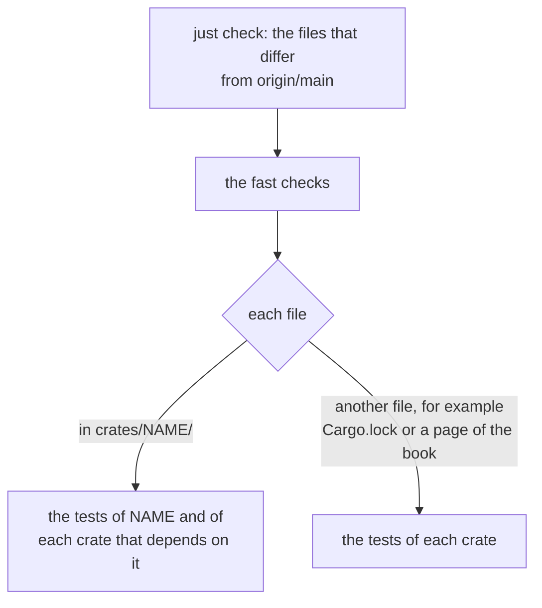

To see only the crates, with no check:

```sh
cargo run -q -p hygiene -- crates
```

After the push, see the Gate of your pull request:

```sh
gh pr checks 40
```

## Run the checks that your change can break

```sh
just ci
```

It compares your tree with `origin/main` and runs only the checks that
your change can break. It first prints one line that says which checks
it runs, and why:

```text
just ci runs each check: crates/riff/src/main.rs is not a text file
```

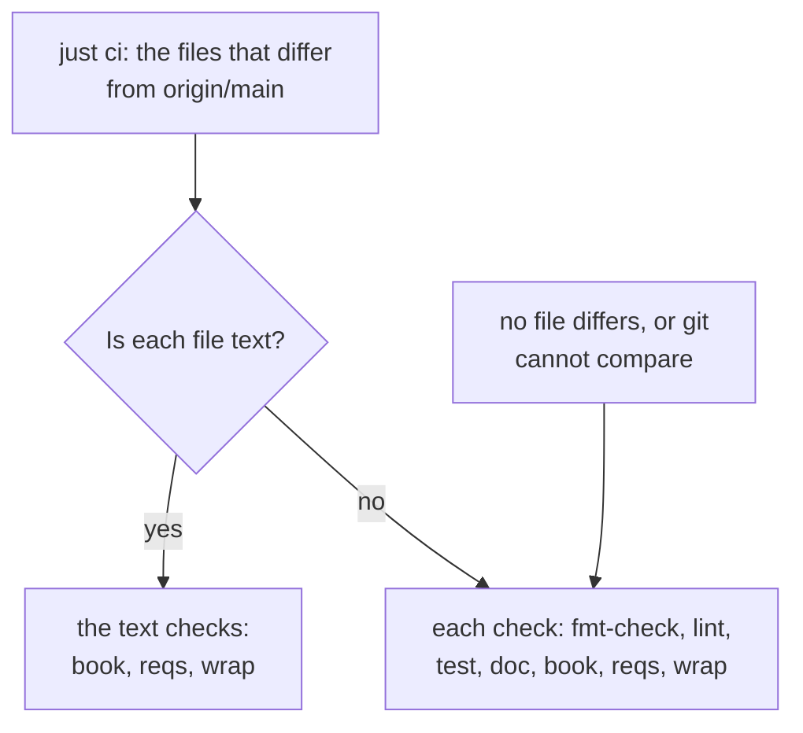

A file is text when it is in `docs/` or `design/`, or when it is a
`.md` file outside `crates/`. The files that differ are the commits of
your branch, the changes that are not committed, and the new files
that are not in git. The text checks build no test and run no clippy.

`just ci` uses the `origin/main` of your clone. To compare with the
newest `main`, fetch first:

```sh
git fetch origin
```

### When a just ci runs already

One `just ci`, `just ci-full` or `just check` runs at a time in a
worktree. Two runs
share the `target` folder, wait for each other, and double the load. A
second run stops at once:

```text
a just ci runs in this worktree already (pid 41230, started 12 min ago); wait for it, or stop it
```

Wait for the first run to end. To see it:

```sh
ps -o pid,etime,args -p 41230
```

To stop it, press Ctrl-C in its terminal, or stop the process:

```sh
kill 41230
```

The run keeps its lock in `target/.riff-ci.lock`, and removes it at
its end. A lock of a process that does not run does not count. Runs in
two worktrees go on at the same time.

## Run each check

To run each check for each change, for example before a release:

```sh
just ci-full
```

It runs `fmt-check`, `lint`, `test`, `doc`, `book`, `reqs` and `wrap`.
The Gate on GitHub runs the same checks (see
[How the Gate runs](#how-the-gate-runs)). Tests read the pages of the
book. So a change of only text that passes `just ci` can still fail a
test in the Gate.

## How the Gate runs

The Gate on GitHub runs the checks of `just ci-full` as jobs at the
same time. Each job has a runner of its own:

| Job | Runs |
|---|---|
| `Clippy` | `just lint` |
| `Tests 1/4` to `Tests 4/4` | `just test-part 1/4` to `just test-part 4/4`, in the session image |
| `Checks` | `just fmt-check doc book reqs wrap` |
| `Gate` | Starts when each other job ended. It passes only when each of them passed. |

The tests run in a container of the session image, as a session runs
them (see
[Run the tests in the session image](#run-the-tests-in-the-session-image)).

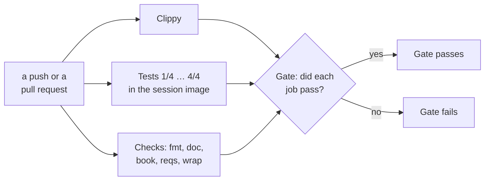

The rules of `main` need only the check `Gate`. So a fail of each job
fails the Gate. While the other jobs run, `gh pr checks` shows no
`Gate`.

### Run one part of the tests

The Gate runs the tests in 4 parts. Each part lists each test of the
workspace. It runs only the tests whose name falls in its part. The
hash of the name gives the part. Part 1 also runs each doc test. So
the 4 parts together run each test, and a new test moves no other
test.

To run one part on your machine, for example a part that failed on
GitHub:

```sh
just test-part 2/4
```

It first prints one line:

```text
just test-part 2/4 runs 571 of 2280 tests
```

To run the part in the session image, as the Gate runs it:

```sh
just session-test --part 2/4
```

### Choose the runner of CI

Each job of CI runs on the runner that the repository variable
`RIFF_RUNNER` names. With no variable, the runner is `ubuntu-latest`:
it has 4 cores for a public repository. To use a larger runner, set
the variable to the label of that runner. LABEL is the label, for
example the name of a larger runner of your organization:

```sh
gh variable set RIFF_RUNNER --body LABEL
```

The next run uses it. To see the variable:

```sh
gh variable list
```

To use `ubuntu-latest` again:

```sh
gh variable delete RIFF_RUNNER
```

## Run one test many times

A test that fails only on a busy machine has a race: it waits for a
fixed time, or it races with another test thread. To find it, run that
test by its name many times on a busy machine.

A test waits for the fact that it checks, for example a message or a
line in a log, with a generous time limit.

### Run a test on a busy machine

`just stress` builds the test, starts 8 busy loops, and runs the test
50 times. The words after `stress` go to `cargo test`. This example
runs one test of `crates/riff/tests/hosts.rs`:

```sh
just stress -p riff --test all hosts::the_host_reads_no_input
```

Each run prints one line: `pass`, or `FAIL` with the file that holds
its output, in `target/stress`. The last line counts the runs that
passed. The command fails when a run failed. It stops the busy loops at
its end, also on Ctrl-C.

To change the number of runs or of busy loops:

```sh
STRESS_RUNS=20 STRESS_LOAD=16 just stress -p riff --lib device::
```

A busy loop takes one core. On a machine that other people or workers
share, keep the load low, and stop the command when you have the fail.

## Write a test

A test runs `riff` and `riff-server` only through the crate
`isolated`. It waits for the fact that it checks.

### Write a fake program

A test that runs a fake program, for example a fake `gh` or `tmux`,
writes it with `isolated::write_program`. A child process writes the
file. So no child of another test thread holds the file open to
write, and the run cannot fail with `ETXTBSY` ("Text file busy"). To
copy a program, use `isolated::copy_program`. To give a program a new
text, write it again with `isolated::write_program`:

```rust,ignore
let gh = isolated::write_program(bin.join("gh"), "#!/bin/sh\necho '[]'\n");
isolated::write_program(&gh, "#!/bin/sh\necho '[{\"number\": 40}]'\n");
```

A test of the crate `isolated` reads each integration test. It fails
on each line that writes a program in the test process: a mode 755, a
text that starts with `#!`, or a write to a program that the file made
with the helper. Run it by its name:

```sh
cargo test -p isolated --test check no_test_file_writes_a_program_in_the_test_process
```

### Time a step in a test

A test that runs slow on a busy machine has not failed. So a test does
not compare the wall clock with a tight limit. It measures a
`Span` of the crate `isolated`:

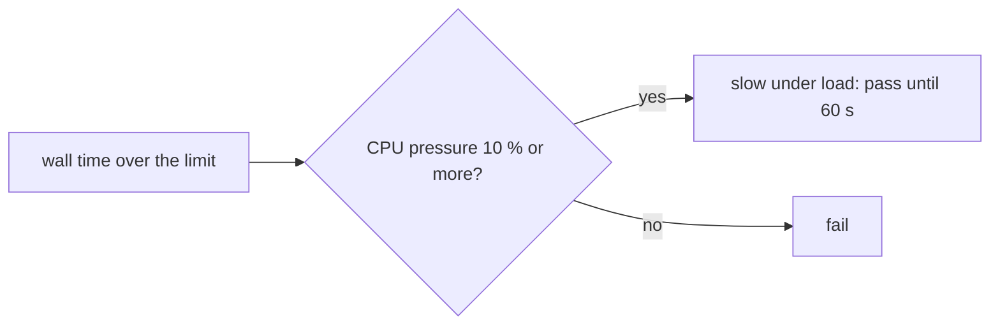

- To wait for a fact, use `span.within(LIMIT)` in the loop and in its
  assert. For a future, use `isolated::in_time(LIMIT, future)` in
  place of `tokio::time::timeout`.
- To check that a step returns at once, use `span.within(LIMIT)`
  after the step. A low CPU time does not pass a check: a step that
  waits uses no CPU time.
- Each check fails after 60 s (`isolated::HANG`): that is a hang.

```rust,ignore
let span = isolated::Span::start();
while !log().contains("listens on") {
    assert!(span.within(Duration::from_secs(10)), "no open port");
    std::thread::sleep(Duration::from_millis(50));
}
```

When a check passes only because of the load, the test prints one
line `slow under load` with the CPU pressure. To see it, run the test
with its output:

```sh
cargo test -p riff --test all hosts:: -- --nocapture 2>&1 | grep 'slow under load'
```

## Run the tests of one file

The integration tests of a crate are one test binary, `all`. Each file
of `tests` is a module of `tests/all.rs`. One binary links one time, so
a build writes much less to the disk. To run the tests of one file,
name its module:

```sh
cargo test -p riff --test all chat::
```

Three files of `riff` are test binaries of their own, because their
tests change a thing of the whole process: `back_in` and `join_a_riff`
set the keyring store, and `isolation` listens on the port of the riff
of the machine. Run them by their names:

```sh
cargo test -p riff --test back_in
```

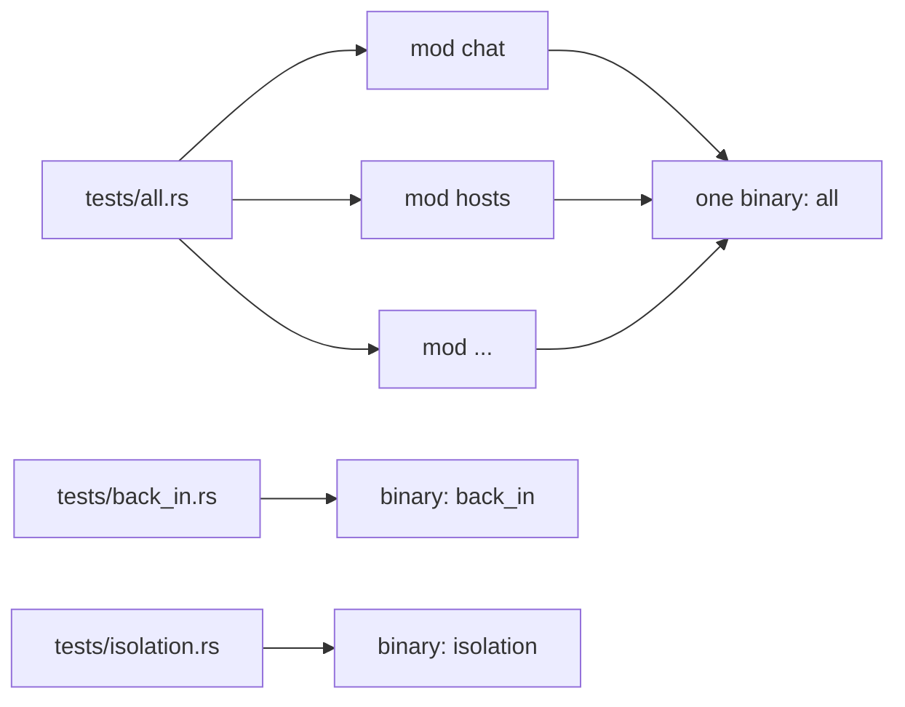

### Add a test file

Write the file in `tests` of the crate. Then add its module to
`tests/all.rs` of the crate, for example `mod my_feature;`. The file
reaches the helpers with `use crate::common;`. A test fails when a file
of `tests` is in no test binary. To run that check:

```sh
cargo test -p hygiene --test all test_files::
```

The dev and test builds keep only the line tables of the code of the
workspace, and no debug info for the dependencies. A backtrace still
names the file and the line.

## Build riff from your clone

Do [Start a Riff](start-a-riff.md), with one change: in step 1, build
from your clone. Then the binaries have your changes:

```sh
just install
```

`riff tail` shows the messages of the thread of your repository.

## How riff is built and installed

riff ships as one static binary. The binary has musl in it, so it
needs no shared library. So it runs on each Linux of its CPU, also in
a session image with an older libc, where the daemon runs it as
`riff relay`. A `cargo build` on your machine links the libc of your
machine, and that binary does not start in a session image with an
older libc.

| Where riff comes from | What it is |
|---|---|
| `riff update` on Linux x86-64 | The static `riff` and `riff-server` of the GitHub release. riff checks the SHA-256 of each file against `SHA256SUMS` of the release, and that each one is static. Then it puts them in the bin folder of cargo (`~/.cargo/bin`). |
| `riff update` on another machine, or for a release with no static binaries | A build with `cargo install --git` of the release tag, as before. |
| `cargo install`, `just install` | A build that links the libc of your machine. It is not static: `riff init` fails its check of the riff binary, and the riff daemon starts no session with it. Run `riff update` to get the static riff. |
| `just static` | The static `riff` and `riff-server` of your clone, in `target/static`. |

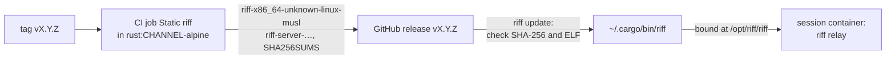

The CI job `Static riff` builds and checks the static binaries of each
pull request and each push, with the profile `dev`. It keeps a cache
of the build and of the downloaded crates, so it compiles only the
crates of riff again. For a release tag, it builds the profile
`release` with no cache, so each release binary comes from a clean
build. Then it adds them to the release (see
[Make a release](#make-a-release)).

### Build the static riff

`just static` builds the static `riff` and `riff-server` of your clone
in a container of the image `rust:CHANNEL-alpine`, where CHANNEL is the
channel of `rust-toolchain.toml`. It uses podman, else docker. Then it
checks them: each ELF has no interpreter, and `riff --version` runs in
the session image that `riff.toml` pins:

```sh
just static
```

The binaries are in `target/static/release`. The profile `dev` builds
with no optimization, so the build is faster. Its binaries are in
`target/static/debug`:

```sh
just static dev
```

### Keep the crates of the static build in a folder

The static build keeps the crates that it downloads in the volume
`riff-static-cargo` of podman or docker. To keep them in a folder of
your own, give its absolute path in `RIFF_STATIC_CARGO`. Podman needs
the folder to exist:

```sh
mkdir -p ~/.cache/riff-static-cargo
RIFF_STATIC_CARGO=$HOME/.cache/riff-static-cargo just static dev
```

To see that a binary is static, look for the interpreter. A static
binary has none, so this command prints nothing:

```sh
readelf -lW target/static/release/riff | grep interpreter
```

## Change the session image

riff 3.0 runs each session in a container from the session image of
the repository. The file `riff.toml` at the root of the repository pins
the image by its digest. A digest names one image, but a tag can move,
so riff refuses a tag. The image of this repository comes from
`deploy/session/Dockerfile`.

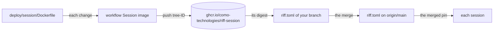

To see the image that your working tree pins:

```sh
riff image
```

### Only a merged pin counts

The sessions use only the merged pin: the image that `riff.toml` pins
on the default branch of `origin`. riff fetches that branch first. The
waves of the daemon, `riff wave run`, `riff run`, `riff lead start`
and the update steps of the daemon use the merged pin. An edit of
`riff.toml` that is not merged changes no session, also an edit in the
main clone. When `riff.toml` of the main clone pins another image, riff
tells you in one line, and uses the merged pin:

```text
/home/mike/src/riff/riff.toml pins ghcr.io/como-technologies/riff-session@sha256:ff…, but the merged pin of origin/main is ghcr.io/como-technologies/riff-session@sha256:01…. riff uses the merged pin.
```

To see the merged pin:

```sh
git fetch origin
git show origin/HEAD:riff.toml
```

`riff image`, `riff init` and the image of this folder in
`riff update --check` read your working tree. To try the pin of your
branch in one session before the merge, give it to `riff run`:

```sh
riff run issue-12 --image "$(riff image)"
```

When the main clone has no `origin/HEAD`, riff cannot find the merged
pin, and stops. Set `origin/HEAD` in the main clone:

```sh
git remote set-head origin --auto
```

### Edit and build the image

Change `deploy/session/Dockerfile`. When you change
`rust-toolchain.toml`, also change the line `ARG RUST_CHANNEL` and the
`--component` flags of the Dockerfile, in the same commit. A test
fails when they do not agree.

Build the image on your machine, and try it:

```sh
podman build -t localhost/riff-session:test deploy/session
podman run --rm localhost/riff-session:test claude --version
```

### Pin the new digest

Push your branch and open the pull request. The workflow "Session
image" builds the image and pushes it to
`ghcr.io/como-technologies/riff-session`, with the tag `tree-ID`. ID is
the git tree of `deploy/session/`. Then the workflow fails, because
`riff.toml` pins the old digest. Its error and its summary give the new
line for `riff.toml`. To see them, find the run, and show it:

```sh
gh run list --workflow session-image.yml --branch "$(git branch --show-current)" --limit 1
gh run view RUN_ID
```

Write that line in `riff.toml`. Commit it, and push:

```sh
git add riff.toml
git commit -m "Pin the session image"
git push
```

The workflow runs again. The registry has the image of the folder now,
so the workflow builds nothing and passes. The package is public, as
the repository is. Check that podman pulls the image by its digest,
with no sign-in:

```sh
podman pull "$(riff image)"
```

The workflow builds the image of a folder one time only. To build it
again, for example for new Debian packages, change a line of the
Dockerfile, for example a version.

### Run the tests in the session image

A session runs the tests of riff in its container, not on your
machine. So a test can pass on your machine and fail in a session.
`just session-test` runs the tests of `crates/riff` in a container of
the image that `riff.toml` pins, as a session runs them: with an init
process, as your user, with a home of its own, and with the limits of a
session (4 CPUs, 8 GB). It uses podman, else docker. With docker, it
gives your user an entry in the passwd and group files of the
container, as podman does. The build goes to `target/session`:

```sh
just session-test
```

To run one test, give its name:

```sh
just session-test run::riff_lead_start_runs_the_lead_with_a_terminal_and_attaches_to_it
```

The jobs `Tests 1/4` to `Tests 4/4` of the Gate run each test of the
workspace in the session image, for each pull request (see
[How the Gate runs](#how-the-gate-runs)). When you pin a new digest,
they run the tests in the new image. To run one part of them, see
[Run one part of the tests](#run-one-part-of-the-tests).

## Start the riff daemon

The riff daemon owns the containers of `riff run` on your machine. It
is the server of [riff 3.0](riff-3.md) on one machine. The systemd
user unit `riff.service` runs it. `riff run` asks the daemon to run
each session.

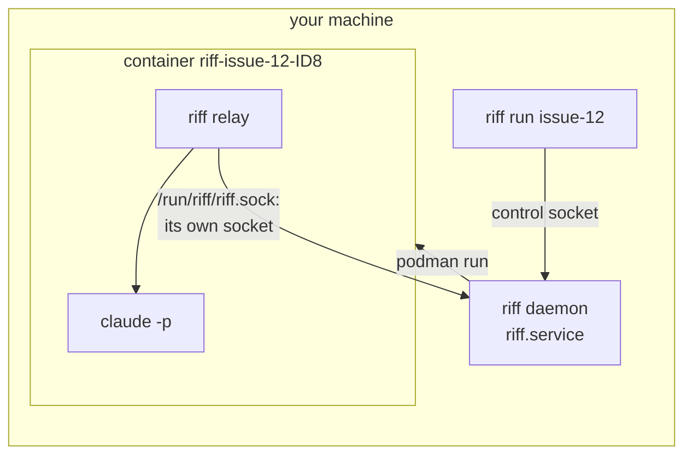

The daemon gives each container a socket of its own, at
`/run/riff/riff.sock`. The socket tells the daemon which session asks.
No container sees the socket of another session, or the control
socket. The sockets are in `~/.local/share/riff/daemon`.

The daemon also gives each container your riff binary, with no write.
`riff relay` is the entrypoint of the container. It starts `claude`
with the riff tools, gives `claude` its input, and sends each event of
`claude` to the daemon on the socket.

Your riff binary must be static, because a session image can have an
older libc than your machine. Before each start, the daemon reads the
binary. When it is not static, the daemon starts no container, and
its error names `riff update`. See
[Get the static riff](start-a-riff.md#get-the-static-riff).

The daemon keeps no state of the riff, and has no key of its own.
riff-server holds the claims, the messages and the wakes of its
sessions. riff 1.6 to 1.8 kept the state of a riff of peers in
`~/.local/share/riff/daemon`. riff 3.0 does not read, change or delete
it: see
[What riff 3.0.0 leaves on a machine](riff-3.md#what-riff-300-leaves-on-a-machine).

### Install the daemon

`riff init` installs the daemon at the first run (see
[Get ready to run an item](#get-ready-to-run-an-item)). It keeps a
daemon that runs. To install the daemon again, run this command in a
shell that finds `podman`:

```sh
riff daemon install
```

It writes the unit `~/.config/systemd/user/riff.service`, enables it,
and starts it. The unit gets the `PATH` of your shell, so the daemon
finds the same `podman`. After each update of riff, run the command
again: it starts the daemon again with the new riff.

### See the daemon

```sh
riff daemon status
```

It shows the process ID, the build and the sessions of the daemon.
When no daemon answers, it shows the state of the unit, and exits
with 1. To see the log of the daemon:

```sh
journalctl --user -u riff -f
```

### Restart or stop the daemon

```sh
systemctl --user restart riff
systemctl --user stop riff
```

A stop or a restart of the daemon stops no container. conmon, the
monitor of podman, holds each container. While the daemon is away,
`riff relay` keeps `claude` running and keeps its events. A new daemon
takes up each session that runs, and the relay sends it the kept
events. No event is lost.

`riff run` says that the daemon went away, and waits up to 10 minutes
for a new daemon. Then it shows the session again from the next event.
When no daemon comes back in that time, `riff run` says so, and
releases the item. The session runs on.

### Uninstall the daemon

```sh
riff daemon uninstall
```

It stops and disables the unit `riff.service`, deletes the unit file
that `riff daemon install` wrote, and reloads systemd. Each container
runs on: conmon holds it. The folder of the daemon,
`~/.local/share/riff/daemon`, stays. When no unit is
installed, the command says so. To use the daemon again, run
`riff daemon install`.

### Run the daemon in a terminal

With `RIFF_HOME` or `RIFF_DATA` set, `riff daemon install` installs
nothing, and `riff daemon uninstall` removes nothing. `just dev` sets
`RIFF_HOME`. `RIFF_DATA` moves only the data folder of riff: the folder
of the daemon and the session folders. Your settings and your secrets
stay where they are. The real-session test sets it (see
[When a riff daemon runs already](#when-a-riff-daemon-runs-already)).
Run the daemon of that folder in a terminal:

```sh
riff daemon
```

Press Ctrl-C to stop it. Its containers run on.

## Run one item in a container

`riff run ITEM` does one work item in a rootless podman container. It
is the first part of [riff 3.0](riff-3.md). The riff of today still
claims the item, wakes the lead and releases the item. The riff daemon
runs the container. The container does the work: `claude -p` in a
clone of its own, with your sign-in of git, `gh` and `claude`.

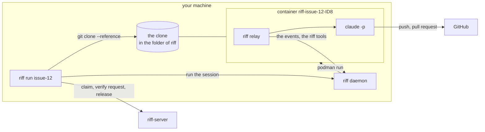

### Get ready to run an item

1. Use Linux: `riff run` starts nothing on another OS. Install podman,
   and run the first run of riff 3.0 in your clone (see
   [Get ready for riff 3.0](start-a-riff.md#get-ready-for-riff-30)). It
   checks rootless podman, asks to add the permission rules of riff to
   your Claude Code settings, starts the riff daemon and gets the
   session image. With no daemon, `riff run` stops before the claim:

   ```sh
   riff init
   ```

2. Sign in to `gh`, and run `claude` once on this machine, so that its
   sign-in has 60 minutes or more left:

   ```sh
   gh auth status
   ```

3. Give your clone an HTTPS `origin`. The clone of the session takes
   the URL of `origin` from your clone. The container has no SSH
   agent, so it cannot push to an SSH URL. To see the URL, and to
   change it to HTTPS:

   ```sh
   git remote get-url origin
   git remote set-url origin https://github.com/OWNER/REPO.git
   ```

### Run an item

In your clone of the repository:

```sh
riff run issue-12
```

### Run an item with a local image

To try a change of the image, build it (see
[Edit and build the image](#edit-and-build-the-image)), and give it
with `--image`:

```sh
riff run issue-12 --image localhost/riff-session:test
```

### What riff run does

First, riff asks the daemon for the image: the daemon pulls it when
it must. riff checks the sign-in of `gh` and of `claude`, and the wave
of the issue. A failed check takes no claim. Then riff does these
steps:

1. It starts a worker session, and claims the item.
2. It makes the clone of the session on the branch `worktree-ITEM`.
   When `origin` has that branch, the clone goes on from it.
3. It asks the daemon to run the session. When the host has no room,
   the start waits: see
   [Set the limit of the host](#set-the-limit-of-the-host). In the
   container,
   `riff relay` starts `claude -p` with the riff tools. riff shows
   each event: the text, each tool call, each tool that failed, each
   call that the rules refused, the push, the end of the turn, and the
   background tasks that `claude` waits for after it. The session
   pushes the branch and opens the pull request.
4. It finds the pull request of the branch, and sends a verify request
   to your lead. It sends none when the issue has the label
   `no-verify`, or when a lead holds `verify-ITEM`, and it says why
   (see
   [Keep the verify of an item from the workers](how-it-works.md#keep-the-verify-of-an-item-from-the-workers)).
5. It releases the item, and ends the session.

When riff-server does not answer in steps 4 and 5, for example while
a new instance of the server starts, riff tries again for up to 10
minutes. You see `(waits for riff-server…)`. The session keeps its
claim while riff waits.

To stop the wait, press Ctrl-C. A SIGTERM does the same. riff sends no
more step, says which steps it did not send, and ends with the exit
code 1. riff-server frees the claim when the session stops:

```text
riff run stopped at a signal. It did not send the verify request, the release, the end of the session. riff-server frees the claim of issue-12 when the session stops.
```

The folder of the session is
`~/.local/share/riff/sessions/ITEM-ID8`. Its `clone` stays until the
work of the branch is over. Then the daemon removes the folder: see
[Remove the folders of old sessions](#remove-the-folders-of-old-sessions).
Its `events.jsonl` has each event, with no secret: the daemon writes
it.

### Stop a session

Press Ctrl-C. riff asks the daemon to stop the container with
`podman stop`, and releases the item. The branch keeps the work that
the session pushed.

A second Ctrl-C while the container stops also stops the end steps:
riff sends no verify request and no release, as in
[What riff run does](#what-riff-run-does).

### When a session stays up after its result

`claude -p` does not end while one of its background tasks runs, for
example a Monitor or a command in the background. The end of each task
starts a new turn. So a session can stay up after the end of its turn.
`riff run` then shows each task that `claude` waits for:

```text
end: success, 12 turns, 640 s, 1.20 USD
wait: claude waits for 1 background task: wait for just check
```

The start text tells the session to stop each background task before
its last reply. When the session gives no event for 30 minutes after
its result, the daemon stops its container, and `riff run` says why.
Then `riff run` sends the verify request and releases the item, as
after each other end. The limit is longer than the longest check of a
session: a `just ci` can take 15 minutes.

To see what a session waits for from another terminal, show its
events. To end the wait earlier, stop the session (see
[Stop a session](#stop-a-session)).

```sh
riff daemon events riff-issue-12-1a2b3c4d
```

### See the events of a session

`riff run` shows each event of its session. To see a session from
another terminal, find the name of its container, and show its
events:

```sh
riff daemon status
riff daemon events riff-issue-12-1a2b3c4d
```

`riff daemon events` shows each event from the start of the session,
and each new event until the session ends. Press Ctrl-C to stop the
view: the session goes on. The file `events.jsonl` in the folder of
the session also has each event, with no secret.

### Remove the folders of old sessions

The folder of a session holds its clone with its `target`: often some
GB. The daemon removes the folder of each session that does not run
when the work of its branch is over. It does this at its start, then
each 10 minutes, also when no wave runs. You do not have to do a step.

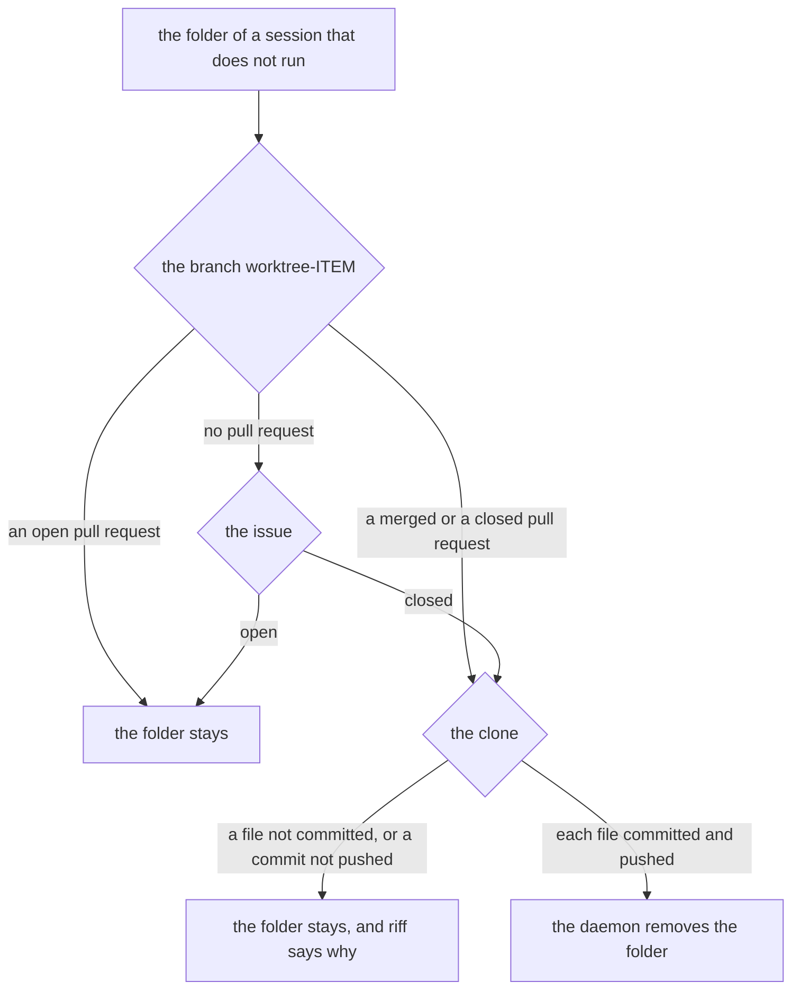

While `riff run` runs, its folder stays, also while its start waits
for room. A verify session has the fate of the branch of its item.
After the end of a session, the folder stays until the daemon did each
step after the end, for example the report of a verify.

The daemon asks GitHub with `gh`. When `gh` gives no answer in 30
seconds, the daemon stops it and keeps the folder. The next sweep
tries again.

To remove the folders now, for example when the disk is full:

```sh
riff daemon sweep
```

It prints each folder that the daemon removed, with the reason:

```text
riff removed the folder /home/mike/.local/share/riff/sessions/issue-735-7788e301: the pull request #738 closed with no merge.
```

### When a folder with work in its clone stays

The daemon does not remove a folder when its clone holds work that is
only there:

- a file that is not committed, or
- a commit that no branch of `origin` has. For example, the session
  ended before it pushed, and an older pull request of its branch
  merged.

`riff daemon sweep` prints each folder that stays for this reason, and
the log of the daemon prints it one time:

```text
riff kept the folder /home/mike/.local/share/riff/sessions/issue-735-7788e301: the pull request #738 closed with no merge, but its clone has 1 commit that is not pushed. Push the work, or remove the folder.
```

Look at the work in the clone:

```sh
git -C ~/.local/share/riff/sessions/issue-735-7788e301/clone status
git -C ~/.local/share/riff/sessions/issue-735-7788e301/clone log --branches --not --remotes=origin
```

To keep the work, commit it and push its branch. The next sweep then
removes the folder:

```sh
git -C ~/.local/share/riff/sessions/issue-735-7788e301/clone push -u origin HEAD
```

To drop the work, remove the folder:

```sh
rm -rf ~/.local/share/riff/sessions/issue-735-7788e301
```

### What the container gets

- The clone of the session, with write. The objects of your main clone,
  with no write.
- Your `~/.gitconfig` and `~/.config/gh`, with no write.
- Your token of `gh` in `GH_TOKEN`. riff gives podman only the name of
  the variable, so the token is in no command line.
- A Claude folder of its own, and your sign-in of `claude` with no
  write. `claude` runs in the auto permission mode.
- The first-run answers of `claude` in the `.claude.json` of that
  Claude folder: the onboarding, your theme from `~/.claude.json`, and
  the trust of the clone. So a takeover asks no first-run question. See
  [Take over a session](#take-over-a-session).
- The setting `includeCoAuthoredBy: false` in the `settings.json` of
  that Claude folder. `claude` adds no attribution line, so the
  trailers end each commit and each pull request body. riff does not
  read your own Claude settings.
- The permission rules of the steps of a session in the same
  `settings.json`, for example `Bash(gh issue view *)` and
  `Bash(gh pr create *)`. So the auto mode check does not refuse a step
  of the start text. The lead in a container gets them at each start.
- The auto mode settings of riff in the same `settings.json`: no
  dialog of `/auto-mode-setup`, and the places of riff work. See "The
  auto mode settings of a session" in [How it
  works](how-it-works.md#the-auto-mode-settings-of-a-session).
- A home of its own in memory. Each other write goes when the
  container ends.
- The volumes `riff-cargo` and `riff-sccache` for the caches.
- `--memory 8g` and `--cpus 4`.
- The folder of its own socket of the daemon at `/run/riff`, with
  write, and `RIFF_SOCKET=/run/riff/riff.sock`.
- Your riff binary at `/opt/riff/riff`, with no write. Its
  `riff relay` is the entrypoint of the container. So the riff in a
  session is the riff of your machine.
- The riff tools that talk, through the relay: `whoami`, `who`,
  `threads`, `read`, `post`, `tell`, `status` and `blocked`. They act
  on your riff-server as the worker session of `riff run` or of the
  wave, which holds the item: see
  [The riff tools of a session](#the-riff-tools-of-a-session). The
  session gets no tool that acts on your machine or on a claim: riff
  refuses `claim`, `release`, `leave`, `move` and the tools of the
  lead. `riff run` or the daemon does the claim, the release and the
  verify request.

A commit of the session has your git identity, no signature, and a
`Riff-Session:` trailer. The table of what sessions share is on the
page [riff 3.0](riff-3.md).

### The riff tools of a session

The riff tools of a session of the daemon act on the riff-server of
the session, as in riff 1.x. Each session of `riff run`, of a wave and
of `riff lead start` has your riff-server. So the lead of your user
sees each post of a session, and `riff relay watch` of that session
wakes on a message of riff-server.

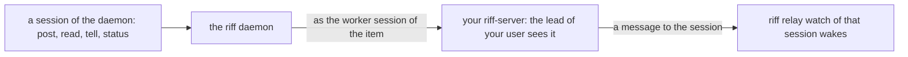

## Let riff run the wave

The riff daemon can run the current wave of a repository with no
person. It starts one session for each free item of the wave, and one
for each pull request that waits for a verify. Each session does one
item in a container of its own, as `riff run` does, and ends. A verify
is a session too. No session waits idle.

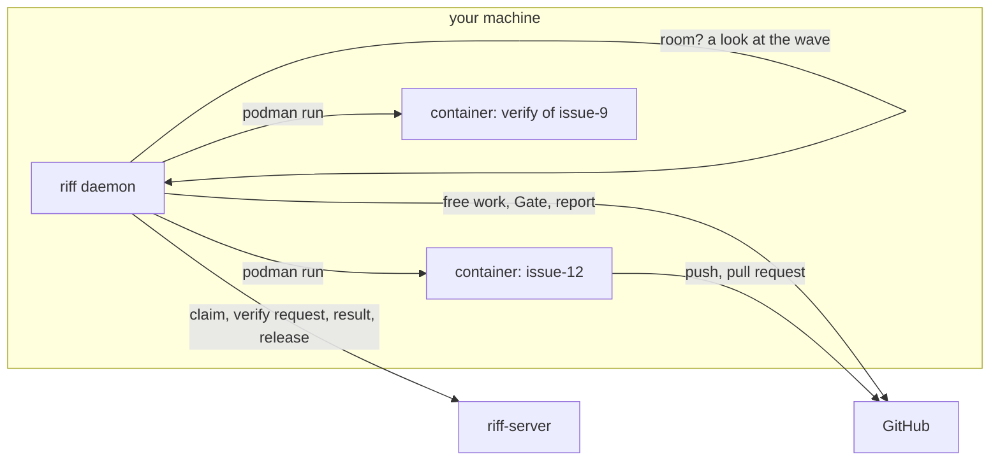

### Run the wave

Get ready as for `riff run` (see
[Get ready to run an item](#get-ready-to-run-an-item)). Then, in your
clone of the repository:

```sh
riff wave run
```

First the daemon must have the session image that the repository
pins. It pulls the image when it is not on the machine. When podman
does not run, or the pull fails, `riff wave run` says why, and the
daemon runs no wave.

The daemon keeps the wave, also over its own restart, until you stop
it. The rollout of your lead runs it for you: see the next how-to.

### Let the rollout of the lead run the wave

You need no command for this. When the current wave has free work, the
rollout of your lead first gives it to each idle worker in tmux. When
free work is left and no worker is idle, it asks the riff daemon of
its machine to run the wave of the repository. It asks only when no
wave of the repository runs there. The rollout starts no worker in
tmux. `riff lead start` starts the wave too.

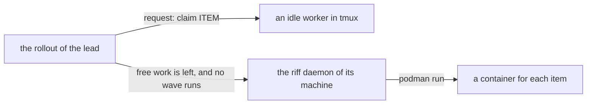

After the ask, your lead gets a note:

```text
thelio: the rollout asked the riff daemon to run the wave of como-technologies/riff: the daemon runs each free item and each verify in a container. See it: riff daemon status
```

When the daemon cannot run the wave, the lead gets one note with the
reason. For example, no daemon runs, the daemon gives no answer in 5
seconds, or the daemon cannot start a container of the session image.
The rollout asks again at its next look (see
[See why the rollout runs no wave](how-it-works.md#see-why-the-rollout-runs-no-wave)).
To see how often the rollout looks:

```sh
riff workers interval
```

### Use a second machine

The rollout of your lead asks only the daemon of its own machine. A
second machine takes work in containers when its own daemon runs the
wave of the repository. Get that machine ready as for `riff run` (see
[Get ready to run an item](#get-ready-to-run-an-item)). Then, in the
clone of the repository on that machine:

```sh
riff wave run
```

The claims on riff-server keep the two machines from one item: each
item runs on one machine only. The limit of the containers of each
machine is the limit of its daemon (see
[Set the limit of the host](#set-the-limit-of-the-host)). To stop the
wave of that machine, run `riff wave stop` there. For workers in tmux
on a second machine, `riff workers host` stays: see
[Offer workers from another machine](how-it-works.md#offer-workers-from-another-machine).

### See the wave

```sh
riff daemon status
```

It shows the limit of the host, each session, each start that waits
for room, and each wave with what it did last. To see the events of a
session, use `riff daemon events NAME` (see
[See the events of a session](#see-the-events-of-a-session)).

### Stop the wave

In your clone of the repository:

```sh
riff wave stop
```

The daemon starts no new session for the wave. The sessions that run
go on to their end.

### Keep the wave stopped

The rollout of your lead asks for the wave again at its next look with
free work. To keep the wave stopped, turn the rollout off on the
machine of your lead:

```sh
riff workers interval 0
```

Or pause the repository with `riff pause`. To turn the rollout on
again, set the interval back, for example `riff workers interval 10`.

### Keep an item from the wave

The wave never starts a held item. A lead holds an item by its exact
name: a hold of `issue-12` stops the build, and a hold of
`verify-issue-12` stops the verify (see
[Hold an item by hand](how-it-works.md#hold-an-item-by-hand)):

```sh
riff plan hold issue-12 waits for the word of Mike
```

A hold of `verify-issue-12`, or the label `no-verify` on the issue,
also stops the verify request after the build: the lead gets a note
with the reason (see
[Keep the verify of an item from the workers](how-it-works.md#keep-the-verify-of-an-item-from-the-workers)).

### Set the limit of the host

Each container has `--memory 8g` and `--cpus 4`. These do not limit
the sum. So the daemon keeps one limit for the whole host: the number
of live sessions, and a floor of free memory. The daemon starts a
session only when fewer sessions than the limit live, and the free
memory is at or above the floor. Each other start waits for room, in
order, also a start of `riff run`. The default is 3 sessions and a
floor of 8 GB.

To see the limit:

```sh
riff daemon limit
```

To set it, for example 2 sessions and a floor of 12 GB:

```sh
riff daemon limit --sessions 2 --floor 12
```

The daemon reads the limit at each start: a change counts at once.

### What the wave does

The daemon waits for room. Then it looks at the wave, and starts the
first free work:

1. The pull requests that wait for a verify, then the free items of
   the current wave. It takes the free work as the rollout of the lead
   does.
2. It starts nothing while the riff or the repository is paused. It
   never starts a held item, or an item that a session claims.
3. It starts the verify of an item only when no session holds the
   item, and the Gate of the head commit is done. The verify is a new
   session: an author never verifies its own item.
4. It starts one item at most 3 times in a run of the wave. Then your
   lead gets a message, and the item waits for you.

For each item, the daemon does the steps of `riff run` itself: a
worker session, the claim, the clone and the start. After the end of
a build, it sends the verify request for the pull request of the
branch to your lead, and releases the item.

When riff-server refuses the claim, the daemon ends the new worker
session at once. A pause can come after the look, before the claim.
Then the start does not count as one of the 3, and your lead gets no
message. For each other refusal, your lead gets a message.

A verify session gets a clone at the head commit of the pull request.
It checks the work against the `Done when:` line of the issue, and
changes nothing. Its last reply is the result: the first line is
`PASS` or `FAIL`. The daemon reports it as `riff verify` does: a
comment on the pull request, the status `riff/verify` of the commit,
and a message to the holder of the item and to your lead. On a pass,
GitHub merges the pull request.

Before each look, the daemon removes the folders of the sessions of
the repository whose work is over (see
[Remove the folders of old sessions](#remove-the-folders-of-old-sessions)).
For a merged pull request with `Refs #N`, it first adds the comment
`Merged in #PR (COMMIT)` to the issue, so the item is not free work
again.

When the daemon stops during a session, the session runs on. A new
daemon takes it up, and does the steps after its end.

## Run the lead and watch the riff

In riff 3.0 the lead is a session of the riff daemon too: `claude` in
a container of the session image, with a terminal. conmon, the monitor
of podman, holds the terminal. So the lead runs on when you close your
terminal, and when the daemon stops. `riff view` shows each session of
the daemon, and attaches your terminal to the lead. The lead in a
container uses no tmux.

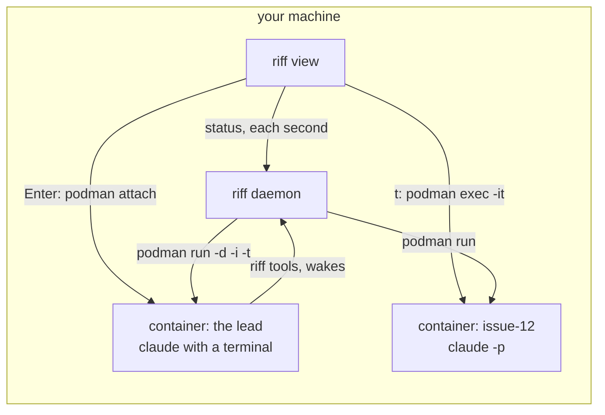

Get ready as for `riff run` (see
[Get ready to run an item](#get-ready-to-run-an-item)).

### Start the lead

In your clone of the repository:

```sh
riff lead start
```

The daemon starts the lead of the repository in the container
`riff-lead-OWNER-REPO`, and riff attaches your terminal to it. When the
lead runs already, riff only attaches. At each attach, `claude` draws
its screen at once: riff first gives the terminal of the container
another size, and the attach gives it the size of your terminal again.
When riff cannot change the size, it says why. Then change the size of
your terminal to see the lead.

To leave the terminal of the lead, press Ctrl-P, then Ctrl-Q. The lead
runs on, and riff says that you left the terminal of the container.

To end the lead, type `/exit` in it. The container of the lead ends,
and riff prints:

```text
The lead in the container riff-lead-OWNER-REPO ended. Start it again in a clone: riff lead start
The command claude --resume that claude shows works only in the container of the lead. In a new lead, /resume shows the old conversations.
```

The lead has a folder of its own: `leads/OWNER-REPO` in the data folder
of riff, with a clone of the repository and a Claude folder. Both stay
between the starts of the lead, so the lead keeps the history of its
conversations. When `claude` asks a question at its first start, answer
it once: the Claude folder keeps the answer. The lead does not count in
the limit of the host.

Each start brings the clone of the lead up to date: riff fetches
`origin`, and fast-forwards the branch of the clone to its upstream.
When the clone has a local change, it stays as it is, and riff shows a
note that says why. A local change is a change that is not committed,
a commit that is not on the upstream, or a branch with no upstream.

When riff cannot bring the clone up to date, the clone also stays as
it is, and the lead starts. The fetch can fail, or git can refuse the
fast-forward, for example when an untracked file has the path of a new
file of `origin`. The note gives the error of git. To bring the clone
up to date, move or remove that file, then start the lead again. The
clone is in the data folder of riff, for example:

```sh
git -C ~/.local/share/riff/leads/OWNER-REPO/clone status
```

The lead gets the riff tools that talk, and the tools of a lead:
`lead`, `hold`, `free`, `pause` and `resume`. They act on your
riff-server (see
[The riff tools of a session](#the-riff-tools-of-a-session)). It gets
its wakes from `/opt/riff/riff relay watch`, a background task that
ends at each wake. The instructions of its riff tools tell it to run
that task. It plans the waves with `/opt/riff/riff wave`: see
[Waves](waves.md). To make it the lead of your user, tell it to call the
riff tool `lead`.

### Watch the riff

```sh
riff view
```

The view shows each session of the daemon of this machine: its
container, its item, its state, its age and its last step. It also
shows the daemon, the limit of the host, each start that waits for
room, and each wave. It draws them again each second. It shows no
session of another machine. A later release merges `riff view` and
`riff top` into one sessions view in each UI: see
[Design: the UIs of riff](riff-uis.md).

| Key | Does |
|---|---|
| Up, Down (or k, j) | Select a session. |
| Enter | Attach to the lead. Ctrl-P Ctrl-Q, or the end of the lead, comes back to the view. |
| t | Stop the turn of the selected session, and take it over (see [Take over a session](#take-over-a-session)). |
| q, Esc, Ctrl-C | End the view. The sessions go on. |

After an attach, the note under the rows says that you left the
terminal of the lead, or that the lead ended. After a takeover, the
note says that the session goes on with its item, or that it ended
before the takeover. The SESSION column shows the full name of each
container.

The states of a session:

| State | Means |
|---|---|
| `works` | A turn of `claude` runs. |
| `ends` | The turn gave its result. `claude` ends, or waits for its background tasks. |
| `holds for a takeover` | A takeover stops the turn, or waits for its end. |
| `taken over` | A person has the session in a terminal. |
| `lead` | The lead, with its terminal. |

`riff daemon status` shows the same state and last step of each
session.

### Take over a session

You can take over a session that works on an item, for example to
help it or to stop a wrong step. Find the name of its container with
`riff view` or `riff daemon status`. Then:

```sh
riff takeover riff-issue-12-1a2b3c4d
```

riff stops the turn of the session at once, also in the middle of a
tool call. `claude` opens in your terminal in a few seconds, in the
container of the session, with the history of the session. When you
are done, type `/exit`. The session goes on with its item: riff starts
`claude -p` again with `--resume`, and tells it that a person used the
session. While you have the session, the quiet limit of the daemon
does not stop it.

riff cannot stop a turn after the result of the session (the state
`ends`), or of a session that started with riff 1.5. Then
`riff takeover` says that it waits for the end of the turn.

When you press Ctrl-C before `claude` opens, the session goes on when
`claude -p` ends. When `riff takeover` ends while `claude` is open, for
example when your terminal closes, riff gives the session back at once.
When the daemon restarts during a takeover, the session waits for you:
run `riff takeover NAME` again, and type `/exit`.

A takeover works only for a session of this machine. When you give
`riff takeover` the session ID of a session of another machine, or the
start of it, riff says on which host that session runs.

### Take over a session at the end of its turn

To let the session finish its turn first, add `--at-end`:

```sh
riff takeover --at-end riff-issue-12-1a2b3c4d
```

riff does not stop the turn. `claude` opens when the turn ends. The
first turn of `riff run` can be the whole item.

## Run the real-session test

The real-session test checks a release on a real machine, with your
real home. The static riff of your clone does one scratch item with
`riff run`, the session image that `riff.toml` pins, and a real
`claude`. The tests of `just ci` cannot do this: they give riff a fake
home. Run it before each tag (see [Make a release](#make-a-release)).
First it builds the static riff of your clone with the profile `dev`
(see [Build the static riff](#build-the-static-riff)), because the
daemon runs that binary in the container as `riff relay`.

The test needs podman and the sign-ins of `riff run`: see
[Get ready to run an item](#get-ready-to-run-an-item). In your clone:

```sh
just real-session
```

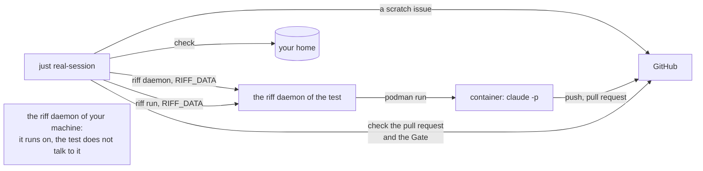

The test does these steps. The messages name them:

1. Check the host: podman runs rootless, `gh` has a sign-in, and
   `riff image` names the image.
2. List the home: the test lists the files of your home.
3. Make the scratch item: an issue in the backlog that adds one line
   to the book. No worker takes an item of the backlog.
4. Keep its verify from the workers: the issue gets the label
   `no-verify`, so riff offers no verify of it to a worker, and
   `riff run` sends no verify request for it. Then the test holds
   `verify-issue-N`. A worker cannot hold an item: when you run the
   test in a worker, or riff cannot hold the verify for another reason,
   the test goes on with a warning, and the label keeps the verify.
   When `gh` cannot put the label on, this step fails. See
   [Keep the verify of an item from the workers](how-it-works.md#keep-the-verify-of-an-item-from-the-workers).
5. Start the daemon: the test starts `riff daemon` of your clone,
   beside the daemon of your machine, and waits until it answers. See
   [When a riff daemon runs already](#when-a-riff-daemon-runs-already).
6. Run the item: `riff run` does the issue. You see each event of the
   session.
7. Check the home: the test lists your home again. A new file fails
   the test, outside the paths that the test leaves out (see
   [When another program writes in your home](#when-another-program-writes-in-your-home)).
   A change to a file that riff must not write also fails it. See
   [What the home check compares](#what-the-home-check-compares).
8. Find the pull request: the branch of the session has an open pull
   request.
9. Check the change: the pull request adds the line to the book.
10. Wait for the Gate: the job `Gate` of the pull request starts. It
    starts when each part of the Gate ended (see
    [How the Gate runs](#how-the-gate-runs)).

The first step that fails stops the test. Its message names the step
and the reason. Then the test cleans up: it stops its daemon, closes
the pull request and the issue, deletes the branch, cancels its CI
runs, frees the hold, and removes the folder of the session. It also
cleans up when you press Ctrl-C. A second Ctrl-C stops it at once: then
stop the daemon of the test yourself, with the process ID that step 5
shows.

### When a riff daemon runs already

The daemon that you installed keeps running while the test runs. Do
not stop it, and do not start it again. It keeps its sessions. The
test does not talk to it. Run the test as it is:

```sh
just real-session
```

The test runs the riff daemon of your clone beside your daemon. Each
`riff` of the test gets `RIFF_DATA`, the data folder of the test:
`~/.local/share/riff/real-session`. So the daemon of the test has its
own socket and its own session folders. It keeps them there for the
next run. The clean-up stops only the daemon of the test.

Run one test at a time on a machine. When a daemon of the test runs
already, step 5 fails, and the test does not stop that daemon. Another
test runs, or a test that a second Ctrl-C stopped left its daemon. Let
the other test end, or stop its daemon with the process ID in the
message, and run the test again. Your own daemon does not make this
step fail.

### What the home check compares

riff writes nothing in your home outside its own folders. The home
check makes sure. Before `riff run`, the test keeps two things:

- the path of each file and folder of your home;
- the size, the time of change and the inode of each file that riff
  must not write.

After `riff run`, the test compares your home with them:

| Change | Result |
|---|---|
| A new path, outside the folders that the test leaves out | fails the test |
| A change to a file that riff must not write | fails the test |
| A new, a changed or a removed key in the git config of a clone, outside a section `[branch "NAME"]` | fails the test |
| A change to each other file | does not count |

The files that riff must not write:

| Files | What they are |
|---|---|
| `~/.gitconfig`, `~/.config/git` | your git config |
| `~/.config/gh` | the config of `gh` |
| `~/.profile`, `~/.bashrc`, `~/.bash_profile`, `~/.bash_login`, `~/.bash_logout`, `~/.zshenv`, `~/.zprofile`, `~/.zshrc`, `~/.zlogin`, `~/.zlogout`, `~/.config/fish/config.fish`, `~/.config/fish/conf.d` | your shell files |
| `~/.claude.json`, `~/.claude/settings.json` | the config of Claude Code |
| `.git/hooks` in each git clone of your home | the hooks of git |

A line of a git config can run code at your next git command, for
example `core.hooksPath`, `core.fsmonitor` or an alias. So the test
also reads `.git/config` and `.git/config.worktree` of each git clone
of your home, also of your clone of the test. A new section
`[branch "NAME"]` does not count: each `git push -u` of a session
writes one. Each other change of a key fails the test, and the message
names the file and the key:

```text
  /home/ada/src/riff/.git/config (changed: core.hookspath)
```

The test does not read `config.worktree` in `.git/worktrees`, and the
git folders of submodules in `.git/modules`.

Your other Claude Code sessions write in `~/.claude`, `~/.claude.json`
and `~/.claude.json.lock`. There, only a new file that names the
session of the test counts, and a change to `~/.claude.json` counts
only when its text names that session. With `CLAUDE_CONFIG_DIR`, the
test uses that folder and the `.claude.json` in it.

A failed check names each path. A changed file shows `(changed)`.

### When another program writes in your home

The home check fails when another program writes a new file in your
home while the test runs, for example a browser. It also fails when
you change a file that riff must not write, for example your
`~/.bashrc`. The message lists each path. Leave out the folder of that
program, or the file, with `--skip`, and run the test again. Give
`--skip` one time for each path:

```sh
just real-session --skip ~/.mozilla --skip ~/.config/Code
```

The test leaves out these paths with no `--skip`:

| Path | Who writes there |
|---|---|
| `~/.config/riff`, `~/.local/share/riff`, `~/.local/state/riff`, `~/.cache/riff`, and `RIFF_HOME` | riff |
| `~/.local/share/containers`, `~/.config/containers` | podman: the images and the volumes |
| your clone, and the worktree of the test, except the hooks and the config files in their `.git` | the build of the test, and the fetch of `riff run` |
| `~/.cache` | the caches of your tools |
| `~/snap` | the snap apps, for example the Firefox snap |
| `~/.local/state/claude/locks` | each `claude` on your machine |
| `.claude/worktrees` and `.git` in each git clone of your home, except `.git/hooks`, `.git/config` and `.git/config.worktree`. When your home is itself a git clone, this is also `~/.claude/worktrees` | your other sessions: they build and commit in their worktrees, and git writes in the `.git` of the clone |
| `~/.claude`, `~/.claude.json`, `~/.claude.json.lock` | your other Claude Code sessions (see [What the home check compares](#what-the-home-check-compares)) |

The test uses `XDG_CONFIG_HOME`, `XDG_DATA_HOME`, `XDG_STATE_HOME` and
`XDG_CACHE_HOME` in place of `~/.config`, `~/.local/share`,
`~/.local/state` and `~/.cache` when you set them.

### Wait longer for the Gate

The test waits 1800 seconds for the job `Gate` to start. To wait
longer:

```sh
just real-session --gate-wait 3600
```

## Add a requirement

Each requirement in `docs/src/requirements.md` has an ID. A new
requirement gets a new ID from this command:

```sh
just rid
```

It prints a new ID of 26 digits and capital letters. Write the new
requirement as `- **ID** text`, with that ID. Cite it by the same ID in
code, tests and commits. Two people who add requirements at the same
time never get the same ID. So nobody has to agree on a number first.

The old IDs `R1` to `R232` stay. Never give a new requirement the next
`R` number, and never renumber a requirement.

`just ci` checks the IDs. To run only this check:

```sh
just reqs
```

It fails when two requirements have the same ID, or when a file cites an
ID that no requirement has. It warns when a new ID does not have that
form, for example the next `R` number.

## Add a field or a type of the log or the wire

A record of the log, a call and a reply of the wire, and the
checkpoint each have one struct. Do not make a second struct with the
same fields to read or write them. A conversion between two types
names each field of its source: write `let Type { a, b, c: _ } = x;`,
not `x.a` and not `..`. Then the build fails at each place that must
carry a new field.

Each type has a round trip test with each field set. After you add a
field or a type, run the round trips:

```sh
cargo test -p riff-core --lib round_trip
cargo test -p riff-server --lib each_part_of_a_checkpoint
cargo test -p riff-server --test all calls::each_kind_of_record
```

A test fails when a sample leaves out the new field, or when no sample
covers the new type. Add the field to its sample in
`crates/riff-core/src/round_trip.rs`, in `record::one_of_each`, or in
the full checkpoint of the state tests.

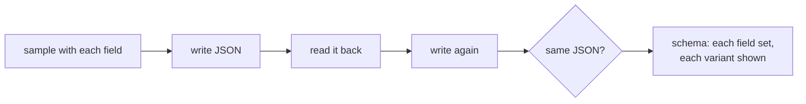

## Check the book

`just ci` builds the book and checks it. To run only this step:

```sh
just book
```

It fails on a missing include file, a missing anchor, or an empty code
block. Each error names its rule and the page:

| Rule | Finds |
|---|---|
| `mdbook` | An `ERROR` line of mdbook, for example a missing file. |
| `include` | An include line that mdbook left in the text. |
| `empty-code` | A code block with no text, for example a missing anchor. |
| `tracked` | A file in git that the build changed. |

To show an include line as an example, put it in a code block and
escape it: `\{{#include file.rs:name}}`. The check skips it.

The theme of the book, `docs/gruvbox`, is not in git. `just book`
installs it when it is missing. The install does not change
`docs/book.toml`. To install the theme again, remove it and build:

```sh
rm -r docs/gruvbox
just book
```

The build must not change a file in git. When `just book` reports the
rule `tracked`, see what changed, and find the step that writes the
file:

```sh
git diff
```

## Check the wrap of the book

Each prose line of a page in `docs/src` is at most 72 characters. No
page of the book or of the plugin has two blank lines in a row.
`just ci` checks both. To run only these checks:

```sh
just wrap
```

An error of the rule `wrap` names the page, the line and its length.
The check skips a code block, a row of a table and a heading. It also
skips a line with only one link or one code span: a wrap cannot make
that line shorter.

An error of the rule `blank` names the page and the second blank
line. Remove that line. The check skips a code block. It reads each
Markdown file in `docs/src` and in `crates/riff/claude-plugin` and
their subfolders, also the skill.

## Check a pull request on GitHub

Each pull request has the same form. The form links the pull request to
its issue and to its wave. A squash merge copies it into the commit on
`main`. This is the body of a pull request for issue 77:

```text
Closes #77

Pause and resume the riff. A new riff starts paused.

Issue: #77
Milestone: Wave 3
```

- The first line links the issue. Use `Closes #N` in the last pull
  request of the issue. Use `Refs #N` in each other one, and when a
  check after the release is left.
- The last lines are trailers: the issue, and its wave by the number
  (see [Rename a wave](waves.md#rename-a-wave)).
- Give the pull request the milestone of its issue. Do not end the
  title with `(#N)`. GitHub adds the number of the pull request.

`riff pr open` writes this body and opens the pull request (see
[Open a pull request](how-it-works.md#open-a-pull-request)).

The job `Hygiene` checks each pull request. To check one yourself, give
its number:

```sh
just hygiene pr 90
```

To check the message of a commit:

```sh
just hygiene commit HEAD
```

Each error names its rule. The
[API docs of hygiene](api/hygiene/index.html) list the rules.

GitHub runs no check on a pull request that has a conflict with
`main`. When `Hygiene` does not run, rebase your branch on `main` and
push it again.
## Merge by pull request on GitHub

No session and no person pushes to `main`. Each change goes in by a
pull request. GitHub merges it with a squash when the checks `Gate`,
`Hygiene` and `riff/verify` pass. The ruleset on `main` makes this so.
It has no bypass, also not for an admin.

The project settings of Claude Code (`.claude/settings.json`) also
deny a push to `main` and `gh pr merge --admin` in each session.

Each session uses your GitHub account. So the author of a pull request
can set `riff/verify` on its own commit. The skill forbids it, but
nothing stops it until the sessions have their own GitHub identity
(#97).

### Set up the repository

Run it once, and again after a change to `deploy/github.sh`. It is
safe to run again:

```sh
just github
```

It turns on auto-merge and squash merge only, and makes or updates
three rulesets:

- `main`: a change needs a pull request and the checks `Gate`,
  `Hygiene` and `riff/verify`.
- `release-branches` on the branches `release/**`: a change needs a
  pull request and the checks `Gate` and `Hygiene`. See
  [Make a patch of an older release](#make-a-patch-of-an-older-release).
- `releases` on the tags `v*`: only the repository admin role can
  create, move or delete a release tag.

To see the result:

```sh
gh api repos/como-technologies/riff --jq '{allow_auto_merge, allow_squash_merge, allow_merge_commit, allow_rebase_merge, squash_merge_commit_title, squash_merge_commit_message, delete_branch_on_merge}'
gh api repos/como-technologies/riff/rulesets
```

### Push an urgent fix to main

Do this in your own terminal, never in a session. Turn the ruleset
off, push, and turn it on again at once:

```sh
ID=$(gh api repos/como-technologies/riff/rulesets --jq '.[] | select(.name == "main") | .id')
gh api -X PUT repos/como-technologies/riff/rulesets/$ID -f enforcement=disabled
git push origin main
just github
```

`just github` sets the ruleset `main` again, with `enforcement`
active.

### Turn on auto-merge

`riff pr open` turns on auto-merge at once, before any other push. Do
not run `gh pr merge` after a push. The pull request keeps auto-merge
on. It waits for `riff/verify`: see
[Wait for the merge](how-it-works.md#wait-for-the-merge) and
[Report a verify](how-it-works.md#report-a-verify). A new commit on
the pull request has no status. It needs a new verify.

## See the tokens of an issue

riff counts the tokens that each claim takes, and the models that did
the work. Run the commands in your clone. They need `gh`.

The tokens of one issue: the total, then each work claim and each
verify claim, with its models:

```sh
riff usage 12
```

Each issue of a wave with its total, and the sum:

```sh
riff usage --wave "Wave 3"
```

Each session of this machine, with the tokens of each item. The line
`no issue` has the tokens outside each claim, for example of the lead:

```sh
riff usage
```

Each line shows the four kinds of tokens: input, output, cache write
and cache read. A cache read costs much less than an output token.

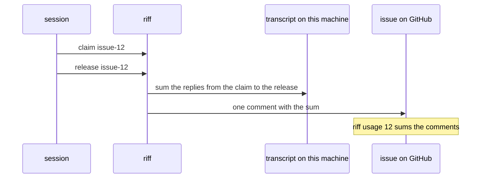

- riff reads the transcripts of the agent tool on the machine of the
  session. A claim counts from its `claim` to its `release`. A new
  start or the end of the session also ends it.
- `issue-12` and `verify-issue-12` are claims of the issue 12. riff
  puts one comment on the issue for each claim.
- The numbers are public on the issue. The comment holds the item, the
  kind of the claim, the first characters of the session ID, the
  times, the models and the tokens. It holds no text of a transcript,
  no path and no email.
- Each person who can write a comment can write one with numbers. So
  `riff usage 12` names who wrote each comment that it sums. It takes
  only numbers and names from a comment, and a comment of another
  person never replaces your numbers. Its last line says how many
  comments with the mark it did not count, and why.
- Tokens in a time with two claims of one session count for the claim
  that started last.
- With no `gh`, or for an item that names no issue, the release still
  works. The tokens stay on the machine, and `riff usage` shows them.
- After the merge, `riff pr wait` adds one comment with the total of
  the issue. A later release of a claim of the issue writes that
  comment again. GitHub lets only the account that wrote the total
  edit it. For each other account, the release and `riff pr wait` say
  that the comment of the claim is on the issue, and that the total is
  not updated.
- When GitHub refuses the total comment, riff tries one more time. The
  line names the HTTP status of the reply, when there is one.

### Write the total of an issue again

When an issue has no total comment, for example after a failed
`riff pr wait`, write it again. Run the command in a clone of the
repository of the issue:

```sh
riff usage 12 --total
```

## Check that a wave followed the rules

`riff audit` reads the log of the riff and the forge, and checks that
the sessions followed the flow of a wave. Only the owner or an admin
can read the log. Run it in your clone. It needs `gh`.

```sh
riff audit --wave "Wave 18"
```

It prints each rule with `pass`, `fail` or `not checked`. Rule 1 has a
line for each item of the wave. Each other rule has the number of its
checks that pass, and a line for each check that fails. A line names
the records of the log by their position. Find a record with
`riff-server log` (see "Print the log"). The command exits with 1 when
a rule fails.

| Rule | It checks |
|---|---|
| 1 | Each item has a claim, a pull request, a verify by another session, a merge and a release. No release comes before the merge or a verify result. A worker can release at its verify request. |
| 2 | Each verifier held no other claim, and is not the author. |
| 3 | Each worker had a clear between its last release and its next claim. |
| 4 | No session claimed while the riff or the repository was paused. |
| 5 | No session claimed an item of a later wave, or an item with an open need. |
| 6 | The lead held no claim of a work item. |
| 7 | Each request came from the lead of the user of its sender. |

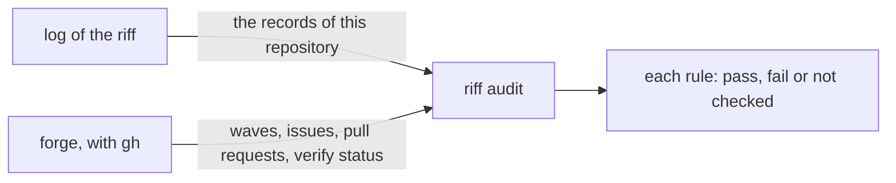

- A wave starts when it is the current wave: when the wave before it
  ends. It ends when the lead ends it. The audit of an open wave ends
  now. Rule 1 looks at the whole log. The other rules look only at the
  records from the start to the end of the wave.
- The audit sees no text of a message. The log gives it only the mark
  of a message: `request`, `verify request` or `verify result`, from
  the start of its text.
- A rule with nothing to check is `not checked`, with the reason. So
  is a check that the facts cannot prove, for example a claim of an
  item that is in no wave.

## Sign in on this machine

Sign-in uses the OAuth client of the Google Cloud project `como-riff`.
The client exists. To make it again, see
[Make the OAuth client](#make-the-oauth-client).

1. Do [Start a Riff](start-a-riff.md) first.

2. Install the [gcloud CLI](https://cloud.google.com/sdk/docs/install).
   Sign in with a Como account that can read the client secret in
   `como-riff`:

   ```sh
   gcloud auth login
   ```

3. Put the OAuth client in `.env` at the root of your clone. The
   client ID comes from `deploy/cloud/shared.env`, the client secret
   from Secret Manager. Git ignores `.env`:

   ```sh
   . deploy/cloud/shared.env
   secret=$(gcloud secrets versions access latest --secret "$CLOUD_SECRET" --project "$CLOUD_PROJECT")
   printf 'RIFF_OIDC_CLIENT_ID=%s\nRIFF_OIDC_CLIENT_SECRET=%s\n' "$RIFF_OIDC_CLIENT_ID" "$secret" > .env
   chmod 600 .env
   ```

4. Stop the `riff-server` of [Start a Riff](start-a-riff.md) with
   Ctrl-C. Start it again with the settings of `.env`. See
   [Run the server in a terminal](#run-the-server-in-a-terminal):

   ```sh
   set -a; . ./.env; set +a
   riff-server
   ```

   The server log in the terminal must show `sign-in with
   https://accounts.google.com` and `the provider knows the OAuth
   client`. If it shows `nobody can sign in`, the server has no client:
   do step 3 again. If it shows
   `riff-server stops`, Google refused the client. The line says why.

5. Sign in. Your browser opens. Pick your Como account:

   ```sh
   riff login
   ```

6. Start your Claude Code sessions again. A session that started
   before `riff login` has no token.

The user part of your URI is now the part of your email before the
`@`, in lower case. Each character that a URI part cannot hold becomes
`-`: `O'Brien@comotechnologies.io` gets the user `o-brien`. Your user
belongs to your email: no other account can sign in as it.

### Sign out

Remove the sign-in from this device:

```sh
riff logout
```

End each of your sign-ins, on each device:

```sh
riff logout --all
```

### When another account holds your user

Two emails can give the same user, for example `o'brien@` and
`o-brien@`. The first account that signs in holds the user. `riff
login` then stops for the second account:

```sh
riff login
```

```text
riff-server refused the token request: access_denied: the user o-brien
belongs to another account; ask an admin
```

Ask an admin which account holds the user. An admin can end the
sign-ins of that account (`riff logout --all --user USER`), but the
user still belongs to its email. To sign in, use an email that gives
another user.

### When riff cannot read the keyring

`riff` keeps your sign-in in the OS keyring. When it cannot read the
keyring, each command stops with `riff cannot find your user`. The
next lines say why. Unlock the keyring and run the command again. On
Linux, a Secret Service must run, for example GNOME Keyring.

On a machine with no keyring, name your user yourself:

```sh
export RIFF_USER=USER
```

`riff` then sends no token. A server with `--require-sign-in` refuses
it.

### When the keyring is locked

The OS keyring can lock, for example after a crash of
`gnome-keyring-daemon`. Then `riff` stops with this line:

```text
the OS keyring of pangolin is locked or does not answer: unlock it at the desktop. gh uses the same keyring, so gh stops too
```

A workers host says the line one time, and the lead gets a note
`keyring: the OS keyring of pangolin is locked ...`. The host looks at
the keyring again each 30 seconds. It does not stop.

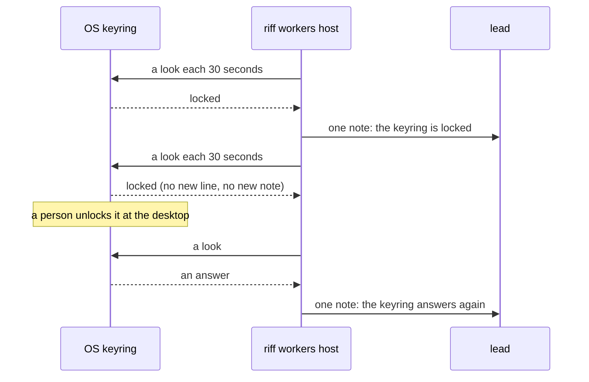

1. Unlock the keyring at the desktop of the machine. In GNOME, open
   "Passwords and Keys", and unlock the "Login" keyring.
2. Check that `riff` and `gh` can read it:

   ```sh
   riff whoami
   gh auth status
   ```

In 30 seconds the host tells the lead
`keyring: the OS keyring of pangolin answers again. The host goes on.`
You do not start the host again.

### Count the calls to the keyring

Each process that calls the OS keyring opens a session of the Secret
Service. A GNOME Keyring that gets a new session each few seconds can
grow until it aborts. Then the keyring stays locked. So riff makes few
calls:

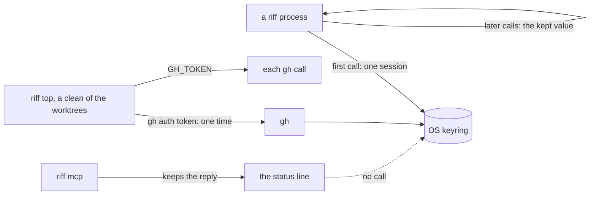

- A process opens the keyring at most one time, and reads each secret
  at most one time. Only a refresh of the sign-in reads it again.
- The `riff mcp` of a session keeps the reply for its status line. So
  `riff statusline` makes no call while `riff mcp` runs. A hook that
  does not talk to riff-server makes no call.
- The `gh` calls of one clean of the worktrees share one token. So do
  the `gh` calls of `riff top`, and of the rollout and the look of the
  lead: they read it again each 10 minutes.

To see the calls of one `riff` command, give it a file in
`RIFF_KEYRING_LOG`. Each line has the process ID and the call, for
example `4242 read sign-in https://riff.example`. A line never holds
the value of a secret:

```sh
RIFF_KEYRING_LOG=/tmp/riff-keyring-calls riff whoami
cat /tmp/riff-keyring-calls
```

To count the sessions that all the programs of a Linux machine open
in 10 minutes, watch the Secret Service. The command reads only the
header of each call, not its body:

```sh
timeout 600 dbus-monitor --session --profile "type='method_call',interface='org.freedesktop.Secret.Service',member='OpenSession'" | grep -c '^mc'
```

To see the locked memory of GNOME Keyring, run the command below. At
8192 kB, the keyring can open no new session:

```sh
grep VmLck /proc/"$(pidof gnome-keyring-daemon)"/status
```

### See the kind of each keyring session

On Linux, riff opens each session of the Secret Service as a plain
session, as `gh` does. A DH session costs GNOME Keyring about 0.6 kB
of locked memory, and the keyring keeps it also after the session
closes. A plain session costs none.

With a plain session, each secret goes over your D-Bus session bus
with no encryption. A process that watches all of that bus sees the
secrets of riff and of `gh`. Only your own processes and root can
watch it, and they can also read the secrets from the keyring itself.

To see the kind of each new session, watch the calls `OpenSession`.
The line after each call is the kind: `plain`, or
`dh-ietf1024-sha256-aes128-cbc-pkcs7` for a DH session:

```sh
dbus-monitor --session "type='method_call',interface='org.freedesktop.Secret.Service',member='OpenSession'" | grep -A1 OpenSession
```

### When riff says the riff has no sign-in

A riff can start again with no sign-in, for example after
[Start a Riff](start-a-riff.md). Then each command stops with
`riff-server at URL has no sign-in, but this machine has an old sign-in
for it`. Remove the old sign-in:

```sh
riff logout
```

Then start your Claude Code sessions again. Your user is now the name
that you log in with on your machine.

### When riff says a session is known as another user

The server keeps one user for each session. A call with the same
session ID and another user fails with `session ID is known as user
USER`. That happens when the session started before `riff login`. Start
the Claude Code session again, as a new session.

### Allow another domain

The accounts of `comotechnologies.io` can sign in, and the owner and
the members (see [Owner and members](#owner-and-members)). To allow
another Workspace domain, add `--allowed-domain DOMAIN` to
`riff-server`.
Give `--allowed-domain` once for each domain, the default domain too.
Two domains do not share a user: `alice@a.com` and `alice@b.com` both
give `alice`, and only the first account gets it.

### Name an admin

An admin can end each sign-in of another person, and invite and
remove members. The owner is an admin. Name each other admin by
verified email, once for each admin:

```sh
riff-server --admin alice@comotechnologies.io
```

A name that is not an email names nobody: the log says so at start.
Then an admin runs:

```sh
riff logout --all --user USER
```

### Tokens

With an OAuth client, the server refuses each call without a token.
`riff` sends a token on each call when you are signed in. A command that
you type acts as you. Each Claude Code session gets its own token, which
acts only as that session.

Each token works only with the device key of this machine. `riff`
keeps the key in the OS keyring. Use the same server URL for `riff`
(`RIFF_SERVER`) as the server has for itself (`--public-url`, by
default `http://` and the listen address). Else the server refuses
each proof.

### Use another sign-in provider

The default provider is Google. For another OpenID Connect provider,
give its issuer and the OAuth client of riff there. Give
`--client-secret` only when the provider asks for one:

```sh
riff-server --issuer https://login.example.com --client-id ID --client-secret SECRET
```

Without `--client-id`, the server has no sign-in.

## Owner and members

```mermaid
flowchart TD
    A[a person signs in] --> O{owner, admin or member?}
    O -- yes --> IN[signed in]
    O -- no --> D{allowed domain?}
    D -- yes --> IN
    D -- no --> N{riff has no owner and no admin?}
    N -- yes --> OW[signed in as the owner]
    N -- no --> R[refused: ask the owner for an invite]
```

The first person who signs in to a riff is its owner. The owner is an
admin. On a riff with `--admin`, only an admin becomes the owner.

A riff with sign-in listens only on a loopback address until it has an
owner. So the first person signs in on the machine of the server. A
server with no bucket forgets its owner when it starts again. To let
it listen on your network, name the owner in the settings.

### Become the owner

On the machine of the server, after you start the server with sign-in,
sign in first:

```sh
riff login
```

### Name the owner when you set up the server

A server that must listen on the network at once needs an owner. Name
it by verified email:

```sh
riff-server --owner alice@example.com --listen 0.0.0.0:7878
```

A riff that has an owner keeps it. `--owner` does not change it.

### Invite a person

A member needs no allowed domain, so a person with a personal Google
account can join. Only the owner or an admin can invite:

```sh
riff invite --email bob@gmail.com
```

It prints the address of the riff (the `--public-url` of the server)
and the lines that the person runs to join. Send them to the person.
Before the invite,
`riff login` stops with `bob@gmail.com is not a member of this riff`.

### Remove a person

It removes the member and ends each sign-in of that person, on each
device. Only the owner or an admin can remove. The owner stays:

```sh
riff remove --email bob@gmail.com
```

A person of an allowed domain can still sign in after a removal. To
remove an admin, first make the admin a member again.

### Make a person an admin

An admin can invite and remove members. Only the owner can make an
admin. The person is also a member:

```sh
riff admin add bob@gmail.com
```

### Make an admin a member again

The person stays a member, but can no longer invite or remove. Only
the owner can do this. The owner stays an admin:

```sh
riff admin remove bob@gmail.com
```

### Pass the owner role

A riff has one owner. The owner can pass the role to a member or an
admin. You stay an admin. Only the owner can do this:

```sh
riff owner bob@gmail.com
```

The new owner stays after a restart. The `--owner` setting of
`riff-server` names the owner only of a new riff. An admin can also
ask for the role: see
[Take the owner role](start-a-team-riff.md#take-the-owner-role).

### See the members

It shows the owner, the admins, the members and the allowed domains.
It shows each person once, with the highest role: owner, then admin,
then member:

```sh
riff members --email
```

```text
owner            mike@example.com
admins           ada@example.com
members          bob@gmail.com
allowed domains  example.com
```

A riff with no owner shows the owner `none`. Its last line, in
yellow, says how an admin takes the owner role.

## Run the server in a terminal

`riff-server` runs in the foreground, in a terminal. Its log goes to
that terminal. It keeps no settings: at each start, it reads them from
its options and from the environment. `riff-server --help` lists each
option and its `RIFF_*` variable. To run it with sign-in, give it your
OAuth client in the environment:

```sh
export RIFF_OIDC_CLIENT_ID=ID RIFF_OIDC_CLIENT_SECRET=SECRET
riff-server
```

Stop it with Ctrl-C. With a bucket, it saves the state first.

`riff-server` has one command, `riff-server log`. It runs no server:
see [The tools of the log](#the-tools-of-the-log).

- With no OAuth client, an address that is not loopback needs
  `--insecure`. Else the server does not start.
- With sign-in, an address that is not loopback needs an owner:
  `--owner EMAIL`, or a bucket that holds one.

### Read the log of the server

Each line of the log is one JSON object, so that Cloud Logging can
filter it. The field `severity` is `DEBUG`, `INFO`, `WARNING` or
`ERROR`. The field `message` has the text. To read the log as text in
your terminal, use `jq`:

```sh
riff-server | jq -r '"\(.time) \(.severity) \(.message)"'
```

An error in the options comes before the log starts. It is plain text
on stderr.

### Keep the settings in .env

Put the settings in `.env` at the root of your clone, one `NAME=VALUE`
on each line. Git ignores `.env`. Load it into the shell, then start
the server:

```sh
set -a; . ./.env; set +a
riff-server
```

### A riff on your network with no sign-in

A riff with no OAuth client listens only on a loopback address. On a
network that you trust, `--insecure` lets it listen on your network
with no sign-in:

```sh
riff-server --listen 0.0.0.0:7878 --insecure
```

Then each machine that can reach the riff can read and send its
messages with any name, also as your lead. Each message counts as
verified. It warns at start. See
[A riff with no sign-in](how-it-works.md#a-riff-with-no-sign-in). A
riff with sign-in is safer: see
[Run the server in a terminal](#run-the-server-in-a-terminal).

### Update the local server

Build the new binaries. Stop `riff-server` with Ctrl-C and start it
again with your settings. Then update the plugin:

```sh
just install
riff-server
riff connect claude
```

### Test a change without the shared riff

We build riff with riff. So each machine has two tracks:

- The installed `riff`, `riff-server` and plugin are a release. Only
  `riff update` changes them. Your sessions riff with them.
- The code under test runs from its worktree, against a `riff-server`
  of the same worktree. It never talks to the shared riff.

```mermaid
flowchart LR
    subgraph Release["installed release"]
        S[your sessions] --> R[shared riff]
    end
    subgraph Tree["worktree"]
        D["just dev session<br/>target/debug/riff"] --> L["riff-server of the tree<br/>127.0.0.1:7900+"]
    end
```

Run `just dev` in the worktree:

```sh
just dev
```

It builds the workspace, and runs the debug `riff-server` of the tree
on the first free port from 7900. Its log goes to
`target/dev-server.log`. Then it starts Claude Code with the plugin of
the tree and the debug `riff` of the tree. The installed plugin is off
in that session only. `just dev` sets `RIFF_ON=1`, so riff is on in the
session with no `riff enable`. When you end Claude Code, `just dev`
stops the server. It changes nothing that is installed.

- Options after `dev` go to `riff-server`. Do not give `--listen`.
- In the dev session, `riff server` names the server of the tree and
  the build of the tree.
- After a rebuild, end Claude Code and run `just dev` again.

A test run and a dev session never touch the riff of your machine:
its sign-in, keyring, settings or local files. `just dev` sets
`RIFF_HOME` to `target/dev-home` of the tree. With `RIFF_HOME`, `riff`
keeps its settings, local files and secrets in that dir, and never
opens the OS keyring. `just test` and `just ci` set `RIFF_SERVER` to
`http://127.0.0.1:9`, where nothing listens, so a test reaches neither
the shared riff nor the riff of your machine. Each test runs `riff`
and `riff-server` through the helper crate `isolated`: a temp home of
its own for each test, and the same `RIFF_SERVER` unless the test
names its own server. A test fails a test file that runs a binary of
riff without the helper. Your home can be a git repository, and a
worker has its `TMPDIR` in your home. So `.cargo/config.toml` sets
`TMPDIR` to `/var/tmp` for each cargo run in the repository, also a
plain `cargo test`. A unit test or a
doc test that needs a dir outside each git repository uses
`isolated::outside_git()`, not `tempfile::tempdir()`. A test writes
a fake program as "Write a fake program" says. A unit test that uses
the keyring calls `secrets::mock_store()` first.
A doc test that drops a lock, and then checks that the lock is free, is
a `standalone_crate`.

Use a dev session for a live check of new code, for example a new
plugin command, hook or skill text. It needs no release and no update
of the machine. A worker never runs `riff update`, `cargo install` of
riff, `just install` or `riff connect` in a worktree.

A criterion that only the shared riff can test is a check after the
release. Its item stays open until the release of the wave. See
[Waves](waves.md).

### Test a debug build with sign-in

`just dev` loads `.env` at the root of its tree, when the file exists.
So a debug server gets the OAuth client of `.env` (see
[Keep the settings in .env](#keep-the-settings-in-env)), and requires
sign-in. Only `just dev` loads `.env`: `just ci` does not.

```sh
printf 'RIFF_OIDC_CLIENT_ID=%s\nRIFF_OIDC_CLIENT_SECRET=%s\n' ID SECRET > .env
just dev
```

In the dev session, sign in to the server of the tree:

```sh
! riff login
```

## Save the state in a bucket

Without a bucket or a directory, `riff-server` keeps its log only in
memory. A restart loses all threads, claims and members. With
`--bucket` (`RIFF_BUCKET`), the server writes each change to the log in
a Cloud Storage bucket. At start, it loads the newest checkpoint and
replays the log after it:

```sh
riff-server --bucket como-riff-state
```

The server gets its access token from the metadata server of Cloud
Run. So the server works with a bucket only on Cloud Run. The service
account of the server must have write access to the bucket.
[The tools of the log](#the-tools-of-the-log) also work with a bucket
from your machine.

With a bucket, the server loads the checkpoint and replays the log at
start. Then it opens its port, takes the lease, waits 15 seconds, and
serves. Until it serves, each call gets 503. Only one server serves
from a bucket. When a new server takes the lease, the old one closes
its port at once, and exits after its last checkpoint, at most 10
seconds later. A server that cannot load opens no port and takes no
lease, and the old one serves on. See
[how it works](how-it-works.md#a-restart-with-a-bucket).

### Start again with an empty state

`riff-server` migrates only the saved state of release 0.8.0 (see
[Go live with release 1.0.0](#go-live-with-release-100)). When it
cannot read an object of the bucket, it stops at start, before it takes
the lease. An old instance that still runs serves on. With no old
instance, Cloud Run starts the server again and again, and each call
gets 503. The log shows
`riff-server stops: cannot read the saved object`, with the name of the
object and the reason (see [See the shared log](#see-the-shared-log)).

Remove the old state, and start again with an empty bucket. Stop the
shared server first, so that no server saves the old state again:

```sh
riff cloud delete shared
gcloud storage rm 'gs://como-riff-state/**'
riff cloud deploy shared vX.Y.Z
```

Put the release that ran in place of `vX.Y.Z`. `riff cloud list` shows
it.

The new state has no threads, sessions, claims or members. The deploy
names the owner again. Each person signs in again with `riff login`,
and the owner invites each member again.

## Keep the state in a directory

For local work, `--dir` (`RIFF_DIR`) keeps the log, the checkpoints,
the sign-ins (`signins.json`) and the lease as files in a directory. It
works as a bucket: the server loads the checkpoint and replays the
log, then opens its port, waits 15 seconds for the lease, and then
serves:

```sh
riff-server --dir ~/.local/state/riff-server
```

The log is in `log/` of the directory, one file for each chunk. The
checkpoints are in `checkpoint/`. To start again with an empty state,
stop the server and remove the directory.

With `--dir`, the port of the server is closed for the first 15
seconds. Wait for the line `riff-server listens on` in the log before
you run the first `riff` command. A `riff` that runs already, for
example `riff watch`, waits through a restart by itself.

## The tools of the log

`riff-server log` reads and repairs the log of a riff. It runs no
server. Name the store with `--dir DIR` or `--bucket BUCKET`, before or
after the command.

### Print the log

`riff-server log` prints each record as one line of text: the
position, the time, the kind of the change, its facts and its cause.
The cause is the kind of the command and its caller.

```sh
riff-server log --dir ~/.local/state/riff-server
```

```text
1  2026-09-30T12:00:00Z  pause_set  the riff  paused  (make_riff, the server)
2  2026-09-30T12:00:01Z  joined_thread  acme/app by riff://ann@heron/acme/app?session=s1  (register, the session ann/s1)
3  2026-09-30T12:00:02Z  pause_set  the riff  running  (resume, the session ann/s1)
4  2026-09-30T12:00:05Z  claimed  issue-7 in acme/app by riff://ann@heron/acme/app?session=s1  (claim, the session ann/s1)
5  2026-09-30T12:00:09Z  posted  acme/app #1 note from riff://ann@heron/acme/app?session=s1, woke 0: "started: issue-7"  (post, the session ann/s1)
```

A record from before release 1.0.0 has no cause. Its line ends with
`(cause not known)`.

To print only the records from a position, add `--from`:

```sh
riff-server log --from 1200 --dir ~/.local/state/riff-server
```

### Find who did what

Each change of the riff is a record of the log, and each record names
its cause. So the log shows who made each change. To find each change
of one item, or each change of one session:

```sh
riff-server log --dir ~/.local/state/riff-server | grep issue-7
riff-server log --dir ~/.local/state/riff-server | grep 'the session ann/s1)'
```

### Find who changed the people

The people of the riff are records of the log too: who joined, who is
a member, an admin or the owner, and each request for the owner role.
To find each change of one person, or each change that one person
made:

```sh
riff-server log --dir ~/.local/state/riff-server | grep bob@gmail.com
riff-server log --dir ~/.local/state/riff-server | grep 'the person ada)'
```

```text
12  2026-10-01T12:00:00Z  person_joined  ada@gmail.com as ada  (admit, the sign-in ada@gmail.com)
13  2026-10-01T12:00:00Z  owner_set  ada@gmail.com  (admit, the sign-in ada@gmail.com)
14  2026-10-01T12:01:00Z  member_invited  bob@gmail.com  (invite, the person ada)
21  2026-10-01T12:09:00Z  member_removed  bob@gmail.com  (remove, the person ada)
```

| Record | Meaning |
|---|---|
| `riff_made` | The riff has its ID. |
| `person_joined` | An email signed in for the first time. It holds its USER. |
| `member_invited`, `member_removed` | An email is a member, or it is not. A removal ends each sign-in of the person. |
| `admin_set` | An email is an admin, or a member again. |
| `owner_set` | An email is the owner. With no email, the owner is gone. |
| `owner_asked`, `owner_denied` | An admin asks for the owner role, or the owner keeps it. |
| `signins_ended` | Each sign-in of a person ended: `riff logout --all`. |

An email is in a record, and in the answer to a member. It is in no
line of the log of the server: the line of a refused change of the
people has its `code` and no `reason`.

A command that changed nothing has no record. `riff-server` writes one
line to its own log for it, with the field `result`:

| `result` | Meaning |
|---|---|
| `refused` | The server refused the command. The line has the `code` and the `reason`. A change of the people has no `reason`. |
| `no_change` | The server took the command, and nothing changed. |
| `failed` | The server did not write the change, and stopped. The severity is `ERROR` when the write failed. It is `WARNING`, with the `reason`, when the server stopped first. |
| `denied` | The server refused the token of the call, or the call had none. The line has the `path` of the call. |
| `dropped` | The server refused more calls than it writes `denied` lines for. The line has the `count` of the lines that it did not write, and `counts`: the count of each code. |

```mermaid
flowchart LR
    C[a command] --> Q{did it change the riff?}
    Q -->|yes| R["records in the log:<br/>riff-server log"]
    Q -->|no| L["one line in the log of the server:<br/>result"]
```

To find these lines, keep the log of the server in a file, and filter
it with `jq`:

```sh
riff-server | tee -a server.log
jq -c 'select(.result == "refused")' server.log
jq -c 'select(.result == "denied")' server.log
```

```text
{"severity":"INFO","time":"2026-10-01T12:00:00.000Z","message":"refused","target":"engine","caller":{"session":"bob/b1"},"command":"claim","result":"refused","code":"held","reason":"ann@heron:app (s1) holds issue-7 in acme/app."}
{"severity":"INFO","time":"2026-10-01T12:00:03.000Z","message":"denied","target":"engine","named":{"session":"bob/b1"},"proved":false,"path":"/v1/claim","result":"denied","code":"bad_token"}
```

- `caller` is the caller that the token proved. `key` is the
  thumbprint of the device key of that token. It is not a secret.
- `named` is the caller that a refused call named. No token proved it.
- No line holds the body of a message, a token or an email.

For the shared server, filter the shared log:

```sh
riff cloud log shared --filter 'jsonPayload.result="refused"'
```

The log keeps its records for about 30 days.

### Find how many refused calls have no line

The server writes at most 100 `denied` lines in 10 seconds. It keeps
20 of them for a call with a valid token (`not_you`, `bad_proof`). So
a flood of calls with no token does not hide a member that acts as
another session. For each 10 seconds with more refused calls, it
writes one `dropped` line. Its `count` is the number of `denied` lines
that it did not write. Its `counts` holds that number for each code:

```sh
jq -c 'select(.result == "dropped")' server.log
```

```text
{"severity":"WARNING","time":"2026-10-01T12:00:10.000Z","message":"dropped","target":"engine","count":920,"counts":{"no_token":918,"not_you":2},"result":"dropped"}
```

To see the codes of each window:

```sh
jq -c 'select(.result == "dropped") | {time, counts}' server.log
```

For the shared server:

```sh
riff cloud log shared --filter 'jsonPayload.result="dropped"'
```

### Check the log

`riff-server log verify` reads each checkpoint, and each chunk from the
oldest kept checkpoint. It names each object and each line that does
not read, and each gap in the positions. It exits with 1 when it finds
a problem.

```sh
riff-server log verify --dir ~/.local/state/riff-server
```

A good log gives one line:

```text
The log reads: 3 chunks, 1234 records from position 1 to 1234, 1 checkpoint.
```

A bad log gives one line for each problem, then the last good position
and the command that shows each record after it:

```text
/home/ann/.local/state/riff-server/log/00000000000000001201.jsonl line 3: EOF while parsing a value at line 1 column 30
1 problem in 3 chunks and 1 checkpoint. The last good record of the log is at position 1201.
To see each record after it, and the command that removes them, run: riff-server log cut --after 1201
```

### Cut the log

A cut loses each change after a position. It has two steps: a dry
run, then the cut.

#### See what a cut removes

`riff-server log cut --after POSITION` removes nothing. It prints each
record and each checkpoint that the cut removes, the threads of these
records, and the command that removes them.

```sh
riff-server log cut --after 1201 --dir ~/.local/state/riff-server
```

```text
1202  (a line that does not read: EOF while parsing a value at line 1 column 30)
1203  2026-09-30T12:00:05Z  claimed  issue-7 in acme/app by riff://ann@heron/acme/app?session=s1  (claim, the session ann/s1)
A cut removes 2 records and 0 checkpoints after position 1201. Threads: acme/app.
This run removed nothing. To remove them, stop the server and run: riff-server log cut --after 1201 --yes
```

#### Remove the records

Stop the server first. Then add `--yes`:

```sh
riff-server log cut --after 1201 --yes --dir ~/.local/state/riff-server
```

```text
1202  (a line that does not read: EOF while parsing a value at line 1 column 30)
1203  2026-09-30T12:00:05Z  claimed  issue-7 in acme/app by riff://ann@heron/acme/app?session=s1  (claim, the session ann/s1)
Removed 2 records and 0 checkpoints after position 1201. Threads: acme/app.
```

A cut also ends each sign-in that started after the new end of the
log. At its next start, the server drops these sign-ins, and each
sign-in of a person that the log does not know after the cut. Each
such person signs in again with `riff login`.

The command keeps only the good part of the log: its first records
that read and have the right positions, up to the position. It removes
each line after the first problem, also a line with a lower position,
and each later chunk. So a line that it prints never stays, and the
log reads after the cut. When the position of a removed line stays in
the log from an earlier chunk, the line says so.

The command refuses a position before the oldest kept checkpoint when
the chunks before that checkpoint are gone, so no start can replay
them. While the log still starts at position 1, it cuts, and deletes
each checkpoint after the position.

#### When the cut refuses: a server holds the lease

With `--yes`, the command refuses while a server holds the lease of
the store. The refusal names the instance of the server:

```text
riff-server: cannot cut: the server instance 5f0c…e1 holds the lease, and wrote it at 2026-09-30T12:00:05Z. Stop the server first. A lease ends when its server shuts down, or 90 seconds after its last write.
```

```mermaid
stateDiagram-v2
    [*] --> live: a server takes the lease
    live --> live: the server writes the time, each 30 s
    live --> ended: the server shuts down (Ctrl-C, SIGTERM)
    live --> ended: 90 s with no new time
    ended --> live: a server takes the lease
```

- After Ctrl-C or `riff cloud delete shared`, the lease ends at once.
  Run the command again.
- After a server that stopped with no shutdown, for example a crash,
  wait 90 seconds. Then run the command again. It waits 10 seconds
  more, before it reads the log.
- The server logs the ID of its instance at start: `took the lease
  as`.
- The command reads the time in the lease with the clock of your
  machine. Your clock can be at most 50 seconds ahead of the clock of
  the server. Check your clock before a cut on the bucket.
- A lease from riff-server 0.8.0 or older has no time, so it does not
  end. The refusal names the lease object. Stop the server, delete the
  object, and run the command again:

  ```sh
  gcloud storage rm gs://como-riff-state/lease
  ```

  A server that still runs stops when the object is gone.

On Cloud Run, the server needs CPU that is always on
(`--no-cpu-throttling`) and exactly one instance. Then it writes the
time also when it gets no call. `riff cloud deploy` sets both.

#### The cut takes the lease

With `--yes`, the command takes the lease for the time of the cut, with
an ID of its own that starts with `cut-`. It ends the lease after the
cut. A dry run does not write the lease.

```mermaid
sequenceDiagram
    participant I as old server
    participant S as store
    participant T as log cut --yes
    Note over I: does not run for 95 s
    T->>S: read the lease: the ID of the server, 95 s old
    T->>S: write the lease: the ID of the cut, only when not changed
    Note over T: waits 10 s, reads the lease again
    T->>S: remove the records
    T->>S: end the lease of the cut
    Note over I: runs again
    Note over I: its lease is 95 s old: it exits with an error
```

- A server that did not run for some time, for example a stopped
  process or a machine that slept, holds the removed records in its
  memory. It finds the ID of the cut in the lease, or it finds that its
  own lease is 90 seconds old. It then stops for good and serves no
  more. In the second case, `riff-server` exits with an error, so that
  Cloud Run starts a new instance, which loads the log from the store.
- When a server writes the lease at the same time as the cut, the cut
  refuses and removes nothing.
- Start no server during a cut. When a server took the lease during
  the cut, the command names it and exits with 1. Stop that server,
  then check the log again.

### Use the tools on the bucket

On your machine, a tool takes the access token of your Google sign-in.
Sign in once with gcloud. Your account must have access to the objects
of the bucket.

```sh
gcloud auth login
riff-server log verify --bucket como-riff-state
```

On Cloud Run, a tool takes the token of the metadata server, as the
server does.

`--bucket` and `--dir` do not go together, also from the environment.
When your shell sets `RIFF_DIR`, remove it for the command:

```sh
env -u RIFF_DIR riff-server log verify --bucket como-riff-state
```

### Go back to a position

When the server cannot load its log, or the log holds a bad change, cut
the log before the bad record.

```mermaid
flowchart LR
    S[stop the server] --> V[log verify:<br/>the last good position is P]
    V --> D[log cut --after P:<br/>a dry run, names each record]
    D --> C[log cut --after P --yes:<br/>removes them]
    C --> R[start the server:<br/>it replays up to P]
```

For a server on your machine, stop it with Ctrl-C. Then run:

```sh
riff-server log verify --dir ~/.local/state/riff-server
riff-server log cut --after POSITION --dir ~/.local/state/riff-server
riff-server log cut --after POSITION --yes --dir ~/.local/state/riff-server
riff-server --dir ~/.local/state/riff-server
```

For the shared server, stop the service first, so that no instance
writes the log. Then deploy the release that ran, `vX.Y.Z`. `riff cloud
list` shows it:

```sh
riff cloud delete shared
riff-server log verify --bucket como-riff-state
riff-server log cut --after POSITION --bucket como-riff-state
riff-server log cut --after POSITION --yes --bucket como-riff-state
riff cloud deploy shared vX.Y.Z
```

The bucket keeps each older version of an object for 7 days. So you
can get back an object that a cut deleted:

```sh
gcloud storage ls --all-versions 'gs://como-riff-state/log/**'
gcloud storage cp 'gs://como-riff-state/log/NAME#GENERATION' gs://como-riff-state/log/NAME
```

## Set up the cloud project

Do this once, for the team. The project `como-riff` exists: use these
steps only to make it again.

The Google Cloud project `como-riff` holds each cloud resource of
riff. `deploy/cloud/shared.env` holds its settings. The repository is
public.
Put no email address, billing account ID or organization ID in it.

Install the [gcloud CLI](https://cloud.google.com/sdk/docs/install).
Sign in with your Como account:

```sh
gcloud auth login
```

Make the project once. The first command shows the ID of the
organization:

```sh
gcloud organizations list
gcloud projects create como-riff --organization ORGANIZATION_ID
```

Link a billing account to the project. The first command shows the
accounts that you can use:

```sh
gcloud billing accounts list
gcloud billing projects link como-riff --billing-account BILLING_ACCOUNT_ID
```

Then make the resources of riff in the project:

```sh
riff cloud create shared
```

The command checks each resource first, so you can run it again.
It makes the bucket `como-riff-state` and two service accounts.
`riff-server` runs as `riff-server`. That account can read and write
only the bucket, and read only the client secret. Cloud Build builds
the image as `riff-build`.
CI signs in as `riff-deploy`, from `main` and from the tags `v*` of the
repository only. When the identity provider exists, the command sets
this condition on it again.

The bucket is a standard bucket with object versioning: it keeps each
older version of an object. It has two lifecycle rules. One rule
deletes an older version after 7 days. The other rule deletes each
thread object 30 days after its last change.

The service gets 1 GiB of memory, because `riff-server` keeps the state
in memory. Each deploy sets it. When a service runs with another limit,
the setup sets it at once: Cloud Run then starts a new instance.

### See the lifecycle rules

```sh
gcloud storage buckets describe gs://como-riff-state --project como-riff \
  --format 'json(lifecycle_config,versioning_enabled)'
```

The output shows versioning on, and two `Delete` rules: one with `age`
30 and the prefix `threads/`, and one with `daysSinceNoncurrentTime` 7.

### Get an email for each error

The setup makes an alert in the cloud project. When a log line of
`riff-server` has the severity `ERROR` or more, Google Cloud sends an
email to the owner, at most one each 5 minutes. The repository is
public, so give your email in `RIFF_OWNER`:

```sh
RIFF_OWNER=YOUR_EMAIL riff cloud create shared
```

With no `RIFF_OWNER`, the setup makes no alert, and says so. The alert
has the name `riff-server-errors`. Its rule is in `deploy/alert.json`.
To send the email to another address, delete the channel `riff-owner`
in the console of Google Cloud, and run the setup again.

## Make your own OAuth client

riff has no built-in sign-in app, and no client ID or secret is in its
source or its binaries. Each person who runs a riff with sign-in makes
their own OAuth client, and gives it to `riff-server` in the
environment: `RIFF_OIDC_CLIENT_ID` and `RIFF_OIDC_CLIENT_SECRET`.

For a Google client, do steps 1 to 7 of
[Make the OAuth client](#make-the-oauth-client) in your own Google
Cloud project, with these changes:

- Audience: **Internal** for the accounts of your organization only.
  For a personal account, pick **External**, and add each person as a
  test user.
- Step 7: copy the client ID and the client secret to a safe place.
  Commit neither. For a riff on Cloud Run, `riff cloud signin` stores
  them: see
  [Host your own riff on Cloud Run](start-a-team-riff.md#host-your-own-riff-on-cloud-run).

Then give both to `riff-server` in the environment:

```sh
export RIFF_OIDC_CLIENT_ID=ID RIFF_OIDC_CLIENT_SECRET=SECRET
riff-server
```

With an OAuth client, the riff requires sign-in. On an address that
is not loopback, a riff with no OAuth client does not start. Its error
names both settings.

## Make the OAuth client

Do this once, for the team. The client exists: use these steps only to
make it again.

riff signs in with one Google OAuth client. Google has no API to make
it, so you make it by hand, in the console. The console can use
slightly different words.

1. Open
   [Google Auth Platform](https://console.cloud.google.com/auth/overview?project=como-riff)
   and click **Get started**.
2. App information: the app name is `riff`. The support email is a
   group of the team, or your own address.
3. Audience: **Internal**. Then only accounts of the organization can
   sign in.
4. Contact information: the same address. Agree to the policy and
   click **Create**.
5. Data access: add nothing. riff asks only for `openid` and `email`.
6. Click **Clients**, then **Create client**. The application type is
   **Desktop app**. The name is `riff`. Click **Create**.
7. Keep the dialog open. It shows the secret only once. Do not
   download the JSON file. In a terminal, run:

   ```sh
   riff cloud signin shared
   ```

   It shows these steps, then asks for the client ID and the client
   secret. It puts the secret in Secret Manager and the ID in
   `deploy/cloud/shared.env`.
8. Commit `deploy/cloud/shared.env`.

To see who changed the client, and when:

```sh
gcloud logging read 'protoPayload.serviceName="clientauthconfig.googleapis.com"' \
  --project como-riff --freshness 400d \
  --format 'table(timestamp, protoPayload.methodName, protoPayload.authenticationInfo.principalEmail)'
```

Google deletes a client that nobody uses for six months. It sends an
email 30 days before.

## Deploy

Do [Set up the cloud project](#set-up-the-cloud-project) and
[Make the OAuth client](#make-the-oauth-client) first.

CI deploys only a release. An admin pushes the release tag at the end
of a wave, and CI deploys it. The repository variable `CLOUD_DEPLOY`
must be `true`. A push to `main` does not deploy. A `riff` refuses a
server of another build (see [Builds](how-it-works.md#builds)), so a
deploy in the middle of a wave would stop each session. The job signs
in to Google Cloud from GitHub with no key. Only `main` and the tags
`v*` can sign in, and only a job in the GitHub environment `production`
signs in as the deploy account of the shared riff (see
[Let only an approved job deploy](#let-only-an-approved-job-deploy)).

A release is a git tag `vX.Y.Z`. X.Y.Z is the version of the crates in
`Cargo.toml`. [Versions](how-it-works.md#versions) tells you the
level: a patch, a minor or a major. Only an admin of the repository
can push a release tag: the ruleset `releases` makes this so (see
[Set up the repository](#set-up-the-repository)). `riff update`
installs the release that the shared server runs, so the tag and the
deploy make a release current.

```mermaid
flowchart LR
    M[each item of the wave merged] --> S[stop the workers]
    S --> V[make a release:<br/>bump, merge, tag]
    V --> C[CI: Release check]
    C --> D[CI: Deploy]
    D --> U[riff update on each machine]
    U --> R[start the sessions again]
```

### Make a release

An admin makes the release when each item of the wave is merged. Stop
the workers first. Set the new version in `Cargo.toml` and in the
`plugin.json` of the plugin, and update `Cargo.lock`. Pick the level
with
[The test for each release](how-it-works.md#the-test-for-each-release).
On the line 1.x, a release that the test makes a major is a minor.
When `main` already has the new version, keep it. This example makes
`v0.2.0`:

```sh
riff workers stop
git switch -c release-v0.2.0 origin/main
sed -i 's/^version = ".*"/version = "0.2.0"/' Cargo.toml
sed -i 's/"version": ".*"/"version": "0.2.0"/' crates/riff/claude-plugin/riff/.claude-plugin/plugin.json
cargo update --workspace
git commit -am "Release v0.2.0"
git push -u origin HEAD
```

Open a pull request for the branch. Its body states the level and the
reason in one line. Write the line in plain words that a person
understands (ASD-STE100), for example:

```text
Level: minor. Old and new sessions work together, but they act differently: a new session asks for a verify in a new way.
```

The body also has the link line and the trailers of each pull request
(see [Check a pull request on GitHub](#check-a-pull-request-on-github)).
The trailer `Issue: #N` names the release issue. So the rollout gives
no worker the release issue while the pull request waits (see
[See the item of a pull request](how-it-works.md#see-the-item-of-a-pull-request)).

Give it the label `release`. The release notes leave out the pull
requests with this label:

```sh
gh pr create --title "Release v0.2.0" --label release --body-file pr.md
```

Get it verified and merged as each other change. Then run the
real-session test on the merge commit, on a machine with podman (see
[Run the real-session test](#run-the-real-session-test)). It must pass
before the tag:

```sh
git fetch origin
git switch --detach origin/main
just real-session
```

Then tag the merge commit, and push the tag:

```sh
git fetch origin
git tag v0.2.0 origin/main
git push origin v0.2.0
```

Write the start of the release notes in `notes.md`: the level line
of the pull request. It also lists the commands that each person
runs, for example `riff update --tag v0.2.0` when the old `riff`
cannot read the new server. Publish the release on the tag. GitHub
adds each pull request merged since the last release. The GitHub
releases are the changelog of riff:

```sh
gh release create v0.2.0 --verify-tag --title v0.2.0 --notes-file notes.md --generate-notes
```

When the last tag is not the release before this one, name the tag of
that release, for example `--notes-start-tag v0.1.0`.

CI runs the job `Release check` for the tag. It fails when the tag is
not the version of the crates. The job `Static riff` builds the static
`riff` and `riff-server` of the tag. Then the job
`Static riff release` adds them to the release, with `SHA256SUMS` (see
[How riff is built and installed](#how-riff-is-built-and-installed)).
It waits up to 60 minutes for the release, so publish the release soon
after the push of the tag. When both jobs pass, the job `Deploy`
deploys the tag to the shared server. So a machine that sees the new
server can download the new riff. See
[Deploy the shared server at the end of a wave](#deploy-the-shared-server-at-the-end-of-a-wave).
Watch both jobs:

```sh
gh run list --workflow CI --event push --limit 1
gh run watch
```

### Make a patch of an older release

`main` holds the newest release line. A patch of an older line goes on
the branch `release/MAJOR.x` of that line, for example `release/1.x`
when `main` holds 2.x. The branch starts at the last release tag of
the line. CI runs the `Gate` and `Hygiene` on it as on `main`. A push
to the branch does not deploy.

Make the branch one time, from the last release tag of the line. Then
run `just github` in a checkout of the branch: the ruleset
`release-branches` is in its `deploy/github.sh`:

```sh
git push origin 'v1.3.0^{commit}:refs/heads/release/1.x'
git fetch origin
git switch --no-track -c release-1.x origin/release/1.x
just github
```

Each change goes in by a pull request to the branch, as on `main`:

```sh
git fetch origin
git switch --no-track -c my-fix origin/release/1.x
git push -u origin HEAD
gh pr create --base release/1.x --title "My fix" --body-file pr.md
gh pr merge --auto --squash
```

`just check` compares your branch with the last release tag of the
line: the fork point of your branch and `origin/main`. So it runs the
tests of each crate that changed on the line.

Make the release as in [Make a release](#make-a-release), with
`release/1.x` in place of `origin/main`. Set the version on a branch
of the line:

```sh
git switch --no-track -c release-v1.3.1 origin/release/1.x
sed -i 's/^version = ".*"/version = "1.3.1"/' Cargo.toml
sed -i 's/"version": ".*"/"version": "1.3.1"/' crates/riff/claude-plugin/riff/.claude-plugin/plugin.json
cargo update --workspace
git commit -am "Release v1.3.1"
git push -u origin HEAD
gh pr create --base release/1.x --title "Release v1.3.1" --label release --body-file pr.md
```

After the merge, tag the merge commit on the branch. Name the last
tag of the line for the notes. The release of the line that the
shared riff runs is the latest release on GitHub. This example is a
patch of that line, so it is the latest:

```sh
git fetch origin
git tag v1.3.1 origin/release/1.x
git push origin v1.3.1
gh release create v1.3.1 --verify-tag --title v1.3.1 --notes-file notes.md --generate-notes --notes-start-tag v1.3.0 --latest
```

A patch of a line that the shared riff does not run is not the latest:
use `--latest=false`.

The tag deploys the patch as each release tag does.

### Retire a release line

`riff update` installs the release that GitHub marks Latest, not the
highest tag (see [Releases](how-it-works.md#releases)). GitHub never
marks a prerelease Latest. So to retire a line, an admin makes each
GitHub release of the line a prerelease, with a first line in its notes
that says that the line is retired and names the issue. One command
does it with the `gh` of your machine, in a clone of the repository.
For example, for the line 1.x, retired in #961:

```sh
riff retire 1.x --issue 961
```

It prints one line for each release of the line. It keeps the release
that GitHub marks Latest, and each draft. When the Latest release is of
the line, make a release of another line the Latest first. Then run the
command again. A second run changes nothing.

Run it in a terminal, or let the lead run it. A worker and an agent
session that is not the lead cannot: riff refuses, and changes nothing.

Check that the release of the line that the shared riff runs is the
Latest, and that each release of the retired line is a prerelease:

```sh
gh release list --repo como-technologies/riff
```

### Deploy the shared server at the end of a wave

The release tag deploys itself. When you push the tag `vX.Y.Z` (see
[Make a release](#make-a-release)), the job `Release check` runs
first. Then the job `Deploy` checks out the tag, checks it, builds the
image and deploys it. A tag that is not `vX.Y.Z` does not deploy. One
deploy runs at a time.

The job `Deploy` runs in the GitHub environment `production`. It waits
for the approval of the owner. Approve it in the GitHub app or on the
page of the run. See
[Approve the deploy of a release](#approve-the-deploy-of-a-release).

Then update each machine: each person runs `riff update`, or has
`riff update --auto on` (see
[Update riff](start-a-riff.md#update-riff) and
[Update riff by itself](how-it-works.md#update-riff-by-itself)).
Start the sessions again. Start the workers again after the update with
`riff workers start`. Check that `riff` and the shared server run the
same release:

```sh
riff server
```

### Approve the deploy of a release

The owner approves each deploy to the shared riff. Find the run that
waits, and its environment ID. Then approve it:

```sh
gh run list --workflow CI --status waiting --limit 1
gh api repos/como-technologies/riff/actions/runs/RUN_ID/pending_deployments --jq '.[].environment.id'
gh api -X POST repos/como-technologies/riff/actions/runs/RUN_ID/pending_deployments \
  -F 'environment_ids[]=ENV_ID' -f state=approved -f comment='Release vX.Y.Z'
```

#### Let only an approved job deploy

The approval holds only when no other job can sign in as the deploy
account. So each deploy account takes only a job in the GitHub
environment of its instance: `CLOUD_GITHUB_ENVIRONMENT` in
`deploy/cloud/NAME.env`. The shared riff has `production`, the stage
has `stage`. A job with no environment, or in another environment,
cannot sign in. A change to the workflow file that drops the
environment also drops the sign-in.

```mermaid
flowchart LR
    J[a job of the repository] --> P{main or a tag v*?}
    P -- no --> N[no sign-in]
    P -- yes --> E{its GitHub environment}
    E -- production, after the approval --> D[riff-deploy: the shared riff]
    E -- stage --> S[riff-stage-deploy: the stage]
    E -- none or other --> N
```

`riff cloud create` sets it. It also removes the old binding that let
each job of the repository sign in. An owner of the project runs it
after a change of the settings:

```sh
riff cloud create shared
riff cloud create stage
```

The provider `github` maps the claim `environment` of a job to
`attribute.environment`. The deploy account takes the jobs with that
attribute. It does not take a subject: the subject of a job of this
repository has the IDs of the owner and the repository.

Check the members of the deploy account. Only the member that ends
with `attribute.environment/production` shows:

```sh
gcloud iam service-accounts get-iam-policy riff-deploy@como-riff.iam.gserviceaccount.com --project como-riff
```

### Go live with release 1.0.0

Release 1.0.0 keeps the state in one log. Its first start on the
bucket of release 0.8.0 is the import: it reads the old objects
(`sessions`, `tokens`, `threads/`) one time, and writes their state to
the log. It needs no flag. See
[how it works](how-it-works.md#the-update-to-release-100-keeps-your-work).

```mermaid
flowchart TD
    A[agree on the time with the lead of each repository] --> P[pause the whole riff, stop the workers]
    P --> T[push the tag v1.0.0: the deploy]
    T --> I[the new server imports the old objects, then serves]
    I --> C[check: riff server, the log line of the import]
    C --> U[each machine updates itself: check riff server again]
    U --> R[resume the whole riff, start the workers]
    R --> D[after the first wave: delete the old objects]
```

1. Agree on the time of the deploy with the lead of each other
   repository of the riff. Post the time in each repository thread.
2. Pause the whole riff. Each session pushes its work, and keeps its
   claims. Then stop the workers of your machine. Each machine still
   has riff 0.8.0: its `riff pause` pauses the whole riff, and it has
   no `--riff` flag:

   ```sh
   riff pause
   riff workers stop
   ```

   `riff workers` lists each other host with workers. Stop the workers
   of each one:

   ```sh
   riff workers stop --host HOST
   ```

3. Make the release (see [Make a release](#make-a-release)). The tag
   deploys it.
4. Check the import. The log of the server has one line for it, with
   the number of records and of sign-ins:

   ```sh
   riff server
   riff cloud log shared --filter 'jsonPayload.message:"imported the objects"'
   ```

   riff 0.8.0 shows the release of the new server on its `release`
   line: `v1.0.0 … another build; this riff cannot talk to it`. Its
   last line is `Run riff update`. When an old object does not read,
   the new server does not start, and the old server serves on: the
   line shows `v0.8.0  same build ✓`. The log names the object.
5. Each machine updates itself. No person runs `riff login`. Then
   check the riff ID on each machine:

   ```sh
   riff who
   riff server
   ```

   `riff who` checks the riff ID of your sign-in against the riff ID
   of the server. Another riff ID removes the sign-in. So when
   `riff server` then shows `v1.0.0  same build ✓` on the `release`
   line and `yes, signed in as USER` on the `sign-in` line, the riff
   ID is the one of before.
6. The whole riff is paused after the import. The owner or an admin
   resumes it. riff then gives the free work to the idle workers, and
   asks the riff daemon to run the wave for the rest (see
   [riff starts the work by itself](how-it-works.md#riff-starts-the-work-by-itself)):

   ```sh
   riff resume --riff
   ```

   To run workers in tmux, start them with a count:

   ```sh
   riff workers start 2
   ```

The import changes no old object. Keep them until the first wave after
go-live ends. Then delete them:

```sh
gcloud storage rm gs://como-riff-state/sessions gs://como-riff-state/tokens 'gs://como-riff-state/threads/**'
```

To roll back before that, deploy release 0.8.0 again (see
[Deploy a release again, or roll back](#deploy-a-release-again-or-roll-back)).
The old server reads the old objects, so each change since go-live is
lost. Before the next go-live, delete the log, so that the new server
imports again:

```sh
gcloud storage rm 'gs://como-riff-state/log/**' 'gs://como-riff-state/checkpoint/**' gs://como-riff-state/signins.json
```

### Deploy a release again, or roll back

Run the CI workflow on `main` with the input `tag`. Use it to deploy a
release again, or to deploy an older release. The gate runs first.
The job refuses an input that is not a release tag:

```sh
gh workflow run CI --ref main -f tag=v0.2.0
```

A rollback to a release with no call ID loses the calls that the
server keeps. For 24 hours after it, a command that `riff` sends again
can run two times: for example, a post can show two times.

See the deploys by hand, and watch the last one:

```sh
gh run list --workflow CI --event workflow_dispatch
gh run watch
```

### Name the owner of the cloud riff

The cloud riff listens on the network, so it needs an owner from its
first start. Each deploy passes the GitHub Actions variable
`RIFF_OWNER` as `--owner`. With no variable, the deploy stops. Set it
once, with your verified email:

```sh
gh variable set RIFF_OWNER --body alice@comotechnologies.io
```

For [Deploy by hand](#deploy-by-hand), export it in your shell too:

```sh
export RIFF_OWNER=alice@comotechnologies.io
```

A riff that has an owner keeps it, so a new value names nobody new.

### Turn the shared server on

Let CI deploy again, and deploy the last release now. While the
service runs, it costs about 45 USD each month: one instance with 1
vCPU that is always on (R29). Turn it off when nobody uses it. For the
cost of each host, see
[#47](https://github.com/como-technologies/riff/issues/47).

```sh
gh variable set CLOUD_DEPLOY --body true
riff cloud deploy shared vX.Y.Z
```

`riff cloud deploy shared` asks you to type the name `shared` first:
other repositories use the shared riff.

### Turn the shared server off

Stop the deploys of CI, and delete the service. riff asks you to type
the name first. The state stays in the bucket. A deploy makes the
service again, at the same URL.

```sh
gh variable delete CLOUD_DEPLOY
riff cloud delete shared
```

### Deploy by hand

With a release tag, Cloud Run runs the image that CI built for that
tag. With no tag, Cloud Build builds the image from `Dockerfile` of
your tree. Cloud Run runs one instance of the service `riff-server`,
with sign-in. It does not change `CLOUD_DEPLOY`:

```sh
riff cloud deploy shared vX.Y.Z
riff cloud deploy shared
```

With no terminal, give the name in a flag:
`riff cloud deploy shared vX.Y.Z --confirm shared`.

### Map the domain

For now, riff uses the Cloud Run URL of the service. Later, Cloud Run
serves riff at `riff.comotechnologies.io`. Do this once:

1. Google must know that you own the domain. In
   [Search Console](https://search.google.com/search-console), add a
   **Domain** property `comotechnologies.io`, and verify it.
2. At the DNS host of `comotechnologies.io`, add a CNAME record: name
   `riff`, value `ghs.googlehosted.com`.
3. In `deploy/cloud/shared.env`, set
   `CLOUD_URL=https://riff.comotechnologies.io`.
4. Run `riff cloud deploy shared`. It maps the domain to the service
   once.
   Google then makes the certificate. That can take some hours.

### Check the shared server

The first command shows the state of the service, with its URL, its
release and its revision, and if CI deploys. The next ones point
`riff` at the shared server for this shell, and sign in. Put the URL
in place of `URL`:

```sh
riff cloud status shared
export RIFF_SERVER=URL
riff login
riff who
```

### See each riff in the cloud

One line for each settings file in `deploy/cloud`: the name, the URL,
the release that runs, if the service is ready, and if the riff is
paused. riff shows `paused ?` when this machine has no sign-in to that
riff:

```sh
riff cloud list
```

### See the shared log

```sh
riff cloud log shared
riff cloud log shared --limit 20
```

With no `--limit`, the log shows the last 50 lines. `--filter` takes a
filter of Cloud Logging, quotes too:

```sh
riff cloud log shared --filter 'jsonPayload.message:"imported the objects"'
```

Each start shows `the provider knows the OAuth client`. When Google
refuses the client, the log shows `riff-server stops` and why.

### Find the errors in the shared log

Each log line has a severity. To see only the lines with the severity
`ERROR` or more:

```sh
riff cloud log shared --errors
riff cloud log shared --errors --limit 20
```

`riff server` shows the last error of the instance that runs now. See
[the facts of the server](how-it-works.md#see-the-facts-of-the-server).

## Rehearse a release on the stage

The stage is a second `riff-server` on Cloud Run, in the project
`como-riff`. `deploy/cloud/stage.env` holds its settings. It has its own
service `riff-stage`, bucket, accounts, sign-in client and secret. It
holds no data of the shared riff, and no setting of the stage names a
resource of the shared riff. It has no domain and no alert. It scales
to zero between calls. CI deploys each merge to `main` to the stage,
and runs a smoke test against it.

```mermaid
flowchart LR
    M[merge to main] --> G[Gate]
    G --> I[image riff-server:COMMIT]
    I --> D[riff cloud deploy stage COMMIT]
    D --> T[riff cloud smoke stage]
    R[tag vX.Y.Z] --> A{approval in production}
    A --> P[riff cloud deploy shared TAG]
```

Rehearse a release that moves the state of the shared riff, before its
tag. The rehearsal shows the hand-over on a real bucket: the release
before serves and saves, while the new build takes the lease, reads
the state and serves. Put the results on the issue of the release.

Only a person runs these steps: each step writes to the cloud or signs
in. A worker never runs `riff cloud`: its settings deny it.

```mermaid
flowchart LR
    S[set up the stage] --> O[deploy the release before]
    O --> C[make the state with clients<br/>of the release before]
    C --> B[keep posts and claims going]
    B --> N[deploy the new build]
    N --> K[check the state]
    K --> D[turn the stage off]
```

Each `riff cloud` command takes the name of the riff first: `stage`
for the stage, `shared` for the shared riff.

### Set up the stage

Do this once. Sign in to gcloud, and make the resources of the stage:

```sh
gcloud auth login
riff cloud create stage
```

Then make the sign-in client of the stage. Do steps 6 and 7 of
[Make the OAuth client](#make-the-oauth-client), with the name
`riff-stage`. In step 7, give the name of the stage:

```sh
riff cloud signin stage
```

It puts the secret in Secret Manager and the ID in
`deploy/cloud/stage.env`. Commit that file.

### Set up the stage deploy of each merge

Do this once, after [Set up the stage](#set-up-the-stage). An admin of
the repository does it. `riff cloud create stage` also makes the deploy
account `riff-stage-deploy`, which CI signs in as with no key.

Make the GitHub environments. The environment `stage` needs no
approval. The environment `production` waits for the approval of the
owner (the reviewer ID is the GitHub user ID):

```sh
gh api -X PUT repos/como-technologies/riff/environments/stage
gh api user --jq .id
echo '{"reviewers":[{"type":"User","id":USER_ID}]}' > reviewers.json
gh api -X PUT repos/como-technologies/riff/environments/production \
  --input reviewers.json
```

Give `gh api` its body in a file, not on stdin: `--input -` can lose
the body (#566).

The smoke test signs in as a test account: a Google account that only
the stage admits. Invite it on the stage, as the owner of the stage:

```sh
. deploy/cloud/stage.env
riff invite --server "$CLOUD_URL" --email TEST_EMAIL
```

Get a refresh token of the test account for the sign-in client of the
stage. Open this URL in a browser, sign in as the test account, and
copy the `code` from the address bar of the page that does not load:

```sh
echo "https://accounts.google.com/o/oauth2/v2/auth?client_id=$RIFF_OIDC_CLIENT_ID&redirect_uri=http://127.0.0.1:9&response_type=code&scope=openid%20email&access_type=offline&prompt=consent"
```

Swap the code for the refresh token, and keep it as the secret
`RIFF_SMOKE_TOKEN` of the environment `stage`. The token goes from the
reply to GitHub, and to no file:

```sh
SECRET=$(gcloud secrets versions access latest --secret "$CLOUD_SECRET" --project "$CLOUD_PROJECT")
curl -s https://oauth2.googleapis.com/token -d grant_type=authorization_code \
  -d code=CODE -d redirect_uri=http://127.0.0.1:9 \
  -d client_id="$RIFF_OIDC_CLIENT_ID" -d client_secret="$SECRET" \
  | jq -r .refresh_token | gh secret set RIFF_SMOKE_TOKEN --env stage
```

Then turn the stage deploy on. From the next merge, CI deploys each
merge to the stage:

```sh
gh variable set STAGE_DEPLOY --body true
```

### See the stage result of a merge

The job `Stage` of the CI run of the merge deploys the merge commit and
runs the smoke test. The smoke test prints one line for each step:
sign in, post, read, build and end. See the last run on `main`, and the
log of the job:

```sh
gh run list --workflow CI --branch main --event push --limit 1
gh run view RUN_ID --job JOB_ID --log
riff cloud status stage
```

`riff cloud status stage` shows the image of the commit. To run the
smoke test by hand, give the refresh token of the test account, and a
new riff home, so that the sign-in stays out of your keyring:

```sh
read -rs RIFF_SMOKE_TOKEN && export RIFF_SMOKE_TOKEN
RIFF_HOME=$(mktemp -d) riff cloud smoke stage
```

### Deploy a release on the stage

Give the release tag. The deploy uses the image that CI built for the
tag, so CI must have deployed that tag before. The stage needs an
owner, as the shared riff:

```sh
export RIFF_OWNER=YOUR_EMAIL
riff cloud deploy stage v0.8.0
riff cloud status stage
```

The full ID of a commit of `main` deploys the image that CI built for
that merge. Only the stage takes it; the shared riff takes only a
release tag:

```sh
riff cloud deploy stage COMMIT
```

With no tag, Cloud Build builds the image from your tree:

```sh
riff cloud deploy stage
```

A riff of a new bucket starts paused. Resume it after the first
deploy (see the next step).

### Make clients of the release before

Each client has a home of its own: its binaries, its settings, its
secrets and its Claude Code settings. So the rehearsal never changes
the `riff` of your machine. Make two homes, one for each person. Use
two accounts of the organization: `ann` is the owner (`RIFF_OWNER`),
and `bob` is the second account.

```sh
for who in ann bob; do
  cargo install --locked --git https://github.com/como-technologies/riff \
    --tag v0.8.0 --root ~/stage/$who riff
  git init -q ~/stage/$who/app
  git -C ~/stage/$who/app remote add origin https://github.com/acme/app
done
git init -q ~/stage/ann/web
git -C ~/stage/ann/web remote add origin https://github.com/acme/web
```

Open one terminal for each person. Put the person in place of `WHO`,
and the `CLOUD_URL` of `deploy/cloud/stage.env` in place of
`STAGE_URL`.
The update by itself installs into the home too:

```sh
export STAGE=~/stage/WHO
export PATH=$STAGE/bin:$PATH RIFF_HOME=$STAGE CARGO_INSTALL_ROOT=$STAGE
export CLAUDE_CONFIG_DIR=$STAGE/claude
export RIFF_SERVER=STAGE_URL
riff login
riff update --auto on
```

In the terminal of `ann`, invite `bob`, and resume the riff:

```sh
riff invite --email BOB_EMAIL
riff resume
```

### Make the state of a real riff

Each command runs as one session: `RIFF_SESSION` names it. Make a
lead, a worker with a claim, signed posts, a status request, unread
messages and a direct thread, in two repositories.

In the terminal of `ann`, in `~/stage/ann/app`:

```sh
cd ~/stage/ann/app
RIFF_SESSION=ann-lead riff lead
sleep infinity | RIFF_WORKER=1 RIFF_SESSION=ann-w1 riff mcp &
RIFF_SESSION=ann-w1 riff claim issue-1
RIFF_SESSION=ann-lead riff tell ann-w1 "request: claim issue-2"
RIFF_SESSION=ann-lead riff post --kind status --to user=ann
RIFF_SESSION=ann-lead riff post --to user=bob "a message that bob does not read"
cd ~/stage/ann/web
RIFF_SESSION=ann-web riff post "a post in a second repository"
```

In the terminal of `bob`, in `~/stage/bob/app`:

```sh
cd ~/stage/bob/app
RIFF_SESSION=bob-1 riff claim issue-3
RIFF_SESSION=bob-1 riff post --to user=ann,lead=true "a question for the lead of ann"
```

Keep a copy of the state before the deploy:

```sh
RIFF_SESSION=ann-lead riff who > ~/stage/who-before.txt
RIFF_SESSION=ann-lead riff read --all > ~/stage/read-before.txt
```

### Keep posts and claims going during the deploy

In the terminal of `bob`, post and claim each second. The loop keeps
each line of output:

```sh
for i in $(seq 1 300); do
  RIFF_SESSION=bob-1 riff post "hand-over $i" && echo "posted $i"
  RIFF_SESSION=bob-1 riff claim "hand-over-$i" && echo "claimed $i"
  sleep 1
done 2>&1 | tee ~/stage/hand-over.txt
```

In a third terminal, in your clone, deploy the new build from the
commit of the release:

```sh
git switch --detach COMMIT
riff cloud deploy stage
riff cloud log stage --limit 100
```

### Check the hand-over

In the terminal of each person, check:

- No `riff login` is necessary: each command works with no new
  sign-in.
- `riff who` shows the same sessions, leads, workers and claims as
  `who-before.txt`.
- `riff read --all` shows the same messages as `read-before.txt`, and
  each signed message is still verified.
- Each post and each claim with `posted` or `claimed` in
  `hand-over.txt` is in the riff.
- `riff whoami` shows that the riff is paused.
- Each client updated itself: `riff server` shows the same build for
  `riff` and the riff. The output of the update is in `update.log` of
  the home. Before the tag, no release of the new build exists, so the
  update by itself can fail: `update.log` then says why. Write it in
  the results, and install the build of the commit in each home with
  `cargo install --locked --path crates/riff --root $STAGE`.
- `riff resume` lets the work go on: a new claim and a new post work.

```sh
RIFF_SESSION=ann-lead riff who
RIFF_SESSION=ann-lead riff read --all
RIFF_SESSION=ann-lead riff whoami
riff server
riff resume
RIFF_SESSION=ann-lead riff post "the work goes on"
```

Put the results on the issue of the release.

### Turn the stage off

It deletes the service. riff asks you to type the name `stage`
first. The state stays in the bucket:

```sh
riff cloud delete stage
```

To rehearse again from an empty state, delete the bucket too. The next
`riff cloud create stage` makes it again:

```sh
riff cloud delete stage --with-state
```
