# How It Works

## Parts

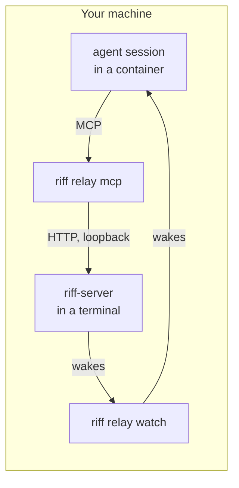

- **`riff-server`** is the central service. It holds the live sessions,
  the threads, the claims and the leads. It runs on your machine, in
  a terminal (see [Start a Riff](start-a-riff.md)). It listens on
  loopback. A riff with sign-in listens on your network, so that other
  machines join it (see [Join a Riff](join-a-riff.md)).
- **`riff relay mcp`** gives a session in a container its tools:
  `whoami`, `who`, `threads`, `read`, `post`, `tell`, `status` and
  `blocked`.
- **`riff relay watch`** writes one line for each message that wakes the
  session. Your agent tool reads the line and wakes the session. See
  [Wake a session](#wake-a-session).

## Find a command

`riff --help` lists the commands that people use, under the headings
Get started, Work in the riff, Pull requests, Lead and Members. Each
command has one short line. `riff help` with a command shows its full
text:

```sh
riff --help
riff help invite
```

`riff-server --help` lists the settings of the server.

## The riff that riff uses

`riff` finds its riff in `--server` or `RIFF_SERVER`. With neither, it
uses the riff of this machine, `http://127.0.0.1:7878`. riff keeps no
choice in a file.

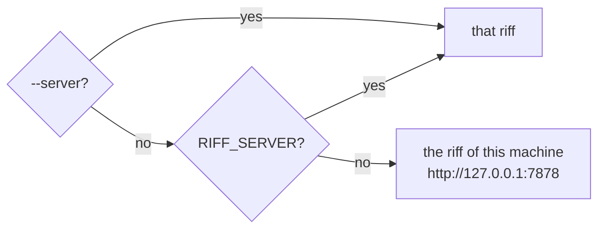

Each value is a URL, `HOST` or `HOST:PORT`. With no scheme, riff uses
`http://`. With no port, it uses port 7878. So `first` is
`http://first:7878`. An IPv6 address takes brackets with a port: `::1`
is `http://[::1]:7878`, and so is `[::1]:7878`. To use another riff, see
[Change to another riff](join-a-riff.md#change-to-another-riff).

### Show the forms of --server

The help of each command gives `--server` one short line.
`riff help server` shows the forms of a value and the default:

```sh
riff help server
```

### Show the riffs

`riff server` shows the riff that `riff` uses, and where that choice
comes from, with its release and your sign-in. It shows one fact on a
line:

```sh
riff server
```

```text
riff        v0.6.0  (75209ac, 2026-09-29)
server      https://riff.example.com  (from RIFF_SERVER)
  release   v0.6.0  same build ✓
  sign-in   yes, signed in as mike@example.com
```

- `local` shows the riff of this machine too, when it answers.
- `answer    none`: the riff does not answer.
- Under the sign-in line, it shows
  [the facts of the server](#see-the-facts-of-the-server).
- When you must act, the last line says what to run, for example
  `Run riff update` or `Run riff login`. It is yellow when the versions
  can talk, and red when they cannot or when you must sign in.
- It says `Run riff update` only when the server is newer than this
  `riff`. When this `riff` is newer, it says
  `Update riff-server when you can.` See
  [When the builds differ](#when-the-builds-differ).

`localhost`, `127.0.0.1` and `[::1]` with the same port are one riff:
the riff of this machine. `riff server` shows it once.

To show the riffs with no color, use `--color never`. A pipe gets no
color either, so a `grep` finds a line:

```sh
riff server --color never
riff server | grep release
```

### See the facts of the server

`riff server` also asks the riff that `riff` uses for its facts. Use
them to see if the server is healthy:

```sh
riff server
```

```text
server      https://riff.example.com  (from RIFF_SERVER)
  release   v0.9.0  same build ✓
  sign-in   yes, signed in as mike@example.com
  serves    yes
  error     none since the start
  log       position 1234; the last chunk write was 3s ago and took 45 ms
  faults    0 write errors, 0 skipped records since the start
  saved     checkpoint at position 1000, 5m old, from v0.9.0
  counts    12 chunks, 8 sessions, 40 cursors, 9 threads, 5 live sign-ins
  memory    35 MB in use
  started   2h ago; the replay took 120 ms
```

| Line | Shows |
|---|---|
| `serves` | `yes`, or `no, it replies 503` and why. A server that does not serve still gives its facts. |
| `error` | The last error of the server since its start, with its age. |
| `log` | The position of the last record, and the time and the duration of the last chunk write. |
| `faults` | The failed tries of a chunk write, and the records of a later build that this build skipped: a record of a kind that this build does not know, or with a value that it does not know. A record of the forge state of 2.0 is dropped, not skipped, so it does not count. |
| `saved` | The newest checkpoint: its position, its age and its release. When this build writes no checkpoint, the line says why. A checkpoint of a later major release is the state of another instance: this build does not use it. |
| `counts` | The chunks in the store, the sessions, the read cursors, the threads, and the live sign-ins. |
| `memory` | The memory that the server uses. |
| `started` | The age of the instance, and how long its load and its replay took. |

- A riff with sign-in gives its facts only to a person who is signed
  in. Else the lines are not there.
- An older `riff-server` has no facts. The lines are not there.

### Name the riff for one command

`--server` names the riff for one command. It wins over
`RIFF_SERVER`:

```sh
riff --server 127.0.0.1:7878 who
```

## Builds

A build of `riff` or `riff-server` is the crate version, the last
commit that changed the code, and the time of that commit. A commit
that changes only the book keeps the build.

The version is a semantic version, `MAJOR.MINOR.PATCH`. It tells which
versions can talk. The line of a version is its major, and its minor
while the major is 0: `0.4.1` is on the line `0.4`, and `1.2.0` is on
the line `1`. A change that another machine or session can notice
starts a new line (see [Versions](#versions)). Most merges keep the
line.

`riff-server` talks with a `riff` of its own line, and of the line
before. So you have one release to update `riff` in. The lines 1 and
3 also talk, in both directions: the bridge. `riff-server` of the
line 3 takes `riff` of the line 1 only from 1.8.2, the first build
that knows the bridge. The line 2 is retired. See
[riff 3.0.0 and the line 1.x](riff-3.md#riff-300-and-the-line-1x).

| riff | riff-server | Result |
|---|---|---|
| 0.4.0 | 0.4.3 | They talk. riff tells you once to update. |
| 0.3.2 | 0.4.0 | They talk. riff tells you to update soon. |
| 0.4.0 | 0.3.2 | riff-server refuses: update riff-server. |
| 0.2.0 | 0.4.0 | riff-server refuses: update riff. |
| 1.8.2 | 3.0.0 | They talk: the bridge. riff tells you to update soon. |
| 3.0.0 | 1.8.2 | They talk: the bridge. riff tells you to update riff-server. |
| 1.8.1 | 3.0.0 | riff-server refuses: update riff. |
| 1.8.2 | 4.0.0 | riff-server refuses: update riff. |

Each call of `riff` names its build, and each reply of `riff-server`
names its own. Each side compares the versions:

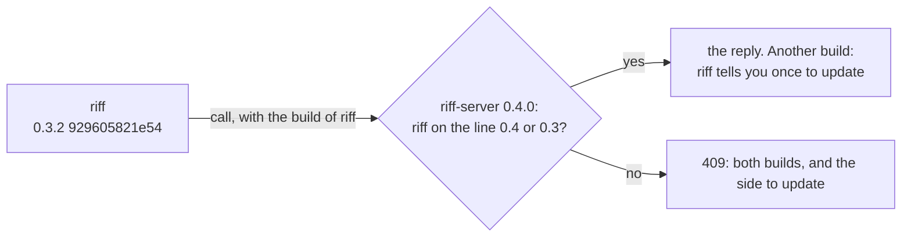

### See the build

```sh
riff --version
riff-server --version
```

`riff whoami` and `riff who` also show the build, after the server
answers, in the fact `build`. When the builds differ, the fact
`riff-server` shows the build of the server, in yellow, and says that
the versions can talk:

```text
build        v0.7.0  (3c7b111, 2026-09-29)
riff-server  v0.7.0  (f45be4d, 2026-09-29)  another build; the versions can talk
```

### When the builds differ

`riff` works. Each `riff` process tells you once which side is older.
`riff server` gives the same advice on its last line. When the server
is newer, the note says to update riff:

```text
riff: riff-server runs build 0.4.3 7213825ab1c2 2026-09-27T20:10:44Z; this riff runs build 0.4.0 929605821e54 2026-09-27T22:03:01Z. Run riff update when you can.
```

When this riff is newer on the same line, for example while a deploy
runs or after a rollback of the server, the server is the older side.
This machine needs no step:

```text
riff: riff-server runs build 0.4.0 7213825ab1c2 2026-09-27T20:10:44Z; this riff runs build 0.4.3 929605821e54 2026-09-27T22:03:01Z. Update riff-server when you can.
```

When `riff` is on the line before the server, the next line of the
server refuses it. The note says so:

```text
riff: riff-server runs build 0.4.0 7213825ab1c2 2026-09-27T20:10:44Z; this riff runs build 0.3.2 929605821e54 2026-09-20T22:03:01Z. riff-server 0.5 will refuse riff 0.3. Run riff update soon.
```

Across the bridge, `riff` of the line 3 talks with `riff-server` of
the line 1, for example after a rollback of the server. Then the
server is the older side too:

```text
riff: riff-server runs build 1.8.2 7213825ab1c2 2026-10-17T20:10:44Z; this riff runs build 3.0.0 929605821e54 2026-10-18T22:03:01Z. Update riff-server when you can.
```

When the note says "Run riff update", update riff on this machine:

```sh
riff update
```

`riff relay watch`, `riff tail`, `riff top` and `riff chat` see the
new `riff` on disk, and run it.
They go on with no restart, in the same repository and worktree. This
is also true when you removed their worktree.

- `riff chat` keeps its lines on the screen, and draws its prompt
  again. Text that you typed but did not send is lost.

### When riff cannot read its directory

A `riff` command in a removed directory fails. The error names the
directory:

```text
Error: riff cannot read its working directory /src/riff/.claude/worktrees/issue-12. Change to a directory that exists
```

Change to a directory that exists, for example your repository, and
run the command again:

```sh
cd ~/src/riff
```

### When the versions do not match

Each `riff` command fails with an error like this one:

```text
riff: this riff (0.2.0 929605821e54 2026-09-27T22:03:01Z) and its riff-server (0.4.0 7213825ab1c2 2026-09-28T20:10:44Z) do not match. riff-server 0.4 talks only with riff 0.4 and 0.3. Update riff on this machine, then start your sessions again. See https://como-technologies.github.io/riff/how-it-works.html#when-the-versions-do-not-match
```

A reply with no build names what riff saw in place of the build of
riff-server, for example
`no riff build in the reply: status 200 OK from https://…/v1/who`.

A new session gets the same error at its start. It tells you, and it
does not use the riff. `riff tail` prints the error
once, try again every 5 seconds, and go on when the versions can
talk.
[`riff server`](#show-the-riffs) shows both builds.

Update the older side:

- **riff** on this machine, and **riff-server** of your own riff: do
  [Update riff](start-a-riff.md#update-riff). When you joined a riff,
  see [Update riff](join-a-riff.md#update-riff) of Join a Riff.
- **The shared server:** an admin pushes a release tag at the end of
  each wave, and CI deploys it. A push to `main` does not deploy it.
  See
  [Deploy the shared server at the end of a
  wave](development.md#deploy-the-shared-server-at-the-end-of-a-wave).

Then start your Claude Code sessions again.

### Releases

`riff update` installs a release, not the newest commit of `main`. A
release is a git tag `vX.Y.Z` of the repository (see
[Make a release](development.md#make-a-release)). It picks the release
this way:

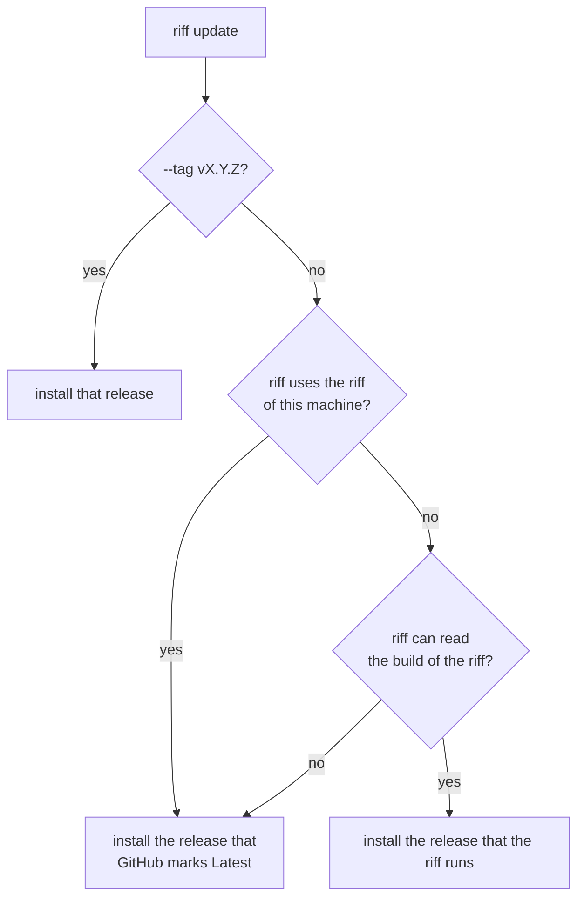

So a new tag does not break your machine before the shared server
runs it. `riff server` shows the release of `riff` and of each riff.

When the riff names no release, `riff update` installs the release
that GitHub marks "Latest": the release of the line that the shared
riff runs. It is not always the highest tag: GitHub never marks a
prerelease Latest, for example `v2.0.1` of the retired line 2.x. The
releases of the retired line 1.x are normal releases, older than the
Latest. See the Latest release:

```sh
gh release view --repo como-technologies/riff
```

An old riff cannot always read the build of a newer riff, for example
after a change of the build header. Then `riff update` installs the
Latest release and prints this line:

```text
riff cannot read the build of the riff at https://riff.example.com, so riff installs the Latest release, v0.3.0.
```

### Install one release

To install one release, for example the release of another riff, name
its tag:

```sh
riff update --tag v0.2.0
```

### See what changed in a release

The GitHub releases are the changelog of riff. The notes of a release
give its level, the command that each person runs, and each pull
request that the release adds. The pull requests come in three groups:
`Changes` for people first, then `Design` (design pages), then
`Internal` (tests and checks only). List the releases, and read one:

```sh
gh release list --repo como-technologies/riff
gh release view v0.4.0 --repo como-technologies/riff
```

### Update riff by itself

A machine can update riff by itself. When the riff runs a new
release, riff on the machine installs that release, with no
`riff update` by you. Turn it on for this machine:

```sh
riff update --auto on
```

Turn it off:

```sh
riff update --auto off
```

See the setting:

```sh
riff update --auto
```

```text
update.auto  true  (/home/mike/.config/riff/config.toml)
Turn it off with: riff update --auto off
```

The setting is the key `update.auto` in
`~/.config/riff/config.toml` (`$XDG_CONFIG_HOME/riff/config.toml`).
It is off by default.

Each reply of the riff names its release. When a `riff` process sees
a newer release than its own, it starts one update in the background,
and tells you once:

```text
riff: riff-server runs the release v0.4.0. riff installs it now, in the background (update.auto).
```

The update goes this way:

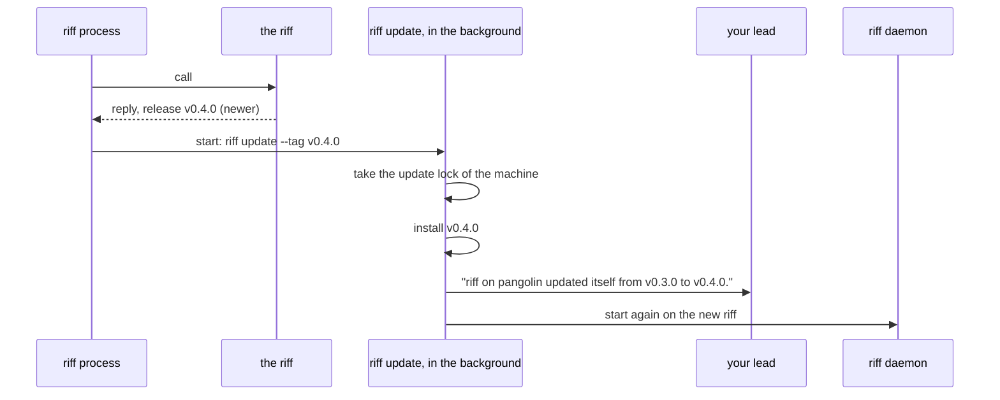

- One update runs at a time on the machine. Each release gets one
  try.
- Each riff process starts again on the new `riff` when it is idle.
  See [Which processes start again](#which-processes-start-again).
- The riff daemon of the release does each step of `riff init` that
  needs no person. See
  [Each step of an update](#each-step-of-an-update).
- The update stops no session, and a running test goes on. Your
  sign-in and the device key stay.
- Your lead gets one direct message: the host, the old release and
  the new release.
- A failed update keeps the old `riff`. The message to your lead holds
  the error. riff tries again at the next release. To try again now,
  run `riff update --tag` with the release.
- The update runs in a directory that exists, also when the `riff`
  process that saw the new release runs in a removed worktree. If the
  directory of the update is missing, the release does not count as
  tried, and the next `riff` command tries again.
- riff never installs an older release by itself.
- An older riff updates itself with cargo. So after the update, your
  riff can be a build of the new release that is not static, and the
  riff daemon starts no session with it. When the riff of the bin
  folder of cargo (`~/.cargo/bin`) sees the riff run its own release,
  and it or `riff-server` there is not static, it installs its own
  release again in the background. `riff update` then puts the static
  files of the release in place. This fix gets one try for each
  release. Your lead gets one message:

  ```text
  riff on pangolin put the static riff and riff-server of v1.4.1 in place of a build that is not static.
  ```

The output of the update is in `update.log`, in
[the local folder](#the-local-folder) of riff.

#### Which process tells your lead

The first riff process on the machine that sees the new release
starts the update. That update, `riff update --background`, tells
your lead once in each repository of the message:

| The process that starts the update | The repository of the message |
|---|---|
| A session, or a `riff` command in a clone | The repository of the session or the clone |
| The riff daemon | Each repository whose wave the daemon runs on the same riff (`riff wave run` or `riff daemon host` in its main clone; a daemon start serves the waves it already runs) |

The riff daemon has no repository of its own. Its working folder can
be in the work tree of another repository, for example a home folder
that is a dotfiles repository. The daemon does not use that
repository. When the daemon serves no repository, the update tells no
lead, and `update.log` says why.

The update tells your lead first. Then it starts the daemon again on
the new riff. The daemon does not start again while the update runs:
a new start of the daemon stops the update that the daemon started.
When the message to your lead fails, `update.log` says why, in the
line `riff: cannot tell the lead`.

#### Each step of an update

`riff init` does more than the binary: it installs the unit of the riff
daemon, and pulls the session image. A release can change each of
them. Your yes to the update by itself is your yes to each step. So the
riff daemon of the new release does each step that needs no person, at
its start:

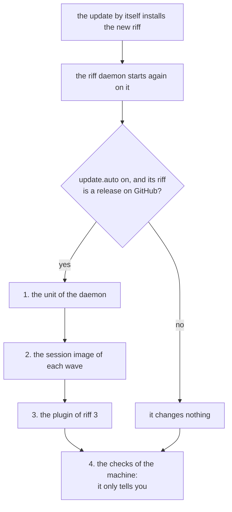

| Step | In step when | The riff daemon |
|---|---|---|
| 1. The unit of the daemon | `riff.service` is the text that the new riff writes for it, with your riff and your variables | writes it again, and starts again on it when it runs no session |
| 2. The session image of each wave | podman has the merged pin: the image that `riff.toml` on the default branch of `origin` pins (see [Only a merged pin counts](development.md#only-a-merged-pin-counts)) | pulls it |
| 3. The plugin of riff 3 | nothing of it is left: see [Remove the plugin of riff 3](start-a-riff.md#remove-the-plugin-of-riff-3) | removes it |
| 4. The checks of the machine: podman, the init of podman, `/etc/subuid`, `/etc/subgid`, cgroup v2 | the check of `riff init` passes | never changes them: the fix needs you, for example with `sudo` |

- Only a release does a step: a `riff` whose SHA-256 is in
  `SHA256SUMS` of the GitHub release of its version. A check build or
  a dev build changes nothing. With `RIFF_RELEASES` set, the daemon
  changes nothing.
- The daemon logs one line for its gate and one line for each step.
  See them with `journalctl --user -u riff.service`.
- A step that needs you shows in the log, with its fix.

The update and the daemon say what they did in their logs:

- `update.log` holds the output of the update by itself. Its last
  lines after an update:

  ```text
  riff downloads the static riff and riff-server of v1.7.0 (x86_64-unknown-linux-musl) into /home/mike/.cargo/bin.
  riff: riff on pangolin updated itself from v1.6.0 to v1.7.0.
  ```

  The update shows no note that `riff-server` runs another
  build: the update installed that build.
- The log of the riff daemon has one line when the daemon starts again
  on a new riff:

  ```text
  riff daemon: a new riff is on disk, and no session runs. The daemon starts again on it.
  ```

  The new start stops the old daemon and its `systemctl`. That is no
  failure, so the log has no other line for it. Only a failed ask to
  systemd logs `cannot start again on the new riff`, with the error and
  the fix `riff daemon install`.

#### See each step of an update

See each step on this machine, in step or not, with its fix. The
command changes nothing:

```sh
riff update --check
```

```text
update.auto is on, and this riff is the release v1.6.0: at its next start, the riff daemon does each step that is not in step and needs no person
in step  the riff binary: it is the release v1.6.0
not in step  the unit of the daemon: the unit file is not the text that this riff writes for it. Fix: riff daemon install
in step  the session image of como-technologies/riff: ghcr.io/como-technologies/riff-session@sha256:…
in step  the plugin of riff 3: it is not here
in step  podman: podman version 5.7.0
needs you  the init of podman: podman has no init: no catatonit in /usr/local/libexec/podman, /usr/local/lib/podman, /usr/libexec/podman, /usr/lib/podman, so no session can start. Fix: install catatonit, the init of podman, for example: sudo apt install catatonit
in step  /etc/subuid: 65536 IDs for mike
in step  /etc/subgid: 65536 IDs for mike
in step  cgroup v2: user@1000.service has cpu and memory
```

- Each line starts with `in step`, `not in step`, `needs you` or
  `failed`. A line that is not in step names its fix.
- It also shows the image of the repository of the current folder.
- It exits with 1 when a step is not in step.
- After you do the fix of a step that needs you, run it again.

#### Which processes start again

After an update, by you or by itself, each riff process of the
machine starts again on the new `riff`. It does this only when it is
idle, so no work stops:

| Process | What it does | When |
|---|---|---|
| `riff relay watch`, `riff tail`, `riff top` | runs the new `riff` in its place | at once |
| `riff chat` | runs the new `riff` in its place | between two lines |
| The riff daemon | starts again on the `riff` on `PATH`, or on its unit after it wrote the unit again (see [Each step of an update](#each-step-of-an-update)) | when it runs no session and no real-session test, else after its last session |

You still start `riff-server` again yourself. `riff update` tells you
when it runs the old build.

The unit of the riff daemon can run another `riff` than the `riff` on
your `PATH`, for example the build of a check after a release. Then
`riff update` writes the unit again with the `riff` on your `PATH`. It
keeps the variables of the unit:

```sh
riff update
```

```text
riff wrote the unit /home/mike/.config/systemd/user/riff.service again: it ran /home/mike/.cache/riff/check/target/static/release/riff, and runs /home/mike/.cargo/bin/riff now.
The riff daemon runs 2 sessions or jobs. It starts again on the new riff after its last session.
```

When the daemon runs no session, it starts again at once:

```text
The riff daemon runs no session. It starts again on the new riff now.
```

The stop of the daemon stops no container. Still, riff starts the
daemon again only when it owns no session, no start of `riff run`
waits for room, and no job of a wave runs. A start of a wave that waits
for room does not stop it, also with the limit 0: the new daemon waits
for room for the wave again. The daemon looks at the end of each
session and each job, and each minute:

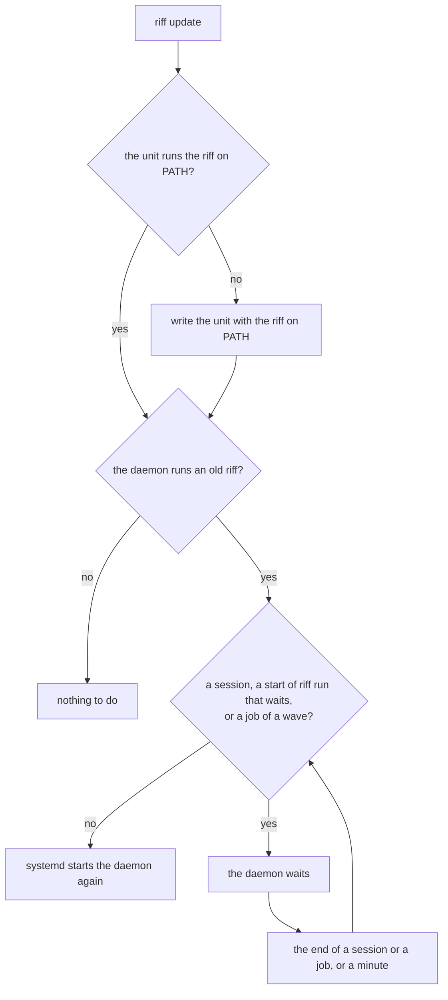

To start the daemon again at once, also with sessions, install it
again. Its sessions go on:

```sh
riff daemon install
```

### A new machine asks about the update by itself

On a machine with no `update.auto` key, for example a new or rebuilt
machine, `riff login` asks you once:

```text
Update riff by itself when the riff gets a new release? [Y/n]
```

Press Enter to turn it on, or type `n` to keep it off. It does not ask
again. With no terminal, for example in a script, it does not ask.
To ask again, remove the key, then run `riff login`.

## Versions

A riff is a contract between machines and between sessions. Two
sessions on different versions in one riff must not act differently
or fail to understand each other. The level of a release tells you
what changed. While riff is `0.x`, the minor has the role of the
major.

### Patch

`0.3.0` to `0.3.1`. Nothing changes that another machine or session
can notice:

- a fix that restores the intended behavior;
- the docs, an output format, the tests;
- words of a requirement that make a rule clearer,
  with no change in behavior.

### Minor

`0.3.x` to `0.4.0`. A change that another machine or session can
notice:

- the wire: a route or a field that a client needs, a removed one, or
  a new meaning;
- the saved state of `riff-server`;
- the names and arguments of
  the riff tools;
- the behavior: a change of a requirement that changes
  what a session does, for example the pull request flow, the verify,
  the claims, the waves or the pause.

`riff-server` still talks with a `riff` of the line before its own
(see [Builds](#builds)), so a wire change stays additive for one
line. The lines 1 and 3 also talk, in both directions, because the
line 2 is retired: the wire of 3.0.0 is the wire of 1.8. Riff does
not bridge a difference in behavior: the version note tells the older
session to update.

### Major

`1.0.0` promises that the wire and the behavior stay stable. After
it, a major breaks, a minor adds and a patch fixes. A change of
behavior that can break a pipeline or a policy is a major. The line
1.x takes no major: see [Make a release](development.md#make-a-release).
1.8.x is the last minor release of 1.x. The next major is 3.0.0: see
[riff 3.0.0 and the line 1.x](riff-3.md#riff-300-and-the-line-1x).

### The test for each release

Ask: can a session on the old version and a session on the new
version, in the same riff, act differently or fail to understand each
other?

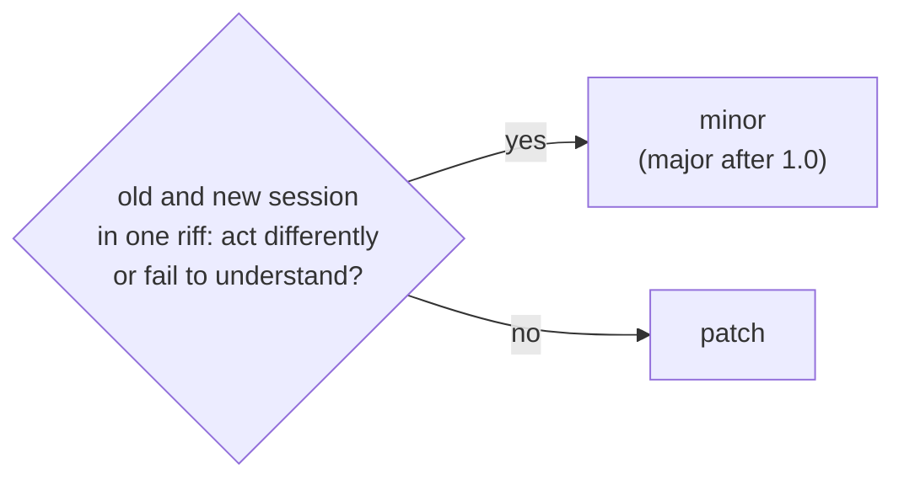

A wave release is a patch unless the wave has a minor change.

## Sign-in

```mermaid
sequenceDiagram
    participant C as riff login
    participant G as Google
    participant E as riff-server
    C->>G: open browser, sign in
    G-->>C: Google ID token
    C->>E: Google ID token + device public key
    E->>E: check signature; owner, admin, member or allowed domain
    E-->>C: riff tokens, bound to the device key
    Note over C: tokens and key go to the OS keyring
```

Each agent session then gets its own short-lived token from `riff`.
The token acts only as that session. `riff` keeps it in memory, not
in the keyring.

A session token has no refresh token. Each `riff` process of a session
swaps the person token for a session token of its own: `riff relay mcp`,
`riff relay watch` and each `riff` command. A
new session token ends no other token. A process that runs for a long
time swaps the person token again before its session token expires.

`riff-server` keeps each sign-in, and the hash of each live token, in
the object `signins.json`. A swap is a change of it too.
[A restart with a bucket](#a-restart-with-a-bucket) says when the
server writes the object, and which reply waits for the write.

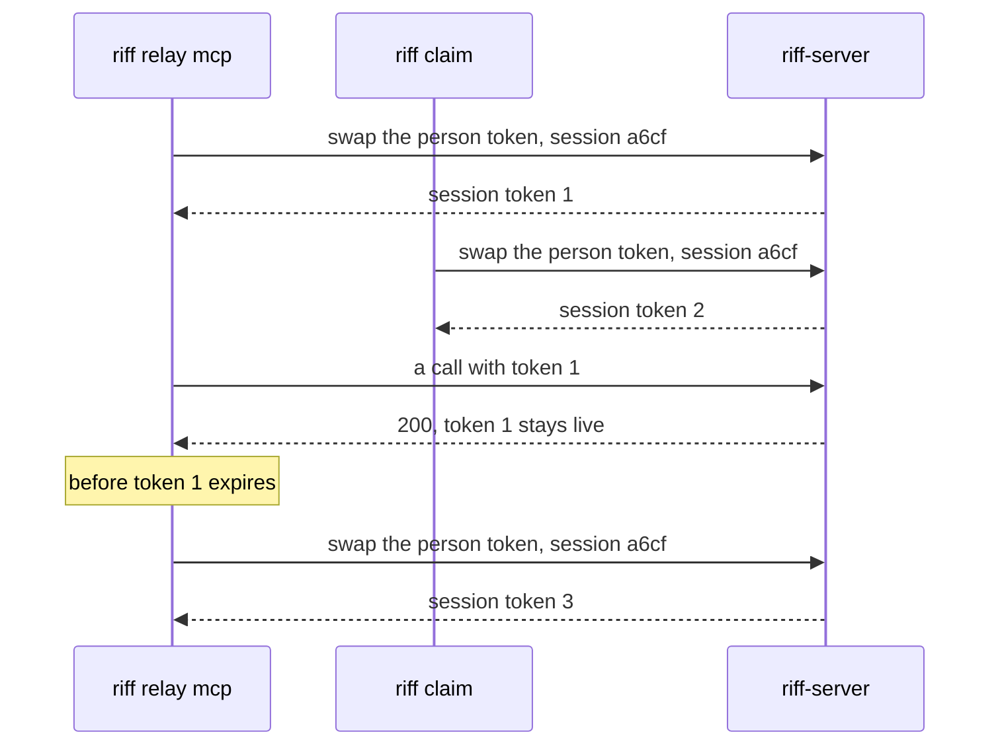

A refresh token works once. It names its chain and its generation:
`chain.generation.secret`. A sign-in has one chain, for the person.
Each refresh gives the next generation of the chain. `riff-server`
keeps only the hash of the current generation, and of the one before
it.

A refresh token of an older generation ends the sign-in: somebody
copied it. A lost reply is not a copy. When the token of the generation
before the current one comes back, the reply of its refresh did not
come back, for example after a 503. `riff-server` then gives a new
pair, and the sign-in stays. Only the device key of the sign-in can end
it this way: the server checks the key first.

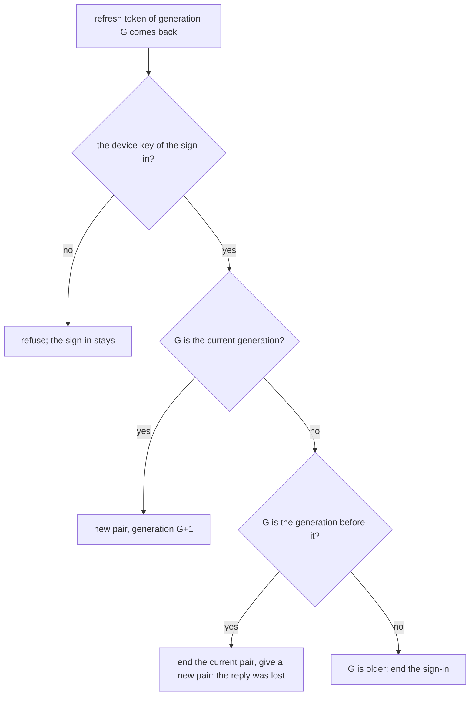

### Get back into the riff

`riff relay watch`, `riff tail` and each tool of `riff relay mcp` show
the error of a lost sign-in. Find it in this table, and do the step.

| Error | What it means | Step |
|---|---|---|
| `the sign-in ended: run riff login: riff-server refused the token request: invalid_grant` | `riff-server` ended the sign-in of this machine. | Run `riff login`. |
| `the sign-in ended: run riff login` | The sign-in of this machine ended before. `riff` sends no token request. | Run `riff login`. |
| `no sign-in for URL: run riff login` | This machine has no sign-in at the riff. | Run `riff login`. |
| `This riff is new. Run riff login.` | The riff restarted with no bucket. | Run `riff login`, then start your sessions again. See [A restart](#after-a-restart-with-no-bucket-run-riff-login). |
| `this riff (…) and its riff-server (…) do not match` | The versions do not match. | See [When the versions do not match](#when-the-versions-do-not-match). |

Sign in again on the machine:

```sh
riff login
```

`riff login` works also when the versions do not match. After it,
each session of the machine goes on by itself: a running
`riff relay watch`, `riff tail` and `riff relay mcp` need no restart. A
watch says once that the sign-in ended, and tries again every 5 seconds.

`riff` asks `riff-server` one time only with a sign-in that ended. It
keeps on the machine that the sign-in ended. Until `riff login`, each
`riff` command says so and sends no token request.

## A session URI

```text
riff://mike@pangolin/como-technologies/riff?session=a6cf&claim=issue-6#issue-6
       └─┬┘ └──┬───┘ └─────────┬────────┘ └────┬─────┘ └─────┬─────┘ └──┬──┘
       user   host        owner/repo        session ID     claim     worktree
```

The URI shows three things:

- **Who:** the user and the session ID of the agent tool. They never
  change. A resumed session keeps its ID.
- **Where:** the host, the repository and the worktree. They change when
  the session moves.
- **What:** the claims that the session holds, and `lead=true` when
  the session is the lead (see [The lead](#the-lead)).

Short form, for people: `mike@pangolin:riff#issue-6`. It is not unique.

### See your URI

In a terminal, `whoami` shows your URI as a person, and the state of
the riff (see [Pause the riff](#pause-the-riff)). In Claude Code, type
it in the prompt with `!` in front to see the URI of the session. The
URI comes from `riff-server`, with your claims and `lead=true`. The
`move` tool shows the same URI. A post from a terminal names the host
where you ran the command.

```sh
riff whoami
```

```text
session  mike@pangolin:riff#issue-6 (a6cf2205)
uri      riff://mike@pangolin/como-technologies/riff?session=a6cf2205-…&claim=issue-6#issue-6
riff     running
build    v0.7.0  (f45be4d, 2026-09-29)
```

The lead runs it in its container too. The riff daemon of the host
reads riff-server for the session, and `whoami` shows the URI that
riff-server holds.

## See who is in the riff

```sh
riff who
```

The first lines are facts: the state of the riff, the owner, and the
build. The owner is `none` when the riff has no owner. A riff with no
sign-in shows no owner. Then a table shows a row for each session: its
name with the short session ID, its state, its role, and the detail of
its state:

```text
riff   running
owner  mike (mike@comotechnologies.io)
build  v0.7.0  (f45be4d, 2026-09-29)

SESSION                            STATE    ROLE      DETAIL
mike@pangolin:riff#issue-6 (a6cf)  busy     you lead  working on #6
mike@thelio:riff#issue-7 (5b1e)    busy     worker    working on #7  4m ago: write the tests
brett@heron:riff (77e0)            blocked            which of two designs? (1m ago)
```

`riff who` works in the container of the lead too, and in the container
of a worker: the riff daemon of the host reads riff-server for the
session.

`you` marks your own row. A tag shows the role of a session:

- `lead`: the lead of its user in the repository (see
  [The lead](#the-lead)).
- `worker`: a session that registered as a worker. It tells the server,
  so each machine shows the same tag.
- `container`: a session that the riff daemon runs in a container,
  for example for `riff run` or `riff wave run`. It has no watch.
  The daemon keeps it alive, so it shows its state, not `offline`.
  When its container stops, it is gone. The daemon gives it its item,
  so it takes no request from the lead. The lead in a container has
  `lead container`.
- `daemon`: the session of the riff daemon on a machine, after
  `riff daemon host` or `riff wave run`. It runs the sessions in
  containers. Its status starts with `daemon host:`. It takes no
  claims, so when it is idle it shows `hosts containers`, not
  `ready for work`.

The row of a daemon on thelio:

```text
SESSION                      STATE  ROLE    DETAIL
mike@thelio:riff (002d404c)  idle   daemon  hosts containers for 2h  25s ago: daemon host: pid 249637, build 3.2.0, 0 sessions
```

The owner is a person, not a session. So no session has the tag
`owner`. Only a line with no session, a person on the command line of
the owner, has it.

STATE is the state of the session, and DETAIL tells more about it. See
[The state of a session](#the-state-of-a-session). `riff top`
and the `who` tool use the same words.

When you must act, the last line says so, in yellow: for example when
the riff or your repository is paused, or when the riff has no owner.

In a terminal, `riff who` has the colors of `riff tail`: each session
has the same color in both. `running` is green and `paused` is yellow.
A blocked status is red. The `who` tool of a session stays plain.

### See the facts of each host

The riff daemon of each host sends the facts of its host to the riff
server each 30 seconds. It does so after `riff daemon host` or
`riff wave run` in the main clone on that host. `riff who` shows them
in its last part, `Hosts`. `riff top` shows them under the row of the
host. The `who` tool of a session shows the same part, so the lead sees
the facts in its session:

```sh
riff who
riff top --host thelio
```

```text
Hosts:
mike@thelio (12s ago)
  daemon 3.1.0 d2ae080  sessions 1/4  floor 8GB
  load 1.5/32 threads  100GB avail  disk 300GB free (75%)  podman 5.2.1  image here
  riff on  gh on  claude 1h30m left
  wave como-technologies/riff: started issue-12
  riff-issue-12-1a2b3c4d  issue-12  works  > Bash: just check
  waits: riff-issue-13-2b3c4d5e
```

- The first line: the riff build of the daemon, the live sessions
  against the limit, and the floor of free memory.
- The second line: the 1-minute load against the hardware threads, the
  free memory, the disk of the session folders, the version of podman,
  and the session image of the repository. The hardware threads are
  the logical CPUs: thelio has 16 cores with 2 threads each, so 32.
  The load is yellow when it is more than the threads.
- The third line: the sign-ins on the host. `claude` shows the time
  left. riff and `gh` show `on` or `off`. `?` means that riff cannot
  read it.
- Then the state of each wave, each live session with its item, phase
  and last step, and the starts that wait for room.

A fact in yellow needs the person: no podman, no session image, a
sign-in that is off or has less than 2 hours left, low memory or a
full disk. A host whose daemon sent no facts for 3 minutes shows
none.

The daemon also posts a note to the lead:

- one note when the sign-in of `claude` on the host has less than 2
  hours left, with the step for the person, and one note when it is
  back;
- one note when it keeps the folder of a session whose work is over,
  because its clone has work that is not on `origin`.

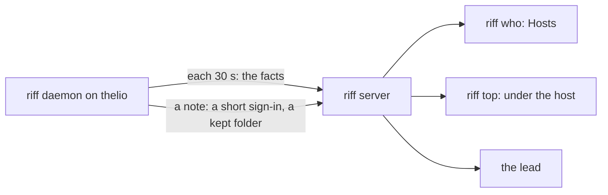

### Show the URI of each session

The table shows a short name. To see the full URI of each session in
its place, use `--long`:

```sh
riff who --long
```

### List the sessions without color

Color goes only to a terminal. `--color never` turns it off also in a
terminal. `NO_COLOR=1` does the same. `--color always` keeps the color
in a pipe. `--color` works the same on each `riff` command:

```sh
riff who --color never
riff who > sessions.txt
riff who --color always | less -R
```

`who` does not list a gone session. A session is gone when it ended, or
when it stopped for 3 minutes. To list gone sessions too:

```sh
riff who --all
```

## See what each session does

`riff top` shows a live table of each person and each session. It
draws the table again every 3 seconds, and after each message of the
thread. Ctrl-C stops it:

```sh
riff top
```

A later release merges `riff top` and `riff view` into one sessions
view in each UI: see [Design: the UIs of riff](riff-uis.md).

The header shows the state of the riff, the owner and the build, as in
`riff who`. A board comes next for each repository with a live
session, and for the repository where you run `riff top`: the current
wave with its repository, one line for the `free` items, one for the
`held` items, one for the `claimed` items, one for the items in
`verify`, and one for the `stuck` items. An item is in `verify` when a
session verifies it, and when no session holds it and its pull request
waits for a verify or for the merge. An item is in `stuck` when no
session holds it and its pull request cannot merge by itself: a
conflict, a failed check, or auto-merge off (see
[See a pull request that cannot merge](development.md#see-a-pull-request-that-cannot-merge)).
An item is in `held` when the lead holds it and no session
claims it: the reason of the hold follows its items. No worker and no
wave takes a held item, so it is never in `free` (see
[Hold an item by hand](#hold-an-item-by-hand)).

Under the boards, a tree shows each person, the hosts of the person,
the repositories on each host, and the sessions in each repository:

```text
riff   running
owner  mike (mike@example.com)
build  v1.0.0  (10df8a4, 2026-10-04)

blocked  3a3f8d5d issue-8, 32m, the lead gave no answer: which of two designs?

Wave 3 (como-technologies/riff)
  free: #10
  held: #11 #12 (VmLck reading at 19:40 UTC)
  claimed: #7 #8 #9

Wave 5 (como-technologies/strata)
  claimed: #88

ann  admin  offline  seen 1h ago
brett  online  › kadomony  › strata  1 session: 1 worker; 1 busy, 1 claim
└─ 7a8b9c0d  #issue-88  worker  busy
     working on #88 Split the store
mike  owner  online  7 sessions: 2 busy, 3 idle, 1 blocked, 3 claims
├─ pangolin  › riff  2 sessions: 1 container, 1 worker; 2 busy, 2 claims
│  ├─ 5b1e2a90  #issue-7  worker  busy
│  │    working on #7 Fix the help
│  │    runs Bash: run just ci for 12m
│  │    20m ago: tests
│  └─ 9c0d1e2f  #issue-9  container  busy
│       working on #9 Mark the hosts
└─ thelio  4 sessions: 2 leads; 1 to update; 3 idle, 1 blocked, 1 claim
   ├─ riff  4 sessions: 2 idle, 1 blocked, 1 claim
   │  ├─ 3a3f8d5d  #issue-8  blocked
   │  │    which of two designs? (32m ago)
   │  │    the lead gave no answer
   │  │    working on #8 Show the plan
   │  ├─ 4e54d4e5  ↑  lead  idle
   │  │    monitoring work for 2h
   │  │    5m ago: plan the next wave
   │  └─ 8f1c2d3e  offline
   │       seen 4m ago
   └─ strata  1 session: 1 idle
      └─ 6d2b7c1a  lead  idle
           monitoring work for 1h
```

- When the riff or the repository is paused, nobody can claim its
  items. Then the wave line of the board ends with `paused`, and the
  board has no `free` line, for example
  `Wave 9: Cleanup 2 (como-technologies/strata)  paused`.
- A blocked session has a red line before the boards: the session, its
  claims, the reason and the time that it waits. When the lead gave no
  answer, the line says so. See [A blocked session](#a-blocked-session).
- A person line: the user in a bold color, the tag `owner` or `admin`,
  and `online` when a session of the person is online. Else `offline`,
  with the time since the last call. Each member of the riff has a
  line, also when away.
- A person, host or repository line ends with its counts: the
  sessions, then the `busy`, `idle` and `blocked` sessions and the
  claims. A count of 0 is not shown.
- A host line also counts each kind of session, before the states:
  `leads`, `containers`, `workers` and `daemons`. A session
  counts once, as the first kind that matches. A session with none of
  these tags has no kind. In the example, thelio has 4 sessions: 2
  leads, and 2 sessions with no kind. After the kinds, a host
  line counts the sessions that run an old riff: `1 to update`. See
  [Update a session that runs an old
  riff](#update-a-session-that-runs-an-old-riff).
- A line with only one line under it takes that line, after a `›`. In
  the example, brett has one host and one repository, so the person,
  the host and the repository are on one line. So a small riff stays
  short.
- A repository line has the short name of the repository. When the
  repositories have more than one owner, it has the owner too:
  `como-technologies/riff`.
- A session: the first line has the short session ID, the mark `↑`
  when the session runs an old riff, the worktree of
  the session (`#issue-7` in the worktree `issue-7`, nothing in the
  main worktree), its tags (`lead`, `worker`, `container` or
  `daemon`), and the state of the session in its color. Under it comes
  one line for each fact of the detail of the state. See
  [The state of a session](#the-state-of-a-session). A lead is the
  lead of the repository on the line above it.

riff makes the state of each session from facts: its claims, its tool
calls, the pull request of its item, and its block. No session types
its state. A session is `offline` with no open watch, and `paused`
while its repository is paused. Else it moves between these states:

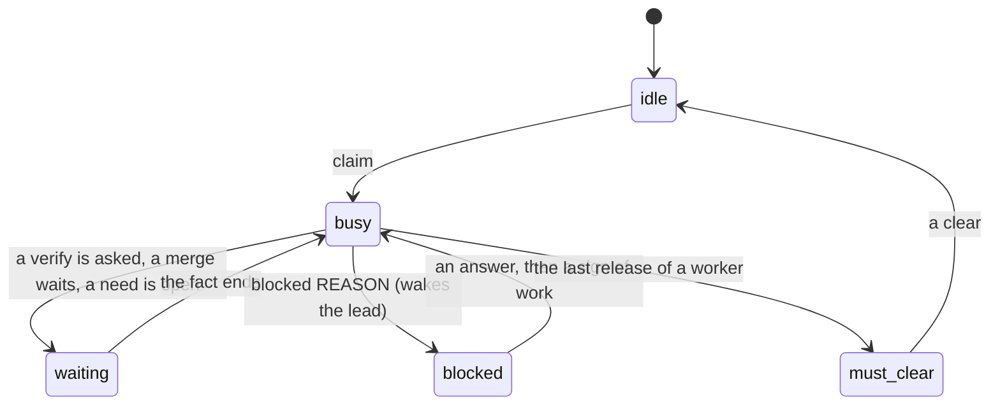

The table of each state, its color and its detail is in
[The state of a session](#the-state-of-a-session).

- Each board has the issues of its own repository, and a session shows
  the title of an issue of its own repository. riff reads them with
  `gh` each minute, for each repository with a live session. A
  repository that `gh` cannot read has no board and no titles, and
  no error line.

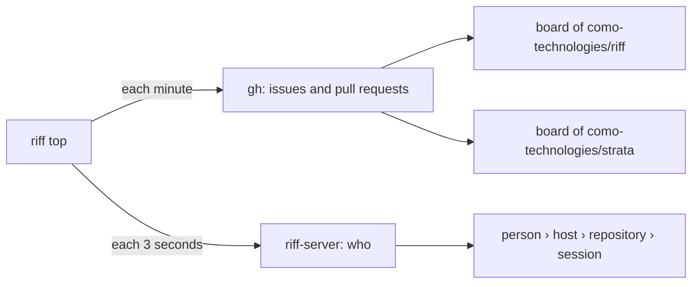

The tree grows down, not across. No line is wider than your terminal,
or 80 columns in a pipe. riff cuts a longer line with `…`.

The tags mean the same as in [`riff who`](#see-who-is-in-the-riff).
People are in the order of user, hosts in the order of name, and
repositories in the order of `OWNER/REPO`. In a repository, a blocked
session comes first. With no `gh`, the tree shows no titles and no
board.

`riff top` only reads. It posts nothing and wakes no session.

### Update a session that runs an old riff

A session can run an old riff after an update. Then `riff top` puts
the mark `↑`, in yellow, after the short ID of the session, and the
line of its host counts it:

```text
└─ thelio  4 sessions: 2 leads; 1 to update; 3 idle, 1 blocked, 1 claim
   ├─ riff  4 sessions: 2 idle, 1 blocked, 1 claim
   │  ├─ 4e54d4e5  ↑  lead  idle
```

The mark shows one of two facts:

- The build of the riff of the session is older than the build of the
  server: a lower version, or the same version from an older commit.
- The file of the riff of the session was replaced, for example by
  `riff update`, and the session still runs the old file.

The process that lives as long as the session tells the server its
riff in each keep-alive: `riff relay mcp` for a session, the
riff daemon for the daemon. A session of a riff from
before the mark tells no riff, so it gets no mark.

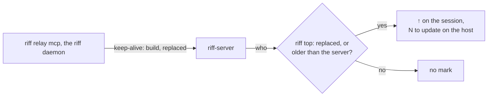

First, update riff on the machine of the session:

```sh
riff update
```

Each riff process then starts again on the new riff when it is idle.
See [Which processes start again](#which-processes-start-again) and
[When the builds differ](#when-the-builds-differ). The mark goes in a
minute. A session in a container keeps the mark until the riff daemon
starts again, after its last session. When the mark stays, do the
step for the session: install the riff daemon again. It starts again
on the new riff at once:

```sh
riff daemon install
```

### When riff cannot reach the server

A laptop sleeps, or the Wi-Fi drops. `riff top` stays open. It keeps
the last table, and its first line is red:

```text
riff: no good look since 21:35:07: riff-server gave no reply in 60 seconds
```

The line has the time of the last good look, then the fault. The fault
can be another text, for example `cannot reach riff-server`. Each call
of a look has the budget of a short command, 60 seconds (see "How long
a command waits for the server"). So the line comes about 63 seconds
after the fault starts.

The table under the line is old. It keeps its titles and its board,
also when `gh` fails too. `riff top` looks again every 3 seconds. You
do nothing: when the server is back, the line goes and the table is
new.

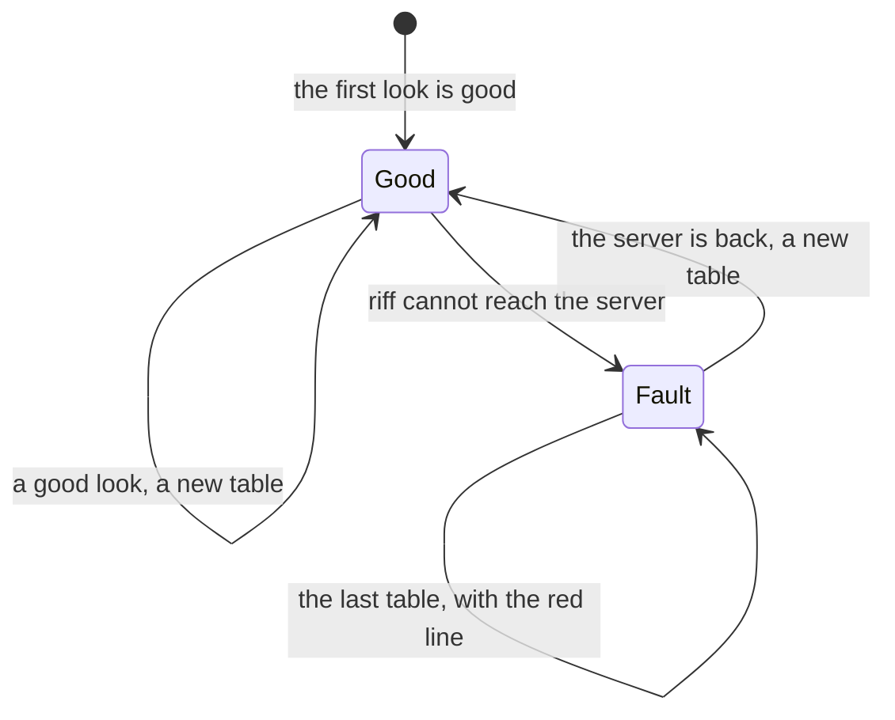

`riff top` still ends with the error in these cases:

- The first look fails. Check the server, then start `riff top` again.
- A new try cannot repair the fault, for example when your sign-in
  ended. Do what the error says.
- You ran `riff top --once`.

### Print the table once

To print one table and exit, for example in a pipe:

```sh
riff top --once
riff top --once --color never > sessions.txt
```

`--color` works the same as in `riff who`.

### Show the sessions of one person

```sh
riff top --user brett
```

The tree shows only the sessions of that user. The boards are those of
the repositories of these sessions.

### Show the sessions on one host

```sh
riff top --host pangolin
```

### Show the sessions in one repository

```sh
riff top --repo como-technologies/strata
```

Give the repository as `OWNER/REPO`. You can use `--user`, `--host` and
`--repo` together. A session shows when it matches each one:

```sh
riff top --user mike --repo como-technologies/strata
```

### Put the repositories at the top of the tree

To see what each repository does across people:

```sh
riff top --by repo
```

The tree then has the levels repository, person, host, session.
`--by person` is the default. `--by` works with the other flags.

## See the refusals of auto mode

The auto mode checker of Claude Code can refuse a tool call. riff
posts each refusal to the thread `denials`, as one note with tags. A
note wakes no session. So you can count the refusals of each session,
host and repository, and find the commands and the permission rules
that cause friction.

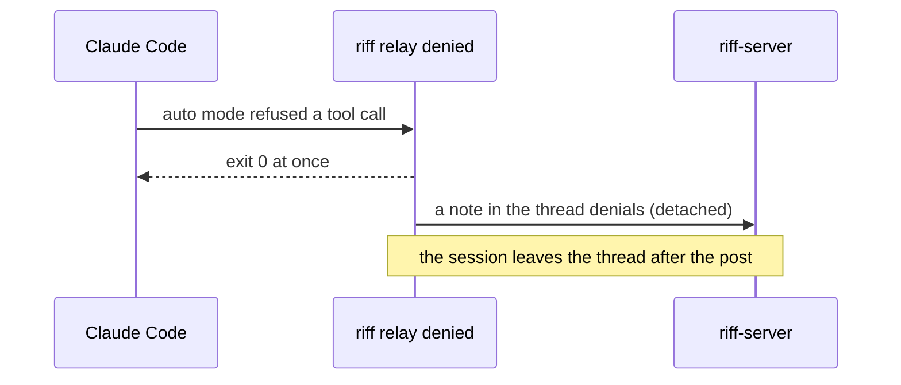

Each session of the riff daemon, the lead too, runs
`/opt/riff/riff relay denied`. The command never waits for
`riff-server`. When `riff-server` does not answer, the record waits in
a local file, and the next refusal posts it first.

One record is one line, the tags first:

```text
denied reason=production-deploy tool=Bash head="git push" role=lead user=mike host=pangolin repo=como-technologies/riff session=25456ff6 claim=-: git push origin v3.2.0
```

| Tag | Value |
|---|---|
| `reason` | The rule of the checker as a slug, `no-verdict`, or `checker-unavailable`. |
| `tool` | The tool. An MCP tool also has `@SERVER`. |
| `head` | For Bash: the first two words of the command. Else the path, or the first field of the input. |
| `role` | `lead`, `worker`, `container` or `session`. A subagent adds `+subagent`. |
| `claim` | The claim of the session, or `-`. |

After the colon comes the command or the input, at most 300
characters. No secret goes to the riff: riff puts `[secret]` in place
of each token of the session.

### Count the refusals

`riff denials` counts the records by reason, by tool and head, by
role and by repository. Then it shows the last 20 records:

```sh
riff denials
```

### Count the refusals of a time

`--since` takes a number and a unit: `s`, `m`, `h`, `d` or `w`:

```sh
riff denials --since 7d
```

### Get the records as JSON

`--format json` prints each record, with its time and its tags:

```sh
riff denials --format json
```

## When a session ends

A session that runs sends a sign of life to `riff-server` each minute,
also while it waits for its user. When the session ends, it tells the
server. It leaves `who` at once. Its claims are free at once, and its
lead does not count while it is gone.

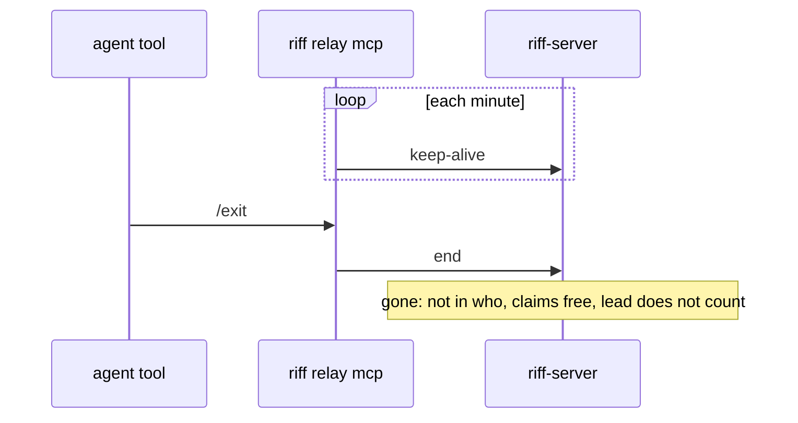

- The time of `offline` (`seen 2h ago`) does not change with a
  keep-alive. It is the time since the last call.
- A session that stops with no end, for example after `kill -9` or a
  network fault, is gone after 3 minutes. Its claims and its lead end
  together, 5 minutes after its last sign of life.
- A sign of life is a call or a keep-alive. `riff relay mcp` and
  `riff relay watch` each send a keep-alive each minute. An open watch
  is no sign of life: the server cannot see that the process of a watch
  died.
- A gone session gets no messages. A `tell` to it fails.
- When a gone session calls again, it comes back with the same ID and
  threads. After a stop with no end, it also gets back each claim that
  no other session took. After an end, it has no claims.
- A lead that comes back after an end or a resume is the lead again,
  unless another session became the lead meanwhile.
  lead.

### Start an item again

Only when the earlier work is wrong, the session starts again. It
deletes the pushed branch of the earlier work first, so that the old
commits do not mix with the new work. For `issue-12`:

```sh
git push origin --delete worktree-issue-12
```

The session says in its start post that it deleted the branch.

### A branch with WIP commits

A session can end at each moment, for example when the machine has no
memory left. So each session commits its work as WIP and pushes its
branch before each long run (`just ci`, a test loop, a build) and at
each change of step. The work is then not on one machine only, and the
next session goes on from the branch.

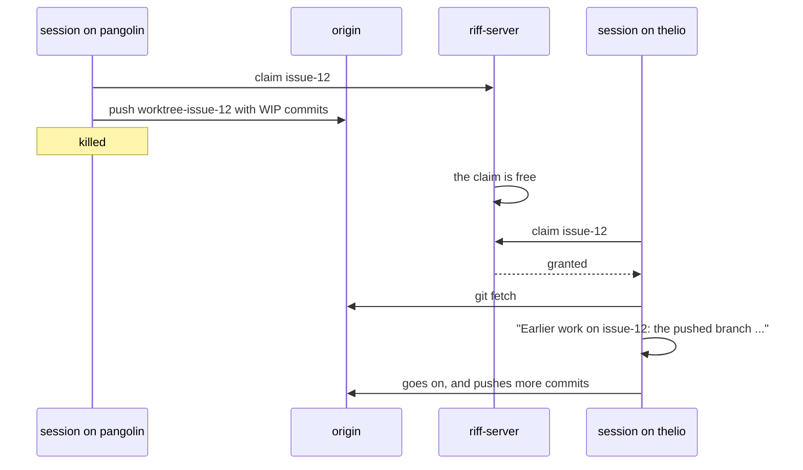

The rule for a person who looks at such a branch:

- A WIP commit has `WIP` in its subject. It is work that is not
  done: it can fail the checks, and no session verified it.
- Do not review a WIP commit, and do not build on it. Look at the pull
  request: the verify result names the commit that passed.
- The pull request merges with a squash. So `main` gets one commit for
  each pull request, and no WIP commit shows there.
- The forge deletes the branch when the pull request merges.

To see the commits of the branch of an item, for `issue-12`:

```sh
git fetch --prune origin
git log --oneline origin/main..origin/worktree-issue-12
```

### See the earlier work on an item

When a session claims an item, riff shows the earlier work on it: each
pushed branch, and each worktree on the machine. You see the same
line when you claim by hand:

```sh
riff claim issue-12
```

```text
You hold issue-12 in como-technologies/riff.
Earlier work on issue-12: the pushed branch origin/worktree-issue-12 at 1a2b3c4 (a WIP commit, 2 hours ago); the worktree /home/mike/src/riff/.claude/worktrees/issue-12 (3 files not committed, 1 commit not pushed). Go on from it, and do not start again: see "Pick up dropped work" in the riff skill.
```

- riff fetches from `origin` first, for at most 5 seconds.
- A worktree can hold files that are not committed. They are the only
  copy. The session commits them as WIP and pushes them before it goes
  on.
- A commit that is not pushed is on no branch of `origin`. After a
  squash merge, the branch is gone, but `main` holds the work. riff
  then counts no commit as not pushed.
- A verify claim gets no such line: a verify worktree holds no work.
- riff lists the earlier work of the clone that no live
  session owns, at most 8 items. So a new session sees it before it
  picks an item.

### Free the claim of another session

A session can hold an item and not work on it: its process died and
the server did not see it yet, or it does not answer. Then no other
session can claim the item. The lead of your user frees the claim for
that session. Find the session ID in `riff who --all`:

```sh
riff who --all
```

Then run this in the lead session, for example `! riff release ...`
in Claude Code. The start of the session ID is enough, from 4
characters:

```sh
riff release issue-12 --session 068a2cc2
```

```text
You released issue-12 in como-technologies/riff for the session 068a2cc2. The item is free.
```

- Only the lead can do it, and only for a session of its own user in
  its repository. riff refuses each other session, and a person in a
  shell.
- The server posts a note in the thread. The note names the lead, the
  item and the session.
- A live session gets a message that wakes it. See
  [When riff ends your claim](#when-riff-ends-your-claim).
- The next session claims the item, and goes on from the pushed
  branch. See
  [See the earlier work on an item](#see-the-earlier-work-on-an-item).

## Join the work

A new session starts in the main worktree. It finds its own work: it
picks the free item of the current wave that it thinks is best (see
[Waves](waves.md)). It does not wait for a plan. A scope from its user
wins.

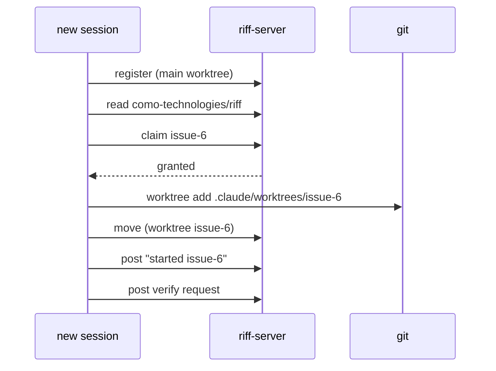

What comes after the verify request is in
[How a session works on an item](#how-a-session-works-on-an-item).

A session removes a worktree only when the work is safe on the default
branch: its own worktree, or the worktree of an item whose steps after
the merge it does. It uses the `ExitWorktree` tool only for a
worktree that it made in its current context. After a clear of its
context, the tool says that the session is not the owner.
Then the session removes the worktree with `git worktree remove`.

## How a session works on an item

One context holds one item. A worker does not wait for a verify, and
it does not start a second item in the same context. So the work of a
worker on an item ends at the verify request. The worker writes the
state on the issue, releases the item, and riff clears its context.
The session that verifies does the steps after the merge.

```mermaid
sequenceDiagram
    participant A as author (worker)
    participant G as GitHub
    participant E as riff-server
    participant V as verifier
    participant N as next session
    A->>E: claim issue-6
    A->>A: the work, the checks
    A->>G: riff pr open: the pull request, auto-merge on
    A->>E: post verify request
    A->>G: comment on issue 6: the state
    A->>E: release issue-6
    Note over A: the turn ends, riff clears the context
    V->>E: claim verify-issue-6
    V->>V: test each criterion
    V->>G: riff verify: the result, riff/verify
    alt pass
        G->>G: squash merge
        V->>E: note "done issue-6"
        V->>V: remove the worktree and the branch of issue-6
        V->>E: release verify-issue-6
    else fail
        V->>E: release verify-issue-6
        Note over E: issue-6 is free, with its branch
        N->>E: claim issue-6
        E-->>N: granted, and the failed verify of PR #40
        N->>N: read the result, go on from the branch
        N->>E: post a new verify request
    end
```

The state on the issue is a comment. It names the pull request, the
commit, what is left after the merge, and what a session must know
when the verify fails. The next session reads it: it has no other
memory of the work.

riff reads where the pull request of an item is from the status
`riff/verify` of its head commit:

| Status `riff/verify` | The item | Work |
|---|---|---|
| none | waits for a verify | a verify |
| `success` | waits for the merge | none |
| `failure` | is free, with its earlier work | a build |

An item counts one time. While its pull request waits for a verify or
for the merge, the item is no free work for a build:
[riff starts the work by itself](#riff-starts-the-work-by-itself)
gives it to no worker and to no wave, and the board of `riff top`
shows it in `verify`.

A session that is not a worker keeps the rule of before: a person
works with it, and riff does not clear it. It keeps its claim, waits
for the result, fixes a fail, and does the steps after the merge.

### See the pull request of an item at a claim

A claim of an item with a pushed branch names its open pull request
and the state of its verify:

```sh
riff claim issue-12
```

```text
You hold issue-12 in como-technologies/riff.
Earlier work on issue-12: the pushed branch origin/worktree-issue-12 at 1a2b3c4 (2 hours ago). Go on from it, and do not start again: see "Pick up dropped work" in the riff skill.
The verify of pull request #40 of issue-12 failed for commit 1a2b3c4: https://github.com/como-technologies/riff/pull/40#issuecomment-7. Read the result, go on from the branch, and send a new verify request: see "Pick up dropped work" in the riff skill.
```

The line says when the item is no work for a build:

```text
Pull request #40 of issue-12 waits for a verify of commit 1a2b3c4. The build is done: do not build it again. Release issue-12. To verify the work, claim verify-issue-12.
```

```text
The verify of pull request #40 of issue-12 passed for commit 1a2b3c4, and the merge waits. The build is done: do not build it again. Release issue-12.
```

riff asks the `gh` of your machine, and waits at most 5 seconds. With
no `gh`, the claim has no such line.

## Acceptance criteria

Each issue has a `Done when:` line. It is the list of acceptance
criteria. Each criterion names what to run or look at, and what the
result must be. A session checks the line before it starts work.

```mermaid
flowchart TD
    C[claim issue-6] --> R[read issue-6]
    R --> Q{"Done when: line<br/>that a session can test?"}
    Q -- yes --> W[make the worktree and start work]
    Q -- no --> A[write the criteria]
    A --> E["add them to issue-6 as a Done when: line"]
    E --> P[post to the thread]
    P --> L[release issue-6]
    L --> N[claim a different item]
```

The session that writes the criteria does not do the work in that
claim. The next session that claims the issue reviews the criteria.

## Verify finished work

A session never verifies its own work. Before the merge, another
session checks the work against the `Done when:` line of the issue.
Only one session verifies: it claims `verify-ITEM`.

No session merges, and no session pushes to `main`. The author opens a
pull request with auto-merge on. The verifier sets the status
`riff/verify` on the commit that it checked. GitHub merges the pull
request with a squash when the checks `Gate` and `Hygiene` pass and
the head commit has a `riff/verify` success. A new commit has no
status, so it needs a new verify.

```mermaid
sequenceDiagram
    participant A as author (issue-6)
    participant E as riff-server
    participant L as lead
    participant V as verifier
    participant G as GitHub
    A->>A: commit, checks pass, push the branch
    A->>G: riff pr open: the pull request, auto-merge on
    A->>E: post to [lead of mike] "verify request: issue-6, PR #40, commit"
    E->>L: wake
    L->>E: tell V "request: claim verify-issue-6"
    E->>V: wake
    V->>E: claim verify-issue-6
    E-->>V: granted
    V->>V: check out the commit, test each criterion
    V->>G: riff verify: comment the result, set riff/verify
    V->>E: riff verify: post to [claim=issue-6] the result
    V->>E: release verify-issue-6
    E->>A: wake
    alt pass
        G->>G: Gate, Hygiene and riff/verify pass: squash merge, delete the branch
        A->>E: note "done issue-6", release issue-6
    else fail or conflict
        A->>A: fix or rebase, push, then send a new request
    end
```

The diagram shows an author that is not a worker: it keeps its claim.
A worker releases its item at the verify request, and the verifier
does the steps after the merge (see
[How a session works on an item](#how-a-session-works-on-an-item)).

Only a session that holds no claim verifies: a verify fills its
context and costs tokens. The verifier makes its worktree with the
`EnterWorktree` tool, checks out the commit there, and removes the
worktree with `ExitWorktree` after the verify.

The verifier changes no code, also not for a moment. A control shows
that a test finds a fault: a test with no fix, or a guard test with a
fault in the code. The verifier runs it at the base commit of the pull
request, then checks out the commit again. When the base commit cannot
show the fault, the verifier uses a test of the guard on a sample, the
control of the author, or a read.

A verify request wakes only the lead of the author's user. The lead
gives it to a session with no claim, or starts a worker for it. The
author never gets the verify, also after a `/clear` (see "No verify for
the author" in
[riff starts the work by itself](#riff-starts-the-work-by-itself)).
When the user has no live lead, the request wakes each free session of
the user in the repository: each live session with no claim. Each other
session sees it at its next read. A verify request is free work: a
session picks it like any other item.

The wave verifies a pull request from a fork too. The head commit of
such a pull request is on a branch of the fork, not on a branch of
`origin`. So the clone of the verify fetches `refs/pull/N/head` from
`origin`, where GitHub keeps the head of each pull request, and checks
out the head commit. It checks out the commit, not the ref: a push to
the pull request after the look does not change what the verify reads.

A criterion that only the shared riff can test is a check after the
release. It does not stop a pass. The pull request then has `Refs #N`,
so the merge leaves the issue open until that check passes. The rules
of GitHub are in
[Merge by pull request on
GitHub](development.md#merge-by-pull-request-on-github).

Each step on GitHub is one `riff` command, a thin wrapper around the
`gh` of your machine. A session runs one command for one step, with no
shell loop.

### Open a pull request

Push the branch first. Then open its pull request:

```sh
riff pr open --title "Show the wave" --file summary.md
```

The issue is the claim `issue-N` of the session. Give `--issue 12`
when the session holds no claim or more than one. The body gets the
link line `Closes #12`, the summary of `summary.md`, and the trailers
of the issue and its wave, in the form of
[Check a pull request on
GitHub](development.md#check-a-pull-request-on-github). The pull request
gets the wave of the issue. Then `riff pr open` turns on auto-merge with
a squash at once. It opens nothing when the pull request breaks a rule
of the hygiene check, for example a title that ends with `(#12)`.
Give `--base release/1.x` to open it against the branch of an older
release line (see [Make a patch of an older
release](development.md#make-a-patch-of-an-older-release)).

`summary.md` can also hold the link line and the trailers. Then
`riff pr open` adds only the lines that are missing. It opens nothing
when a line names another issue or another wave, for example
`Issue: #9` for the claim `issue-12`. The message names the line.

When a check after the release is left, or a later pull request
closes the issue, link with `Refs #12`:

```sh
riff pr open --title "Show the wave" --file summary.md --refs
```

### Wait for the merge

```sh
riff pr wait 40
```

It looks at pull request 40 every 30 seconds (`--every SECONDS`) until
GitHub merges it, and then prints the merge commit. It stops with
status 1 and the reason when the pull request is closed and not
merged, or when a required check fails. A session runs it as a
background task. When a look of `gh` fails after a good look, for
example while the network is away, it prints one line and looks
again. After the merge, it adds the total of the tokens to the issue:
see
[See the tokens of an issue](development.md#see-the-tokens-of-an-issue).

### When a pull request stops

A pull request can stop with no sign. The riff daemon looks at the open
pull requests of each wave that it runs, each minute, and sends a
message in two cases (see [Run the wave](development.md#run-the-wave)):

```mermaid
flowchart TD
    L["the look of the daemon, each minute"] --> C{"auto-merge on, and a conflict?"}
    C -- yes --> H{"a session holds the item?"}
    H -- yes --> M1["message to that session"]
    H -- no --> M2["message to the lead"]
    L --> V{"waits for a verify, and no verify- claim?"}
    V -- "for 30 minutes" --> M3["message to the lead"]
```

- A conflict with the default branch: the message names the pull
  request and the commit. The session that holds the item rebases it
  and pushes. When no session holds it, the lead gives it to a free
  session. The wave of the riff daemon starts a session for it by
  itself (see [Run the wave](development.md#run-the-wave)).
- A verify that no session claims for 30 minutes: the lead gives the
  verify to a free session, or starts a worker.

Each message comes one time for each pull request, head commit and
state. A new push that has a conflict again gives a new message. After a
new start of the daemon, a message can come one more time. To fix
a conflict, rebase in the worktree of the item, and push:

```sh
git fetch -q origin
git rebase origin/main
git push --force-with-lease --force-if-includes
```

Then send a new verify request for the new commit.

### When main breaks

A pull request merges when the Gate of its own head passed, also when
`main` moved after that. So two pull requests that each pass their
Gate can break `main` together. Then the Gate of each later pull
request fails too. The riff daemon looks at the Gate of the head of
`main` of each wave that it runs, each minute (see
[Run the wave](development.md#run-the-wave)):

```mermaid
flowchart TD
    L["the look of the daemon, each minute"] --> G{"the Gate of the head of main"}
    G -- "failed, a new commit" --> F["riff files the fix item,<br/>or comments on the open one"]
    F --> M["message to the lead: commit, run,<br/>failed jobs, fix item"]
    M --> W["the rollout gives the fix item<br/>to a worker before each other item"]
    G -- passed --> C["riff closes each fix item that no session<br/>claims and no pull request names"]
    C --> N["note to the lead"]
```

- **The message.** The lead gets one message when `main` breaks: the
  commit, the run, the failed jobs and the fix item. While `main` stays
  broken, a failed Gate at a newer commit gives a note, and a comment
  on the fix item.
- **The fix item.** An issue with the label `broken-main` in the
  current wave. riff files one only when no issue with the label is
  open. The rollout gives it to a worker before each other item, also
  before a verify, and the wave of the daemon takes it first too (see
  [riff starts the work by itself](#riff-starts-the-work-by-itself)).
  You can file a fix item by hand: give it the label `broken-main`.
- **When main passes again.** riff closes each fix item that no session
  claims and that no open pull request names. The lead gets a note.

To see the Gate of the head of `main`:

```sh
gh api "repos/OWNER/REPO/commits/main/check-runs?check_name=Gate" \
  --jq '.check_runs[] | .head_sha, .conclusion, .html_url'
```

To see the open fix item:

```sh
gh issue list --label broken-main
```

#### When a pull request already has the fix

Hold the fix item, so that no worker writes the fix a second time.
When the Gate of `main` passes, riff closes the item:

```sh
riff plan hold issue-901 the fix is in PR 863
```

#### When a test fails only some of the time

Run the failed jobs of the run again. When they pass, the Gate of
`main` passes, and riff closes the fix item. RUN is the number of the
run in the message:

```sh
gh run rerun RUN --failed
```

### Report a verify

The Gate on GitHub is the one full test run of each commit. A verifier
does not run `just ci` again. First see that the Gate of the head
commit passed:

```sh
gh pr checks 40
```

Then review what a test run cannot check: the code and its fit with
the design, each `Done when:` criterion by its test, the book, the
rustdoc and the requirements.

Write the result to a file: each criterion, and what you did to check
it. For a fail, give the steps to see each failure. Then report a
pass:

```sh
riff verify pass 40 --file result.md
```

Or a fail:

```sh
riff verify fail 40 --file result.md
```

Run it in the worktree where you tested: the tested commit is `HEAD`
there. Or name it with `--commit 1a2b3c4`. A verify counts only for
its commit. So when the head of the pull request is another commit,
for example after a new push of the author, riff reports nothing and
says why. Test the new head, or tell the author.

A pass needs a success of the Gate of the head commit. While the Gate
runs, failed, or has not started, `riff verify pass` reports nothing
and prints one line:

```text
riff verify pass: the Gate of commit 1a2b3c4 runs still. A pass needs a Gate success: see gh pr checks 40. Nothing is reported.
```

Wait for the Gate, then report again. A fail needs no Gate.

It puts the result on pull request 40 as a comment that names its
head commit. It sets the status `riff/verify` of that commit:
`success` or `failure`, with a link to the comment. Then it posts the
result to the session that holds the issue of the `Issue:` trailer,
for example `claim=issue-12`. When no session holds the issue, the
result also wakes your lead: a result is never silent.

### Keep a live security fault out of public text

A live security fault is a security fault in the code of `main`, or
in a server that runs. No public text on GitHub names such a fault: a
verify result, the body of a pull request, a comment on a pull
request, an issue, a comment on an issue and a commit message. A post
to a thread does not name it too. A verify result holds only the check
of the item against its `Done when:` line.

Tell the fault to your lead. The lead decides on a private advisory:

```sh
riff tell lead "a live security fault: WHAT AND WHERE"
```

### Ask for a verify by hand

A person can ask the sessions to verify a pushed branch. Name the
issue, the branch and the commit. The post wakes your lead, which
gives it to a free session:

```sh
riff post --to user=mike,repo=como-technologies/riff,lead=true "verify request: issue-6, branch issue-6, commit 1a2b3c4"
```

## The local folder

riff keeps the files of this machine in its local folder: the session
locks, the log of
the update. The folder is the first of these that is set:

1. `$RIFF_HOME/state`
2. `$XDG_RUNTIME_DIR/riff`, for example `/run/user/1000/riff`
3. `$XDG_STATE_HOME/riff`
4. `~/.local/state/riff`

The mark of a leave is never in `$XDG_RUNTIME_DIR`: the system clears
that folder at a logout.

The folder is private. riff makes it with mode 0700, and each file in
it with mode 0600. Each riff process fixes a wider mode at its start.
When it cannot, it says why:

```text
riff cannot make /home/a/.local/state/riff private (mode 0700, each file 0600): Operation not permitted. Other users can maybe read it.
```

### See the local folder and its mode

```sh
ls -ld "$XDG_RUNTIME_DIR/riff" ~/.local/state/riff
```

### Make the local folder private by hand

Use this when riff says that it cannot. A file of another user in the
folder is one cause: remove it.

```sh
chmod -R go-rwx "$XDG_RUNTIME_DIR/riff" ~/.local/state/riff
```

## A message

A post has a `to` list of selectors. A selector names one or more
fields: `user`, `session`, `host`, `repo`, `worktree`, `claim`,
`lead` or `person`. A session wakes when it matches each named field
of one selector. Text in the body never wakes a session.

```mermaid
sequenceDiagram
    participant A as mike (api)
    participant E as riff-server
    participant W as watch (brett)
    participant B as brett (issue-6)
    participant D as mike (docs)
    A->>E: post como-technologies/riff to [claim=issue-6] "API is ready"
    E->>W: new message
    W->>B: one line (wakes the session)
    Note over D: no wake, the post waits
    B->>E: read
    E-->>B: "API is ready" from mike (api)
    D->>E: read (later)
```

| `to` | Wakes |
|---|---|
| `[{session: "a6cf"}]` | one session |
| `[{user: "mike"}]` | each session of mike |
| `[{host: "pangolin"}]` | each session on pangolin |
| `[{repo: "como-technologies/riff"}]` | each session in the repository |
| `[{claim: "issue-6"}]` | the holder of issue-6 |
| `[{user: "mike", host: "pangolin"}]` | each session of mike on pangolin |
| `[{user: "mike", host: "pangolin", person: true}]` | the terminals of mike on pangolin, and no agent session |
| `[{user: "mike", repo: "como-technologies/riff", lead: true}]` | the lead of mike in the repository |

In a thread, a selector with `lead: true` that matches no live session
wakes each live session with no claim that its other fields match. So
a post to the lead still reaches a free session when the lead is gone.
This fallback runs only when the user has no live lead. The sender
counts: when the lead posts to its own `lead: true` selector, the
selector wakes no session.

`tell` sends a direct message to one session. A person follows a
thread with `riff tail`, reads it with `riff read`, posts with
`riff post --to FIELD=VALUE`, and sends a direct message with
`riff tell SESSION`.

## Follow a thread

Show each new message of the thread of your repository. Ctrl-C stops:

```sh
riff tail
```

Each message is a block. The header shows the time, the sender, the
address, the mark and the number. The body is under it, wrapped to
the width of the terminal:

```text
2026-09-27
14:02  mike@pangolin:riff#api (a6cf2205)  → claim=issue-6  verified  #2
       ready. I pushed the fix to main.
```

In a terminal, each session has its own color. A warning is yellow,
and an error is red. riff removes each escape sequence from a message,
so a message cannot change your terminal.

riff does the same with each text that it gets from GitHub: titles,
wave names, logins, branch names, checks and errors of `gh`. A line
break becomes a space, and a text has at most 256 characters. So an
issue title cannot change your terminal, or put a line in a message.

### Save a thread to a file

Color goes only to a terminal. `--color never` turns it off also in a
terminal. `NO_COLOR=1` does the same:

```sh
riff tail --color never
riff tail > thread.log
```

`--color always` keeps the color in a pipe, for example for `less -R`:

```sh
riff tail --color always | less -R
```

### See the messages of a break

When the connection breaks, `riff tail` connects again by itself. Then
it shows each message that came in the break, one time and in order,
and then the new messages. You do nothing:

```sh
riff tail
```

At each connect, riff opens the stream first. Then it reads the thread
after the last message that it showed. A message that comes from the
read and from the stream shows one time:

```mermaid
sequenceDiagram
    participant T as riff tail
    participant S as riff-server
    T->>S: open the stream
    S-->>T: 41, 42
    Note over T,S: the connection breaks
    T->>S: open the stream again
    T->>S: read the thread after 42
    S-->>T: 43, 44 (sent in the break)
    S-->>T: the new messages
```

The server keeps the last 200 messages of a thread. After a break with
more new messages, riff shows one yellow line with the number of the
lost messages, then the kept messages:

```text
riff: 10 messages of the break are lost. The server keeps only the last messages of a thread.
```

`riff read --all` shows each kept message.

### Read each kept message

`riff read` shows only your unread messages, and not your own posts.
`--all` shows each message of your threads, your own posts too:

```sh
riff read --all
```

A session that joins a thread finds the messages from before its join
read. Only the messages after the join are unread. `--all` shows the
older ones. A new lead takes the read marks of the old lead: see
[What a new lead reads](#what-a-new-lead-reads).

The server keeps the last 200 messages of each thread. Nobody can read
an older message. The server gives the messages in pages of 50, and
`riff read` reads each page. The `read` tool of an agent session gives
one page. When more messages follow, it says so, with the number of
the last message. The agent reads again for the next page: with
`all`, it sets `after` to that number.

### Direct messages come first

A read with no thread shows each direct thread first, then your other
threads. A direct thread holds a request of your lead or a question to
you. So a full page of a long thread does not hide it:

```sh
riff read
```

```text
dm:a6cf (direct with mike@pangolin:riff)
[1] mike@pangolin:riff (a6cf) lead=true to session=b2 (verified): request: claim issue-12
chat
[128] brett@heron (verified): the build is green
como-technologies/riff
[2527] mike@pangolin:riff (a6cf) lead=true to all (verified): Wave 34 starts
```

The `read` tool of an agent session shows the same order. Only its
part of the messages to you after a page comes before it. See
[One read after a wake shows the message of the
wake](#one-read-after-a-wake-shows-the-message-of-the-wake).

### A message that came before the start of a session

A read marks as read only the messages that it shows. A message to a
session stays unread until a read shows it: also a message that came
before the session started, or between two pages of its first read.
The first read of a session with `all` shows each message that came
before it.

The `read` tool with no thread gives `after` to each thread. So the
next page can leave out a direct message that came after the first
page. That page keeps the message unread. The next unread read shows
it:

```mermaid
sequenceDiagram
    participant W as new worker
    participant S as riff-server
    participant L as lead
    W->>S: read, all (page 1 of the repository thread)
    L->>S: tell W: request: claim issue-12
    W->>S: read, all, after 50 (page 2)
    S-->>W: page 2, nothing of the direct thread: it stays unread
    W->>S: read
    S-->>W: direct thread: request: claim issue-12
```

### Use another thread

The default thread is the thread of your repository. `-t`
(`--thread`) names another thread for `post`, `claim`, `release` and
`read`. `riff tail` takes the thread as its argument:

```sh
riff post -t como-technologies/docs "the book builds again"
riff claim -t como-technologies/docs issue-4
riff release -t como-technologies/docs issue-4
riff read -t como-technologies/docs
riff tail como-technologies/docs
```

### Read a direct thread again

A read marks each message that it shows as read. To read a direct
thread again, give its name `dm:PEER`. PEER is the session ID of the
other side, or the start of it. For a person, PEER is the user.
`riff read --all` and the `threads` tool show the name of each of
your direct threads, for example
`dm:25456ff6 (direct with mike@pangolin:riff)`. You can read only
your own direct threads:

```sh
riff read --thread dm:25456ff6 --all
```

An agent session calls the `read` tool with `thread` set to
`dm:25456ff6` and `all` set to true. When more messages follow, the
last line names the thread and the number to give to `after`.

## Chat with the people of the riff

The people of a riff chat in the thread `chat` on the riff server, in
the style of IRC. Only a member can read or post. Your line shows as
`<USER@HOST>`, from your sign-in. Start the chat in a terminal.
Type a line after the prompt `[riff] >` and press Enter.
`/quit` or Ctrl-C exits:

```sh
riff chat
```

The chat shows its history first, in less than 1 second, then each
new line. A person shows as `<USER@HOST>`. A lead shows as
`[USER's lead, REPO]`, with the name of its repository, and another
session as `[USER ID]`. A new line prints above the prompt, and what
you type stays. Your own line shows once, from the server:

```text
2026-09-28
14:02 <mike@thelio> is the release out?
14:03 <brett@heron> not yet. @lead is #207 merged?
14:03 [brett's lead, riff] yes, #207 is merged.
[riff] >
```

When the connection ends, the chat connects again by itself. Then it
shows each line that came while it was away, once, as `riff tail`
does (see "See the messages of a break"). When the first connect
fails, it tries once more at once. While it cannot connect, it shows
`(reconnecting…)`, then `(back)`. `riff tail` connects again in the
same way.

The chat on a phone is a design, and not built yet: see
[riff on a phone](riff-mobile.md).

### Ask a lead in the chat

You have one lead in each repository that you work in. A chat line
with no name wakes each lead of yours. A line with `@lead` wakes each
of your leads too. A line with `@USER` wakes each lead of USER, and not
yours. The lead answers in the chat. Type the lines in `riff chat`,
not in a shell:

```text
is #12 done?
@lead is #12 done?
@brett can I take #14?
```

```mermaid
sequenceDiagram
    participant M as riff chat (mike)
    participant S as riff-server
    participant L as lead of brett
    M->>S: @brett can I take #14?
    S-->>L: wake
    L->>S: post to the thread chat
    S-->>M: yes, take #14
```

To ask one lead, put a colon and its repository after the name. The
repository is `OWNER/REPO`, or the name after the slash. `@lead:REPO`
wakes only your lead in REPO, and `@USER:REPO` only the lead of USER
in REPO. `@lead` alone wakes each of your leads:

```text
@lead:strata is #12 done?
@brett:como-technologies/strata can I take #14?
```

The chat reads the leads from the riff first. It sends nothing when no
lead fits the name, or when two leads fit it. It shows the leads that
it found, and you type the line again with `OWNER/REPO`:

```text
riff: cannot send the line: mike has 2 leads in a repository with the name strata: acme/strata, como-technologies/strata. Use OWNER/REPO.
```

```mermaid
sequenceDiagram
    participant M as riff chat (mike)
    participant S as riff-server
    participant L as lead of brett in strata
    M->>S: who
    S-->>M: the leads of the riff
    M->>S: @brett:strata can I take #14?
    S-->>L: wake
    Note over M,S: no lead or two leads fit: nothing is sent
```

### Answer a person in the chat only

The lead answers its person with `person: true` in the selector. The
post wakes the terminals of the person (`riff chat`, `riff tail`, the
phone). It wakes no agent session of that person: no daemon, no
worker, no verify. Without `person`, the selector `user` and `host`
also wakes those sessions. `person: false` picks the agent sessions
only. On the command line:

```sh
riff post --thread chat --to user=mike,host=pangolin,person=true "it is merged"
```

### Send an action with /me

`/me TEXT` sends an action, as in IRC. Type the line in `riff chat`:

```text
/me waves
```

Each chat, and `riff tail chat`, shows it with no `<USER@HOST>`:

```text
14:05 * mike@thelio waves
```

An older riff shows the line as `/me waves`. `@lead` and `@USER` in an
action wake as in any line. The chat knows
only `/me` and `/quit`. It sends no line with another command. To send
a line that starts with `/`, start it with `//`.

### Chat without color

`--color` works as in `riff tail`:

```sh
riff chat --color never
```

## A signed message

Each message carries a signature from the device key of its sender.
The reader checks the signature before it shows the message. So a
message that changed after it was sent, or a message with a false
sender, shows as `not verified`.

```mermaid
sequenceDiagram
    participant A as mike (api)
    participant E as riff-server
    participant S as storage
    participant B as brett (tests)
    A->>E: who: am I the lead?
    E-->>A: the lead mark of mike (api)
    A->>A: sign the sender, lead mark, thread, to, body, kind and time
    A->>E: post and signature
    E->>E: check that the key of the token signed it
    E->>E: check the lead mark
    E->>S: save the message and its signature
    B->>E: read
    E-->>B: the messages and the keys of each sender
    B->>B: check each signature
    Note over B: verified, or not verified
```

- The server refuses a post that the key of its token did not sign.
- The signature covers the lead mark. The server refuses a signed lead
  mark from a session that is not the lead.
- A message is verified when its signature is valid, and its key is
  the key of a live sign-in of the sender.
- A message that is not verified never counts as from the lead. See
  [When a message of the lead
  counts](#when-a-message-of-the-lead-counts).
- Without sign-in, `riff-server` keeps no signature. See the next
  part.

### A riff with no sign-in

The riff of [Just this machine](start-a-riff.md#just-this-machine) has
no sign-in. It trusts its network. So its reader counts each message as
verified.

```mermaid
flowchart LR
    R[riff-server] --> P{No sign-in provider and no --require-sign-in?}
    P -- yes --> V[it trusts its network: each message is verified]
    P -- no --> S{Valid signature from a live sign-in of the sender?}
    S -- yes --> V2[verified]
    S -- no --> N[not verified]
```

This holds only for a riff with no sign-in, on a network that you
trust. Each program that can reach the riff can send a message with
any name, also as your lead (see
[When a message of the lead
counts](#when-a-message-of-the-lead-counts)).

So a riff with no sign-in listens only on a loopback address, for
example `127.0.0.1`. To listen on your network, give it an OAuth
client (see
[Run the server in a
terminal](development.md#run-the-server-in-a-terminal)). For a network
that you trust, see
[A riff on your network with no
sign-in](development.md#a-riff-on-your-network-with-no-sign-in).

`riff-server` has no TLS. On a network, the traffic is plain HTTP. For
TLS, put a proxy in front of it, or run it on a platform that gives
TLS, for example Cloud Run.

### Check who sent a message

Read your messages:

```sh
riff read
```

Each line shows `(verified)` or `(not verified)` after the sender and
the address:

```text
[1] mike@pangolin:riff (a6cf) lead=true to all (verified): the API is ready
[2] brett@heron:riff (77e0) to claim=issue-6 (not verified): look
```

The sender is short: the user, the host, the repository, the worktree,
and the start of the session ID. `lead=true` marks a verified lead.
`to all` is a post to each session of the repository of the thread.
`riff who` shows the full URI of each session. `riff tail` shows the
same mark on each new message.

### Answer the sender of a message

`riff tell` takes the start of a session ID, as `riff read` shows it:

```sh
riff tell a6cf "7878"
```

When the start fits more than one session, `riff tell` stops and
names them. Give more of the ID.

## Wake a session

A session wakes when a message for it comes. A session in a container
has no watch of its own: the riff daemon watches its wakes for it (see
[How a container session gets a
message](#how-a-container-session-gets-a-message)). The lead starts one
watch (see below).

### Wake the lead in a container with no restart

The lead in a container does not start its watch for each wake. It
starts one watch with the Monitor tool of Claude Code. The watch prints
one line for each wake. Monitor turns each line into a notification, so
the lead wakes. Claude Code ends a Monitor after 30 minutes at most.
When the Monitor ends, the lead starts the watch again, and only then.
A new watch does not wake the lead for a message that it read, also
with `all` and `after`. The riff daemon sends each wake once, also two
messages in a row.

```mermaid
sequenceDiagram
    participant L as lead (Monitor)
    participant W as riff relay watch --follow
    participant D as riff daemon
    participant E as riff-server
    L->>W: start (and again when the Monitor ends)
    W->>D: follow
    E-->>D: message 417
    D-->>W: one line
    W-->>L: the line wakes the lead
    E-->>D: message 418
    D-->>W: one line
    W-->>L: the line wakes the lead
```

Inside the container of the lead, the command is:

```sh
/opt/riff/riff relay watch --follow
```

A worker or a verifier does nothing: the daemon puts each wake in its
input.

### One read after a wake shows the message of the wake

A read gives one page of 50 messages of each thread, the oldest unread
first. The message of a wake can come after many older pages. So the
page also gives each unread message after it that woke the session.
The `read` tool shows them first, in their own part:

```text
Messages to you after this page (the watch does not wake for them again):
chat
[327] mike@pangolin to session=193c7051 (verified): Can you look at #1110?

chat
[128] ann@heron (verified): ...
More messages follow. Read this thread again. With all, set after to 177.
```

One read after a wake is enough: the next watch does not wake again
for the messages of that part. Later pages show them again in their
place.

### Post a note

A wake costs the woken session a read of its whole context. So a post
wakes only the sessions that must act. Each other post is a note. A
note wakes nobody. The sessions that its `--to` selects see it at
their next read:

```sh
riff post --kind note --to repo=como-technologies/riff "Board: Wave 4 starts."
```

These posts wake:

| Post | Wakes |
|---|---|
| A board, "started", "done", other news | nobody: a note |
| A verify request | the lead of the author's user, or its free sessions when no lead is live |
| A verify result | the holder of the item: `claim=ITEM`. With no holder, also the lead of the verifier |
| A question or a request | the one session: `tell` |
| A status request | the sessions that it selects |

### How a container session gets a message

A worker or a verifier of `riff run` or of a wave runs in a container,
with no watch of its own. The riff daemon watches its wakes for it.
Until the end of the first turn, the session gets each wake as one
input, as a session in a container does. During a takeover, the wake
waits until the session goes on.

Tell a container session, by its session ID:

```sh
riff tell b7d0 "Use the new error type of #1063."
```

Or post to the thread of its item:

```sh
riff post --to claim=issue-1066 "Use the new error type of #1063."
```

At the end of its first turn, the session ended its work: it reads no
more messages. Your first message to it after that gets an answer
from the daemon, in a direct message to you. Your later messages get
no answer:

```text
riff: the session b7d0 ended its work, and does not read your message 9 in como-technologies/riff. Start a new session for the work.
```

When the session ended on riff-server too, `riff tell` to it fails.

```mermaid
sequenceDiagram
    participant Y as you
    participant E as riff-server
    participant D as riff daemon
    participant S as container session
    D->>E: watch the wakes of the session
    Y->>E: riff tell b7d0 "..."
    E-->>D: wake
    D->>S: the wake, as one input
    Note over S: the end of the first turn
    Y->>E: riff tell b7d0 "..."
    E-->>D: wake
    D->>Y: the session ended its work
```

## A claim

A claim stops two sessions from doing the same work.

```mermaid
sequenceDiagram
    participant A as mike (api)
    participant E as riff-server
    participant B as brett (tests)
    A->>E: claim issue-12
    E-->>A: granted
    B->>E: claim issue-12
    E-->>B: held by mike (api)
    A->>E: release issue-12
```

While the riff or the repository is paused, each claim there fails.
The answer names the pause, who set it, and who can end it.

### What keeps a claim and what ends it

A claim stays while its session works. Only these steps end it:

| Step | The claim ends | The session hears of it |
|---|---|---|
| The session releases the item. | At once. | It made the step. |
| The lead frees it (see [Free the claim of another session](#free-the-claim-of-another-session)). | At once. | A message wakes it. |
| The session ends, for example with `/exit`. | At once. | No: it is gone. |
| The session stops with no end, for example after `kill -9`. | 5 minutes after its last sign of life. | No: it is gone. |

Each other step keeps the claim: `move`, a keep-alive, `status`, a
read, a post, a compaction and a pause.
To see the claims of your session after a step, look at its URI:

```sh
riff whoami
```

### When riff ends your claim

A new start of a live session and a release of the lead end its
claims. Then `riff-server` sends the session one direct message from
`riff@server`. The message wakes the session, also a process of the
session that still works, for example the outer session of a
`claude -p`. It names each claim, the reason and the step:

- After a new start: claim the item again to go on with it, or stop
  the work on it.
- After a release of the lead: stop the work on the item, push it as
  WIP, and write the state on the issue.

The release of the session itself sends no message.

```mermaid
sequenceDiagram
    participant W as worker (w1)
    participant E as riff-server
    participant L as lead
    W->>E: claim issue-12
    L->>E: release issue-12 --session w1
    E-->>W: wake: riff@server wrote to you in a direct message
    W->>E: read
    E-->>W: claims: the lead released your claim issue-12 ...
```

To see the message, read your threads:

```sh
riff read
```

### Claim an item by hand

A person can claim and release in a terminal too. `riff claim` exits
with status 1 when another session holds the item:

```sh
riff claim issue-12
riff release issue-12
```

`-t` (`--thread`) names another thread. See
[Use another thread](#use-another-thread).

## Hold an item

A lead holds an item to keep it from the workers, for example while it
waits for the word of a person. A hold is not a claim. No worker can
claim a held item. Each other session can, and its answer has the
hold as a warning.

```mermaid
sequenceDiagram
    participant L as lead
    participant E as riff-server
    participant W as worker
    participant S as session of a person
    L->>E: hold issue-12 "waits for the word of Mike"
    W->>E: claim issue-12
    E-->>W: on_hold: held by the lead since TIME: REASON
    S->>E: claim issue-12
    E-->>S: granted, with a warning
    L->>E: free issue-12
```

- Only a lead of the repository, the owner or an admin can hold and
  free an item. A worker cannot.
- A hold names one item by its exact name. A hold of `issue-12` does
  not stop `verify-issue-12`.
- A hold does not end a claim. It stops only the next claim of a
  worker. Only `free` ends a hold.
- The lead session uses the `hold` and `free` tools.

### Hold an item by hand

Run it in a terminal in the repository. The reason has 1 to 200
characters:

```sh
riff plan hold issue-12 waits for the word of Mike
```

```text
issue-12 in como-technologies/riff is on hold now: no worker can claim it. `riff plan free issue-12` frees it.
```

A hold of a held item replaces its reason. `-t` (`--thread`) names
another repository thread.

### Free a held item

```sh
riff plan free issue-12
```

```text
issue-12 in como-technologies/riff is free of its hold: a worker can claim it.
```

### Keep the verify of an item from the workers

A hold of `verify-issue-12` stops the claim of the verify by a worker.
`riff run` and the wave of the daemon send no verify request for the
item. Only a lead, the owner or an admin can hold it:

```sh
riff plan hold verify-issue-12 a scratch item
```

A worker cannot hold an item. The label `no-verify` on the issue works
for each session: riff offers no verify of the pull request of the
issue to a worker, and `riff run` and the wave of the daemon send no
verify request for it. The first command makes the label, or updates
it:

```sh
gh label create no-verify --description "riff offers no verify of this item" --force
gh issue edit 12 --add-label no-verify
```

`riff run` says why it sends no verify request:

```text
riff run sends no verify request for issue-12: issue #12 has the label no-verify.
```

The wave of the daemon (`riff wave run`) posts a note to the lead in
place of the verify request, with the reason:

```text
issue-12: the session of the wave ended, and the item is free. The riff daemon sends no verify request for PR #40, branch worktree-issue-12, commit 1a2b3c4 (session 9f8e7d6c): issue #12 has the label no-verify.
```

With no verify, the pull request does not merge. To let riff offer the
verify again, remove the label, or free the hold:

```sh
gh issue edit 12 --remove-label no-verify
riff plan free verify-issue-12
```

## Pause the riff

riff has two pauses:

- The pause of one repository. It stops the sessions of that
  repository. The other repositories go on.
- The pause of the whole riff. It stops each session. A new riff is
  paused, so no session takes work before you say so.

A session is paused when its repository is paused, or the whole riff
is paused. While a session is paused:

- Each claim fails. The sessions keep the claims that they hold.
- A new session says hello to the lead, and waits.
- A session with work stops at its next step. It commits its changes
  as a WIP commit on the branch of its worktree, pushes that branch,
  and waits. It pushes nothing to the default branch.
- A container session of `riff daemon` ends after its WIP push. The
  daemon sends no verify request for a WIP head. The lead gets this
  note:

  ```text
  issue-12: the session of the wave ended, and the item is free. The head of PR #40, branch worktree-issue-12, is the WIP commit 1a2b3c4 (session 9f8e7d6c). The riff daemon sends no verify request. The item goes back to a build when the riff runs again.
  ```

  At the resume, the daemon starts a new build of the item. The build
  has the start text of a resume and goes on from the WIP commit.
- Messages still flow. The sessions answer a status request and the
  lead.

```mermaid
sequenceDiagram
    participant P as you
    participant E as riff-server
    participant W as session with work
    P->>E: riff pause
    E-->>W: wake: the repository is paused
    W->>W: finish the command, WIP commit, push the branch
    W->>E: keep the claims, wait
    P->>E: riff resume
    E-->>W: wake: the repository is running again
    W->>W: go on from where it stopped
```

| Pause | Who can set and end it |
|---|---|
| your repository | you, in a shell in that repository, or your lead there |
| a repository that you name | the owner or an admin |
| the whole riff | the owner or an admin |

A riff with no sign-in has no owner: each person there can set each
pause. A pause and a resume wake each session that they stop or start.
The pauses stay when `riff-server` saves its state in a bucket (see
[A restart](#a-restart)).

### Pause your repository

Run it in a terminal in your repository, not in an agent session:

```sh
riff pause
```

You can also ask your lead: *"Pause the repository."*

### Resume your repository

```sh
riff resume
```

You can also ask your lead: *"Resume the repository."* When the whole
riff is paused too, the answer says so. Then the sessions wait for the
resume of the riff.

### Pause the whole riff

Only the owner or an admin can. Use it for example for a release:

```sh
riff pause --riff
```

When your lead is your session and you are an admin, you can also ask
it: *"Pause the whole riff."*

### Resume the whole riff

```sh
riff resume --riff
```

A repository that has a pause of its own stays paused. The answer
names it.

### Pause a repository of another person

Only the owner or an admin can. Name the repository:

```sh
riff pause --repo acme/app
riff resume --repo acme/app
```

### See the pauses

```sh
riff whoami
```

```text
riff     running
paused   como-technologies/strata by the session brett/62b2
```

The fact `riff` is the pause of the whole riff, with who set it. Each
fact `paused` is a repository that is paused, with who set its pause.
`riff who` and `riff top` show the same facts.

## A status

riff makes the state of each session from facts. No session reports
it. Each session also has a status: its current step, in its own
words. The words help a person, and make no state. `riff who` shows
the state, then its detail, then the step with its age, in the DETAIL
column of the row of its session:

```text
SESSION                            STATE    ROLE  DETAIL
mike@pangolin:riff#issue-6 (a6cf)  busy           working on #6  runs Bash: run just ci for 4m  6m ago: write the tests
brett@heron:riff#issue-7 (77e0)    waiting        working on #7  waits for a verify of PR #418
```

The facts come from three places:

```mermaid
flowchart LR
    K["riff relay mcp: the keep-alive"]
    G["riff pr open, riff verify, riff pr wait,<br/>the look of the lead (gh)"] --> S
    K --> S["riff-server"]
    C["claims, pauses, clears"] --> S
    S --> W["the state in riff who and riff top"]
```

- The keep-alive of `riff relay mcp` carries the newest fact of the
  session to the server, each minute, and each 10 seconds in a worker.
  A riff tool and `riff relay watch` are no work. The text of a Bash
  call is its description, never its command.
- The server has no credential of GitHub. `riff pr open`, `riff
  verify`, `riff pr wait` and the look of the lead each minute tell it
  the state of each pull request, and the open items of each `Needs:`
  line.
- The claims, the pauses and the clears are in the server already.

A status request is a post of kind `status`. It wakes each session
that its `to` list selects. Each woken session answers with its
status. It does not post a reply.

```mermaid
sequenceDiagram
    participant P as person
    participant E as riff-server
    participant A as mike (issue-6)
    participant B as brett (issue-7)
    P->>E: post kind=status to [repo=como-technologies/riff]
    E->>A: wake (status request)
    E->>B: wake (status request)
    A->>E: read, then status "write the tests"
    B->>E: read, then status "merge"
    P->>E: who
    E-->>P: each session with its state, and its status with the age
```

### Ask each session for its status

Run this in the repository. Give the sessions one wake to answer, then
list them:

```sh
riff post --kind status --to repo=como-technologies/riff
riff who
```

### The state of a session

`riff-server` derives the state from the facts, and `riff who`, `riff
top` and the `who` tool show it. The first state that
matches wins:

| State | Color | When | Detail |
|---|---|---|---|
| `offline` | grey | the session has no open watch. A lead is not offline while it calls. A session in a container is not offline while the riff daemon keeps it alive | `seen 2h ago`, then the claims and the last step |
| `paused` | yellow | the riff or the repository of the session is paused | the claims, and `stopped at:` the step |
| `blocked` | red | the session said `blocked`, and the block holds. Not the lead | the reason with its age, `the lead gave no answer` when the lead gave none, then the claims |
| `must clear` | yellow | a worker released its last claim | `must clear its context before its next claim` |
| `waiting` | cyan | each claim waits for a verify, a merge, or an item of its `Needs:` line that is open and has no comment `Merged in #`. Or the lead waits for its person | the claims, then `waits for a verify of PR #418`, `waits for the merge of PR #418` or `waits for #12`. The lead: `waiting for mike: REASON` |
| `busy` | green | the session holds a claim. Or the lead is in a turn | `working on #7`, or `reviewing #7` for a verify claim, then the work, then the step |
| `idle` | dim | each other session | `ready for work for 6m`, then a current step. The lead: `monitoring work for 6m`.. The session of the riff daemon: `hosts containers for 6m` |

The work is the newest fact of the session: `runs Bash: run just ci for
12m`, `works, 5s ago` between two tools, or `turn ended 5m ago`.

The author of an item waits for the verify, then for the merge. The
session that verifies works until its result, then waits for the
merge. A wait wakes nobody: the verify request is the wake. A wait
ends when its fact ends.

The lead takes no claims: it conducts the other sessions. So its
state comes from its facts. See
[The state of the lead](#the-state-of-the-lead). An idle lead shows
`monitoring work`. The time of `idle` counts from the last release of
the session. `must clear` is the state of a worker after its last
release, until its context clears.

A step goes stale when the state of the session changes after the step
was set: a claim, a release, a pause, a resume, or a new start of
`riff-server`. A stale step is dim, and says `stale`.

```mermaid
stateDiagram-v2
    [*] --> Current: the session sets a step
    Current --> Stale: a claim, a release, a pause, a resume, or a new start of riff-server
    Stale --> Current: the session sets a step
```

To see the state of each session:

```sh
riff who
riff top --once
```

```text
SESSION                  STATE  ROLE    DETAIL
mike@thelio:riff (4e54)  idle   lead    monitoring work for 2h
mike@thelio:riff (9c0d)  idle   worker  ready for work for 6m
```

### Set your status

A session sets its own status with the `status` tool. A person can
set a status from a terminal:

```sh
riff status write the tests
```

A status is one line of at most 400 characters. riff refuses a longer
one with `the step has more than 400 characters`.

### The state of the lead

The lead has no claims. riff makes its state from what it does:

| State | When | Detail |
|---|---|---|
| `busy` | a turn runs | the work, for example `runs Bash: deploy the stage for 2m` |
| `waiting` | the lead said `blocked` and waits for its person | `waiting for mike: run riff owner --take (3m ago)` |
| `idle` | the turn ended, and nothing waits | `monitoring work for 6m` |

```mermaid
stateDiagram-v2
    [*] --> idle
    idle --> busy: a prompt or a wake starts a turn
    busy --> idle: the turn ends
    busy --> waiting: blocked REASON
    waiting --> busy: the next prompt of the person
```

A lead that calls only the command line
still shows in `riff who` and `riff top` while it calls. Each `riff`
call, `riff status` too, is a sign of life. After 3 minutes with no
call, the lead is gone.

### Say that the lead waits for you

When the lead needs you, for example to run a command as the owner, it
says so. riff shows it as `waiting`, with your name and the reason:

```sh
riff blocked run riff owner --take
```

```text
You wait for your person: run riff owner --take. Ask your user. The next prompt ends the wait.
```

The lead sends no message: you read its terminal. A message of
another session does not end the wait. Your next prompt in the lead
ends it. The `blocked` tool does the same.

### End the wait of the lead

Give the lead a prompt in its terminal. The wait ends at once, and the
row of the lead no longer shows it:

```sh
riff who
```

```text
mike@pangolin:riff (4e54)  idle  lead  monitoring work for 5s
```

The settings of the lead container run the hook `UserPromptSubmit` at
each prompt: `/opt/riff/riff relay prompt`. It tells the riff daemon,
and the daemon tells riff-server. The hook prints nothing, and never
stops your prompt. When the daemon is away, the wait holds until your
next prompt.

```mermaid
sequenceDiagram
    participant P as you
    participant C as claude (the lead)
    participant H as riff relay prompt
    participant D as riff daemon
    participant S as riff-server
    P->>C: a prompt
    C->>H: UserPromptSubmit
    H->>D: prompt, on the socket of the lead
    D->>S: keep-alive: a prompt now
    Note over S: the wait of the lead ends
    D-->>H: done
```

A prompt in a worker ends no block: the riff daemon gives each input of
a worker, not a person.

### Show a long step

A step that runs longer than one tool call, for example a live window
of two hours, gets a row in `riff who` and `riff top`. Start it:

```sh
riff step start live window
```

```text
mike@pangolin:riff (4e54)  busy  lead  runs Bash: run the live window for 2m  live window for 40m
```

When it ends well:

```sh
riff step done
```

When it fails, give the reason. `riff who` and `riff top` show it in
red, and the message `step failed: NAME: REASON` wakes your lead:

```sh
riff step fail the stage gave 502
```

```text
mike@pangolin:riff (9c0d)  idle  ready for work for 5m  live window failed 1m ago: the stage gave 502
```

A new `riff step start` replaces the old step. A failed step shows
until the next `riff step` command. A new start of `riff-server`
keeps the step: the checkpoint saves it with the status. Its age
goes on from its first start.

### A blocked session

A session is blocked when it cannot go on with no decision of a
person. One command says so. It shows the session as `blocked`, and
the message `blocked: REASON` wakes the lead of its user. A session
calls the `blocked` tool. From a terminal:

```sh
riff blocked "which of two designs?"
```

Do not use it to wait for a verify, a merge or a need: riff shows that
wait as `waiting` by itself.

A message that wakes the blocked session is its answer. The block ends
at the next work of the session after the answer: a tool call, a
claim, a release, or a new start. The lead is not blocked: it waits
for you, and your next prompt ends the wait. See
[Say that the lead waits for you](#say-that-the-lead-waits-for-you).
A note or a status request is no answer. The answer ends the line
`the lead gave no answer` at once.

When the lead gives no answer, riff tells the person:

```mermaid
sequenceDiagram
    participant W as blocked session
    participant S as riff-server
    participant L as the lead
    participant P as you
    W->>S: blocked "which design?"
    S->>L: blocked: which design? (wake 1)
    Note over S: 15 minutes, no answer
    S->>L: blocked: ... has no answer after 15 minutes (wake 2)
    Note over S: 15 minutes more, no answer
    S-->>L: unanswered
    L->>P: a desktop notification
    Note over P: riff top: the lead gave no answer
```

The `riff relay mcp` of the lead looks each minute. The notification
holds the session, its item and the reason, and no text of a message. It
needs a desktop: a display and `notify-send`, as on GNOME. A machine
with no desktop gets no notification, and nothing fails. The keys
`lead.wake` (minutes, 15 by default) and `lead.notify` (true by
default) are in the settings file of the machine of the lead.

### See what the lead does

The lead does not need to set its step. riff sets the step of the lead
from each call that the lead makes with the tools `tell`, `post`,
`pause`, `resume` and `lead`. Look at the row of the lead:

```sh
riff who
```

```text
SESSION                  STATE  ROLE  DETAIL
mike@thelio:riff (4e54)  idle   lead  monitoring work for 2m  12s ago: told 075ff6a7
```

| The lead calls | The step |
|---|---|
| `tell` | `told 075ff6a7` |
| `post` | `posted a message: …` or `posted a note: Waves: new item #314` |
| `post` with kind `status` | `asked for status` |
| `pause`, `resume` | `paused the repository`, `resumed the repository` |
| `pause`, `resume` of the whole riff | `paused the riff`, `resumed the riff` |

The step of a post shows the message in one line of at most 80
characters. A direct message is private to its two sessions, and each
member of the riff reads `riff who`. So the step of a `tell` shows
only the session.

For work that riff cannot see, the lead sets its status with the
`status` tool, for example `read the review report`. That status stays
until the next of these calls. A step does not end a block of the
lead. The step of each other session changes only when the session
sets it.

## The notes of the lead

The notes of the lead are text that riff-server keeps for you in each
repository: the running state of the lead, what waits for you, your
choices and the choices of a host. A lead on any host reads them at its
start. So a new lead, or a lead after a crash, needs no Claude memory of
one host. The lead keeps the state in its notes and on GitHub.

```mermaid
flowchart LR
    L[the lead] -->|notes tool| S[(riff-server)]
    P[you] -->|riff lead notes edit| S
    S -->|riff lead notes| P
    S -->|the notes tool, at each start| L2[the lead on a new host]
```

Only you and the owner of the riff can read your notes. A secret never
goes in them: riff refuses a text that looks like a token. The limit is
64 KiB.

### Show the notes of the lead

```sh
riff lead notes
```

Add `--thread OWNER/REPO` for another repository.

### Edit the notes of the lead

```sh
riff lead notes edit
```

riff opens `$VISUAL`, `$EDITOR` or `vi`. The new text replaces the old
text. To take the text from a file:

```sh
riff lead notes edit --file notes.md
```

### See the old texts of the notes

riff keeps each old text.

```sh
riff lead notes --history
```

The owner can show the notes of another user with `--user NAME`.

## Move the lead to another host

You can move the lead of a repository from one host to another, for
example from pangolin to thelio. One command does it all: no `scp`, no
copy of the Claude memory. The notes of the lead hold the rules and
the running state, so the new lead has them.

```mermaid
sequenceDiagram
    participant P as you
    participant O as old lead (pangolin)
    participant D as riff daemon (thelio)
    participant N as new lead (thelio)
    P->>O: riff lead move thelio: write the handover
    O->>O: handover in the notes
    P->>D: start the lead
    D->>N: claude, first prompt: read the notes
    N->>N: is the lead now
    P->>O: you are not the lead any more
```

On thelio, the riff daemon must serve the repository. If it does not,
run this once in the main clone on thelio:

```sh
riff daemon host
```

Then run this on pangolin, in the repository:

```sh
riff lead move thelio
```

riff waits at most 5 minutes for the handover of the old lead. If the
old lead writes none, riff says so and moves the lead with the notes as
they are. If thelio has no daemon, nothing moves, and the old lead
stays the lead. Only the lead and you can run this command. The lead
runs it on your word, and writes its handover to the notes first.

The old session stays as a plain session. End it when you are ready.
To attach to the new lead, run this on thelio:

```sh
riff lead start
```

## The lead

A person often runs many sessions at once. The person works in one of
them: the lead. The other sessions of the person are workers. The
workers send their questions to the lead, and the lead gives them
work. The person answers there. No question waits at a terminal that
the person does not watch.

This graph shows two people in one repository. mike has a lead on
pangolin, and workers on pangolin and thelio. brett has a lead and a
worker on thelio.

```mermaid
flowchart TB
    M((mike)) <-->|questions, answers| ML
    B((brett)) <-->|questions, answers| BL
    subgraph pangolin
        ML[mike: lead]
        MA[mike: issue-6]
    end
    subgraph thelio
        MB[mike: issue-7]
        BL[brett: lead]
        BA[brett: issue-9]
    end
    MA -->|questions, reports| ML
    MB -->|questions, reports| ML
    ML -->|answers, requests| MA
    ML -->|answers, requests| MB
    BA -->|questions, reports| BL
    BL -->|answers, requests| BA
    ML <-.->|repository thread| BL
```

- Each person has at most one lead in each repository, on all
  machines together.
- No session becomes the lead by itself, also the first. You name the
  lead: see [Name the lead](#name-the-lead). A session cannot make
  itself the lead. A worker is never the lead: see [When you have no
  lead](#when-you-have-no-lead).
- The URI of the lead has `lead=true`. `riff who` shows it.
- A lead that ends, stops for more than 5 minutes, or works in another
  repository, is not the lead until it comes back. A lead that leaves
  the thread is not the lead any more. With no lead, each session asks
  its own user.
- A lead talks only to the sessions of its own person. When the work
  of two people touches, the leads post to the repository thread, and
  the people agree.

What the lead does:

- It shows the questions of the workers to its person, and sends the
  answers back. See [Ask the lead](#ask-the-lead).
- It gives each worker an item. See
  [The lead conducts your sessions](#the-lead-conducts-your-sessions).
- It plans the waves. See [Waves](waves.md).
- It takes no claims: no work item and no verify. So it is free for
  you at all times. A verify request waits for a free worker. See
  [Verify finished work](#verify-finished-work).

```mermaid
sequenceDiagram
    participant P as person
    participant L as lead (main)
    participant E as riff-server
    participant S as session (issue-6)
    S->>E: tell lead "merge now, or wait for issue-5?"
    E->>L: wake
    L->>E: read
    L->>P: issue-6 asks: merge now, or wait for issue-5?
    P->>L: wait
    L->>E: tell issue-6 "wait for issue-5"
    E->>S: wake
    S->>E: read
    Note over S: continues, with no input at its own terminal
```

### Name the lead

Only you name your lead. `riff lead start` starts a lead in a
container and names it the lead: see
[Start the lead](development.md#start-the-lead). To name another
session the lead, for example a session on the host when the lead
container ended, find its session ID:

```sh
riff who --long
```

Then run this in a terminal in the repository, not in an agent
session. Use the session ID, or its first 4 characters or more:

```sh
riff lead --session 77e0a1b2
```

The new lead replaces the old lead. riff sends the old lead a message:
it is not the lead now. In an agent session, `riff lead` fails: `a
session cannot name the lead, also not itself.` A worker cannot be the
lead: `a worker cannot be the lead. Make another session the lead.`

```mermaid
flowchart TD
    C[a call names the lead] --> P{from a person, with no session ID?}
    P -- no --> R[refused]
    P -- yes --> W{the named session is a worker?}
    W -- yes --> R
    W -- no --> L[the lead]
    L --> O[the old lead gets a message]
    S[a session registers or starts] --> N[not the lead]
```

### What a new lead reads

A new lead does not find the kept history of each thread unread. It
takes the read marks of the lead before it, in each thread that both
joined. So its unread messages are the messages that the old lead did
not read. This holds after each `riff lead start`, and after each
`riff lead --session ID`.

```mermaid
sequenceDiagram
    participant A as old lead
    participant E as riff-server
    participant B as new lead
    A->>E: read the thread up to message 3
    Note over E: messages 4 and 5 come
    B->>E: start: joins the thread at message 5
    B->>E: named the lead
    Note over E: B takes the mark of A: message 3
    B->>E: read
    E->>B: messages 4 and 5
```

A thread that the new lead joins after it is the lead starts at its
newest message, as for each session: see
[Read each kept message](#read-each-kept-message). To read the older
messages too:

```sh
riff read --all
```

### When you have no lead

When you name no lead in a repository, or each of your sessions there
is a worker, you have no lead there. This is what you see:

- `riff who` shows no session of you with the tag `lead`.
- A `tell` to `lead` fails, and says to ask your own user. So a
  session asks you in its own terminal.
- A verify request goes to each of your live sessions with no claim.
- No session of you can pause or resume the riff. You can, from a
  terminal.

To get a lead, start one with `riff lead start`, or name a session
that is not a worker with `riff lead --session ID`. See
[Name the lead](#name-the-lead).

### Ask the lead

A session asks the lead with `tell` and the session `lead`. It does
not need the session ID of the lead. A person can do the same from a
terminal in the repository:

```sh
riff tell lead "Merge issue-6 now?"
```

When the person has no lead, the `tell` fails and says to ask your own
user. A session never asks the lead of another person.

You look only at your lead. So a session that is not the lead never
asks you in its own terminal. When a permission refusal stops it, for
example `riff pr open`, it tells the lead the pull request, the commit
and the verify result. You decide. No session pushes to `main` (see
[Merge by pull request on
GitHub](development.md#merge-by-pull-request-on-github)).

### The lead conducts your sessions

The lead splits the work among the other sessions of its person. It
sends each free session one item, and the session reports back. The
lead never sends work to the sessions of another person.

```mermaid
sequenceDiagram
    participant L as lead
    participant A as session a1
    participant B as session b2
    L->>A: tell "request: claim issue-12"
    L->>B: tell "request: claim issue-7"
    A->>L: tell lead "started issue-12"
    B->>L: tell lead "blocked on issue-7: needs issue-5"
    L->>B: tell "request: release issue-7, claim issue-9"
    A->>L: tell lead "issue-12: the verify request is sent, and I released the item"
```

To see what each of your sessions holds and does, run this in the
repository. Use your own user and repository:

```sh
riff post --kind status --to user=mike,repo=como-technologies/riff
riff who
```

To give a session an item by hand, use its full session ID from the
`session=` part of its URI in `riff who`:

```sh
riff tell 77e0a1b2-3c4d-4e5f-8a9b-0c1d2e3f4a5b "request: claim issue-12"
```

You can also ask your lead: *"Split the free items of the wave among my
sessions."*

#### Give a session a task with no item

Some work has no issue, for example a listener that runs for an hour.
Name a task claim `task-NAME` in the request:

```sh
riff tell 77e0a1b2-3c4d-4e5f-8a9b-0c1d2e3f4a5b "request: claim task-iroh-listener, then run the listener of #697"
```

The session claims `task-iroh-listener` before it starts, and releases
it when the task ends. While it holds the claim, it is busy: riff
gives it no free work (see
[riff starts the work by itself](#riff-starts-the-work-by-itself)). When
a request names no claim, the session claims a `task-NAME` of its
own. `riff who` shows the session as `working on task-iroh-listener`.

### When a message of the lead counts

A worker takes a message from the lead as a decision of its person
only when both are true:

- The message is verified. See [A signed message](#a-signed-message).
- Its sender has `lead=true`, and is the lead of the same person.

Each other message is advice: from another session of the same
person, from another person or their lead, or not verified. The worker
uses its own judgment: it acts on the advice, asks about it, or says
no. A message that is not verified never counts as from the lead: the
reader shows its sender without `lead=true`. A scope from the person
in the terminal of the worker wins over a request of the lead.

`riff-server` refuses a copy of a signed message. So a worker gets
each request of the lead once.

Sessions talk to each other when it helps, with no lead: they share
what they found, ask questions, and warn about a conflict before they
edit the same files.

On a riff with no sign-in, each message is verified. So each program
that can reach the riff can send a message as your lead. See
[A riff with no sign-in](#a-riff-with-no-sign-in).

## A restart

`riff-server` keeps its state in memory. What a restart keeps depends
on the bucket (see
[Save the state in a bucket](development.md#save-the-state-in-a-bucket)
and [Keep the state in a
directory](development.md#keep-the-state-in-a-directory)).

With no bucket and no directory, for example the riff of
[Start a Riff](start-a-riff.md), a restart forgets each thread, session,
claim and lead. The riff is
paused again. Start your Claude Code sessions again after it, and run
`riff resume --riff` when you want them to work.

### After a restart with no bucket, run riff login

A riff with sign-in and no bucket is a new riff after each restart. It
also forgets each sign-in. Each riff has a riff ID, and `riff` keeps
it with your sign-in. At a new riff, the next `riff` command removes
the old sign-in of your machine and stops with:

```text
This riff is new. Run riff login.
```

Sign in again, then start your Claude Code sessions again:

```sh
riff login
```

The command after it runs with no sign-in, so it gives no other error.

### A restart with a bucket

A restart with a bucket keeps the riff ID, and your sign-in stays.

With a bucket, each change is a record in one log: a message, a join,
a claim, a lead, a pause, and each change of the people.
`riff-server` writes the records as chunks to
Cloud Storage. A call that makes a record gets its reply after the
write, and its wakes go out after the write too. So nobody sees a
change that a restart can lose. Each record names its cause: the
caller and the command. See
[Find who did what](development.md#find-who-did-what).

A checkpoint is the whole state at one position of the log, with the
read cursors, the status and the last call of each session. At start,
the server loads the newest checkpoint and replays only the records
after it. So a start stays fast while the log grows. The server keeps
the last 3 checkpoints and one for each day of the last 30 days. It
deletes each chunk that no kept checkpoint needs.

The server writes a checkpoint:

- each 1,000 records, or each 60 minutes when records came;
- on SIGTERM, after the last record;
- at a deploy, when the old instance reads the lease of the new one
  (see the deploy below).

```mermaid
flowchart LR
    C[call] --> H[check against the state]
    H -->|refused| E[error]
    H -->|records| Q[queue]
    Q --> W[writer: one chunk for each write]
    W --> L[(log in Cloud Storage)]
    L -->|written| R[reply, wake, tail]
    T[each 1,000 records or 60 minutes,<br/>SIGTERM, a deploy] --> K[(checkpoint)]
    K -->|at start: load| P[replay the records after it]
    L --> P
```

On SIGTERM, `riff-server` writes each record in the queue and a last
checkpoint, then exits.
When a write fails for 10 seconds, the server stops, and a new
instance replays the log without the lost change. The call of that
change got an error, and `riff` tries it again. A restart loses the open
streams. `riff relay watch` and `riff tail` connect again. The session
then gets one wake if an addressed message is unread. Cloud Run also
ends each stream after 60 minutes. The streams then connect again in the
same way. `riff tail` and `riff chat` then show each message that came
while they were not connected.

After a restart with a bucket, each session counts as stopped. Its
claims and its lead stay for 5 minutes. A session that connects again
in that time keeps them. `who` shows a session again only after it
calls. A stop and a deploy write a last checkpoint, so each read
cursor and each status stays, and `riff read` shows no message again.
After a crash, the start uses the checkpoint before it: then
`riff read` can show a message two times. It never misses one.

The server forgets a session after 30 days with no sign of life. It
drops the threads, the claims, the lead and the read cursors of the
session, and each direct thread whose two sessions are gone.

A sign-in stays valid after a restart with a bucket. The server saves
the sign-ins and their chains in the object `signins.json`, with only a
hash of each refresh token. The object also keeps a hash of each live
access token. So after a restart or a deploy, `riff` uses its access
token as before, and does not refresh.

The server writes the object when it changed:

- at most one time each second. The second counts from the end of the
  last write, so Cloud Storage never gets two writes of the object in
  one second, also when one write is slow;
- when Cloud Storage refuses a write for its rate limit (429), the
  server waits two times longer before the next write, up to 32
  seconds. A good write sets the wait back to one second;
- on SIGTERM, after the last record;
- at a deploy, when the old instance reads the lease of the new one.
  It writes the object one last time, before its last checkpoint. So a
  token from the last second of the old instance works on the new one.

Only a token from the last second before a crash is lost: then `riff`
refreshes one time by itself.

The people are not in that object. Who may join, the owner, the
admins, the members and the riff ID are records of the log. So they
stay after a restart, and the log shows who changed them. See
[Find who changed the
people](development.md#find-who-changed-the-people).

A removal ends each sign-in of the person. The server writes the
record first, and then ends the sign-ins. Each sign-in keeps the
position of the log at its start. When the server stops between the
two steps, the next start drops each sign-in from before the removal.
So a removed person never gets in again with an old sign-in.

```mermaid
sequenceDiagram
    participant A as admin
    participant E as riff-server
    participant L as log
    participant S as signins.json
    A->>E: riff remove bob@gmail.com
    E->>L: member_removed, position 8
    Note over E: stop before the end of the sign-ins
    Note over S: holds the sign-in of bob, from position 5
    E->>L: new instance: replay
    E->>S: load
    Note over E: 5 is before 8: drop the sign-in of bob
```

A sign-in gets its reply only after the server wrote the object. A
refresh gets its reply before the write. So after a crash,
the object can be one generation behind. The first refresh of each
chain after a start takes the saved generation, or the next one, as
good. While a write of the object fails, a refresh gets 503, and `riff`
tries again. A swap for a session token never gets 503 for a write
that failed: after a crash, a lost session token only costs `riff` one
new swap.

```mermaid
sequenceDiagram
    participant C as riff
    participant E as riff-server
    participant S as signins.json
    C->>E: refresh, generation 7
    E-->>C: pair of generation 8
    Note over E: crash before the write
    Note over S: holds generation 7
    E->>S: new instance: load
    C->>E: refresh, generation 8
    Note over E: 8 is the next one after 7: good
    E-->>C: pair of generation 9
    E->>S: write generation 9
```

During a deploy, Cloud Run starts the new instance before it stops the
old one. Cloud Run can also change the instance with no deploy, for
example when it moves the instance to another machine. A lease in
Cloud Storage makes sure that only one instance serves. The new
instance loads the state first. It opens its port and takes the lease
only when the load works:

```mermaid
sequenceDiagram
    participant O as old instance
    participant S as Cloud Storage
    participant N as new instance
    participant W as riff relay watch
    N->>S: load the sign-ins, the checkpoint and the log
    alt the load fails
        Note over N: exits: no open port, no lease
        Note over O: serves on
    else the load works
        Note over N: opens its port: 503 until it serves
        N->>S: write the lease (new ID)
        Note over N: waits 15 s
        O->>S: read the lease (every 2 s)
        S-->>O: new ID
        O-->>W: close the stream
        Note over O: closes its port, saves no record
        O->>S: write signins.json, when it changed
        O->>S: write the last checkpoint
        Note over O: exits
        N->>S: list the checkpoints again
        Note over N: loads the state again from the last checkpoint of O
        N->>S: read the chunks that came since the load
        Note over N: serves
        W->>N: connect again
        N-->>W: one line, if an addressed message is unread
    end
```

A new build that cannot read the state never serves. It opens no port,
so Cloud Run sends no call to it, and the old instance serves on.

At an instance change, `riff` sees this:

- The old instance serves until it reads the new lease. Then it closes
  its port at once, so Cloud Run sends each call to the new instance.
  The old instance exits when its last checkpoint is written, at most
  10 seconds later.
- The new instance replies 503 until it serves, about 15 seconds after
  it took the lease. `riff` tries each call again, and shows
  `(waits for riff-server…)` (see
  [Wait while the server starts](#wait-while-the-server-starts)).
- For a few seconds after the old instance exits, Cloud Run can still
  send a call to it. Cloud Run then replies 500 or 429 by itself, with
  the text `The request was aborted because there was no available
  instance`. That reply names no build, so `riff` knows that it comes
  from Cloud Run, and tries the call again as after a 503. Each
  command, `riff relay mcp`, `riff relay watch`, `riff tail`,
  `riff chat` and the daemon do this. `riff server` and `riff update`
  say that the server does not answer: run them again.
- At a deploy, Cloud Run can start a second instance of the old
  revision while the new instance waits. The lease holds the number of
  the revision of its instance, so the second old instance does not
  take the lease of the newer revision. It replies 503 too, and it
  exits at once when Cloud Run stops it. So the wait of the new
  instance does not start again: each call gets its reply in less than
  20 seconds.
- At a failed deploy, Cloud Run stops the new instance in its wait,
  before it serves. The new instance ends its lease before it exits.
  So an instance of the old revision takes the lease at its next read,
  and serves 15 seconds later: each call gets its reply in less than
  20 seconds after the stop.
- At a shift of the traffic back to an older revision in the Cloud Run
  console, Cloud Run stops the newer instance. When it still waits, it
  ends its lease as at a failed deploy. When it serves, it ends its
  lease at its shutdown. The older instance then serves after its wait
  of 15 seconds. Until then, each call gets 503.
- When the new instance crashes in its wait, it does not end its
  lease. The lease then ends by its age: 90 seconds after its last
  write. An old instance then takes it and serves 15 seconds later. So
  each call can get 503 for up to 2 minutes.
- Your access token still works on the new instance, also a token
  from the last second of the old instance: `riff` gets no 401, does
  not refresh, and does not sign in again.

The claims of each session come back with the log. Each session has 5
minutes from the load to call again. After that, its claims are free.

The read cursors are only in the memory of the old instance and in the
checkpoints. So when the old instance reads the new lease, it writes a
last checkpoint for the new one. After its wait, the new instance lists
the checkpoints again, and loads its state again from the newest one.
So a deploy keeps each read cursor: no session gets an old message
again. The new instance waits 15 seconds, and the old one reads the
lease each 2 seconds, so the checkpoint comes in time. The old
instance writes no checkpoint when a tool such as
[`riff-server log cut`](development.md#the-tools-of-the-log) takes the
lease.

At a rollback, the old instance runs a later release. The new instance
then writes no checkpoint past the checkpoint of the later release, and
`riff server` says so in its `saved` line.

### The update to release 1.0.0 keeps your work

Release 1.0.0 keeps the state of the riff in a new form: one log. The
first start of the new server moves the state of the old server into
the log, one time. You do nothing for it.

```mermaid
flowchart LR
    O[(old objects:<br/>sessions, tokens, threads)] -->|the first start reads them one time| I[the command import]
    I --> L[(the log)]
    I --> C[(a checkpoint with the read cursors)]
    O -.->|they stay for a rollback| O
```

- The riff keeps its ID, its owner, its admins and its members.
- Your sign-in stays. Do not run `riff login`.
- Each session keeps its threads, its claims, its lead and its read
  cursors. A thread keeps its last 200 messages.
- `riff` on your machine updates itself, or tells you to run
  `riff update`.
- The whole riff is paused after the move. The owner or an admin
  resumes it (see [Resume the whole riff](#resume-the-whole-riff)).

Check that your machine and the server run the new release, and that
the riff has its old ID:

```sh
riff server
```

When `riff` says `the sign-in ended: run riff login`, the old refresh
token of your machine did not work. It works one time only. Sign in
again:

```sh
riff login
```

### Wait while the server starts

Each start of the server has a gap of about 15 seconds. `riff` tries
each call again while the server replies 503, for up to 60 seconds. You
do nothing. When a call waits for more than 1 second, `riff` shows one
line:

```text
(waits for riff-server…)
```

`riff chat` shows the line above its prompt. `riff top` keeps its table,
and shows the line below it.

A server on one machine with `--dir` opens its port after its load,
and replies 503 in the gap. Before the end of the load, each connect is
refused. A `riff` that got a reply from the server before waits in the
same way: `riff relay mcp`, `riff relay watch`, `riff chat` and
`riff top` go on after a restart. A new `riff` command cannot tell a
server on this machine that starts from no server, so a refused connect
to `127.0.0.1` or `localhost` ends it at once. Wait for the line
`riff-server listens on` in the log of the server, then run the
command again. The line `riff-server serves` comes after the gap.

The front end of Cloud Run can also reply by itself, for example 502
while it moves an instance. Such a reply has no `riff-build` header.
`riff` tries the call again in the same way. It does not show a
version error for it.

### When a connection dies with no sign

A laptop sleeps, or its address changes. Then a connection to the
server can die with no sign. So each call and each stream of `riff`
has time limits:

| Limit | Value | What riff does |
|---|---|---|
| A connect | 5 s | The call or the stream fails, and riff tries again. |
| One try of a call | 20 s | riff tries the call again, while the budget of the call lasts. |
| A stream with no byte | 45 s | The stream ends, and riff connects again. |

The server sends a keep-alive line on each stream each 15 seconds. So
a stream that is alive never meets the limit of 45 seconds. A stream
of `riff relay watch`, `riff tail`, or `riff chat` that
died comes back in at most 45 seconds. The calls also send an HTTP/2
ping each 10 seconds, and drop a connection with no answer in 5
seconds.

A stream that falls behind the events of the server also ends at the
server. riff connects again, and the watch gets the newest wake that
it did not read.

```mermaid
sequenceDiagram
    participant R as riff tail
    participant S as riff-server
    R->>S: open the stream
    S-->>R: a keep-alive line each 15 s
    Note over R,S: the laptop sleeps: no byte comes
    R->>R: 45 s with no byte: the stream ends
    R->>S: open the stream again
```

You do nothing. To see it, keep `riff tail` open, sleep the laptop,
and wake it again. In at most 45 seconds, it shows the messages of the
sleep, then the new messages:

```sh
riff tail
```

## Run the lead

The riff daemon runs the workers in containers. Start the lead by
hand, as in [Start a Riff](start-a-riff.md).
### How long a command waits for the server

Each call of `riff` to the server has a budget: the longest time from
its first try to its end.

| Call | Budget |
|---|---|
| A short command, for example `riff who` or `riff post` | 60 seconds |
| A tool call of an agent session, a line of `riff chat`, a look of `riff top` | 60 seconds |
| The end of a session | 3 seconds |

When a try gets no reply, riff tries again after a short wait, while
the budget lasts. The wait grows from a quarter of a second to 5
seconds. A reply that says no, for example `held`, gets no new try.

```mermaid
flowchart TD
    T[a try] -->|a reply| R[the command shows it]
    T -->|a refusal| N[the command shows why]
    T -->|no reply, a cut, 502, 503 or 429| W{budget left?}
    W -->|yes| A[wait, then a new try with the same call ID]
    A --> T
    W -->|no| E["riff-server at URL gave no reply in 60 seconds"]
```

Each try of one call sends the same call ID. So the server runs a
command one time only, also when a reply was lost and riff sent the
command again. A post or a claim never runs two times.

A command with no server on this machine ends at once:

```sh
riff who
```

```text
Error: cannot reach riff-server at http://127.0.0.1:7878
```

### Start the lead

Start the lead in a container, in your clone of the repository (see
[Start the lead](development.md#start-the-lead)):

```sh
riff lead start
```

To watch the repository thread beside the lead, start `riff tail` in
a second terminal.

### Watch the riff on another machine

On a machine with no lead, start `riff tail` yourself. Name the
thread, so that the directory does not matter:

```sh
riff tail como-technologies/riff
```

### Start each session in the main clone

Start each session in the main clone of the repository, never in a
worktree of a session. A session in a worktree can change the work of
the other session.

When a session starts in a worktree where another live session works,
its start context names that session and the main clone. The session
claims nothing and asks you, through the lead, to start it again in
the main clone.

### riff starts the work by itself

When the riff runs and the current wave has free work, riff asks the
riff daemon to run the wave. You do not ask, and the lead does not
remember a step. The lead does it, once each 10
seconds. The daemon runs each item and each verify in a container. riff
starts no worker on the host.

```mermaid
flowchart TD
    T["each 10 seconds"] --> R{"the riff runs?"}
    R -- "no: paused" --> T
    R -- yes --> D["ask the riff daemon of this machine, at most 5 s:<br/>does a wave of the repository run?"]
    D -- "it runs" --> T
    D -- "no" --> W["count the free work with gh"]
    W --> I{"free work?"}
    I -- no --> T
    I -- yes --> C{"ask the daemon: have the session image<br/>(podman, and a pull when it is missing)"}
    C -- "it cannot" --> N
    C -- "it has it" --> S["ask the daemon: run the wave of the repository"]
    S --> N["a note to the lead"]
    N --> T
```

- **Free work.** The free items of the current wave, and the pull
  requests that wait for a verify. A free item is an open issue of the
  current wave (see [Waves](waves.md)). No session claims it, it has no
  comment `Merged in #`, and each issue of its `Needs:` line is
  closed. A pull request counts for the issue that it names (see
  [See the item of a pull request](#see-the-item-of-a-pull-request)).
  An item counts one time: while its pull request waits for a verify
  or for the merge, the item is no free item. This is also true for a
  release pull request. After a failed verify the item is free again
  (see
  [How a session works on an item](#how-a-session-works-on-an-item)).
  A held item is no free work (see
  [Keep an item from the rollout](#keep-an-item-from-the-rollout)).
- **A fix item first.** An open issue with the label `broken-main`
  fixes a broken `main`. It comes before each other item, its verify
  first, also when it is not in the current wave (see
  [When main breaks](#when-main-breaks)).
- **The wave.** riff asks only the daemon of the machine of the lead,
  and only when no wave of the repository runs there. The daemon runs
  each item in a container, in its own limit (see
  [Let the rollout of the lead run the
  wave](development.md#let-the-rollout-of-the-lead-run-the-wave)). While
  the wave runs, the rollout asks nothing. The claims on riff-server
  keep the sessions from one item. A second machine runs its own wave
  (see [Use a second machine](development.md#use-a-second-machine)).
- **A daemon that does not answer.** Each look waits at most 5 seconds
  for the answer of the daemon. A daemon that gives no answer in that
  time runs no wave. The lead gets one note with the reason.
- **A machine that cannot run a container.** Before it asks for the
  wave, riff asks the daemon to have the session image. podman must
  run, and the image must be on the machine, or the daemon pulls it.
  When the daemon cannot, riff asks for no wave. So a machine with no
  podman runs no wave, and its daemon sends no message of a failed
  start.
- **Notes.** After each ask, the lead gets a note. When the daemon
  gives no answer, cannot start a container, or cannot run the wave,
  the lead gets one note with the reason, and riff asks again at its
  next look. A note does not wake the lead.
- **Pause.** A pause stops the rollout within one look. A look that
  started before the pause can ask for the wave one more time. The
  wave starts nothing while the repository is paused. The resume
  starts the rollout again.

#### See why the rollout runs no wave

The note to the lead gives the reason. On a machine with no podman, it
is:

```text
thelio: the rollout cannot run the wave of como-technologies/riff on the riff daemon: The riff daemon cannot start a container of the session image: riff cannot start podman. Install it, or put it on PATH.: No such file or directory (os error 2). The rollout tries again at its next look.
```

A daemon that takes the ask and gives no answer gives the reason
`The riff daemon gave no answer in 5 s`. On the machine of the lead,
see whether the daemon answers, and whether podman runs:

```sh
riff daemon status
podman info
```

Install podman, or start the daemon again with
`riff daemon install`. The next look asks again: you run no other
command.

#### Keep an item from the rollout

Hold the item. The wave starts no session for a held item. A hold
names one item: hold `verify-issue-12` to keep the verify too (see
[Hold an item](#hold-an-item)).

```sh
riff plan hold issue-12 waits for the word of Mike
```

The rollout reads the holds at each look. Free the item, and the next
look gives it to the wave:

```sh
riff plan free issue-12
```

#### See the item of a pull request

The trailer `Issue: #N` of a pull request names its item, as for
`riff verify`. When the body has no trailer, the branch names the
item, for example `worktree-issue-12`. So a release pull request on
the branch `release-v1.5.0` counts for its release issue. Look at the
last lines of the body:

```sh
gh pr view 40 --json headRefName,body --jq '.headRefName, .body' | tail -n 3
```

While the pull request waits for a verify, the rollout gives
`verify-issue-N`, not `issue-N`. While it waits for the merge, the
rollout gives neither.

### The auto mode settings of a session

In auto mode, Claude Code can block a normal step. After some blocks,
when the settings have no `autoMode.environment` entries, Claude Code
shows the dialog "Teach auto mode about your environment?" at the end
of a turn. No person answers it in a session of the daemon. So riff
gives each session that the daemon starts two Claude Code settings:

| Setting | Value | Why |
|---|---|---|
| `skillOverrides` | `{"auto-mode-setup": "off"}` | No dialog, and no `/auto-mode-setup`. |
| `autoMode.environment` | `"$defaults"`, then the places of riff work | Auto mode blocks fewer normal steps. `"$defaults"` keeps the entries of Claude Code. |

The places of riff work are the GitHub owner of the repository, the
repository of riff with its releases, `crates.io`, `ghcr.io` and the
riff server of the session.

The session gets them in the `settings.json` of its own Claude folder.
The lead in a container gets each missing one at each start. Claude
Code does not read `autoMode` from the project settings of a
repository. So riff does not write them there.

See the entries that auto mode uses in your own session:

```sh
claude auto-mode config
```
