# How It Works

## Parts

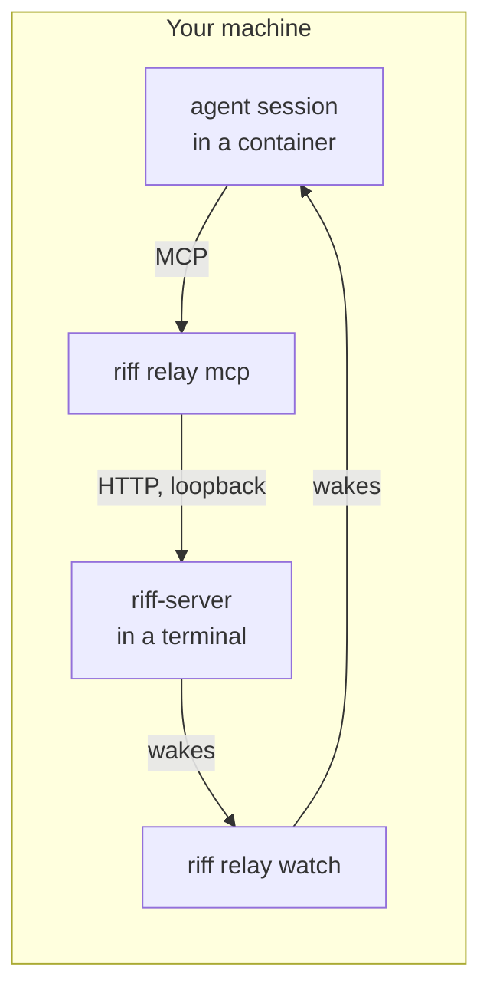

- **`riff-server`** is the central service. It holds the live sessions,
  the threads, the claims and the leads. It runs on your machine, in
  a terminal (see [Start a Riff](start-a-riff.md)). It listens on
  loopback. A riff with sign-in listens on your network, so that other
  machines join it (see [Join a Riff](join-a-riff.md)).
- **`riff relay mcp`** gives a session in a container its tools:
  `whoami`, `who`, `threads`, `read`, `post`, `tell`, `status` and
  `blocked`.
- **`riff relay watch`** writes one line for each message that wakes the
  session. Your agent tool reads the line and wakes the session. See
  [Wake a session](#wake-a-session).

## Sessions in containers

The riff daemon of each machine runs each work item in a container of
its own. riff-server is the server of the riff: the claims, the
messages, the chat, the sign-in and the update of each machine. The
waves stay on GitHub.

### The goal of isolation

riff is not a security tool. It does not make Claude Code more secure
than a plain `claude` that you start. The permission modes and the
settings of Claude Code do that, and you choose them.

riff isolates sessions, so that they do not step on each other or on
your machine: files, git state, processes, `/tmp`, ports, CPU and
memory.

riff does not make Claude less secure. A session gets no power that a
plain `claude` lacks, other than the riff tools.

### The picture

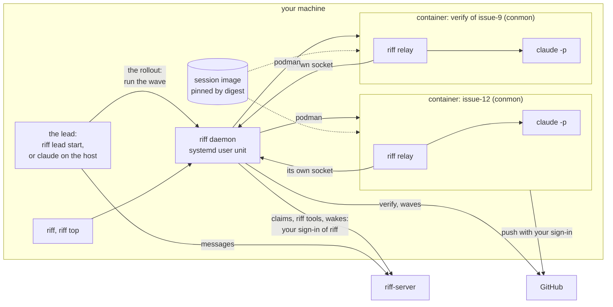

- The daemon is a systemd user unit, and a launchd agent on a Mac. It
  owns the sessions of the machine. A Mac runs no session yet.
- Each work item is one session in one rootless podman container. A
  verify is an item too. The session starts, does its item and ends.
- The rollout runs the wave of the daemon. The lead asks the daemon
  to run the wave of the repository. The wave starts one session for
  each free item, in the limit of the machine. The rollout starts no
  worker on the host.
- `riff relay` is the entrypoint of the container. It starts `claude`
  and talks to the daemon through a socket that only that session
  sees.
- The daemon makes the claim of each item on riff-server, as the worker
  session of the item, with your sign-in of riff. The riff tools of the
  session act on riff-server through the daemon.
- Each repository names its session image, pinned by digest, in the
  file `riff.toml` at its root. A project builds that image `FROM` the
  public image `riff-base` of riff, or `riff-rust`, and adds its own
  toolchain. See
  [Build the image of a project](start-a-riff.md#build-the-image-of-a-project)
  and
  [Change the session image](development.md#change-the-session-image).
- The daemon reads the version of `claude` and `gh` in the session image
  of a repository at the first job of its wave after the daemon starts.
  When a tool is older than the `riff-base` of this riff has, the lead
  gets one message with the new digest. See
  [Build the image again for a new riff-base](start-a-riff.md#build-the-image-again-for-a-new-riff-base).
- The session pushes its work with your sign-in of GitHub.

### How a session works in a container

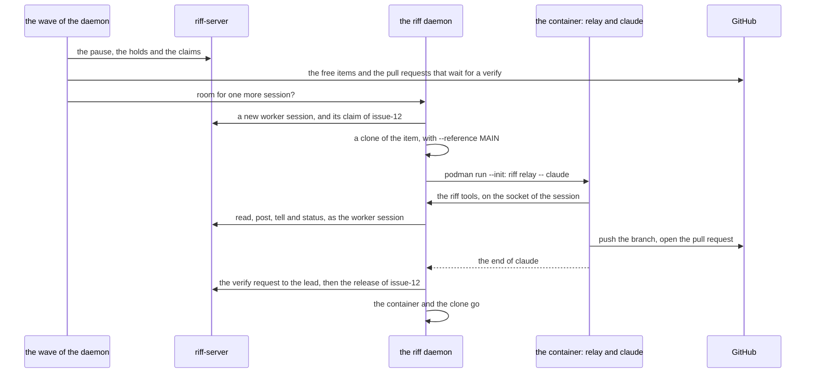

A second machine takes work when it gives workers to the repository
too. `riff host join --host HOST` adds it: see
[Add a host to the wave](development.md#add-a-host-to-the-wave). The
claims on riff-server keep two machines from one item.

### Which host takes a free item

When a wave runs on two hosts or more, the host with the most free room
takes a free item first:

- A change of the plan wakes the wave of each host. When a lead holds or
  frees an item, or a session releases its claim, riff-server tells the
  riff daemon of each host. So do a new item in a wave and a merge on
  GitHub: see
  [How riff learns of a change on GitHub](#how-riff-learns-of-a-change-on-github).
  Each wave looks at once, also a wave that waits with no work. So each
  host sees the free item at the same time.
- Before the claim, the daemon of a host waits a short time that grows
  with its load: 10 s × its live sessions / its limit. An empty host
  waits 0 s. A host with 3 sessions of its limit of 4 waits 7.5 s.
- After the wait, the daemon claims the item only when it is still free.
  When another host took it, the daemon claims nothing, and the start
  does not count.
- With the same load, the first host to look takes the item. No host has
  a fixed preference.

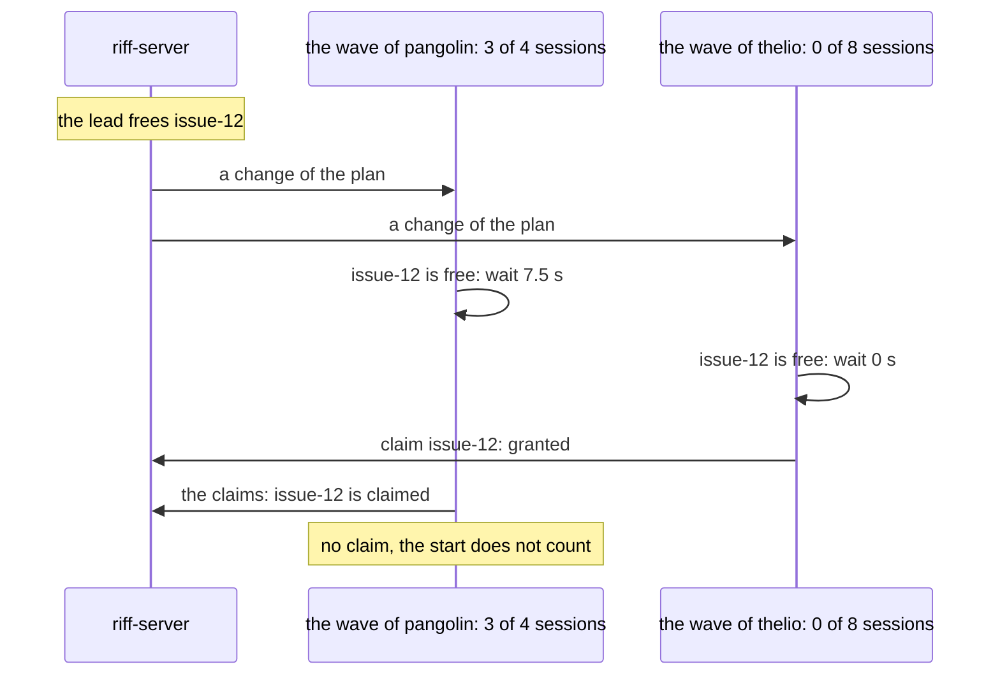

A host with a higher limit gets more of the work. To give a host more
room, raise its limit, for example on `thelio`:

```sh
riff daemon limit --sessions 8 --host thelio
```

### How riff learns of a change on GitHub

GitHub tells riff-server of each change on a repository of the riff. The
session App of the riff has a webhook: `riff github create` sets it to
`URL/hooks/github` of riff-server, with the events `issues`,
`issue_comment`, `pull_request`, `check_run`, `status`, `workflow_run`
and `merge_group`. See
[Make the GitHub Apps of riff](start-a-team-riff.md#make-the-github-apps-of-riff).

- riff-server checks the signature of each delivery with the webhook
  secret of the App. A delivery with no signature or a bad one gets
  status 401. A delivery that comes a second time wakes nobody.
- An issue that comes into an open wave, and a merge of a pull request,
  wake the wave of each host at once, as a change of the plan does. The
  wave then looks, and finds the new free item.
- riff-server takes the events of one issue or one pull request in 5
  seconds into one wake: a pull request with CI sends dozens of
  `check_run` events. The wake names the repository, the kinds of the
  events and the number. It goes to the riff daemon of each host of the
  repository, on a stream that the daemon opens. So a host behind a
  firewall needs no inbound port.
- riff-server keeps the wakes of each repository for one hour. A daemon
  that was away gets the wakes that it missed when it comes back. A new
  riff-server, for example after a deploy, starts with no wake.

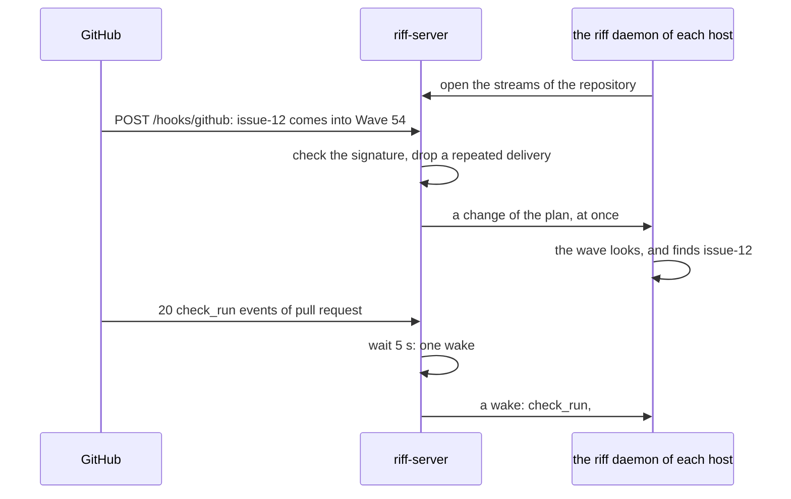

The riff daemon keeps the ID of the last wake of each repository in its
folder. After a restart, it asks riff-server for each wake after that
ID, so it gets the wakes that it missed in the last hour.

#### What the daemon reads for a wake

A wake names the issue or the pull request that changed. So the wave
reads only that item on GitHub: `gh pr view 41` or `gh issue view 12`,
for one GraphQL point. It reads no list of the open issues or pull
requests. The look of the daemon and the sweep use the same replies.

The wave reads the list of the open pull requests in three cases:

- A wake has no number: a status, or a check of a commit with no pull
  request.
- The wakes since the last look name two pull requests or more.
- A pull request merged while another one is open. The merge changes the
  mergeable state of the other pull requests, and GitHub sends no event
  for that.

The events of a repository are on while its last wake is less than one
day old, and no dropped event came after it (see
[The safety look and the dropped events](#the-safety-look-and-the-dropped-events)).
A riff with no GitHub App, or with no webhook, sends no wake.
Then its waves read GitHub as before: two cheap reads ask GitHub first
whether anything changed (see
[Know how an idle wave reads GitHub](development.md#know-how-an-idle-wave-reads-github)).

#### The safety look and the dropped events

GitHub can lose an event, and riff-server keeps the wakes for one hour
only. So the wave reads GitHub in full each 30 minutes: the safety look.
A wave with no work waits 30 minutes for its next look, in place of 5. A
wake, a change of the plan and the end of a session wake it at once.

The safety look compares the facts that the wakes gave with the full
read. A change that no wake told is a dropped event. The daemon waits
one minute for a late wake. Then it logs the repository, the item and
the kind of the event:

```text
riff daemon: o/r: a dropped event: the safety look found a change of pull request #41, of the kind check_run, and no event of GitHub told it.
```

A change of the mergeable state or of a milestone is no dropped event:
GitHub sends the App no event for it. Each look reads the open
milestones, so the wave sees the end of a wave at its next look.

A dropped event with no wake after it tells you that the wakes do not
come. Then the events of the repository are off: each look of the wave
reads GitHub in full, as the safety look does, and makes no cheap read
first. The next wake turns the events on again. `riff daemon status`
says that the events are off (see
[See how the daemon uses the GitHub limit](development.md#see-how-the-daemon-uses-the-github-limit)).

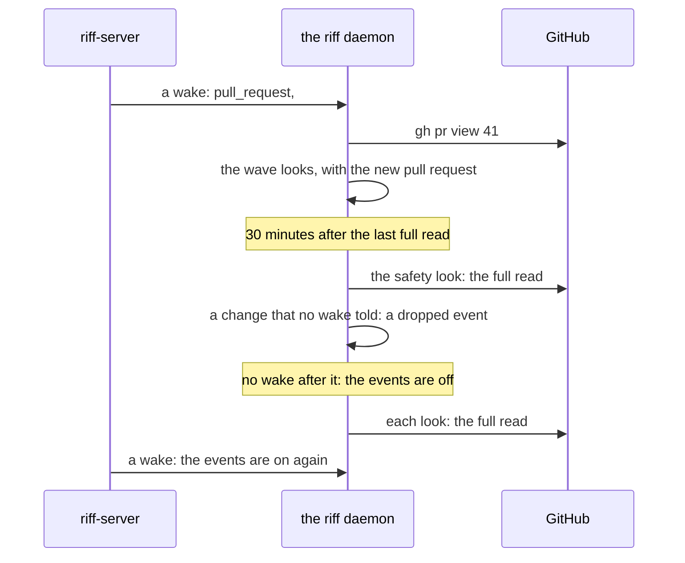

#### The read before a build

The facts that the wakes gave can miss a new pull request when its event
is lost. So before the wave starts a build of an item, it reads the open
pull requests on GitHub again. When a pull request of the item waits for
its verify or for the merge, the wave starts no build, and the start
does not count. The daemon logs one line:

```text
The wave of o/r: pull request #41 of issue-12 waits for its verify, at the head 1a2b3c4. riff starts no build of issue-12, and the start does not count.
```

The read goes into the facts of the wave, so the next look sees the
pull request, and the wave starts its verify. A change in the read that
no wake told is a dropped event, as at the safety look. A read that
fails starts no build either: the next look tries again. A build that
your lead asks for with `riff run` in its container makes no such read.

`riff daemon status` counts the dropped events of the last day: see
[See how the daemon uses the GitHub limit](development.md#see-how-the-daemon-uses-the-github-limit).
Many dropped events tell you that the events do not come. Then look at
the last events of the repository with `riff github events`.

The daemon opens the streams of a wave with your sign-in from the
keyring: the stream of the wakes, and the stream of the changes of the
plan. When the keyring is locked, for example after a login with a
security key, the start of a stream fails. Until a stream runs, the wave
gets no wake, and waits for its safety look. The daemon tries the start
again each 30 seconds, until it works. You restart nothing. The log of
the daemon gets one line at the first failure, and one line at the
start:

```text
riff daemon: o/r: cannot follow the wakes of GitHub on riff-server: riff cannot find your user. Unlock the keyring, or set RIFF_USER: the OS keyring of thelio is locked or does not answer: unlock it at the desktop. gh uses the same keyring, so gh stops too. riff tries again each 30s.
riff daemon: o/r: follows the wakes of GitHub on riff-server again, after 12 failed starts in 6m.
```

The stream then opens after the ID of the last wake, so the wave gets
the wakes of the last hour that it missed. While a stream does not run,
`riff daemon status` names it under its wave: see
[See that the wakes come again after the unlock](development.md#see-that-the-wakes-come-again-after-the-unlock).

`riff top` and the TUI follow the same stream for the repository of
their folder. A wake of an issue or of a pull request makes them read
GitHub again at once, at most one time each 5 seconds. So a change shows
within seconds. A wake of a check waits for their next read: CI sends
many of them.

#### See the last events

In a clone of the repository:

```sh
riff github events
```

riff prints the last wakes of the repository, the oldest first: the
time, the issue or the pull request, the kinds of the events and their
count. The last line counts the deliveries since riff-server started:
the ones that it took, the repeats that it dropped, and the ones that
it refused with status 401. riff-server logs a warning for a refused
delivery. Run the command in a plain terminal: it refuses in an agent
session and in a container.

### What sessions share

Each row is a thing that two sessions on one machine share. The last
column is honest: it says what a session can still do to another
session. The rows use the result of the spike of one item in a
container,
[#707](https://github.com/como-technologies/riff/issues/699#issuecomment-6186136739),
and the result of the spike of the claims,
[#708](https://github.com/como-technologies/riff/issues/699#issuecomment-6184805987).
The
[requirements for sessions in containers](requirements.md#sessions-in-containers)
hold each decision of the design.

| What sessions share | How riff keeps them apart | What a session can still do to another |
|---|---|---|
| The files of your machine | Each session is a rootless podman container (`--userns=keep-id`). It writes only its binds: its own clone, its own Claude folder, the folder of its socket and the volumes that `riff.toml` names. Each other write goes to the copy-on-write layer of the container, and goes when the session ends. | Nothing outside its binds. See the rows of git and of the caches. |
| git: the clone and its alternates | Each session has its own clone, made with `git clone --reference MAIN` in a folder of riff. The container sees the objects of the main clone at the same path, with no write. No session writes the git dir of the main clone or of another session. The clone goes when its item ends, after its push. | Nothing in the clone of another session. A `git gc` of the main clone can remove an object that a session clone reads. |
| git: the config | `~/.gitconfig` is bound with no write, or as an overlay whose changes go when the session ends. riff writes no git config of yours. A session writes only the config of its own clone. | Nothing. |
| git: the commit | A commit has the bot of the GitHub App of the session as its author, for example `riff-como-technologies[bot]`, with the noreply email of the bot, and a `Riff-Session:` trailer that names the session. Where the Apps are not on the repository, it has your git identity. A session commits with no signature: riff sets `commit.gpgsign=false` in the environment of the container, so it applies to each git call of the session. The squash merge on GitHub makes the commit on `main` from the message that `riff verify pass` gives: the body of the pull request, which ends with `Riff-Session:` and `Co-authored-by:` you. No gpg agent goes into a container. See [Find the commits of a session](development.md#find-the-commits-of-a-session). | Nothing. The trailer `Riff-Session:` tells the commits of two sessions apart. |
| git: the repository on GitHub | Each session pushes its own branch from its own clone. The daemon makes the claims, not the session: see the next row. | With your sign-in, a session can push to the branch of another session, or delete it. |
| The claims | The daemon claims each item on riff-server, as the worker session of the item, with your sign-in of riff. riff-server gives each item to one session. The daemon releases the claim at the end of the session. riff-server ends the claim of a session that stops. | Nothing. A session has no sign-in of riff-server, and no riff tool of a session claims or releases. |
| The processes | Each container has its own processes. Its PID 1 is the init of podman (`podman run --init`): it reaps each process that ends, so no zombie stays. A `pkill` in one session does not hit another. `podman stop` ends a session and each of its processes. | Nothing: it does not see the processes of another container. |
| `/tmp` | Each container has its own `/tmp`. It goes when the session ends. | Nothing. |
| The ports | Each container has its own loopback. A test port of one session does not hit another. | It can reach a port that listens on the network of your machine, as each program on it can. |
| The caches | riff sets no cache. A repository names its cache volumes in `riff.toml`. The `riff.toml` of riff names one volume for `CARGO_HOME` and one for the folder of sccache. Both are bound with write. The tools lock them themselves. The toolchain is in the image, with no write. A new clone has no `target/`: a warm sccache makes its build short. | It can write a bad file in a cache, and a later build of another session uses it. |
| Your home | The home of the container is an empty tmpfs at the path of your home. riff binds your `~/.gitconfig` and the Claude folder of the session on top of it. Each folder above a bind belongs to the session user: see [The folders of the home above a volume](development.md#the-folders-of-the-home-above-a-volume). Each other write in that home goes when the session ends. riff writes nothing in your home outside its own folders. It does not write `~/.claude`, `~/.claude.json`, a git config or a shell file. | It reads `~/.gitconfig`. It does not see `~/.config/gh`. |
| The CPU | Each container gets `--cpus`, 8 by default. riff sets no build jobs: a tool reads the CPUs of its container. `riff daemon limit --cpus N` sets it for the host. The daemon keeps one limit for the host: the number of live sessions, at most 3 by default. Each process of a container runs at the lowest CPU priority: see [The priority of a session](development.md#the-priority-of-a-session). | A build of one session makes the builds of the others slower, up to its limit. |
| The memory | Each container gets `--memory`, 8 GB by default. `riff daemon limit --memory GB` sets it for the host. A session past its limit loses its own processes, not those of another session. The daemon starts no new session while the free memory is below a floor, 8 GB by default. | It takes memory, up to its limit, that a new session needs. |
| The network | Each session reaches the internet, as a plain `claude` does. No proxy and no filter. | It uses the same connection and reaches each service that your machine reaches. |
| The sign-in of `gh` | The session acts on GitHub as a bot of a GitHub App of the riff, with a token for its one repository and the rights of its role: see [Who acts on GitHub for each role](#who-acts-on-github-for-each-role). The container never gets your token. Where the Apps are not on the repository, no worker and no verify starts, and the lead starts with no token on GitHub: see [Repair riff with claude on the host](#repair-riff-with-claude-on-the-host). The image has `gh` at `/usr/bin/gh`. The daemon binds the binary of riff at `/usr/local/bin/gh`: it counts each call for `riff daemon status` (see [See how the daemon uses the GitHub limit](development.md#see-how-the-daemon-uses-the-github-limit)), and runs the real `gh`. An image with its own `gh` at `/usr/local/bin/gh` gets no bind: its `gh` runs as it is, with no count. No secret goes into a log line, a message or a file of a clone. | A worker can change an issue or a comment of another session: the right `issues: write` has no smaller part. The guard puts the change back: see [Add to an issue](#add-to-an-issue). |
| The sign-in of `claude` | Each session has its own Claude folder in a folder of riff. riff trusts the clone of the session there, as you trust the main clone. The daemon gives the session the long-lived token of `riff claude-token`, kept in the OS keyring, in `CLAUDE_CODE_OAUTH_TOKEN`. With no token, riff binds your `~/.claude/.credentials.json` with no write, and starts no session while its access token has less than 60 minutes left. riff never changes your own Claude config. | It uses the limits of your plan that another session needs. |
| The daemon and the riff tools | Each relay talks to the daemon through its own Unix socket, in a folder that only that session sees. The socket tells the daemon which session asks. The daemon serves the riff tools of the session on riff-server, as its worker session. A session gets only the riff tools that talk: `whoami`, `who`, `threads`, `read`, `post`, `tell`, `status` and `blocked`. No riff tool of a session acts on a folder of your machine or on a claim. The admin steps need a person at the CLI. No riff tool does them. | It can send messages to other sessions through the riff tools. |

## Where the env of a session comes from

riff sets in a session what riff needs itself: the home, the user, the
sign-ins, the git config, the Claude folder, the clone, the folder of
the socket, the caps `--memory` and `--cpus`, and the lowest CPU
priority. It sets no variable and no volume of a language or a tool.
The repository gives them in its `riff.toml`, in the tables
`[session.env]` and `[session.volumes]`. The key `model` in
`[session]` names the model of each session: riff starts `claude
--model MODEL`, and the default is `opus`. Only the merged `riff.toml`
counts, as for the image (see
[Only a merged pin counts](development.md#only-a-merged-pin-counts)).

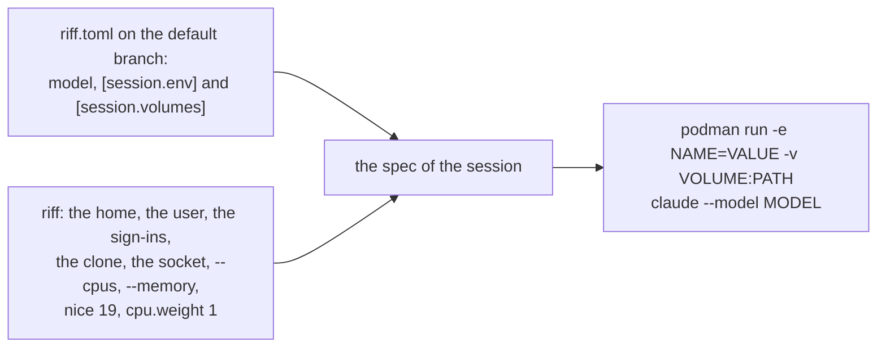

A `riff.toml` with neither table gives a session no tool variable and
no cache volume. A repository of any language works the same way. The
`riff.toml` of riff has `model = "opus"`. It also sets the build cache
of riff: the cargo home, sccache, and their two volumes. To write the
tables, see
[Set the env and the volumes of a session](development.md#set-the-env-and-the-volumes-of-a-session).
To choose the model, see
[Set the model of the sessions](development.md#set-the-model-of-the-sessions).

## Find a command

`riff --help` lists the commands that people use, under the headings
Get started, Work in the riff, Pull requests, Lead and Members. Each
command has one short line. `riff help` with a command shows its full
text:

```sh
riff --help
riff help invite
```

`riff-server --help` lists the settings of the server.

## The riff that riff uses

`riff` finds its riff in `--server` or `RIFF_SERVER`. With neither, it
uses the riff of this machine, `http://127.0.0.1:7878`. riff keeps no
choice in a file.

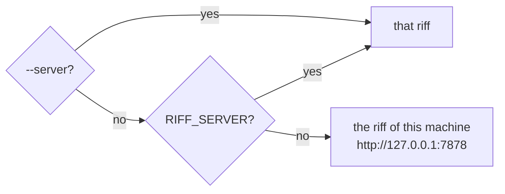

Each value is a URL, `HOST` or `HOST:PORT`. With no scheme, riff uses
`http://`. With no port, it uses port 7878. So `first` is
`http://first:7878`. An IPv6 address takes brackets with a port: `::1`
is `http://[::1]:7878`, and so is `[::1]:7878`. To use another riff, see
[Change to another riff](join-a-riff.md#change-to-another-riff).

### Show the forms of --server

The help of each command gives `--server` one short line.
`riff help server` shows the forms of a value and the default:

```sh
riff help server
```

### Show the riffs

`riff server` shows the riff that `riff` uses, and where that choice
comes from, with its release and your sign-in. It shows one fact on a
line:

```sh
riff server
```

```text
riff        v0.6.0  (75209ac, 2026-09-29)
server      https://riff.example.com  (from RIFF_SERVER)
  release   v0.6.0  same build ✓
  sign-in   yes, signed in as mike@example.com
```

- `local` shows the riff of this machine too, when it answers.
- `answer    none`: the riff does not answer.
- Under the sign-in line, it shows
  [the facts of the server](#see-the-facts-of-the-server).
- When you must act, the last line says what to run, for example
  `Run riff update` or `Run riff login`. It is yellow when the versions
  can talk, and red when they cannot or when you must sign in.
- It says `Run riff update` only when the server is newer than this
  `riff`. When this `riff` is newer, it says
  `Update riff-server when you can.` See
  [When the builds differ](#when-the-builds-differ).

`localhost`, `127.0.0.1` and `[::1]` with the same port are one riff:
the riff of this machine. `riff server` shows it once.

To show the riffs with no color, use `--color never`. A pipe gets no
color either, so a `grep` finds a line:

```sh
riff server --color never
riff server | grep release
```

### See the facts of the server

`riff server` also asks the riff that `riff` uses for its facts. Use
them to see if the server is healthy:

```sh
riff server
```

```text
server      https://riff.example.com  (from RIFF_SERVER)
  release   v0.9.0  same build ✓
  sign-in   yes, signed in as mike@example.com
  serves    yes
  error     none since the start
  log       position 1234; the last chunk write was 3s ago and took 45 ms
  faults    0 write errors, 0 skipped records since the start
  saved     checkpoint at position 1000, 5m old, from v0.9.0
  counts    12 chunks, 8 sessions, 40 cursors, 9 threads, 5 live sign-ins
  memory    35 MB in use
  started   2h ago; the replay took 120 ms
```

| Line | Shows |
|---|---|
| `serves` | `yes`, or `no, it replies 503` and why. A server that does not serve still gives its facts. |
| `error` | The last error of the server since its start, with its age. |
| `log` | The position of the last record, and the time and the duration of the last chunk write. |
| `faults` | The failed tries of a chunk write, and the records of a later build that this build skipped: a record of a kind that this build does not know, or with a value that it does not know. A record of the forge state of 2.0 is dropped, not skipped, so it does not count. |
| `saved` | The newest checkpoint: its position, its age and its release. When this build writes no checkpoint, the line says why. A checkpoint of a later major release is the state of another instance: this build does not use it. |
| `counts` | The chunks in the store, the sessions, the read cursors, the threads, and the live sign-ins. |
| `memory` | The memory that the server uses. |
| `started` | The age of the instance, and how long its load and its replay took. |
| `keys` | Only when riff-server cannot read the keys of the GitHub Apps: the cause and the fix. See [When riff-server cannot read the keys of the Apps](#when-riff-server-cannot-read-the-keys-of-the-apps). |

- A riff with sign-in gives its facts only to a person who is signed
  in. Else the lines are not there.
- An older `riff-server` has no facts. The lines are not there.

### Name the riff for one command

`--server` names the riff for one command. It wins over
`RIFF_SERVER`:

```sh
riff --server 127.0.0.1:7878 who
```

## Builds

A build of `riff` or `riff-server` is the crate version, the id of the
code, and the time of the last commit that changed the code. The id is
the short hash of the code: `crates`, `Cargo.toml` and `Cargo.lock`. Two
commits with the same code have the same id. A commit that changes only
the book keeps the build.

CI builds and tests the tree of a pull request in the pull request. Its
merge group builds and tests the tree again, or with no merge queue the
push to `main` does: they take no build of a pull request. The commit on
`main` takes the build of its merge group, and builds its release
binaries once. Its tag takes those binaries. So the build of a commit
on `main` and of a release has the id of the code, and the time of the
last commit on `main` that changed the code. Two builds with the same
version and id are the same build, also with another time. The time
only tells which of two builds of different code is older. The version
is the same (see
[Build once for each tree](development.md#build-once-for-each-tree)).

The version is a semantic version, `MAJOR.MINOR.PATCH`. It tells which
versions can talk. The line of a version is its major, and its minor
while the major is 0: `0.4.1` is on the line `0.4`, and `1.2.0` is on
the line `1`. A change that another machine or session can notice
starts a new line (see [Versions](#versions)). Most merges keep the
line.

`riff-server` talks with a `riff` of its own line, and of the line
before. So you have one release to update `riff` in. It talks with no
`riff` of another line.

| `riff` is on | Result |
|---|---|
| the line of `riff-server` | They talk. When the builds differ, riff tells you once to update. |
| the line before | They talk. riff tells you to update soon. |
| a later line | riff-server refuses: update riff-server. |
| two lines before, or more | riff-server refuses: update riff. |

Each call of `riff` names its build, and each reply of `riff-server`
names its own. Each side compares the versions:

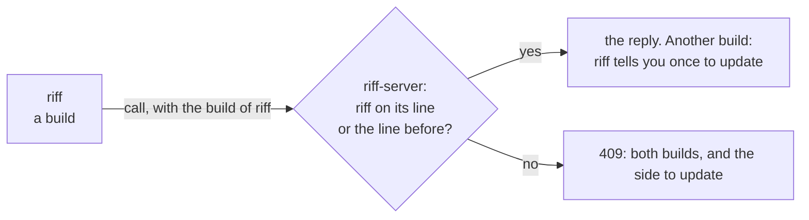

### See the build

```sh
riff --version
riff-server --version
```

`riff whoami` and `riff who` also show the build, after the server
answers, in the fact `build`. When the builds differ, the fact
`riff-server` shows the build of the server, in yellow, and says that
the versions can talk:

```text
build        v0.7.0  (3c7b111, 2026-09-29)
riff-server  v0.7.0  (f45be4d, 2026-09-29)  another build; the versions can talk
```

### When the builds differ

`riff` works. Each `riff` process tells you once which side is older.
`riff server` gives the same advice on its last line. When the server
is newer, the note says to update riff:

```text
riff: riff-server runs build 0.4.3 7213825ab1c2 2026-09-27T20:10:44Z; this riff runs build 0.4.0 929605821e54 2026-09-27T22:03:01Z. Run riff update when you can.
```

When this riff is newer on the same line, for example while a deploy
runs or after a rollback of the server, the server is the older side.
This machine needs no step:

```text
riff: riff-server runs build 0.4.0 7213825ab1c2 2026-09-27T20:10:44Z; this riff runs build 0.4.3 929605821e54 2026-09-27T22:03:01Z. Update riff-server when you can.
```

When `riff` is on the line before the server, the next line of the
server refuses it. The note says so:

```text
riff: riff-server runs build 0.4.0 7213825ab1c2 2026-09-27T20:10:44Z; this riff runs build 0.3.2 929605821e54 2026-09-20T22:03:01Z. riff-server 0.5 will refuse riff 0.3. Run riff update soon.
```

When the note says "Run riff update", update riff on this machine:

```sh
riff update
```

`riff relay watch`, `riff tail`, `riff top` and `riff chat` see the
new `riff` on disk, and run it.
They go on with no restart, in the same repository and worktree. This
is also true when you removed their worktree.

- `riff chat` keeps its lines on the screen, and draws its prompt
  again. Text that you typed but did not send shows again after the
  prompt.

### When riff cannot read its directory

A `riff` command in a removed directory fails. The error names the
directory:

```text
Error: riff cannot read its working directory /src/riff/.claude/worktrees/issue-12. Change to a directory that exists
```

Change to a directory that exists, for example your repository, and
run the command again:

```sh
cd ~/src/riff
```

### When git fails

riff asks git where you work: the repository, the remote `origin` and
the worktree. riff never guesses. A directory outside git is not a
fault: its repository is `-`. A repository with no `origin` is not a
fault either: its repository is `local/NAME`. When a call of git
fails for another reason, riff tries it 3 times. Then the command
fails, and the error names the call and the reason of git:

```text
Error: riff cannot read git in /src/riff: `git rev-parse --show-toplevel` failed with exit code 128: fatal: detected dubious ownership in repository at '/src/riff'. riff does not guess where you work. Run the command again.
```

The command registers no session. Fix what git says, and run the
command again. To see the reason yourself, run the same call:

```sh
git -C ~/src/riff rev-parse --show-toplevel
```

### When the versions do not match

Each `riff` command fails with an error like this one:

```text
riff: this riff (0.2.0 929605821e54 2026-09-27T22:03:01Z) and its riff-server (0.4.0 7213825ab1c2 2026-09-28T20:10:44Z) do not match. riff-server 0.4 talks only with riff 0.4 and 0.3. Update riff on this machine, then start your sessions again. See https://como-technologies.github.io/riff/how-it-works.html#when-the-versions-do-not-match
```

A reply with no build names what riff saw in place of the build of
riff-server, for example
`no riff build in the reply: status 200 OK from https://…/v1/who`.

A new session gets the same error at its start. It tells you, and it
does not use the riff. `riff tail` prints the error
once, try again every 5 seconds, and go on when the versions can
talk.
[`riff server`](#show-the-riffs) shows both builds.

Update the older side:

- **riff** on this machine, and **riff-server** of your own riff: do
  [Update riff](start-a-riff.md#update-riff). When you joined a riff,
  see [Update riff](join-a-riff.md#update-riff) of Join a Riff.
- **The shared server:** the lead pushes a release tag at the end of
  each wave, and CI deploys it after a person approves the deploy. A
  push to `main` does not deploy it.
  See
  [Deploy the shared server at the end of a
  wave](development.md#deploy-the-shared-server-at-the-end-of-a-wave).

Then start your Claude Code sessions again.

### Releases

`riff update` installs a release, not the newest commit of `main`. A
release is a git tag `vX.Y.Z` of the repository (see
[Make a release](development.md#make-a-release)). It picks the release
this way:

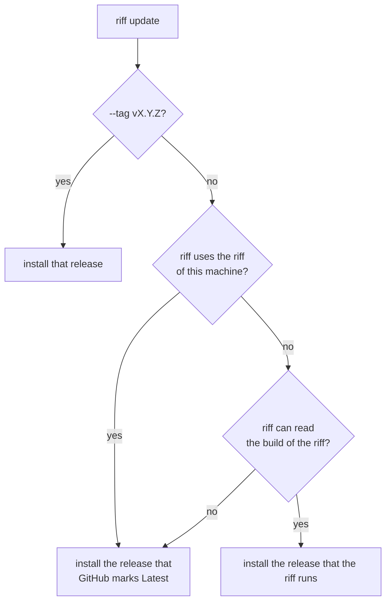

So a new tag does not break your machine before the shared server
runs it. `riff server` shows the release of `riff` and of each riff.

When the riff names no release, `riff update` installs the release
that GitHub marks "Latest": the release that the shared riff runs. It
is not always the highest tag: GitHub never marks a prerelease Latest.
See the Latest release:

```sh
gh release view --repo como-technologies/riff
```

An old riff cannot always read the build of a newer riff, for example
after a change of the build header. Then `riff update` installs the
Latest release and prints this line:

```text
riff cannot read the build of the riff at https://riff.example.com, so riff installs the Latest release, v0.3.0.
```

#### How a release is cut

The version of a release is on `main` from the start of its wave. CI
makes one release build of each commit of `main`, and runs the release
test on it. So at the end of the wave, the release is the last commit
of `main`: riff tags that commit, and builds nothing again.

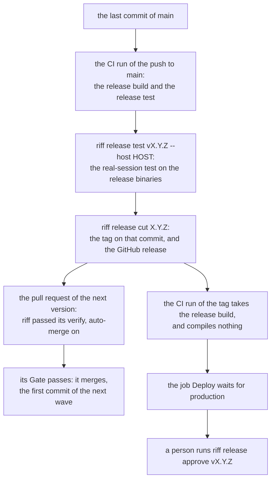

The cut writes the one commit of the pull request of the next version:
the version in `Cargo.toml` and `Cargo.lock`. So the cut passes its
verify, and no session verifies it. It merges when its Gate passes, as
each other pull request.

The lead sees the state of the release, tests the last commit of
`main`, and cuts the release:

```sh
riff release status
riff release test v3.3.0 --host thelio
riff release cut 3.3.0
```

For each step, each check and each refusal, see
[Make a release](development.md#make-a-release).

#### Who tags and who approves a release

The lead cuts each release, and a person approves its deploy. GitHub
decides each step, not the words of a session:

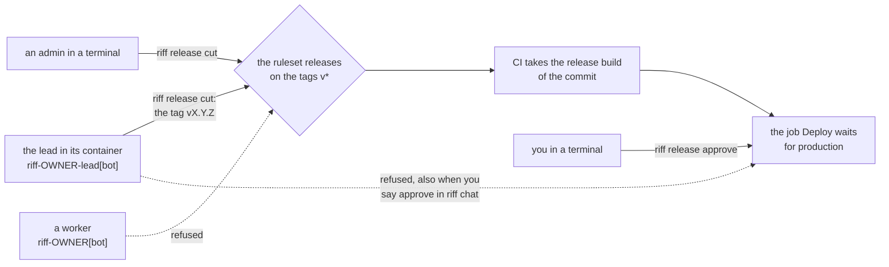

| Step | Who | What decides |
|---|---|---|
| Push the tag `vX.Y.Z` | the lead in its container, with the token of the lead App, or an admin of the repository in a terminal | The ruleset `releases` lets only the admin role of the repository and the lead App push a tag `v*`. `riff release cut` checks no role: when GitHub refuses the push, riff names the ruleset and deletes the tag on its machine. |
| Approve the deploy | you, an admin of the riff, in a plain terminal | `riff release approve` refuses each session, also the lead, also when you say approve in riff chat. Only a person is a reviewer of the environment `production`. |

`just github` and `riff project init` make the ruleset `releases`: see
[Let the lead push the release tag](start-a-riff.md#let-the-lead-push-the-release-tag).
To see who can push a release tag, read the bypass actors of the
ruleset. Only an admin of the repository sees them:

```sh
ID=$(gh api repos/como-technologies/riff/rulesets --jq '.[] | select(.name == "releases") | .id')
gh api "repos/como-technologies/riff/rulesets/$ID" --jq .bypass_actors
```

The list has the admin role, `RepositoryRole` 5, and the lead App, an
`Integration` with the App ID of the lead App.

#### See the state of an open release

From the release issue to the check, `riff who` and the header of the
TUI have one line of the release: its step in `riff release status`,
what it waits for, and who acts next. For example, while the
real-session test runs:

```sh
riff who
```

```text
riff     running
release  v3.3.0: the real-session test runs
```

The row `release` shows these lines, one after the other, from the
release issue to the check:

```text
release  v3.3.0: the release build passed; it waits for the real-session test of the lead of como-technologies/riff
release  v3.3.0: the real-session test runs
release  v3.3.0: the real-session test passed; it waits for the cut of the lead of como-technologies/riff
release  v3.3.0: the CI run of the tag builds
release  v3.3.0: the deploy waits for a person (riff release approve v3.3.0)
release  v3.3.0: the deploy runs; the riff is paused
release  v3.3.0: the deploy passed; it waits for the check of the lead of como-technologies/riff
```

After a passed check, the line goes. A failed step has a line too, with
who acts next.

Before the release issue, the same line tells you when the release is
ready. When each item of the current wave is closed, the line says that
the wave is complete and that the release waits for its cut. It also
says why the cut waits, when riff knows it. For example, after the full
check of `main` failed:

```text
riff     running
release  Wave 41 is complete: the release waits for its cut; the full check of main failed
```

When the full check of `main` passes, the line names the lead that cuts
the release. When `riff release test` or the cut makes the release
issue, the line of the release takes its place.

The line comes from the watches of the riff daemons and from the pause
of the riff. With no open release and no complete wave, there is no
line. See
[See who acts next on the release](development.md#see-who-acts-next-on-the-release)
for the line of each step, also of a failed step.

### Install one release

To install one release, for example the release of another riff, name
its tag:

```sh
riff update --tag v0.2.0
```

### See what changed in a release

The GitHub releases are the changelog of riff. The notes of a release
give its level, the commands that each person runs, the items of each
wave of the release, and each pull request that the release adds. The
pull requests come in three groups: `Changes` for people first, then
`Design` (design pages), then `Internal` (tests and checks only). List
the releases, and read one:

```sh
gh release list --repo como-technologies/riff
gh release view v0.4.0 --repo como-technologies/riff
```

### Update riff by itself

A machine can update riff by itself. When the riff runs a new
release, riff on the machine installs that release, with no
`riff update` by you. Turn it on for this machine:

```sh
riff update --auto on
```

Turn it off:

```sh
riff update --auto off
```

See the setting:

```sh
riff update --auto
```

```text
update.auto  true  (/home/mike/.config/riff/config.toml)
Turn it off with: riff update --auto off
```

The setting is the key `update.auto` in
`~/.config/riff/config.toml` (`$XDG_CONFIG_HOME/riff/config.toml`).
It is off by default.

Each reply of the riff names its release. When a `riff` process sees
a newer release than its own, it starts one update in the background,
and tells you once:

```text
riff: riff-server runs the release v0.4.0. riff installs it now, in the background (update.auto).
```

The update goes this way:

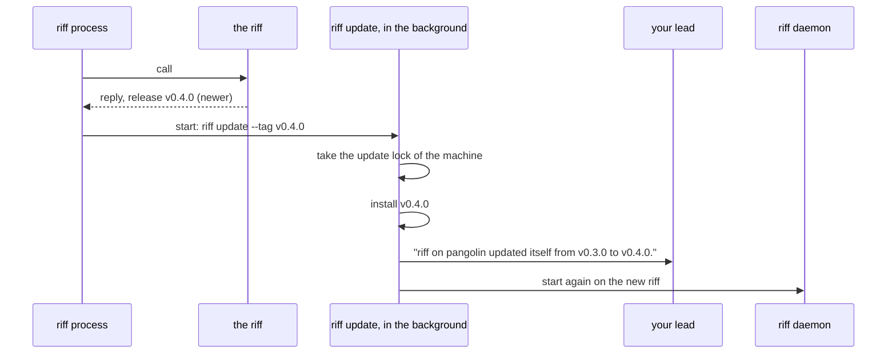

- One update runs at a time on the machine. Each release gets one
  try.
- Each riff process starts again on the new `riff` when it is idle.
  See [Which processes start again](#which-processes-start-again).
- The riff daemon of the release does each step of `riff init` that
  needs no person. See
  [Each step of an update](#each-step-of-an-update).
- The update stops no session, and a running test goes on. Your
  sign-in and the device key stay.
- Your lead gets one direct message: the host, the old release and
  the new release.
- A failed update keeps the old `riff`. The message to your lead holds
  the error. riff tries again at the next release. To try again now,
  run `riff update --tag` with the release.
- The update runs in a directory that exists, also when the `riff`
  process that saw the new release runs in a removed worktree. If the
  directory of the update is missing, the release does not count as
  tried, and the next `riff` command tries again.
- riff never installs an older release by itself.
- An older riff updates itself with cargo. So after the update, your
  riff can be a build of the new release that is not static, and the
  riff daemon starts no session with it. When the riff of the bin
  folder of cargo (`~/.cargo/bin`) sees the riff run its own release,
  and it or `riff-server` there is not static, it installs its own
  release again in the background. `riff update` then puts the static
  files of the release in place. This fix gets one try for each
  release. Your lead gets one message:

  ```text
  riff on pangolin put the static riff and riff-server of v1.4.1 in place of a build that is not static.
  ```

The output of the update is in `update.log`, in
[the local folder](#the-local-folder) of riff.

#### Which process tells your lead

The first riff process on the machine that sees the new release
starts the update. That update, `riff update --background`, tells
your lead once in each repository of the message:

| The process that starts the update | The repository of the message |
|---|---|
| A session, or a `riff` command in a clone | The repository of the session or the clone |
| The riff daemon | Each repository where the host has a part on the same riff (`riff host join` in its main clone, or with `--host` from another host; a daemon start serves the repositories where the host has a part) |

The riff daemon has no repository of its own. Its working folder can
be in the work tree of another repository, for example a home folder
that is a dotfiles repository. The daemon does not use that
repository. When the daemon serves no repository, the update tells no
lead, and `update.log` says why.

The update tells your lead first. Then it starts the daemon again on
the new riff. The daemon does not start again while the update runs:
a new start of the daemon stops the update that the daemon started.
When the message to your lead fails, `update.log` says why, in the
line `riff: cannot tell the lead`.

#### Each step of an update

`riff init` does more than the binary: it installs the unit of the riff
daemon, and pulls the session image. A release can change each of
them. Your yes to the update by itself is your yes to each step. So the
riff daemon of the new release does each step that needs no person, at
its start:

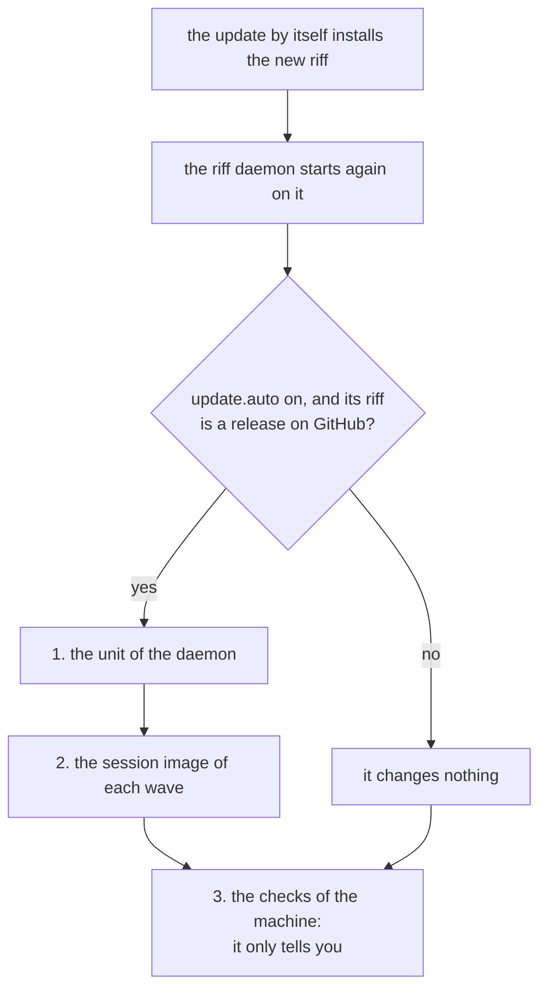

| Step | In step when | The riff daemon |
|---|---|---|
| 1. The unit of the daemon | `riff.service` is the text that the new riff writes for it, with your riff and your variables | writes it again, and starts again on it when it runs no session |
| 2. The session image of each wave | podman has the merged pin: the image that `riff.toml` on the default branch of `origin` pins (see [Only a merged pin counts](development.md#only-a-merged-pin-counts)) | pulls it |
| 3. The checks of the machine: podman, the init of podman, `/etc/subuid`, `/etc/subgid`, cgroup v2 | the check of `riff init` passes | never changes them: the fix needs you, for example with `sudo` |

- Only a release does a step: a `riff` whose SHA-256 is in
  `SHA256SUMS` of the GitHub release of its version, or on a Mac in
  `SHA256SUMS-aarch64-apple-darwin`. A check build or a dev build
  changes nothing. With `RIFF_RELEASES` set, the daemon
  changes nothing.
- The daemon logs one line for its gate and one line for each step.
  See them with `journalctl --user -u riff.service`.
- A step that needs you shows in the log, with its fix.

The update and the daemon say what they did in their logs:

- `update.log` holds the output of the update by itself. Its last
  lines after an update:

  ```text
  riff downloads the static riff and riff-server of v1.7.0 (x86_64-unknown-linux-musl) into /home/mike/.cargo/bin.
  riff: riff on pangolin updated itself from v1.6.0 to v1.7.0.
  ```

  The update shows no note that `riff-server` runs another
  build: the update installed that build.
- The log of the riff daemon has one line when the daemon starts again
  on a new riff:

  ```text
  riff daemon: a new riff is on disk, and no session runs. The daemon starts again on it.
  ```

  The new start stops the old daemon and its `systemctl`. That is no
  failure, so the log has no other line for it. Only a failed ask to
  systemd logs `cannot start again on the new riff`, with the error and
  the fix `riff daemon install`.

#### See each step of an update

See each step on this machine, in step or not, with its fix. The
command changes nothing:

```sh
riff update --check
```

```text
update.auto is on, and this riff is the release v1.6.0: at its next start, the riff daemon does each step that is not in step and needs no person
in step  the riff binary: it is the release v1.6.0
not in step  the unit of the daemon: the unit file is not the text that this riff writes for it. Fix: riff daemon install
in step  the session image of como-technologies/riff: ghcr.io/como-technologies/riff-session@sha256:…
in step  podman: podman version 5.7.0
needs you  the init of podman: podman has no init: no catatonit in /usr/local/libexec/podman, /usr/local/lib/podman, /usr/libexec/podman, /usr/lib/podman, so no session can start. Fix: install catatonit, the init of podman, for example: sudo apt install catatonit
in step  /etc/subuid: 65536 IDs for mike
in step  /etc/subgid: 65536 IDs for mike
in step  cgroup v2: user@1000.service has cpu and memory
```

- Each line starts with `in step`, `not in step`, `needs you` or
  `failed`. A line that is not in step names its fix.
- It also shows the image of the repository of the current folder.
- It exits with 1 when a step is not in step.
- After you do the fix of a step that needs you, run it again.

#### Which processes start again

After an update, by you or by itself, each riff process of the
machine starts again on the new `riff`. It does this only when it is
idle, so no work stops:

| Process | What it does | When |
|---|---|---|
| `riff relay watch`, `riff tail`, `riff top` | runs the new `riff` in its place | at once |
| `riff chat` | runs the new `riff` in its place | between two lines |
| The riff daemon | starts again on the `riff` on `PATH`, or on its unit after it wrote the unit again (see [Each step of an update](#each-step-of-an-update)) | when it runs no session and no real-session test, else after its last session |
| The lead in a container | the daemon stops its container and starts it again on the new `riff` with `claude --resume`; the lead goes on with its conversation (see [The lead starts again on the new riff](#the-lead-starts-again-on-the-new-riff)) | after the daemon started again on the new riff, at the first end of a turn of the lead; a lead of an older riff, when its transcript got no write for 5 minutes |

You still start `riff-server` again yourself. `riff update` tells you
when it runs the old build.

The unit of the riff daemon can run another `riff` than the `riff` on
your `PATH`, for example the build of a check after a release. Then
`riff update` writes the unit again with the `riff` on your `PATH`. It
keeps the variables of the unit:

```sh
riff update
```

```text
riff wrote the unit /home/mike/.config/systemd/user/riff.service again: it ran /home/mike/.cache/riff/check/target/static/release/riff, and runs /home/mike/.cargo/bin/riff now.
The riff daemon runs 2 sessions or jobs. It starts again on the new riff after its last session.
```

When the daemon runs no session, it starts again at once:

```text
The riff daemon runs no session. It starts again on the new riff now.
```

A session keeps its network over a start of the daemon again. riff
runs each `podman run` in a systemd scope of its own. So `pasta`, the
network process of podman, is not in the cgroup of `riff.service`, and
the stop of the unit does not end it:

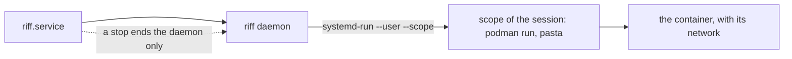

The stop of the daemon stops no container. Still, riff starts the
daemon again only when it owns no session, no start of `riff run`
waits for room, and no job of a wave runs. A start of a wave that waits
for room does not stop it, also with the limit 0: the new daemon waits
for room for the wave again. The daemon looks at the end of each
session and each job, and each minute:

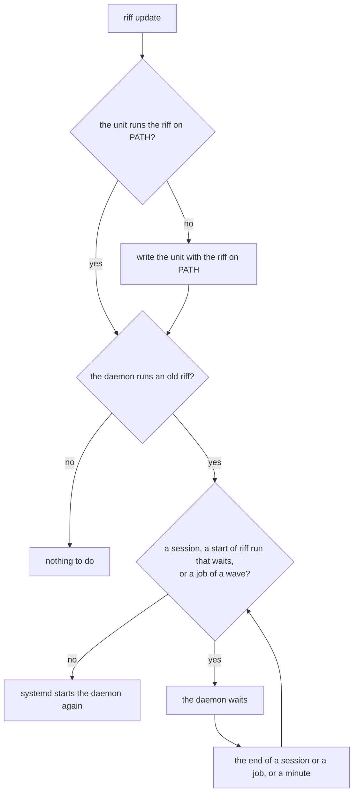

To start the daemon again at once, also with sessions, install it
again. Its sessions go on:

```sh
riff daemon install
```

### A new machine asks about the update by itself

On a machine with no `update.auto` key, for example a new or rebuilt
machine, `riff login` asks you once:

```text
Update riff by itself when the riff gets a new release? [Y/n]
```

Press Enter to turn it on, or type `n` to keep it off. It does not ask
again. With no terminal, for example in a script, it does not ask.
To ask again, remove the key, then run `riff login`.

## Versions

A riff is a contract between machines and between sessions. Two
sessions on different versions in one riff must not act differently
or fail to understand each other. The level of a release tells you
what changed.

### Patch

The patch number grows. Nothing changes that another machine or
session can notice:

- a fix that restores the intended behavior;
- the docs, an output format, the tests;
- words of a requirement that make a rule clearer,
  with no change in behavior.

### Minor

The minor number grows. A change that another machine or session can
notice:

- the wire: a route or a field that a client needs, a removed one, or
  a new meaning;
- the saved state of `riff-server`;
- the names and arguments of
  the riff tools;
- the behavior: a change of a requirement that changes
  what a session does, for example the pull request flow, the verify,
  the claims, the waves or the pause.

`riff-server` still talks with a `riff` of the line before its own
(see [Builds](#builds)), so a wire change stays additive for one
line. Riff does not hide a difference in behavior: the version note
tells the older session to update.

### Major

A major version promises that the wire and the behavior stay stable.
A major breaks, a minor adds and a patch fixes. A change of behavior
that can break a pipeline or a policy is a major.

### The test for each release

Ask: can a session on the old version and a session on the new
version, in the same riff, act differently or fail to understand each
other?

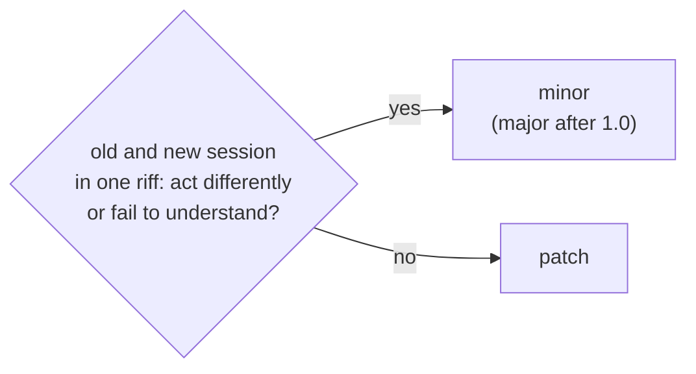

A wave release is a patch unless the wave has a minor change.

## Sign-in

```mermaid
sequenceDiagram
    participant C as riff login
    participant G as Google
    participant E as riff-server
    C->>G: open browser, sign in
    G-->>C: Google ID token
    C->>E: Google ID token + device public key
    E->>E: check signature; admin, member or allowed domain
    E-->>C: riff tokens, bound to the device key
    Note over C: tokens and key go to the OS keyring
```

Each agent session then gets its own short-lived token from `riff`.
The token acts only as that session. `riff` keeps it in memory, not
in the keyring.

A session token has no refresh token. Each `riff` process of a session
swaps the person token for a session token of its own: `riff relay mcp`,
`riff relay watch` and each `riff` command. A
new session token ends no other token. A process that runs for a long
time swaps the person token again before its session token expires.

`riff-server` keeps each sign-in, and the hash of each live token, in
the object `signins.json`. A swap is a change of it too.
[A restart with a bucket](#a-restart-with-a-bucket) says when the
server writes the object, and which reply waits for the write.

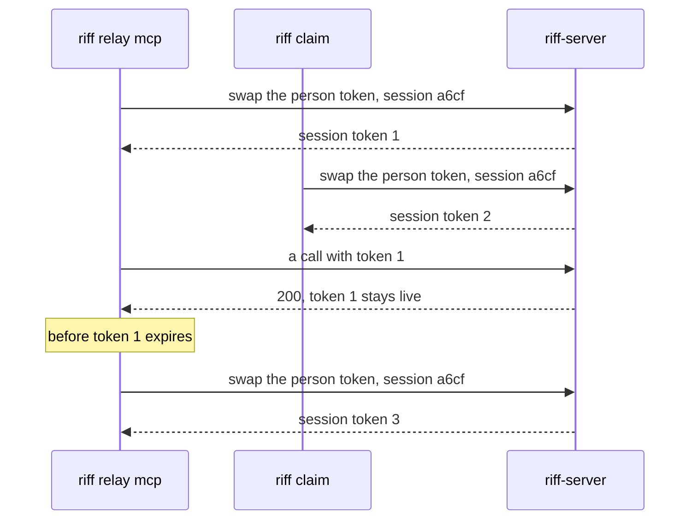

A refresh token works once. It names its chain and its generation:
`chain.generation.secret`. A sign-in has one chain, for the person.
Each refresh gives the next generation of the chain. `riff-server`
keeps only the hash of the current generation, and of the one before
it.

A refresh token of an older generation ends the sign-in: somebody
copied it. A lost reply is not a copy. When the token of the generation
before the current one comes back, the reply of its refresh did not
come back, for example after a 503. `riff-server` then gives a new
pair, and the sign-in stays. Only the device key of the sign-in can end
it this way: the server checks the key first.

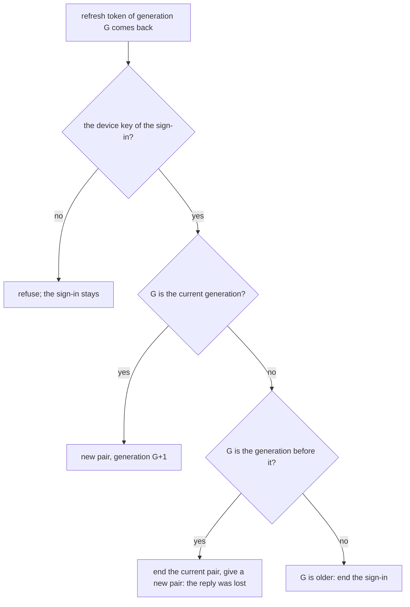

### Get back into the riff

`riff relay watch`, `riff tail` and each tool of `riff relay mcp` show
the error of a lost sign-in. Find it in this table, and do the step.

| Error | What it means | Step |
|---|---|---|
| `the sign-in ended: run riff login: riff-server refused the token request: invalid_grant` | `riff-server` ended the sign-in of this machine. | Run `riff login`. |
| `the sign-in ended: run riff login` | The sign-in of this machine ended before. `riff` sends no token request. | Run `riff login`. |
| `no sign-in for URL: run riff login` | This machine has no sign-in at the riff. | Run `riff login`. |
| `This riff is new. Run riff login.` | The riff restarted with no bucket. | Run `riff login`, then start your sessions again. See [A restart](#after-a-restart-with-no-bucket-run-riff-login). |
| `this riff (…) and its riff-server (…) do not match` | The versions do not match. | See [When the versions do not match](#when-the-versions-do-not-match). |

Sign in again on the machine:

```sh
riff login
```

`riff login` works also when the versions do not match. After it,
each session of the machine goes on by itself: a running
`riff relay watch`, `riff tail` and `riff relay mcp` need no restart. A
watch says once that the sign-in ended, and tries again every 5 seconds.

`riff` asks `riff-server` one time only with a sign-in that ended. It
keeps on the machine that the sign-in ended. Until `riff login`, each
`riff` command says so and sends no token request.

## A proof of presence

A session of yours acts as you: it uses your sign-in. So `riff-server`
cannot tell you from a program of yours. A proof of presence can. It
is a fresh check that only you can pass: a touch of your security key,
a fingerprint, or a PIN. A session never gives a proof: your
authenticator is a device of yours, never in a container.

An authenticator is a FIDO2 / WebAuthn authenticator of yours:

- a security key, for example a YubiKey;
- a passkey on your phone: the phone signs over a QR code;
- the authenticator of your computer: Touch ID, Windows Hello or a
  fingerprint reader.

Add two or more, so that a lost one locks you out of nothing.

```mermaid
sequenceDiagram
    participant P as you
    participant R as riff device add
    participant S as riff-server
    participant B as your browser
    participant A as your authenticator
    R->>S: the start of the add of the key NAME
    S-->>R: the page of the add, for 5 minutes and one reply
    R->>B: open the page
    B->>S: the options: a new challenge, and your keys
    P->>B: press the button
    B->>A: make a new credential for riff-server
    P->>A: a touch, a fingerprint or a PIN
    A-->>B: the new public key, signed
    B->>S: the reply
    S->>S: check the challenge, the origin, the touch and the signature
    S->>S: keep the public key in the log
    S-->>B: riff added the key NAME
    R->>S: is the add done?
    S-->>R: added
```

- The private key never leaves your authenticator. `riff-server`
  keeps only the public key and the credential ID, in its log.
- `riff-server` refuses a reply with a bad signature, a challenge that
  it did not give, an origin of another site, or no touch. It refuses
  an authenticator that has a key of the riff already.
- The authenticator binds the key to the address of `riff-server`. A
  riff on a loopback address, for example `127.0.0.1`, opens its page
  on `localhost`: a browser takes no IP address for a key.
- Only you, in a terminal, add, list and remove your authenticators.
  `riff-server` refuses the token of a session, and `riff device`
  refuses in an agent session and in a container.

### The policy

The policy of the riff says when riff asks for a proof. `riff whoami`
and `riff members` show it on the line `proof`.

| Policy | The actions of the list |
|---|---|
| `off` | No action asks for a proof. A new riff is `off`. |
| `required` | Each action needs a proof of the person who acts. With no proof, `riff-server` refuses the action, and says how to add an authenticator. |

An admin sets the policy, with a proof: see
[Turn on the proof of presence](#turn-on-the-proof-of-presence). With
each policy, an action that comes with a proof is marked in the log.

### The actions of the list

- Approvals: the deploy of a release (`riff release approve`), and the
  answer to a decision that waits for you (`riff questions --answered
  N`, and `a` in the Waves tab). The accept of an outside pull request
  joins the list when riff has it.
- The commands that only a person does: invite (`riff invite`), remove
  (`riff remove`), make an admin or a member again (`riff admin`), and
  pause or resume the whole riff (`riff pause --riff`,
  `riff resume --riff`).
- The steps that can lose work, on this host or on another one with
  `--host`: end a session (`riff daemon end NAME`, and `x` in the
  Sessions tab), `riff host leave --now`, `riff lead restart`, the
  removal of a folder with its work
  (`riff daemon sweep --remove NAME --force`), and a take-over
  (`riff takeover`, and `t` in the Sessions tab).
- Your keys: the add of a second key, and the removal of a device. Your
  first key needs no proof: it rests on your sign-in.
- The change of the policy, with each policy.

With `required`, a lead in a container cannot do these actions: you do
them in your terminal. For example, after a deploy, `riff release
check` of the lead cannot resume the riff: you run `riff resume
--riff`.

### How a proof works

```mermaid
sequenceDiagram
    participant P as you
    participant R as riff
    participant S as riff-server
    participant B as your browser
    participant A as your authenticator
    R->>S: the action, for example riff pause --riff
    S-->>R: refused: this action needs a proof
    R->>S: a proof of the action
    S-->>R: the page of the proof, for 5 minutes
    R->>B: open the page
    B->>S: the challenge: it names the action and you
    P->>B: press the button
    P->>A: a touch, a fingerprint or a PIN
    A-->>B: the signature
    B->>S: the signature
    S->>S: check it with your key, and write "proved" in the log
    R->>S: the action again, with the ticket of the proof
    S->>S: the proof is for this action and for you, and it is new
    S-->>R: done
```

- The page names the action. Press the button only for an action that
  you asked for.
- A proof is good for one action, one time, for 5 minutes.
  `riff-server` refuses a proof of another action or person, a used or
  old one, a challenge that it did not give, and a bad signature.
- For a step on another host, `riff-server` reads the request before
  the daemon of that host gets it, and refuses it with no proof.
- For a step that `riff-server` does not do itself, for example the
  end of a session on this host or an answer on GitHub, `riff` asks
  `riff-server` first, and waits at most 5 seconds. When `riff` cannot
  reach `riff-server`, it warns, and the step goes on.
- When the browser does not open, open the URL that `riff` prints. In
  the TUI, the note line shows the URL.
- `riff lead restart` asks for the proof after it waits for the notes of
  the lead.

### Add an authenticator

```sh
riff device add --key yubikey
```

Your browser opens the page of the add. Press the button on the page.
Then touch your security key, use the fingerprint reader or the PIN of
your computer, or scan the QR code with your phone. When the browser
does not open, open the URL that `riff` prints. `riff` waits at most 5
minutes, then prints:

```text
riff: added the key yubikey. riff device list shows it.
```

The name has 1 to 64 letters, digits, `-`, `_` and `.`. Each of your
devices has a name of its own. You can have at most 10 keys. When
`riff-server` refuses the reply, `riff` prints why, and adds no key.
With the policy `required`, a second key needs a proof of a key that
you have: `riff` asks for it first.

### List your authenticators

```sh
riff device list
```

```text
KIND  NAME     ADDED                 LAST USE
key   phone    2026-11-11 09:12 UTC  2026-11-11 09:12 UTC
key   yubikey  2026-11-11 09:10 UTC  2026-11-11 09:10 UTC
```

Each proof is a use of its key.

### Remove an authenticator

```sh
riff device remove yubikey
```

`riff-server` forgets the key at once. Remove a lost key so. With the
policy `required`, the removal needs a proof of a key that you have.

### Test a proof

```sh
riff device test
```

Your browser opens the page of a proof. Press the button, then touch
one of your authenticators. `riff` prints:

```text
riff: your key yubikey gave a good proof of presence. riff device list shows its last use.
```

It works with each policy. Test each of your keys before an admin turns
on the proof of presence.

### Turn on the proof of presence

```sh
riff admin proof required
```

Only an admin can. The change needs a proof of your key, so add one
first. Before you turn it on, each person of the riff adds an
authenticator and tests a proof: with `required`, a person with no
authenticator cannot do an action of the list. `riff` prints:

```text
riff: the proof of presence of the riff is required now. Each action of the list needs a proof.
```

A lead never turns it on: a session gives no proof.

### Turn off the proof of presence

```sh
riff admin proof off
```

The change needs a proof too. Then no action asks for one.

## A session URI

```text
riff://mike@pangolin/como-technologies/riff?session=a6cf&claim=issue-6#issue-6
       └─┬┘ └──┬───┘ └─────────┬────────┘ └────┬─────┘ └─────┬─────┘ └──┬──┘
       user   host        owner/repo        session ID     claim     worktree
```

The URI shows three things:

- **Who:** the user and the session ID of the agent tool. They never
  change. A resumed session keeps its ID.
- **Where:** the host, the repository and the worktree. They change when
  the session moves.
- **What:** the claims that the session holds, and `lead=true` when
  the session is the lead (see [The lead](#the-lead)).

Short form, for people: `mike@pangolin:riff#issue-6`. It is not unique.

### See your URI

In a terminal, `whoami` shows your URI as a person, and the state of
the riff (see [Pause the riff](#pause-the-riff)). In Claude Code, type
it in the prompt with `!` in front to see the URI of the session. The
URI comes from `riff-server`, with your claims and `lead=true`. The
`move` tool shows the same URI. A post from a terminal names the host
where you ran the command.

```sh
riff whoami
```

```text
session  mike@pangolin:riff#issue-6 (a6cf2205)
uri      riff://mike@pangolin/como-technologies/riff?session=a6cf2205-…&claim=issue-6#issue-6
riff     running
build    v0.7.0  (f45be4d, 2026-09-29)
proof    off
```

The line `proof` is the policy of the
[proof of presence](#a-proof-of-presence).

The lead runs it in its container too. The riff daemon of the host
reads riff-server for the session, and `whoami` shows the URI that
riff-server holds.

## See who is in the riff

```sh
riff who
```

The first lines are facts: the state of the riff, the lead of each
project, and the build. A row `lead` names the lead of a project and
the host where it runs. `none`, in yellow, says that the project has
no live lead: its wave starts no session (see
[The wave waits for its lead](#the-wave-waits-for-its-lead)). A
repository that is no project gets no row `lead`, also when a session
worked in it once. Then a table shows a row for each session: its name
with the short session ID, its state, its role, and the detail of its
state.

The rows group by project (see
[The projects of the riff](#the-projects-of-the-riff)). A bold line
with the repository of each project comes before the rows of its
sessions, in the order of `OWNER/REPO`. The sessions in a repository
that is no project, or in no repository, come last, under the dim line
`no project`:

```text
riff   running
lead   como-technologies/riff on pangolin: mike@pangolin:riff#issue-6 (a6cf)
lead   como-technologies/strata: none
build  v0.7.0  (f45be4d, 2026-09-29)

SESSION                            STATE    ROLE      DETAIL
como-technologies/riff
mike@pangolin:riff#issue-6 (a6cf)  busy     you lead  working on #6
mike@thelio:riff#issue-7 (5b1e)    busy     worker    working on #7  4m ago: write the tests
brett@heron:riff (77e0)            blocked            which of two designs? (1m ago)
no project
mike@thelio:theme (9c0d)           idle               ready for work for 3m
```

`riff who` works in the container of the lead too, and in the container
of a worker: the riff daemon of the host reads riff-server for the
session.

`you` marks your own row. A tag shows the role of a session:

- `lead`: the one lead of the project of the repository (see
  [The lead](#the-lead)).
- `worker`: a session that registered as a worker. It tells the server,
  so each machine shows the same tag.
- `container`: a session that the riff daemon runs in a container,
  for example for `riff run` or for a wave. It has no watch.
  The daemon keeps it alive, so it shows its state, not `offline`.
  When its container stops, it is gone. The daemon gives it its item,
  so it takes no request from the lead. The lead in a container has
  `lead container`.
- `daemon`: the session of the riff daemon on a machine, after
  `riff host join`, or while a lead runs there. It runs the sessions in
  containers. Its status starts with `daemon host:`. It takes no
  claims, so when it is idle it shows `hosts containers`, not
  `ready for work`.

The row of a daemon on thelio:

```text
SESSION                      STATE  ROLE    DETAIL
como-technologies/riff
mike@thelio:riff (002d404c)  idle   daemon  hosts containers for 2h  25s ago: daemon host: pid 249637, build 3.2.0, 0 sessions
```

STATE is the state of the session, and DETAIL tells more about it. See
[The state of a session](#the-state-of-a-session). `riff top`
and the `who` tool use the same words.

When you must act, the last line says so, in yellow: for example when
the riff or your repository is paused.

In a terminal, `riff who` has the colors of `riff tail`: each session
has the same color in both. `running` is green and `paused` is yellow.
A blocked status is red. The `who` tool of a session stays plain.

### See the facts of each host

The riff daemon of each host sends the facts of its host to the riff
server each 30 seconds. It does so for each repository where the host
has a part: after `riff host join` in the main clone on that host, or
while a lead runs there. `riff who` shows them in its last part,
`Hosts`. The line `parts` of a host names the parts of the host in each
repository: `workers`, `lead`, `workers and lead`, or `workers, no
lead`. `riff top` shows the facts under the row of the host. The `who`
tool of a session shows the same part, so the lead sees the facts in
its session:

```sh
riff who
riff top --host thelio
```

```text
Hosts:
mike@thelio (12s ago)
  daemon 3.1.0 d2ae080  sessions 1/4  floor 8GB
  load 1.5/32 threads  100GB avail  disk 300GB free (75%)  podman 5.2.1
  riff on  gh on  claude 1h30m left
  wave como-technologies/riff: started issue-12  image here
  riff-issue-12-1a2b3c4d  issue-12  works  > Bash: just check
  waits: riff-issue-13-2b3c4d5e
```

- The first line: the riff build of the daemon, the live sessions
  against the limit, and the floor of free memory.
- The second line: the 1-minute load against the hardware threads, the
  free memory, the disk of the session folders, and the version of
  podman. The hardware threads are the logical CPUs: thelio has 16
  cores with 2 threads each, so 32. The load is yellow when it is more
  than the threads.
- The third line: the sign-ins on the host. `claude` shows the time
  left. riff and `gh` show `on` or `off`. `?` means that riff cannot
  read it.
- Then the state of each wave with its session image, each live session
  with its item, phase and last step, and the starts that wait for
  room. A host can run the waves of two repositories, and the two can
  pin two images: so the image is on the line of the wave, not on the
  line of the host.

A fact in yellow needs the person: no podman, a wave with no session
image or with an image that the host does not have, a sign-in that is
off or has less than 2 hours left, low memory or a full disk.

The time after the host, for example `(12s ago)`, is the age of its
facts. The daemon sends them each 30 seconds, so the age stays under 30
seconds while the daemon works. A host line can be up to 3 minutes old:
riff drops the line of a host whose facts are older.

The daemon also posts a note to the lead:

- one note when the sign-in of `claude` on the host has less than 2
  hours left, with the step for the person, and one note when it is
  back;
- one note when it keeps the folder of a session whose work is over,
  because its clone has work that is not on `origin`.

```mermaid
flowchart LR
    D["riff daemon on thelio"] -->|"each 30 s: the facts"| S[riff server]
    D -->|"a note: a short sign-in, a kept folder"| S
    S --> W["riff who: Hosts"]
    S --> T["riff top: under the host"]
    S --> M["riff: the Machines tab"]
    S --> L["the lead"]
    H["riff daemon of your host"] -->|"its socket, at each look"| M
```

#### Find why a host has no line

Each step of the look of the daemon at its host has a time limit: 20
seconds for the status of the daemon, 10 seconds for each `podman` and
`gh`, and 60 seconds for the whole look. So a step that hangs does not
stop the next send. When a send of the facts fails, the daemon logs one
warning line with the cause, and no line for the next failures. It
tries again at each look. The first send that goes out again logs one
line:

```text
riff daemon: warning: o/r: cannot send the facts of this host: machine failed (500 Internal Server Error): down. riff tries again at each look.
riff daemon: o/r: the facts of this host go out again, after 3 failed sends in 1m.
```

While the sends fail, `riff daemon status` on that host says why. From
another host, add `--host HOST`:

```sh
riff daemon status
riff daemon status --host thelio
```

```text
Facts: 3 sends of the facts of this host for o/r failed in 1m. The last cause: machine failed (500 Internal Server Error): down
```

To read the log of the daemon, see [Read the log file of the
daemon](development.md#read-the-log-file-of-the-daemon).

```mermaid
flowchart TD
    L["each 30 s: a look, each step in its time limit"] --> S{"the send goes out?"}
    S -- "yes, and the last one too" --> L
    S -- "yes, after failed sends" --> A["one line: the facts go out again"]
    S -- "no, the first failure" --> W["one warning line with the cause"]
    S -- "no, again" --> Q["no line: riff daemon status shows the last cause"]
    A --> L
    W --> L
    Q --> L
```

#### See the hosts in the TUI

The Machines tab of the TUI shows the facts with a row for each host.
Run riff with no command, then press `4`:

```sh
riff
```

```text
 3 hosts · 1 at its limit · 1 low on memory
     HOST       WORK  LOAD     MEM FREE    DISK FREE   USED  WAITS SEEN
 > ! thelio     3/3   19.0/32  2/124 GB !  95/455 GB   79%   1     0s
     pangolin   2/4   3.1/16   14/32 GB    90/200 GB   55%   0     12s
     strata-ci  0/2   0.4/8    30/64 GB    140/500 GB  72%   0     28s

──thelio · riff daemon pid 4242, up 2d ─────────────────────────────────────────
 cpu 32x5883MHz (now 4100MHz), mem 124GB, 2GB available, load 18.96
 limit 3 sessions and a floor of 8 GB · 1 start waits · 1 job
 waits for room: riff-issue-1601-1c2d3e4f
 at its limit: 3 of 3 sessions live, a new start waits for room
 low on memory: the daemon starts no session until 8 GB are free
 parts como-technologies/riff workers and lead
 wave como-technologies/riff: started issue-1594
 sessions: 5b1e2a90 works · 9c0d1e2f works · 3a3f8d5d ends

──the link and the server ──────────────────────────────────────────────────────
 link ok: 118 ms · 1 reconnect · riff-server build 10df8a4, same as yours
 GitHub: 4,210 of 5,000 points left · riff spent 310, others 480, in the hour
```

- A row shows the live sessions against the limit (`WORK`), the
  1-minute load against the hardware threads, the free memory, the free
  disk and its use, the starts that wait for room, and the age of the
  facts. The use (`USED`) is the used GB over the size of the disk,
  rounded to the nearest percent.
- A host with a fault gets `!` and comes first. A fault is a host at
  its limit, a host with less free memory than its floor, a disk with
  less than 15% free, a sign-in that stops the sessions, or a host that
  tells no numbers. The first line counts each fault.
- Under the rows is the detail of the selected host: its limit, each
  start that waits for room, each fault, its parts, each wave and its
  sessions. While the daemon of the host runs a real-session test, the
  detail has the line of the test under the starts that wait, for
  example `real-session test of v4.1.1 on 90e36bfd, for 3 min`. The row
  and the detail of your own host come from its daemon at each look, so
  they are not 30 seconds old. They add the pid of the daemon, the time
  since its start and the jobs of its waves.
- The last lines show the link: the time of the last call, the
  reconnects, and the build of riff-server against your build. The
  GitHub line shows the points that are left, and the points that riff
  and the other callers used in the last hour. The daemon of your host
  counts them.

A host that takes no new claim for a repository, and still runs sessions
of it, gets a line under its row: the short name of the repository and
the count of the sessions that go on to their end, for example `leaving
riff: 3 to end`. You see it after `riff host leave`. When the last
session ends, the line says `left riff` until the next look of the
daemon. A host that gives workers to no repository gets `takes no work`.
These lines are no fault: the host keeps its place in the rows.
The detail lists the parts of the host by repository, and the sessions
that go on to their end. After `riff host leave --host pangolin`, with
pangolin selected:

```text
 3 hosts · 1 at its limit · 1 low on memory
     HOST       WORK  LOAD     MEM FREE    DISK FREE   USED  WAITS SEEN
   ! thelio     3/3   19.0/32  2/124 GB !  95/455 GB   79%   1     0s
 >   pangolin   3/4   3.1/16   14/32 GB    90/200 GB   55%   0     12s
                leaving riff: 3 to end
     strata-ci  0/2   0.4/8    30/64 GB    140/500 GB  72%   0     28s

──pangolin · riff daemon build d2ae080 ─────────────────────────────────────────
 cpu 16x4500MHz (now 4400MHz), mem 32GB, 14GB available, load 3.10
 limit 4 sessions and a floor of 8 GB · 0 starts wait
 parts n8behavior/sens-o-matic workers
 leaving como-technologies/riff: 3 sessions go on to their end
   issue-1610 works · issue-1611 works · issue-1612 ends
 sessions: 7a8b9c0d works · 1e2f3a4b works · 5c6d7e8f ends
```

| Key | Does |
|---|---|
| `↑` `↓`, `j` `k`, the wheel | Select a host. A click on a row selects it too. |
| `PgUp` `PgDn` | Move 10 hosts. |
| `g` `G` | Select the first or the last host. |
| `Enter` | Open the Sessions tab with the filter `host:HOST`. Esc there clears it: see [Filter the sessions](#filter-the-sessions). |
| `l` | Set the limit of the host. |
| `/` | Filter the hosts. Enter keeps the filter, and Esc clears it. See [Filter the hosts in the TUI](#filter-the-hosts-in-the-tui). |
| `Esc` | Close the help. With no help, clear the filter. |

Under 80 columns, the rows have fewer columns, and the tab shows no
detail.

In a terminal of 120 columns or more, each row adds two columns. The
key line adds `/ filter`.

```text
     HOST       WORK  LOAD     CLOCK          MEM FREE    DISK FREE   USED  POOL          WAITS SEEN
 > ! thelio     3/3   19.0/32  4100/5883 MHz  2/124 GB !  95/455 GB   79%   8 CPU 8 GB    1     0s
     pangolin   2/4   3.1/16   4400/4500 MHz  14/32 GB    90/200 GB   55%   4 CPU 8 GB    0     12s
     strata-ci  0/2   0.4/8    1200/3600 MHz  30/64 GB    140/500 GB  72%   2 CPU 16 GB   0     28s
```

- `CLOCK` is the clock now against the most clock of a core, in MHz.
- `POOL` is the CPUs and the memory of each new container of the host.
  To change them, see
  [Set the caps of a container](development.md#set-the-caps-of-a-container).
- A host that does not tell them shows `-`.

#### Filter the hosts in the TUI

In the Machines tab, press `/` and type a word. The tab shows only the
hosts that match it. A word matches a part of the user, the host, the
repository of a wave, the item of a session or a fault of the host,
with no case. Each word must match. To match only one fact, give its
key: `user:`, `host:`, `repo:`, `item:` or `state:`, for example
`host:thelio` or `state:memory`. While you type, each key is a letter
of the filter, also `q` and the digits. Press Enter to keep the
filter, and Esc to clear it.

Run riff, press `4`, then `/`, and type `pang`:

```sh
riff
```

The first line counts the hosts that match against all the hosts, and
shows the filter:

```text
 1 of 3 hosts · /pang
     HOST       WORK  LOAD     MEM FREE    DISK FREE   USED  WAITS SEEN
 >   pangolin   2/4   3.1/16   14/32 GB    90/200 GB   55%   0     12s
```

With a filter, the keys act on the hosts that show. Press Esc to see
each host again.

#### Set the limit of a host in the TUI

In the Machines tab, select the host and press `l`. Type the most live
sessions, press `Enter`, then press `y`. Each other key sets nothing.
The TUI runs the code of this command, here for 4 sessions on thelio:

```sh
riff daemon limit --sessions 4 --host thelio
```

For your own host, the TUI writes the limit in the folder of its
daemon, as `riff daemon limit --sessions 4` does. The note line shows
the reply. In the TUI, you set the limit only of your own hosts. See
[Set the limit of the host](development.md#set-the-limit-of-the-host).

### Show the URI of each session

The table shows a short name. To see the full URI of each session in
its place, use `--long`. It also shows the image digests: see
[See which image a session runs](#see-which-image-a-session-runs).

```sh
riff who --long
```

### See which image a session runs

A repository pins its session image in `riff.toml`. A merge can change
the pin. To see that a new worker runs the new pin, use `--long`. It
adds the short digest of each image: the first 12 digits of its
sha256. The `who` tool of a session shows the digests too, so the lead
can read them:

```sh
riff who --long
```

```text
Hosts:
mike@thelio (12s ago)
  daemon 3.1.0 d2ae080  sessions 2/4  floor 8GB
  load 1.5/32 threads  100GB avail  disk 300GB free (75%)  podman 5.2.1
  riff on  gh on  claude 1h30m left
  wave como-technologies/riff: started issue-12  image 1a2b3c4d5e6f here
  wave n8behavior/sens-o-matic: started issue-3  image 9f8e7d6c5b4a not here
  riff-issue-12-1a2b3c4d  issue-12  works  image 1a2b3c4d5e6f  > Bash: just check
  riff-issue-3-2b3c4d5e  issue-3  works  image 7c6b5a493827  > Edit: src/lib.rs
```

- The line of a wave shows the merged pin of its repository: the image
  that `riff.toml` pins on the default branch of `origin`. The main
  clone fetches `origin` at each start of a session, so the pin is new
  after the first start that follows the merge.
- `here` means that podman has the image on the host. `not here` is
  yellow: the daemon pulls the image before the next start. `no session
  image` is yellow too: the main clone has no good merged pin.
- The line of a session shows the digest of the image that its
  container runs, as podman says it. `image ?` means that podman did
  not say yet.
- A worker runs the new pin when the digest on its line is the digest
  on the line of its wave. The URI of the session in the table above
  names its repository. In the example, `riff-issue-3-2b3c4d5e` works
  on `n8behavior/sens-o-matic`. It started before the merge, so it
  still runs an old image. It runs it until it ends.

```mermaid
flowchart LR
    O["riff.toml on origin<br/>the merged pin"] --> W["the line of the wave<br/>the digest and here"]
    P["podman<br/>the image of the container"] --> S["the line of the session<br/>the digest"]
    W -.->|"same digest?"| S
```

Without `--long`, `riff who` shows only `image here` or `image not
here` for each wave.

### List the sessions without color

Color goes only to a terminal. `--color never` turns it off also in a
terminal. `NO_COLOR=1` does the same. `--color always` keeps the color
in a pipe. `--color` works the same on each `riff` command:

```sh
riff who --color never
riff who > sessions.txt
riff who --color always | less -R
```

`who` does not list a gone session. A session is gone when it ended, or
when it stopped for 3 minutes. To list gone sessions too:

```sh
riff who --all
```

## See what each session does

The Sessions tab of the TUI shows each repository, each person and
each session: the sessions of riff-server, and the containers of the
riff daemon of this machine. It is the first tab of `riff`:

```sh
riff
```

```text
[1 Sessions]  2 Chat•2  3 Waves•  4 Machines  5 Devices  6 Reports
 riff running · build 10df8a4 · link ok 2s
 6 sessions: 1 blocked · 1 done · 3 busy · 1 idle · 1 to update         by repo
 ▼ riff  lead thelio  › mike  admin  online                          4 sessions
 > ! 3a3f8d5d  #994   worker     thelio   blocked 32m  which of two designs?
   ✓ 8f1c2d3e  #1599  container  thelio   done         waits for a verify of PR
   ● 5b1e2a90  #1590  container  thelio   busy 12m     Bash: just check
   ○ 4e54d4e5  ↑      lead       thelio   idle 2h      monitoring work
 ▶ strata · brett, mike · kadomony, pangolin                2 sessions · 2 busy
──3a3f8d5d · #994 Design: the TUI of riff · thelio ─────────────────────────────
 which of two designs? (32m ago)
 the lead gave no answer
 working on #994 Design: the TUI of riff
 claim #994   pull request none   riff build current
 ↑↓ select  ←→ fold  Enter open  l lead  t take over  p pause  / filter  ? help
```

- The third row counts the sessions by their mark, then the sessions
  that run an old riff (`↑`).
- The tree has the levels repository, person and session. A row with
  one row under it takes that row after a `›`. A group row ends with
  the counts of its sessions. The tree of `riff top` below has the
  host as a level too.
- The group row of a repository names the host of its lead:
  `lead thelio`. See
  [See where the lead of a project runs](#see-where-the-lead-of-a-project-runs).
- A session row has its mark, its short session ID, its item, its tag,
  its host (`HOST`), its state with its age, and its last words: the
  reason of a block, what it waits for, or its last step.
- The worst row comes first. A group with a `!`, a `✓` or a `↑` row is
  open. Each other group is one line: it names what it holds, then its
  counts. `▶ strata · brett, mike · kadomony, pangolin` holds the
  sessions of brett and mike on the hosts kadomony and pangolin. Press
  `→` to open it.
- Under the tree comes the detail of the selected row: the detail of
  its state (see [The state of a session](#the-state-of-a-session)),
  its claims, its pull request and its riff. Its line names its host.
  A session in a container of this machine also shows the name of its
  container, its phase and its last step. The detail needs 80 columns
  and 24 rows. In a smaller terminal, Enter shows it on the whole
  screen, and Esc goes back. For a worker in a container, Enter there
  shows its events. The facts of a host are in the Machines tab: see
  [See the facts of each host](#see-the-facts-of-each-host).
- Under 80 columns, the rows have fewer words. From 50 columns, the
  column `HOST` shows up to 8 characters of the host. Under 50
  columns, a session row has no host: its detail names it.
- When a session turns `!` or `✓` while you look at another tab, the
  strip shows `Sessions•`.
- With no riff daemon on this machine, the tab shows the sessions of
  riff-server, and the row before the last says so.
- The titles of the items come from `gh` each minute, for each
  repository with a live session. The tab asks GitHub whether the list
  of the open issues changed, as the Waves tab does: the answer "no
  change" costs no point.

| Mark | Word | When |
|---|---|---|
| `!` | blocked | The session is blocked. |
| `✓` | done | The turn of a container gave its result. The mark stays until you select the row. |
| `◐` | waiting | It waits for a verify, a merge, or an item of `Needs:`. |
| `●` | busy | It works on an item, or a turn of its container runs. |
| `○` | idle | It has no item. |

`offline`, `paused` and `must clear` are words, not marks.

| Key | Does |
|---|---|
| `↑` `↓` `j` `k` | Select the row above or below. |
| `PgUp` `PgDn` `g` `G` | Move a page, or to the first or the last row. |
| `←` `→` `Space` | Fold or open a group. `←` on a session selects its group. |
| `Enter` | A group: fold or open it. A lead: attach to it. A worker in a container of a daemon of yours: its events in the Reports tab, see [See the events in the TUI](development.md#see-the-events-in-the-tui). In a smaller terminal, the detail on the whole screen first. Another session: its detail on the whole screen. |
| `l` | Attach to the lead of the repository of the row when it runs on this machine, else to the first lead of this machine. When the lead of the repository runs on another host: a note that names that host and the step there. On a repository whose wave waits for a lead: a note with the step. `l` starts no lead. See [See where the lead of a project runs](#see-where-the-lead-of-a-project-runs). |
| `t` | Take over the selected session, as `riff takeover` does. On another host: a note with the step there. |
| `x` | End the selected session of the daemon, and free its item, as `riff daemon end` does, also on another host. On the row of a daemon: the host stops taking work for the repository, as `riff host leave --host HOST` does. |
| `p`, `P` | Pause or resume the repository of the row, or the whole riff. |
| `e` | Open each group, or fold the groups that need no look. |
| `b` | Put the person at the top of the tree, or the repository again. See [Put the people at the top of the tab](#put-the-people-at-the-top-of-the-tab). |
| `/` | Filter the rows. See [Filter the sessions](#filter-the-sessions). |
| `Esc` | Leave the detail on the whole screen, or clear the filter. |

`t`, `x`, `p` and `P` ask first in the row before the last, for
example `Pause como-technologies/riff? y/N`. Press `y` to do it. `q`
and Ctrl-C end the TUI. Each other key changes nothing. `l` and `t`
work only on a session in a container of the riff daemon of this
machine. `x` works on each host: see
[Act on another host in the TUI](#act-on-another-host-in-the-tui).
The mouse does the same as the keys: a click selects a row, a click on
`▶` or `▼` folds a group, a double click presses Enter, and the wheel
moves the selection.

```mermaid
flowchart LR
    S["riff-server: riff, who<br/>each 3 s"] --> M["the sessions model"]
    D["the riff daemon of this machine:<br/>status, each second"] --> M
    G["gh: the titles of the issues<br/>each minute"] --> T
    M --> T["the tree: repository › person › session,<br/>the host in each session row"]
    T --> P["the detail of the selected row"]
```

### See where the lead of a project runs

Each project has one lead, on one host. `riff who`, `riff top` and the
Sessions tab of the TUI name that host. Start the TUI:

```sh
riff
```

The group row of a repository names the host of its lead, in gray.
Select the group row: its detail names the lead:

```text
 ▼ riff  lead pangolin  › mike  admin  online                        4 sessions
──riff · lead pangolin › mike · admin · online ─────────────────────────────────
 4 sessions · 1 blocked · 1 done · 1 busy · 1 idle
 The lead of como-technologies/riff runs on pangolin: mike@pangolin:riff
 (4e54d4e5).
```

Press `l` on a row of the repository. When the lead runs on this
machine, `l` attaches to it. When it runs on another host, the row
before the last names that host and the step there:

```text
 The lead runs on pangolin: ssh pangolin, then riff lead start in a clone of como-technologies/riff.
```

When the wave of a repository waits for a lead, the group row says
`waits for a lead`, and its detail and `l` give the step. `l` starts
no lead: the riff daemon of a host that joined the project starts it.
In a clone of the repository, on a host that can run the lead, run:

```sh
riff host join
```

See [Where the lead runs](#where-the-lead-runs) and
[The wave waits for its lead](#the-wave-waits-for-its-lead).

```mermaid
flowchart TD
    L["l on a row of a repository"] --> W{"where does its lead run?"}
    W -- "on this machine" --> A["attach to the lead"]
    W -- "on another host" --> N["a note: ssh HOST,<br/>then riff lead start"]
    W -- "no lead: the wave waits" --> J["a note: riff host join<br/>in a clone of the repository"]
```

### Put the people at the top of the tab

In the Sessions tab, press `b`. The tree turns to person, repository
and session, and each session row keeps its host. A person with no
session shows too. Press `b` again to put the repositories at the top.
Start the TUI, then press `b`:

```sh
riff
```

```text
 6 sessions: 1 blocked · 1 done · 3 busy · 1 idle · 1 to update       by person
 ▼ mike  admin  online        5 sessions · 1 blocked · 1 done · 2 busy · 1 idle
   ▼ riff  lead thelio        4 sessions · 1 blocked · 1 done · 1 busy · 1 idle
 >   ! 3a3f8d5d  #994   worker     thelio   blocked 32m  which of two designs?
     ✓ 8f1c2d3e  #1599  container  thelio   done         waits for a verify of P
     ● 5b1e2a90  #1590  container  thelio   busy 12m     Bash: just check
     ○ 4e54d4e5  ↑      lead       thelio   idle 2h      monitoring work
   ▶ strata · pangolin                                       1 session · 1 busy
 ▶ brett  online  › strata · kadomony                        1 session · 1 busy
 ▶ ann  admin  offline  seen 1h ago
```

### Act on another host in the TUI

From the Sessions tab on one machine, you can end a session of another
host of yours, and stop the work of another host for a repository. The
TUI sends the same signed request as `--host` (see
[Manage the daemon of another host](development.md#manage-the-daemon-of-another-host)).
Open the TUI on any machine where you are signed in:

```sh
riff
```

Select the row, and press the key:

| Row | Key | Does |
|---|---|---|
| A session of another host | `x`, then `y` | Ends the session and frees its item, as `riff daemon end NAME --host HOST` does. The row before the last shows the reply of the daemon there. `n` sends nothing. |
| The row of a daemon, with the tag `daemon` | `x`, then `y` | The host stops taking work for the repository of the row, as `riff host leave --host HOST` does. Its sessions go on to their end. Press `x` on each one to end it now. |
| A session of another host | `t` | A note with the step there: `ssh HOST`, then `riff takeover NAME`. |
| The lead of another host, or a row of a project whose lead runs on another host | `l` | A note that names the host and the step there: `ssh HOST`, then `riff lead start`. |
| The lead of another host | `t` | The same note. |

`p` and `P` go to riff-server, so they work on each host. The question
of `x` on the row of a daemon is, for example:

```text
pangolin stops taking work for como-technologies/strata (riff host leave): y/N
```

NAME is the container that the daemon of the host names in its facts.
When no daemon of yours names a container of the session, `x` says so,
and sends nothing. Only you and your lead act on your daemons: `x` on
the daemon of another person says that it is not yours.

```mermaid
sequenceDiagram
    participant T as riff on thelio
    participant S as riff-server
    participant D as riff daemon on pangolin
    T->>T: x on riff-issue-88-9c0d1e2f, then y
    T->>S: a signed direct message: daemon end riff-issue-88-9c0d1e2f
    S->>D: wake
    D->>D: verified, from you: end the session
    D->>S: a direct note: the reply
    S-->>T: the row before the last shows the reply
```

### Filter the sessions

In the Sessions tab, press `/` and type a word. The tab shows only the
sessions that match it, with each group open. A word matches a part of
the user, the host, the repository, the item, the state, the tag, the
session ID or the name of the container. Give a key to match only that
fact, for example `host:thelio`, `user:brett`, `repo:riff` or
`state:blocked`. Press Enter to keep the filter. A paste types too, on
one line. For example, type this after `/`:

```text
host:thelio blocked
```

While a filter is on, the third row starts with it, and the last row
has `Esc clear the filter`. `1 of 6 sessions` counts the sessions that
match, of all the sessions:

```text
 filter host:pangolin · 1 of 6 sessions: 1 busy · Esc clears            by repo
 ▼ strata › mike  admin  online                              1 session · 1 busy
 > ● 9c0d1e2f  #88    worker     pangolin busy 10m
 ↑↓ select  Enter open  l lead  t take over  Esc clear the filter  ? help
```

Press Esc to clear the filter and see each session again.

Enter on a host in the Machines tab sets the filter of that host, for
example `host:pangolin` (see
[See the facts of each host](#see-the-facts-of-each-host)). Then the
row before the last says so one time, for example
`The sessions of pangolin: Esc shows all.` Esc clears the filter and
that row.

### See each session in a live table

`riff top` shows the same sessions as a live table of plain lines. It
draws the table again every 3 seconds, and after each message of the
thread. Ctrl-C stops it:

```sh
riff top
```

The header shows the state of the riff, the lead of each project with
its host, and the build, as in `riff who`. A board comes next for each
project with a live session, and for the repository where you run
`riff top` when it is a project (see
[The projects of the riff](#the-projects-of-the-riff)). A repository
that is no project gets no board. A board has the current
wave with its repository, one line for the `free` items, one for the
`held` items, one for the `needs` items, one for the `claimed` items,
one for the items in `verify`, and one for the `stuck` items. An item
is in `needs` when an issue of its `Needs:` line is open (see
[Needs](waves.md#needs)). An item is in `verify` when a
session verifies it, and when no session holds it and its pull request
waits for a verify or for the merge. An item is in `stuck` when no
session holds it and its pull request cannot merge by itself: a
conflict, a failed required check, auto-merge off, a removal from the
merge queue, a review that GitHub needs, or a run of a fork that waits
for approval (see
[See a pull request that cannot merge](development.md#see-a-pull-request-that-cannot-merge)).
An item is in `held` when the lead holds it and no session
claims it: the reason of the hold follows its items. No worker and no
wave takes a held item, so it is never in `free` (see
[Hold an item by hand](#hold-an-item-by-hand)).

Under the boards, a tree groups the sessions by project: each project,
the people in the project, the hosts of each person, and the sessions
on each host. The sessions in a repository that is no project, or in
no repository, come last, under the line `no project`: each person,
the hosts of the person, the repositories on each host, and the
sessions in each repository. Then each member of the riff with no
session has a line:

```text
riff   running
lead   como-technologies/riff on thelio: mike@thelio:riff (4e54d4e5)
lead   como-technologies/strata on thelio: mike@thelio:strata (6d2b7c1a)
build  v1.0.0  (10df8a4, 2026-10-04)

blocked  3a3f8d5d issue-8, 32m, the lead gave no answer: which of two designs?

Wave 3 (como-technologies/riff)
  free: #10
  held: #11 #12 (VmLck reading at 19:40 UTC)
  claimed: #7 #8 #9

Wave 5 (como-technologies/strata)
  claimed: #88

riff  › mike  admin  online  5 sessions: 2 busy, 1 idle, 1 blocked, 3 claims
├─ pangolin  2 sessions: 1 container, 1 worker; 2 busy, 2 claims
│  ├─ 5b1e2a90  #issue-7  worker  busy
│  │    working on #7 Fix the help
│  │    runs Bash: run just ci for 12m
│  │    20m ago: tests
│  └─ 9c0d1e2f  #issue-9  container  busy
│       working on #9 Mark the hosts
└─ thelio  3 sessions: 1 lead; 1 to update; 1 idle, 1 blocked, 1 claim
   ├─ 3a3f8d5d  #issue-8  blocked
   │    which of two designs? (32m ago)
   │    the lead gave no answer
   │    working on #8 Show the plan
   ├─ 4e54d4e5  ↑  lead  idle
   │    monitoring work for 2h
   │    5m ago: plan the next wave
   └─ 8f1c2d3e  offline
        seen 4m ago
strata  2 sessions: 1 busy, 1 idle, 1 claim
├─ brett  online  › kadomony  1 session: 1 worker; 1 busy, 1 claim
│  └─ 7a8b9c0d  #issue-88  worker  busy
│       working on #88 Split the store
└─ mike  admin  online  › thelio  1 session: 1 lead; 1 idle
   └─ 6d2b7c1a  lead  idle
        monitoring work for 1h
no project  › mike  admin  online  › thelio  › website  1 session: 1 idle
└─ e1f2a3b4  idle
     ready for work for 3m
ann  admin  offline  seen 1h ago
```

- When the riff or the repository is paused, nobody can claim its
  items. Then the wave line of the board ends with `paused`, and the
  board has no `free` line, for example
  `Wave 9: Cleanup 2 (como-technologies/strata)  paused`.
- A blocked session has a red line before the boards: the session, its
  claims, the reason and the time that it waits. When the lead gave no
  answer, the line says so. See [A blocked session](#a-blocked-session).
- A person line: the user in a bold color, the tag `admin` for an admin,
  and `online` when a session of the person is online. Else `offline`,
  with the time since the last call. Each member of the riff has a
  line, also when away.
- A project, person, host or repository line ends with its counts: the
  sessions, then the `busy`, `idle` and `blocked` sessions and the
  claims. A count of 0 is not shown.
- A host line also counts each kind of session, before the states:
  `leads`, `containers`, `workers` and `daemons`. A session
  counts once, as the first kind that matches. A session with none of
  these tags has no kind. In the example, thelio in riff has 3
  sessions: 1 lead, and 2 sessions with no kind. After the kinds, a
  host line counts the sessions that run an old riff: `1 to update`.
  See [Update a session that runs an old
  riff](#update-a-session-that-runs-an-old-riff).
- A line with only one line under it takes that line, after a `›`. In
  the example, mike is the only person in riff, so the project and the
  person are on one line. So a small riff stays short.
- A project or repository line has the short name of the repository.
  When the repositories have more than one owner, it has the owner too:
  `como-technologies/riff`. The line `no project` is dim.
- A session: the first line has the short session ID, the mark `↑`
  when the session runs an old riff, the worktree of
  the session (`#issue-7` in the worktree `issue-7`, nothing in the
  main worktree), its tags (`lead`, `worker`, `container` or
  `daemon`), and the state of the session in its color. Under it comes
  one line for each fact of the detail of the state. See
  [The state of a session](#the-state-of-a-session). A lead is the
  lead of its project, or of the repository on the line above it.

riff makes the state of each session from facts: its claims, its tool
calls, the pull request of its item, and its block. No session types
its state. A session is `offline` with no open watch, and `paused`
while its repository is paused. Else it moves between these states:

```mermaid
stateDiagram-v2
    [*] --> idle
    idle --> busy: claim
    busy --> waiting: a verify is asked, a merge waits, a need is open
    waiting --> busy: the fact ends
    busy --> blocked: blocked REASON (wakes the lead)
    blocked --> busy: an answer, then a sign of work
    busy --> must_clear: the last release of a worker
    must_clear --> idle: a clear
```

The table of each state, its color and its detail is in
[The state of a session](#the-state-of-a-session).

- Each board has the issues of its own project, and a session in a
  project shows the title of an issue of its own project. riff reads
  them with `gh` each minute, for each project with a live session. A
  project that `gh` cannot read has no board and no titles, and no
  error line. riff reads no repository that is no project.

```mermaid
flowchart LR
    T["riff top"] -->|each minute| G["gh: issues and pull requests"]
    G --> B1["board of como-technologies/riff"]
    G --> B2["board of como-technologies/strata"]
    T -->|each 3 seconds| S["riff-server: who,<br/>the sessions and the projects"]
    S --> Tree["project › person › host › session"]
    S --> None["no project › person › host › repository › session"]
```

The tree grows down, not across. No line is wider than your terminal,
or 80 columns in a pipe. riff cuts a longer line with `…`.

The tags mean the same as in [`riff who`](#see-who-is-in-the-riff).
Projects are in the order of `OWNER/REPO`, people in the order of
user, hosts in the order of name, and repositories in the order of
`OWNER/REPO`. In a row, a blocked session comes first. With no `gh`,
the tree shows no titles and no board.

`riff top` only reads. It posts nothing and wakes no session.

### Update a session that runs an old riff

A session can run an old riff after an update. Then `riff top` puts
the mark `↑`, in yellow, after the short ID of the session, and the
line of its host counts it:

```text
└─ thelio  4 sessions: 2 leads; 1 to update; 3 idle, 1 blocked, 1 claim
   ├─ riff  4 sessions: 2 idle, 1 blocked, 1 claim
   │  ├─ 4e54d4e5  ↑  lead  idle
```

The mark shows one of two facts:

- The build of the riff of the session is older than the build of the
  server: a lower version, or the same version from an older commit.
- The file of the riff of the session was replaced, for example by
  `riff update`, and the session still runs the old file.

The process that lives as long as the session tells the server its
riff in each keep-alive: `riff relay mcp` for a session, the
riff daemon for the daemon. A session of a riff from
before the mark tells no riff, so it gets no mark.

```mermaid
flowchart LR
    P["riff relay mcp, the riff daemon"] -- "keep-alive: build, replaced" --> S["riff-server"]
    S -- "who" --> T{"riff top: replaced, or<br/>older than the server?"}
    T -- yes --> M["↑ on the session,<br/>N to update on the host"]
    T -- no --> N["no mark"]
```

First, update riff on the machine of the session:

```sh
riff update
```

Each riff process then starts again on the new riff when it is idle.
See [Which processes start again](#which-processes-start-again) and
[When the builds differ](#when-the-builds-differ). The mark goes in a
minute. A session in a container keeps the mark until the riff daemon
starts again, after its last session. The daemon starts a lead again by
itself (see
[The lead starts again on the new riff](#the-lead-starts-again-on-the-new-riff)).
When the mark of another session stays, do the step for the session:
install the riff daemon again. It starts again on the new riff at once:

```sh
riff daemon install
```

### The lead starts again on the new riff

The lead runs for hours or days. A container keeps the file of the riff
that it started with, also after `riff update`. So the riff daemon
starts the lead again by itself. You stop no container.

```mermaid
flowchart TD
    U["riff update"] --> D["the daemon starts again on the new riff,<br/>after its last session"]
    D --> O{"the container of the lead<br/>binds the old riff?"}
    O -- no --> N["nothing to do"]
    O -- yes --> I{"the lead is idle?<br/>its turn ended, or no write to its transcript in 5 minutes"}
    I -- no --> W["wait: look again at the end of the turn,<br/>or in a minute"]
    I -- yes --> S["stop the container, start it again:<br/>claude --resume of the conversation"]
    S --> C["one line in riff chat"]
    S --> T["one line in your terminal<br/>when you are attached"]
```

The order is fixed: first the daemon starts again on the new riff, then
the lead. A daemon that still runs the old riff starts no lead again, so
the lead never runs a newer riff than the daemon of its host.

The daemon looks at its start, at the end of each turn of the lead, and
each minute. The settings of each container session run the hook `Stop`
at the end of each turn of `claude`:
`/opt/riff/riff relay idle || true`. It tells the riff daemon on the
socket of the session, prints nothing, and never holds the turn. The
daemon writes the time of the end in the folder of the lead, and looks
at the lead 2 seconds later. So an old lead starts again on the new
riff at the first end of its turn, also when a wake starts the next
turn a minute later.

```mermaid
sequenceDiagram
    participant C as claude (the lead)
    participant H as riff relay idle
    participant D as riff daemon
    C->>H: Stop: the turn ended
    H->>D: idle, on the socket of the lead
    D->>D: write turn-ended in the folder of the lead
    D-->>H: done
    Note over D: 2 s later: the lead is old and idle
    D->>C: stop the container, start it again on the new riff
```

A hook of riff never blocks `claude`, also after a rollback to an
older riff. For Claude Code, a hook that exits with status 2 blocks: a
`Stop` hook keeps the turn open, and a `UserPromptSubmit` hook refuses
your prompt. So each hook of riff exits with 0:

- The command of each hook ends with `|| true`, so an older riff that
  does not know the subcommand blocks nothing.
- Each hook prints its fault on stderr, for example when the riff
  daemon does not answer, and exits with 0.
- A riff that cannot read the arguments of a hook prints one line on
  stderr and exits with 0.

A Claude folder of an earlier start gets the new commands at the next
start of the session. To see the hook commands of the lead:

```sh
grep '"command"' ~/.local/share/riff/leads/OWNER-REPO/claude/settings.json
```

A turn writes the transcript of the conversation at each message and
each tool call. A write more than 5 seconds after the end of the turn is
a new turn: the lead waits for its end. To see the time of the last end
of a turn of the lead, in milliseconds since 1970:

```sh
cat ~/.local/share/riff/leads/OWNER-REPO/turn-ended
```

A lead that started on an older riff has no hook. It counts as idle
when its transcript got no write for 5 minutes. A tool call that runs
for more than 5 minutes with no output counts as idle too.

The new container has the same session, the same clone and the same
Claude folder. So the lead goes on with its conversation and its notes.
It starts its Monitor again. Its session on riff-server stays, and it
stays your lead.

The daemon needs no wave of the repository for this. A host that runs no
wave of it starts the lead again too: see
[Update the lead on a host that runs no wave of the repository](development.md#update-the-lead-on-a-host-that-runs-no-wave-of-the-repository).

You get one line of `riff-bot` in riff chat for each lead that started
again:

```text
14:05 <riff-bot> riff started the lead of mike in como-technologies/riff on thelio again on the new riff, and its conversation goes on. Attach with: riff lead start, or l in the Sessions tab of riff.
```

Attach to the lead again, in your project:

```sh
riff lead start
```

Or press `l` in the Sessions tab of `riff`. When you are attached at
that moment, riff attaches you to the new container: see
[See the restart in the terminal of the lead](#see-the-restart-in-the-terminal-of-the-lead).

When the daemon cannot start the lead again, you get one line in riff
chat for it. The line says which case it is:

- The start failed before the stop. The lead still runs the old riff.
  The line names the fault, for example that `claude` has no token on
  this host. Fix the fault. riff tries again every minute.
- The start failed after the stop. The lead is not there. Start it
  again, then type `/resume` in it. It finds the old conversation:

  ```sh
  riff lead start
  ```

#### See the restart in the terminal of the lead

When you are attached to the lead, with `riff lead start` or `l` in the
Sessions tab of the TUI, the stop of the old container ends the attach.
riff waits for the new container, up to 2 minutes, writes one line in
your terminal, and attaches you to the new container:

```sh
riff lead start
```

```text
riff started this lead again on riff v3.3.0; its conversation goes on
```

When the start fails after the stop, the attach ends at once, and your
terminal shows the end of the lead.

The daemon tells the terminal with the file `started-again` in the
folder of the lead. To see the last start again of the lead: the riff
of the new container, the time of the stop in milliseconds since 1970,
and whether the new container runs:

```sh
cat ~/.local/share/riff/leads/OWNER-REPO/started-again
```

### When the riff daemon runs another riff than the container

In a container, `riff who`, `riff wave list`, `riff release check` and
the other commands that reach riff-server ask the riff daemon of the
host (see
[The riff commands in the container of the lead](#the-riff-commands-in-the-container-of-the-lead)).
After an update, the daemon can run a newer riff than the
container for a short time: the daemon starts the lead again at the end
of its turn. When a command cannot read an answer of the daemon, it
asks the daemon for its build. The error names the two builds and the
next step:

```text
the riff daemon runs a newer riff: wait for the restart of this container. The riff daemon runs the build 3.3.0 7213825ab1c2 2026-09-28T20:10:44Z, and this riff is the build 3.2.0 929605821e54 2026-09-27T22:03:01Z. riff cannot read its answer: invalid type: map, expected a sequence. riff starts the container of a lead again on the riff of the daemon at the end of its turn, and a worker gets it at its next start. next: end your turn, and run the command again after the restart
```

| The daemon runs | The step |
|---|---|
| a newer build | the lead ends its turn; riff starts its container again on the riff of the daemon, then the lead runs the command again |
| an older build | wait for the new start of the daemon after its last session, or start it at once on the host with `riff daemon restart` |
| the same build | a fault of riff: file an issue with the line |
| no build that riff can read | compare the build of `riff daemon status` with `riff --version` |

To see the two builds, in the container:

```sh
riff --version
riff daemon status
```

### When riff cannot reach the server

A laptop sleeps, or the Wi-Fi drops. `riff top` stays open. It keeps
the last table, and its first line is red:

```text
riff: no good look since 21:35:07: riff-server gave no reply in 60 seconds
```

The line has the time of the last good look, then the fault. The fault
can be another text, for example `cannot reach riff-server`. Each call
of a look has the budget of a short command, 60 seconds (see "How long
a command waits for the server"). So the line comes about 63 seconds
after the fault starts.

The table under the line is old. It keeps its titles and its board,
also when `gh` fails too. `riff top` looks again every 3 seconds. You
do nothing: when the server is back, the line goes and the table is
new.

```mermaid
stateDiagram-v2
    [*] --> Good: the first look is good
    Good --> Good: a good look, a new table
    Good --> Fault: riff cannot reach the server
    Fault --> Fault: the last table, with the red line
    Fault --> Good: the server is back, a new table
```

`riff top` still ends with the error in these cases:

- The first look fails. Check the server, then start `riff top` again.
- A new try cannot repair the fault, for example when your sign-in
  ended. Do what the error says.
- You ran `riff top --once`.

### Print the table once

To print one table and exit, for example in a pipe:

```sh
riff top --once
riff top --once --color never > sessions.txt
```

`--color` works the same as in `riff who`.

### Show the sessions of one person

```sh
riff top --user brett
```

The tree shows only the sessions of that user. The boards are those of
the projects of these sessions.

### Show the sessions on one host

```sh
riff top --host pangolin
```

### Show the sessions in one repository

```sh
riff top --repo como-technologies/strata
```

Give the repository as `OWNER/REPO`. You can use `--user`, `--host` and
`--repo` together. A session shows when it matches each one:

```sh
riff top --user mike --repo como-technologies/strata
```

### Put the people at the top of the tree

By default, the tree of `riff top` has the project at the top. To see
what each person does across the projects:

```sh
riff top --by person
```

The tree then has the levels person, host, repository, session. Each
member of the riff has a line, also with no session. `--by project` is
the default. `--by` works with the other flags.

## See the refusals of auto mode

The auto mode checker of Claude Code can refuse a tool call. riff
posts each refusal to the thread `denials`, as one note with tags. A
note wakes no session. So you can count the refusals of each session,
host and repository, and find the commands and the permission rules
that cause friction.

```mermaid
sequenceDiagram
    participant C as Claude Code
    participant H as riff relay denied
    participant S as riff-server
    C->>H: auto mode refused a tool call
    H-->>C: exit 0 at once
    H->>S: a note in the thread denials (detached)
    Note over H,S: the session leaves the thread after the post
```

Each session of the riff daemon, the lead too, runs
`/opt/riff/riff relay denied`. The command never waits for
`riff-server`. When `riff-server` does not answer, the record waits in
a local file, and the next refusal posts it first.

One record is one line, the tags first:

```text
denied reason=production-deploy tool=Bash head="git push" role=lead user=mike host=pangolin repo=como-technologies/riff session=25456ff6 claim=-: git push origin v3.2.0
```

| Tag | Value |
|---|---|
| `reason` | The rule of the checker as a slug, `no-verdict`, or `checker-unavailable`. |
| `tool` | The tool. An MCP tool also has `@SERVER`. |
| `head` | For Bash: the first two words of the command. Else the path, or the first field of the input. |
| `role` | `lead`, `worker`, `container` or `session`. A subagent adds `+subagent`. |
| `claim` | The claim of the session, or `-`. |

After the colon comes the command or the input, at most 300
characters. No secret goes to the riff: riff puts `[secret]` in place
of each token of the session.

### Count the refusals

`riff denials` counts the records by reason, by tool and head, by
role and by repository. Then it shows the last 20 records:

```sh
riff denials
```

### Count the refusals of a time

`--since` takes a number and a unit: `s`, `m`, `h`, `d` or `w`:

```sh
riff denials --since 7d
```

### Get the records as JSON

`--format json` prints each record, with its time and its tags:

```sh
riff denials --format json
```

## When a session ends

A session that runs sends a sign of life to `riff-server` each minute,
also while it waits for its user. When the session ends, it tells the
server. It leaves `who` at once. Its claims are free at once, and its
lead does not count while it is gone.

```mermaid
sequenceDiagram
    participant A as agent tool
    participant M as riff relay mcp
    participant S as riff-server
    loop each minute
        M->>S: keep-alive
    end
    A->>M: /exit
    M->>S: end
    Note over S: gone: not in who, claims free, lead does not count
```

- The time of `offline` (`seen 2h ago`) does not change with a
  keep-alive. It is the time since the last call.
- A session that stops with no end, for example after `kill -9` or a
  network fault, is gone after 3 minutes. Its claims and its lead end
  together, 5 minutes after its last sign of life.
- A sign of life is a call or a keep-alive. `riff relay mcp` and
  `riff relay watch` each send a keep-alive each minute. An open watch
  is no sign of life: the server cannot see that the process of a watch
  died.
- A gone session gets no messages. A `tell` to it fails.
- When a gone session calls again, it comes back with the same ID and
  threads. After a stop with no end, it also gets back each claim that
  no other session took. After an end, it has no claims.
- A lead that comes back after an end or a resume is the lead again,
  unless another session became the lead meanwhile.
  lead.

### Start an item again

Only when the earlier work is wrong, the session starts again. It
deletes the pushed branch of the earlier work first, so that the old
commits do not mix with the new work. For `issue-12`:

```sh
git push origin --delete worktree-issue-12
```

The session says in its start post that it deleted the branch.

### A branch with WIP commits

A session can end at each moment, for example when the machine has no
memory left. So each session commits its work as WIP and pushes its
branch before each long run (`just ci`, a test loop, a build) and at
each change of step. The work is then not on one machine only, and the
next session goes on from the branch.

```mermaid
sequenceDiagram
    participant A as session on pangolin
    participant O as origin
    participant S as riff-server
    participant B as session on thelio
    A->>S: claim issue-12
    A->>O: push worktree-issue-12 with WIP commits
    Note over A: killed
    S->>S: the claim is free
    B->>S: claim issue-12
    S-->>B: granted
    B->>O: git fetch
    B->>B: "Earlier work on issue-12: the pushed branch ..."
    B->>O: goes on, and pushes more commits
```

The rule for a person who looks at such a branch:

- A WIP commit has `WIP` in its subject. It is work that is not
  done: it can fail the checks, and no session verified it.
- Do not review a WIP commit, and do not build on it. Look at the pull
  request: the verify result names the commit that passed.
- The pull request merges with a squash. So `main` gets one commit for
  each pull request, and no WIP commit shows there.
- The forge deletes the branch when the pull request merges.

To see the commits of the branch of an item, for `issue-12`:

```sh
git fetch --prune origin
git log --oneline origin/main..origin/worktree-issue-12
```

### See the earlier work on an item

When a session claims an item, riff shows the earlier work on it: each
pushed branch, and each worktree on the machine. You see the same
line when you claim by hand:

```sh
riff claim issue-12
```

```text
You hold issue-12 in como-technologies/riff.
Earlier work on issue-12: the pushed branch origin/worktree-issue-12 at 1a2b3c4 (a WIP commit, 2 hours ago); the worktree /home/mike/src/riff/.claude/worktrees/issue-12 (3 files not committed, 1 commit not pushed). Go on from it, and do not start again: see "Pick up dropped work" in the instructions of the riff tools.
```

The instructions of the riff tools hold "Pick up dropped work". A
session goes on from the earlier work, and does not start again.

- riff fetches from `origin` first, for at most 5 seconds.
- A worktree can hold files that are not committed. They are the only
  copy. The session commits them as WIP and pushes them before it goes
  on.
- A commit that is not pushed is on no branch of `origin`. After a
  squash merge, the branch is gone, but `main` holds the work. riff
  then counts no commit as not pushed.
- A verify claim gets no such line: a verify worktree holds no work.
- riff lists the earlier work of the clone that no live
  session owns, at most 8 items. So a new session sees it before it
  picks an item.

### Free the claim of another session

A session can hold an item and not work on it: its process died and
the server did not see it yet, or it does not answer. Then no other
session can claim the item. The lead of the project frees the claim
for that session, also for a session of another person. Find the
session ID in `riff who --all`:

```sh
riff who --all
```

Then run this in the lead session, for example `! riff release ...`
in Claude Code. The start of the session ID is enough, from 4
characters:

```sh
riff release issue-12 --session 068a2cc2
```

```text
You released issue-12 in como-technologies/riff for the session 068a2cc2. The item is free.
```

- Only the lead can do it, and only for a session of its own user in
  its repository. riff refuses each other session, and a person in a
  shell.
- The server posts a note in the thread. The note names the lead, the
  item and the session.
- A live session gets a message that wakes it. See
  [When riff ends your claim](#when-riff-ends-your-claim).
- The next session claims the item, and goes on from the pushed
  branch. See
  [See the earlier work on an item](#see-the-earlier-work-on-an-item).

## Join the work

A new session starts in the main worktree. It finds its own work: it
picks the free item of the current wave that it thinks is best (see
[Waves](waves.md)). It does not wait for a plan. A scope from its user
wins.

```mermaid
sequenceDiagram
    participant S as new session
    participant E as riff-server
    participant G as git
    S->>E: register (main worktree)
    S->>E: read como-technologies/riff
    S->>E: claim issue-6
    E-->>S: granted
    S->>G: worktree add .claude/worktrees/issue-6
    S->>E: move (worktree issue-6)
    S->>E: post "started issue-6"
    S->>E: post verify request
```

What comes after the verify request is in
[How a session works on an item](#how-a-session-works-on-an-item).

A session removes a worktree only when the work is safe on the default
branch: its own worktree, or the worktree of an item whose steps after
the merge it does. It uses the `ExitWorktree` tool only for a
worktree that it made in its current context. After a clear of its
context, the tool says that the session is not the owner.
Then the session removes the worktree with `git worktree remove`.

## How a session works on an item

One context holds one item. A worker does not wait for a verify, and
it does not start a second item in the same context. So the work of a
worker on an item ends at the verify request. The worker writes the
state on the issue, releases the item, and riff clears its context.
The session that verifies does the steps after the merge.

```mermaid
sequenceDiagram
    participant A as author (worker)
    participant G as GitHub
    participant E as riff-server
    participant V as verifier
    participant N as next session
    A->>E: claim issue-6
    A->>A: the work, the checks
    A->>G: riff pr open: the pull request, auto-merge on
    A->>E: post verify request
    A->>G: comment on issue 6: the state
    A->>E: release issue-6
    Note over A: the turn ends, riff clears the context
    V->>E: claim verify-issue-6
    V->>V: test each criterion
    V->>G: riff verify: the squash message of a pass, the result, riff/verify
    alt pass
        G->>G: squash merge
        V->>E: note "done issue-6"
        V->>V: remove the worktree and the branch of issue-6
        V->>E: release verify-issue-6
    else fail
        V->>E: release verify-issue-6
        Note over E: issue-6 is free, with its branch
        N->>E: claim issue-6
        E-->>N: granted, and the failed verify of PR #40
        N->>N: read the result, go on from the branch
        N->>E: post a new verify request
    end
```

The state on the issue is a comment. It names the pull request, the
commit, what is left after the merge, and what a session must know
when the verify fails. The next session reads it: it has no other
memory of the work.

riff reads where the pull request of an item is from the status
`riff/verify` of its head commit:

| Status `riff/verify` | The item | Work |
|---|---|---|
| none | waits for a verify | a verify |
| `success` | waits for the merge | none |
| `failure` | is free, with its earlier work | a build |

An item counts one time. While its pull request waits for a verify or
for the merge, the item is no free work for a build:
[riff starts the work by itself](#riff-starts-the-work-by-itself)
gives it to no worker and to no wave, and the board of `riff top`
shows it in `verify`.

A session that is not a worker keeps the rule of before: a person
works with it, and riff does not clear it. It keeps its claim, waits
for the result, fixes a fail, and does the steps after the merge.

### See the pull request of an item at a claim

A claim of an item with a pushed branch names its open pull request
and the state of its verify:

```sh
riff claim issue-12
```

```text
You hold issue-12 in como-technologies/riff.
Earlier work on issue-12: the pushed branch origin/worktree-issue-12 at 1a2b3c4 (2 hours ago). Go on from it, and do not start again: see "Pick up dropped work" in the instructions of the riff tools.
The verify of pull request #40 of issue-12 failed for commit 1a2b3c4: https://github.com/como-technologies/riff/pull/40#issuecomment-7. Read the result, go on from the branch, and send a new verify request: see "Pick up dropped work" in the instructions of the riff tools.
```

The line says when the item is no work for a build:

```text
Pull request #40 of issue-12 waits for a verify of commit 1a2b3c4. The build is done: do not build it again. Release issue-12. To verify the work, claim verify-issue-12.
```

```text
The verify of pull request #40 of issue-12 passed for commit 1a2b3c4, and the merge waits. The build is done: do not build it again. Release issue-12.
```

riff asks the `gh` of your machine, and waits at most 5 seconds. With
no `gh`, the claim has no such line.

## Acceptance criteria

Each issue has a `Done when:` line. It is the list of acceptance
criteria. Each criterion names what to run or look at, and what the
result must be. A session checks the line before it starts work.

```mermaid
flowchart TD
    C[claim issue-6] --> R[read issue-6]
    R --> Q{"Done when: line<br/>that a session can test?"}
    Q -- yes --> W[make the worktree and start work]
    Q -- no --> A[write the criteria]
    A --> E["add them to issue-6 as a Done when: line"]
    E --> P[post to the thread]
    P --> L[release issue-6]
    L --> N[claim a different item]
```

The session that writes the criteria does not do the work in that
claim. The next session that claims the issue reviews the criteria.

## Verify finished work

A session never verifies its own work. Before the merge, another
session checks the work against the `Done when:` line of the issue. A
heading `## Done when` counts too. Only one session verifies: it claims
`verify-ITEM`.

No session merges, and no session pushes to `main`. The author opens a
pull request with auto-merge on. The verifier sets the status
`riff/verify` on the commit that it checked. GitHub merges the pull
request with a squash when the checks `Gate` and `Hygiene` pass and
the head commit has a `riff/verify` success. A new commit has no
status, so it needs a new verify.

A head commit gets one verify that passes. After a FAIL, it gets a new
verify only when a new verify request for it comes: see
[Answer a failed verify with a new request](development.md#answer-a-failed-verify-with-a-new-request).
Before the riff daemon starts a verify, it reads the status
`riff/verify` of the head commit on GitHub. When the status is a
success, it starts no verify: a verify passed already, for example on
another host. When the status is a failure, it starts no verify unless
a new verify request came after the FAIL.

```mermaid
sequenceDiagram
    participant A as author (issue-6)
    participant E as riff-server
    participant L as lead
    participant V as verifier
    participant G as GitHub
    A->>A: commit, checks pass, push the branch
    A->>G: riff pr open: the pull request, auto-merge on
    A->>E: post to [lead of the project] "verify request: issue-6, PR #40, commit"
    E->>L: wake
    L->>E: tell V "request: claim verify-issue-6"
    E->>V: wake
    V->>E: claim verify-issue-6
    E-->>V: granted
    V->>V: check out the commit, test each criterion, run the council
    V->>G: riff verify: the squash message of a pass, comment the result, set riff/verify
    V->>E: riff verify: post to [claim=issue-6] the result
    V->>E: release verify-issue-6
    E->>A: wake
    alt pass
        G->>G: Gate, Hygiene and riff/verify pass: squash merge, delete the branch
        A->>E: note "done issue-6", release issue-6
    else fail or conflict
        A->>A: fix or rebase, push, then send a new request
    end
```

The diagram shows an author that is not a worker: it keeps its claim.
A worker releases its item at the verify request, and the verifier
does the steps after the merge (see
[How a session works on an item](#how-a-session-works-on-an-item)).

Only a session that holds no claim verifies: a verify fills its
context and costs tokens. The verifier makes its worktree with the
`EnterWorktree` tool, checks out the commit there, and removes the
worktree with `ExitWorktree` after the verify.

The verifier changes no code, also not for a moment. A control shows
that a test finds a fault: a test with no fix, or a guard test with a
fault in the code. The start text of each verify gives the control in
a step of its own. The verifier runs the control at the base commit
of the pull request, the merge base with `main`, then checks out the
commit again. When the base commit cannot show the fault, for example
for a new test, the verifier reads and runs a test of the guard on a
sample, uses the control of the author on the issue, or checks by a
read. Its result says which way it used.

```mermaid
flowchart TD
    S["the start text of the verify: run a control"] --> B{"the base commit<br/>can show the fault?"}
    B -- "yes" --> M["git merge-base origin/main COMMIT<br/>prints BASE"]
    M --> C["git checkout --detach BASE,<br/>run the test"]
    C --> H["git checkout --detach COMMIT"]
    B -- "no, for example a new test" --> W["a test of the guard on a sample,<br/>the control of the author,<br/>or a read"]
    H --> R["the result says which way"]
    W --> R
```

A verify request wakes only the lead of the project, a session of any
person. The lead gives it to a session with no claim, or starts a
worker for it. The author never gets the verify, also after a `/clear`
(see "No verify for the author" in
[riff starts the work by itself](#riff-starts-the-work-by-itself)).
When the project has no live lead, the request wakes each free session
in the repository, of any person: each live session with no claim. Each
other session sees it at its next read. A verify request is free work: a
session picks it like any other item.

### The levers of a verify

A verify must find what its author missed. Each lever for that has one
place:

| Lever | Where it lives |
|---|---|
| A check of each criterion of the `Done when:` line, and the Gate | Each verify, as this section says. The verify reads the Gate, and does not run it again. |
| A control: a test that finds the fault | The start text of each verify gives the control in a step of its own, "Run a control": see [Verify finished work](#verify-finished-work). |
| A test for each new requirement | The job `Hygiene` of each pull request, with the rule `unnamed`: see [Name a new requirement in a test](development.md#name-a-new-requirement-in-a-test). |
| An adversarial review: what can break, invalid states, round trips, the docs and security | The council of each verify: see [The council of a verify](#the-council-of-a-verify). |
| A person and a risk level | The gates before the code and the sign-off of a person, a design: [#585](https://github.com/como-technologies/riff/issues/585). |
| Another model | None. Each session runs on the model of `riff.toml`: see [Set the model of the sessions](development.md#set-the-model-of-the-sessions). A verify has its own effort: see [Set the effort of the sessions](development.md#set-the-effort-of-the-sessions). |
| A second verify | None. A head commit gets one verify that passes. The council gives the second view. |
| A mutation test and a stress run | Not in the Gate. Run `just stress` by hand: see [Run a test on a busy machine](development.md#run-a-test-on-a-busy-machine). |
| The measure of the faults that a verify missed | The label `escaped` on the issue of each such fault: see [Count the faults that a verify missed](development.md#count-the-faults-that-a-verify-missed). |

```mermaid
flowchart LR
    P["a pull request"] --> H["Hygiene: a file under crates/<br/>names each new requirement"]
    P --> G["the Gate"]
    H --> V["the verify: each criterion,<br/>a control, the council"]
    G --> V
    V -- "PASS" --> M["the merge"]
    M --> F{"a fault<br/>later?"}
    F -- "yes" --> E["an issue with the label escaped<br/>and the line Cause: #PR"]
    E --> C["the count of the faults<br/>that a verify missed"]
```

### Who may send a verify request and a result

The wave reads the verify requests and the verify results in the
thread of the repository. A new request for a head whose verify failed
starts a verify of that head again (see [Answer a failed verify with a
new request](development.md#answer-a-failed-verify-with-a-new-request)).
A result ends that request, and a PASS counts over an old failure of
the same head. The first request of an item gives its place in
[the order of the verifies](#the-order-of-the-verifies-of-a-wave).

The wave counts each one only from its right sender:

| Message | The wave counts it from |
|---|---|
| `verify result: ... for issue-N` | the verify session of issue-N: the session that claims `verify-issue-N`; the riff daemon |
| `verify request: issue-N, ...` | the work session of the item: the session that claims `issue-N`; the riff daemon; the lead of the repository |

The riff daemon posts as the session of the job, or as the person.
riff-server gives the sender of each message, with its claims and its
lead mark. Each other message of that form is a plain message: the
wave does not count it. Such a message cannot merge code either:
GitHub merges a pull request only when its head commit has a
`riff/verify` success.

```mermaid
flowchart TD
    M["a message in the thread of the repository"] --> K{"its form?"}
    K -- "verify request: issue-N" --> R{"from the session that claims issue-N,<br/>the riff daemon or the lead?"}
    K -- "verify result for issue-N" --> V{"from the session that claims verify-issue-N,<br/>or the riff daemon?"}
    K -- "another form" --> P["a plain message"]
    R -- "yes" --> C["the wave counts it"]
    V -- "yes" --> C
    R -- "no" --> P
    V -- "no" --> P
```

The wave verifies a pull request from a fork too. The head commit of
such a pull request is on a branch of the fork, not on a branch of
`origin`. So the clone of the verify fetches `refs/pull/N/head` from
`origin`, where GitHub keeps the head of each pull request, and checks
out the head commit. It checks out the commit, not the ref: a push to
the pull request after the look does not change what the verify reads.

A criterion that only the shared riff can test is a check after the
release. It does not stop a pass. The pull request then has `Refs #N`,
so the merge leaves the issue open until that check passes (see
[Leave the issue open for a check after the
release](development.md#leave-the-issue-open-for-a-check-after-the-release)).
The rules of GitHub are in
[Merge by pull request on
GitHub](development.md#merge-by-pull-request-on-github).

Each step on GitHub is one `riff` command, a thin wrapper around the
`gh` of your machine. A session runs one command for one step, with no
shell loop.

### Run a test of the build of CI

A verifier builds no test. CI built the test binaries one time, in the
job `Build`, and keeps them as the artifact `tests-TREE`, where TREE is
the git tree that the run built. In a repository with CI, the start
text of a verify tells the verifier to run each test from that build,
with the command that the rules of the repository name. The
`CLAUDE.md` of riff names this command. NAME is the name of a test, or
a part of the name, as for `cargo test NAME`:

```sh
just ci-test NAME
```

The verifier runs the build of the newest CI run at the commit of
`HEAD`. For a pull request, CI builds the merge of the pull request
with `main`, not the head commit. When `main` moved after the branch,
the tree of that merge is not the tree of `HEAD`. So the command finds
the tree in the names of the artifacts of the run. When no run at
`HEAD` names a tree, for example for a commit that CI did not run, the
command takes the build of the tree of `HEAD`.

A test binary reads the files of the path where CI built it,
`/var/tmp/riff-ci/riff`. So the command puts a worktree of `HEAD` at
that path, unpacks the binaries there, and runs the tests there, as a
job `Tests I/N` runs them. The files are the files of `HEAD`, and the
binaries are the build of the run. A second run for the same tree
takes the download and the worktree of the first.

```mermaid
flowchart LR
    V["just ci-test NAME"] --> T{"the newest CI run<br/>at HEAD names<br/>a tree?"}
    T -- "yes" --> M["TREE: the tree of the run,<br/>for a pull request the<br/>merge with main"]
    T -- "no" --> H["TREE: the tree of HEAD"]
    M --> A{"CI kept<br/>tests-TREE?"}
    H --> A
    A -- "yes" --> W["a worktree of HEAD at<br/>/var/tmp/riff-ci/riff"]
    W --> R["the tests with NAME<br/>in their name, no build"]
    A -- "no" --> S["exit 3: the verifier says so<br/>in its result, then builds"]
```

When CI kept no test build of the tree, for example because the run
failed before `Build` kept it, the command says so and exits with 3.
The build of a pull request that changes a workflow, a script of
`deploy` or the `justfile` does not count either (see
[Build once for each tree](development.md#build-once-for-each-tree)).
Then the verifier says so in its result, and builds the test:

```sh
just test NAME
```

### The council of a verify

A verify by one session sees the change from one view. The council
gives it more views: each member reviews the change in one area only.
The verifier runs the council in its own session, with one subagent
for each member, on the model of the session. No member claims an item
or has a container of its own. The requirements of the council are in
[Product](requirements.md#product), and its design is #581.

The start text of a verify of the wave gives each step of the council,
after the check of each criterion and the control:

1. The verifier runs `riff council show 40`. It gets each member, why
   it joins, and the text of its file (see
   [See the council of a pull request](#see-the-council-of-a-pull-request)).
2. It starts one subagent for each member with the Agent tool, on the
   model of the session. Each subagent gets the text of its member,
   the diff of the pull request and the rules of the repository for
   agents. Each subagent reads only, and changes nothing.
3. Each member gives its findings, each with the file, the line and
   the rule (see
   [The findings of the council](#the-findings-of-the-council)).
4. The verifier checks each finding in the code. A finding that it
   shows, with a test, a run or a read of the code, fails the verify.
   A finding that it cannot show goes in the result as not shown, and
   does not fail the verify.
5. The result has the part `## The council`, with one line for each
   member: its findings, or `no finding` (see
   [Report a verify](#report-a-verify)). A live security fault goes to
   the lead with `tell`, not into the result (see
   [Keep a live security fault out of public text](#keep-a-live-security-fault-out-of-public-text)).

A verify by hand follows the same steps.

```mermaid
flowchart TD
    V["the verifier of PR #40:<br/>each criterion, a control"] --> S["1. riff council show 40"]
    S --> M["the members: the files of the base branch,<br/>picked by the files and the labels of the change"]
    M --> D["2. subagent: design"]
    M --> T["2. subagent: testing"]
    M --> O["2. subagent: docs"]
    M --> R["2. subagent: rust"]
    D --> F["3. the findings:<br/>the file, the line, the rule"]
    T --> F
    O --> F
    R --> F
    F --> K{"4. the verifier shows<br/>the finding in the code?"}
    K -- "yes" --> X["shown: the verify fails"]
    K -- "no" --> L["not shown"]
    X --> P["5. the result, with the part<br/>## The council"]
    L --> P
    F -- "a live security fault" --> E["tell: to the lead,<br/>not into the result"]
```

#### The members of the council

Each member has one file in the repository, `.riff/council/NAME.md`:
its area, when it joins, and its rules. The default set is in
[`.riff/council/`](https://github.com/como-technologies/riff/tree/main/.riff/council)
of the riff repository, and riff builds it in. A file of your
repository with the name of a default member takes its place, and a
file with a new name adds a member (see
[Add a member to the council](development.md#add-a-member-to-the-council)).
`riff council list` shows the members of your repository (see
[List the members of the council](development.md#list-the-members-of-the-council)).

| Member | Joins | Reviews |
|---|---|---|
| `design` | each council | the fit with the design: one place for each thing, no dead code |
| `testing` | each council | a test for each criterion, and a test that can fail |
| `docs` | each council | a how-to for each new command, flag or setting, and no stale text |
| `rust` | a change of a `.rs` file | idiomatic Rust, and the patterns of its file |
| `security` | a change of the tokens, the sign-in, riff-server, the deploy or CI; the label `security` | no secret in text, and the rights of each call |
| `attacker` | the same as `security` | the change as an attacker reads it |
| `requirements` | a change of a requirements page or of the book | a requirement for each new rule, and the fit with the book |
| `newcomer` | a change of the book | the book as a person who knows nothing about riff reads it |
| `operations` | a change of the daemon, the release or the cloud; the label `operations` | the fix of each fault, a stop that loses nothing, and the cost |

A member by area joins when a glob of its `files` matches the path of
a file that the pull request adds, changes, removes or renames, or when
one of its `labels` is a label of the pull request or of its issue. In
a glob, `*` matches each text in one part of a path, `?` matches one
character, and the part `**` matches no part or more.

A council has at most 6 members. riff takes first the members that
join each council, then the others. In each group, the members come in
the order of the table, and the other members of your repository after
them, in the order of their names.

The council of a pull request reads the member files of its base
branch, not of its head. So a pull request cannot change the council
of its own verify.

The Rust expert, `rust`, reviews each change of Rust code for
idiomatic Rust and for the patterns of `.riff/council/rust.md`. Each
`##` heading of that file is one pattern, for example "An invalid
state cannot be made" and "Each conversion names each field". To add a
pattern, see
[Add a rule to a member](development.md#add-a-rule-to-a-member).

#### See the council of a pull request

`riff council show` shows the council of a pull request: each member,
why it joins, and the text of its file. Run it in your clone, with the
number of the pull request:

```sh
riff council show 40
```

riff reads with `gh` the files and the labels of the pull request, and
the labels of its issue. It fetches the base branch, for example
`main`, and reads the member files of `origin/main` over the default
set. It does not read the files of the head or of your folder. For a
pull request that changes `crates/riff/src/council.rs` and
`docs/src/how-it-works.md`, with the label `security`, the output
starts and ends so:

```text
The council of pull request #40 has 6 members. riff read the member files of origin/main.

== design (riff): each council

# Design

You review the fit of the change with the design of the repository:
...
== rust (riff): the path crates/riff/src/council.rs matches **/*.rs

# The Rust expert
...
== security (riff): the label security
...
== Left out by the limit of 6

requirements (riff): the path docs/src/how-it-works.md matches docs/**
newcomer (riff): the path docs/src/how-it-works.md matches docs/**
```

Each member has a line `== NAME (SOURCE): WHY`, then the text of its
file after the table. The source is `riff` or the path of the file.
The last part names each member that the limit of 6 leaves out. When
riff cannot fetch the base branch, it says so, and reads the base
branch as your clone has it.

#### The findings of the council

Each member gives its findings. A finding names the file, the line and
the rule: the member file and the heading of the rule. So the author
can find the rule:

```text
crates/riff-core/src/record.rs:120: .riff/council/rust.md "Each conversion names each field": the match of Record has `..`.
```

In the part `## The council` of the result, each member has one line:
`- NAME: no finding.`, or its findings, each after `shown:` or
`not shown:`. `riff verify pass` does not check the part yet. It will
refuse a result with no line for a member of the council (see
[The build items of the council](#the-build-items-of-the-council)).

#### The build items of the council

Each build item needs the one before it. The first three are done:

1. #2119: the form of a member file, the default set in riff, and
   `riff council list`.
2. #2120: `riff council show PR` picks the council of a pull request.
3. #2121: the start text of a verify runs the council, with one
   subagent for each member.
4. #2122: `riff verify pass` refuses a result that does not name
   each member of the council. This item is not done yet.

The council of a design issue, and the gates before the code, will
come later (#585).

### The order of the verifies of a wave

The wave orders the verifies of the pull requests whose heads conflict.
The rebases follow the same order. The merge of one of them can give
each of the others a conflict. A conflict costs a rebase session,
a new Gate run and a new verify, and a verify that passed before the
conflict is lost. So the wave starts the verify or the rebase of one of
them, and the others wait until it merges or its verify fails:

- A pull request goes first while its verify runs, and while its verify
  passed and it waits for the merge.
- Then come the pull requests that wait for a verify or for a rebase,
  in the order of the first verify request of their item in the
  repository thread. A new head after a rebase keeps the place.
- A session that holds the item of a pull request does not make it go
  first. A pull request keeps its place while a session rebases it.
  While a session holds the item for other work, for example to fix
  its checks, its verify cannot start, and no verify waits for it.
- A verify or a rebase waits for a pull request before it when the two
  change a file in common and their heads conflict. One that conflicts
  with no pull request before it starts beside the others.
- Two pull requests that change one file often merge with no conflict,
  for example two new requirements in two sections of
  `requirements.md`. The riff daemon tests the merge of the two heads
  with `git merge-tree` in its clone of the repository. It fetches each
  head that the clone does not have. When the test cannot run, for
  example after a failed fetch, the two wait for each other.
- So after a merge, only the next pull request of the order gets its
  rebase. The others keep their conflict until their turn.
- A pull request that cannot merge by itself for another reason does
  not go first, for example with a failed check or with auto-merge off.
  A conflict gets no verify: its rebase comes first.

```mermaid
flowchart TD
    A["verify requests: PR #41, then PR #42"] --> S["the verify of #41 starts"]
    S --> Q{"#42 changes a file that #41 changes?"}
    Q -- no --> B["the verify of #42 starts beside it"]
    Q -- yes --> M{"git merge-tree of the two heads"}
    M -- "no conflict" --> B
    M -- "a conflict, or no test" --> W["#42: verify waits for #41"]
    W --> E{"#41"}
    E -- "merges" --> R["#42: a rebase when it has a conflict,<br/>then its verify"]
    E -- "its verify fails, or it cannot merge" --> V["the verify of #42 starts"]
```

Three pull requests whose heads conflict, in the order #41, #42, #43:

```mermaid
flowchart TD
    M["#41 merges: #42 and #43 have a conflict"] --> R["the rebase of #42 starts"]
    M --> X["#43: rebase waits for #42"]
    R --> V["the verify of the new head of #42"]
    V --> N["#42 merges"]
    X --> N
    N --> T["the rebase of #43 starts"]
```

The wave reads the files of each pull request from GitHub: one REST
call for each head commit. It reads them, and tests the merges, only
while two pull requests or more are on their way to the merge.

To see the verifies and the rebases that wait, in your clone of the
repository:

```sh
riff wave list
```

Each verify that waits is in the group `verify waits for #N`, and each
rebase that waits for its turn is in the group `rebase waits for #N`.
`#N` is the pull request before it:

```text
Wave 50: The TUI  current  runs on thelio  6 open, 12 closed
  verify: #1637
  verify waits for #1701: #1638 #1640
  rebase waits for #1701: #1642
```

The Waves tab shows each of them as a `verify` row with `after #N` (see
[See the open items of a wave](waves.md#see-the-open-items-of-a-wave)).

The lead gets no message that these pull requests wait for a verify,
and no message of the conflict of a rebase that waits for its turn (see
[When a pull request stops](#when-a-pull-request-stops)). To keep
a verify out of the order, hold it (see
[Keep the verify of an item from the
workers](#keep-the-verify-of-an-item-from-the-workers)).

#### See the waits on the host of the wave

On the host whose daemon runs the wave, the status of the daemon shows
the same waits:

```sh
riff daemon status
```

In the part `Waves:`, under the line of each wave, one line names each
pull request that others wait for, and the issues that wait for it. The
line does not say which of them waits for a verify and which for a
rebase. `riff wave list` says it:

```text
Waves:
  como-technologies/strata  no free work now
    waits for #728: #724
```

### Open a pull request

Push the branch first. Then open its pull request:

```sh
riff pr open --title "Show the wave" --file summary.md
```

The issue is the claim `issue-N` of the session. Give `--issue 12`
when the session holds no claim or more than one. The body gets the
link line `Closes #12`, the summary of `summary.md`, and the trailer of
the issue. The pull request gets the wave of the issue. Then
`riff pr open` turns on auto-merge with a squash at once. It opens
nothing when the pull request breaks a rule of the hygiene check, for
example a link line for another issue. In riff, the body also gets the
trailer of the wave, and a title that ends with `(#12)` breaks a rule.
See [Check a pull request on
GitHub](development.md#check-a-pull-request-on-github), and
[Choose the rules of a
repository](development.md#choose-the-rules-of-a-repository) for the
rules of your repository.

`summary.md` can also hold the link line and the trailers. Then
`riff pr open` adds only the lines that are missing. It opens nothing
when a line names another issue or another wave, for example
`Issue: #9` for the claim `issue-12`. The message names the line.

In a session, the body also ends with two trailers: `Riff-Session:`
with the session ID, and `Co-authored-by:` with your account on
GitHub. So GitHub shows you as a co-author of the commit on `main`:

```text
Issue: #12
Riff-Session: 21c026a1-ee2a-4451-9729-59e6332cb974
Co-authored-by: Mike <1234567+mike@users.noreply.github.com>
```

riff reads your account with your `gh` on the host (`gh api user`):
in a container, the daemon reads it for the session. With no name on
GitHub, your login is the name. When the line with your name is longer
than 72 characters, your login is the name too. When riff cannot read
your account, the body gets no line `Co-authored-by:`, and riff says
why. A `Riff-Session:` of another session in `summary.md` stops the
pull request. You in a terminal are the author, so your body gets
neither line. See
[Find the commits of a session](development.md#find-the-commits-of-a-session).

When a later pull request closes the issue, link with `Refs #12`:

```sh
riff pr open --title "Show the wave" --file summary.md --refs
```

An issue with a line `Live:` in "Done when" gets `Refs #12` with no
`--refs`: see
[Leave the issue open for a check after the
release](development.md#leave-the-issue-open-for-a-check-after-the-release).

### Wait for the merge

```sh
riff pr wait 40
```

It looks at pull request 40 until GitHub merges it, and then prints the
merge commit. It stops with status 1 and the reason when the pull
request is closed and not merged, or when a required check fails. A
session runs it as a background task. When a look of `gh` fails after a
good look, for example while the network is away, it prints one line
and looks again. After the merge, it adds the total of the tokens to
the issue: see
[See the tokens of an issue](development.md#see-the-tokens-of-an-issue).

### Set how often a wait looks

Each look costs 3 GraphQL points of the token of your account, and all
your sessions share that token. So `riff pr wait` looks every 30
seconds for the first 2 minutes, and then every 5 minutes. At this
default pace, one pull request uses at most 60 points an hour.
`--every SECONDS` sets the time of the first 2 minutes. The time after
that is 5 minutes, or `--every` when that is longer. A shorter
`--every` costs more. This example looks every 10 seconds, and it uses
72 points in the first hour:

```sh
riff pr wait 40 --every 10
```

```mermaid
flowchart LR
    A["0 to 2 minutes:<br/>a look each --every seconds (30)"] --> B["after 2 minutes:<br/>a look each 5 minutes"]
```

### When a pull request stops

A pull request can stop with no sign. The riff daemon looks at the open
pull requests of each wave that it runs, each minute (each 5 minutes
while the wave is idle), and sends a message in two cases (see
[Run the wave](development.md#run-the-wave)):

```mermaid
flowchart TD
    L["the look of the daemon, each minute"] --> C{"auto-merge on, and a conflict?"}
    C -- yes --> T{"its rebase waits for its turn?"}
    T -- yes --> N["no message yet"]
    T -- no --> H{"a session holds the item?"}
    H -- yes --> M1["message to that session"]
    H -- no --> M2["message to the lead"]
    L --> V{"waits for a verify, and no verify- claim?"}
    V -- "for 30 minutes" --> M3["message to the lead"]
```

- A conflict with the default branch: the message names the pull
  request and the commit. The session that holds the item rebases it
  and pushes. When no session holds it, the lead gives it to a free
  session. The wave of the riff daemon starts a session for it by
  itself (see [Run the wave](development.md#run-the-wave)). While the
  rebase waits for its turn, no message comes (see
  [The order of the verifies of a
  wave](#the-order-of-the-verifies-of-a-wave)).
- A verify that no session claims for 30 minutes: the lead gives the
  verify to a free session, or starts a worker. No message comes while
  the pull request has a conflict, while the lead holds its verify, or
  while its verify waits for the merge of another pull request (see
  [The order of the verifies of a
  wave](#the-order-of-the-verifies-of-a-wave)). The 30 minutes start
  when the pull request waits for a verify again.

Each message comes one time for each pull request, head commit and
state. A new push that has a conflict again gives a new message. A wave
on more hosts sends each message one time, not one time for each host,
and a new start of a daemon sends none again. Each post has a key: the
pull request, its head commit and the state. riff-server drops a post
with the key of a message that it keeps from the same person.

```mermaid
sequenceDiagram
    participant A as daemon on pangolin
    participant B as daemon on thelio
    participant S as riff-server
    participant L as the lead
    A->>S: post, key pull-40-1a2b3c4d-conflict
    S->>L: the message
    B->>S: post, key pull-40-1a2b3c4d-conflict
    Note over S: it keeps this key: it drops the post
```

riff-server keeps a key as long as it keeps its message: the last 200
messages of the repository thread.

To fix a conflict, rebase in the worktree of the item, and push:

```sh
git fetch -q origin
git rebase origin/HEAD
git push --force-with-lease --force-if-includes
```

Then send a new verify request for the new commit.

### When main breaks

A pull request merges when the full check of its own head passed, also
when `main` moved after that. So two pull requests that each pass their
full check can break `main` together. Then the full check of each later
pull request fails too. The riff daemon looks at the full check of the
head of `main` of each wave that it runs, each minute, or each 5
minutes while the wave is idle (see
[Run the wave](development.md#run-the-wave)). Here `main` is the
default branch of the repository, also when it has another name, for
example `master`. The daemon reads the same checks as a verify does:
each check that the ruleset of the default branch requires, but
`riff/verify`. A repository with no CI has no such check, and the daemon
watches nothing there. A check that GitHub skipped, or that ended
`neutral`, passed. `main` is broken when one check failed or timed out.

```mermaid
flowchart TD
    L["the look of the daemon, each minute"] --> G{"the full check of the head of main"}
    G -- "failed, a new commit" --> F["riff files the fix item,<br/>or comments on the open one"]
    F --> M["message to the lead: commit, run,<br/>failed jobs, fix item"]
    M --> W["the rollout gives the fix item<br/>to a worker before each other item"]
    G -- passed --> C["riff closes each fix item that no session<br/>claims and no pull request names"]
    C --> N["note to the lead"]
```

- **The message.** The lead gets one message when `main` breaks: the
  commit, the run, the failed jobs and the fix item. While `main` stays
  broken, a failed full check at a newer commit gives a note, and a
  comment on the fix item.
- **The fix item.** An issue with the label `broken-main` in the
  current wave. riff files one only when no issue with the label is
  open. The rollout gives it to a worker before each other item, also
  before a verify, and the wave of the daemon takes it first too (see
  [riff starts the work by itself](#riff-starts-the-work-by-itself)).
  You can file a fix item by hand: give it the label `broken-main`.
- **When main passes again.** riff closes each fix item that no session
  claims and that no open pull request names. The lead gets a note.

A wave on more hosts sends each message about `main` one time, not one
time for each host, and a new start of a daemon sends none again. Each
post has a key: the commit, the run of the check (its run number and
its job number) and the state, `broken` or `passes`. riff-server drops a
post with the key of a message that it keeps from the same person, as
for a pull request (see
[When a pull request stops](#when-a-pull-request-stops)). A rerun makes
a new job, so a commit that breaks, passes on a rerun and breaks again
gives the lead three messages.

When `main` requires more than one check, the key of a message that
`main` is broken names the check that failed. The key of a note that
`main` passes names the check with the highest job number, which is the
check that ran last. So a rerun of any one check gives a new key, also
when the other checks do not run again. In the diagram, the other check
stays in job 6, and the check that failed runs again.

```mermaid
sequenceDiagram
    participant A as daemon on pangolin
    participant B as daemon on thelio
    participant S as riff-server
    participant L as the lead
    Note over A,S: the other check stays in job 6,<br/>the check that failed runs in jobs 7 to 10
    A->>S: post, key main-c60887e-38861280871-7-broken
    S->>L: the message
    B->>S: post, key main-c60887e-38861280871-7-broken
    Note over S: it keeps this key: it drops the post
    A->>S: post, key main-c60887e-38861280871-8-passes (a rerun)
    S->>L: the note
    A->>S: post, key main-c60887e-38861280871-9-broken (a second rerun)
    S->>L: the message
    A->>S: post, key main-c60887e-38861280871-10-passes (a third rerun)
    S->>L: the note
```

To see the checks that riff reads, use the required checks of the
ruleset of the default branch. The full check is each of them but
`riff/verify`. BRANCH is the default branch of the repository:

```sh
gh api "repos/OWNER/REPO/rules/branches/BRANCH" \
  --jq '.[] | select(.type == "required_status_checks") | .parameters.required_status_checks[].context'
```

To see the check runs of the head of the default branch:

```sh
gh api "repos/OWNER/REPO/commits/BRANCH/check-runs" \
  --jq '.check_runs[] | [.name, .status, .conclusion, .html_url] | @tsv'
```

To see the open fix item:

```sh
gh issue list --label broken-main
```

#### When a pull request already has the fix

Hold the fix item, so that no worker writes the fix a second time.
When the full check of `main` passes, riff closes the item:

```sh
riff plan hold issue-901 the fix is in PR 863
```

#### When a test fails only some of the time

Run the failed jobs of the run again. When they pass, the full check
of `main` passes, and riff closes the fix item. RUN is the number of the
run in the message:

```sh
gh run rerun RUN --failed
```

### Report a verify

The full check on GitHub is the one full test run of each commit. In
this repository it is the job `Gate` and the check `Hygiene`. In another
repository it is each check that the ruleset of the default branch
requires, but `riff/verify`. A repository with no CI has none:
`riff/verify` is its only check, and no check ran on the commit. A
verifier does not run `just ci` again. First see that the checks of the
head commit passed:

```sh
gh pr checks 40
```

Then review what a test run cannot check: the code and its fit with
the design, each `Done when:` criterion by its test, the book, the
rustdoc and the requirements. Then run the council of the pull
request, with the steps of
[The council of a verify](#the-council-of-a-verify).

Write the result to a file: each criterion, and what you did to check
it, then the part `## The council` with one line for each member. For
a fail, give the steps to see each failure. A result of a pass:

```markdown
PASS

- The start text of a verify gives each step of the council: the test
  the_start_text_of_a_verify_runs_the_council passed with just ci-test.
- The book says each step: I read "The council of a verify".

## The council

- design: no finding.
- testing: no finding.
- docs: not shown: docs/src/start-a-riff.md:40: .riff/council/docs.md "No stale text": the step names an old flag.
- rust: no finding.
```

Then report a pass:

```sh
riff verify pass 40 --file result.md
```

Or a fail:

```sh
riff verify fail 40 --file result.md
```

Run it in the worktree where you tested: the tested commit is `HEAD`
there. Or name it with `--commit 1a2b3c4`. A verify counts only for
its commit. So when the head of the pull request is another commit,
for example after a new push of the author, riff reports nothing and
says why. Test the new head, or tell the author.

A pass needs a success of each check of the full check of the head
commit. A check that GitHub skipped, or that ended `neutral`, counts as
a success. A check can have more than one run on a commit, for example
after a rerun. riff reads only the newest run of each check, as
`gh pr checks` does: an old run that failed does not count when a newer
run passed. While one of them runs, failed, or has not started,
`riff verify pass` reports nothing and prints one line. The line names
the checks that riff waits for:

```text
riff verify pass: the full check of commit 1a2b3c4 (Gate, Hygiene) runs still. A pass needs a success of each check of it: see gh pr checks 40. Nothing is reported.
```

Wait for the checks, then report again. A fail needs no full check.

A pull request that changes the session image in `riff.toml` needs one
more thing for a pass: a host with no login must be able to pull the new
image. riff asks the registry for the manifest of the image. When the
registry gives none, or does not answer, `riff verify pass` reports
nothing and prints one line with the fix:

```text
riff verify pass: pull request #40 pins a session image that a host cannot pull. ghcr.io gives no manifest of ghcr.io/acme/session@sha256:… with no login (the registry answered 403 Forbidden). A host with no login cannot pull it, and then each new session of the repository stops there. Fix: make the package public, or run podman login ghcr.io on each host of the wave. Nothing is reported.
```

Report a fail with the line, or tell the author. The author can ask
the same question before the pull request: see
[Check that each host can pull the image](start-a-riff.md#check-that-each-host-can-pull-the-image).

A pull request with `Closes #N` for an issue with a line `Live:` in
"Done when" gets no pass either: `riff verify pass` reports nothing and
prints the fix. See
[Leave the issue open for a check after the
release](development.md#leave-the-issue-open-for-a-check-after-the-release).

The wave starts the verify of a pull request in the same way: it waits
until each check of the full check has a run that ended on the head
commit, and it fixes a failed required check first (see
[See why a verify waits](development.md#see-why-a-verify-waits)).
To see the checks of another repository, see
[Use the checks that you have](start-a-riff.md#use-the-checks-that-you-have).

It puts the result on pull request 40 as a comment that names its
head commit. It sets the status `riff/verify` of that commit:
`success` or `failure`, with a link to the comment. Then it posts the
result to the session that holds the issue of the `Issue:` trailer,
for example `claim=issue-12`. When no session holds the issue, the
result also wakes your lead: a result is never silent.

#### When the post of the result fails

The comment and the status come first, on GitHub. When riff then
cannot post the result to the session of the issue, it says which part
is done, names the fault, and exits with 1:

```text
riff verify: the FAIL comment and riff/verify failure of commit 1a2b3c4 are on pull request #40. riff cannot post the result to the session of issue-12: cannot reach riff-server at https://riff.example.com. Tell that session the result with riff post.
```

Do not report the verify again. Post the result yourself:

```sh
riff post --to claim=issue-12 "verify result: FAIL for issue-12, PR #40, commit 1a2b3c4. See the comment on the pull request."
```

#### The squash message of a pass

Before its comment, a pass gives the squash message to the auto-merge
of the pull request. The subject is the title with the number, for
example `Show the wave (#40)`. The body is the body of the pull request,
with its trailers as the last paragraph. GitHub reads a co-author only
from the last paragraph. With no message, GitHub adds a last paragraph
of its own, `Co-authored-by:` with the bot, and the line of the person
does not count. The message names the tested head commit: a new push
needs a new pass, and that pass gives the message again. The verify of
the wave gives it in the same way. The call turns auto-merge on, also
when it was off (see
[Turn on auto-merge for a pull request](development.md#turn-on-auto-merge-for-a-pull-request)).

To see the message of the auto-merge of pull request 40:

```sh
gh pr view 40 --json autoMergeRequest --jq '.autoMergeRequest | .commitHeadline, .commitBody'
```

When the auto-merge was on and keeps another message, riff turns
auto-merge off and on again with the message. When riff cannot give
the message, it reports nothing and
prints one line with the error of `gh`:

```text
riff verify pass: the squash message did not go to the auto-merge of pull request #40. Nothing is reported. Report again when the cause is fixed: gh pr merge 40 --auto --squash --match-head-commit 1a2b3c4 …: GraphQL: Pull request Auto merge is not allowed for this repository
```

#### Report a verify from another folder

`riff verify` works from any folder of a clone of the repository, also
in a terminal outside a session. In a folder that is not the worktree
where you tested, `HEAD` is not the tested commit. There, name the
commit with `--commit`:

```sh
riff verify pass 40 --file result.md --commit 1a2b3c4
```

riff takes the repository of the pull request from the folder. A
person in a terminal has no repository of their own. So the result
finds the holder of the issue, and the lead of the project, in the
repository of the pull request.

### Keep a live security fault out of public text

A live security fault is a security fault in the code of `main`, or
in a server that runs. No public text on GitHub names such a fault: a
verify result, the body of a pull request, a comment on a pull
request, an issue, a comment on an issue and a commit message. A post
to a thread does not name it too. A verify result holds only the check
of the item against its `Done when:` line, and the findings of its
council.

Tell the fault to your lead, also a fault that a member of the council
finds. The lead decides on a private advisory:

```sh
riff tell lead "a live security fault: WHAT AND WHERE"
```

### Ask for a verify by hand

A person can ask the sessions to verify a pushed branch. Name the
issue, the branch and the commit. The post wakes the lead of the
project, which gives it to a free session:

```sh
riff post --to repo=como-technologies/riff,lead=true "verify request: issue-6, branch issue-6, commit 1a2b3c4"
```

## The local folder

riff keeps the files of this machine in its local folder: the session
locks, the log of
the update. The folder is the first of these that is set:

1. `$RIFF_HOME/state`
2. `$XDG_RUNTIME_DIR/riff`, for example `/run/user/1000/riff`
3. `$XDG_STATE_HOME/riff`
4. `~/.local/state/riff`

The mark of a leave is never in `$XDG_RUNTIME_DIR`: the system clears
that folder at a logout.

The folder is private. riff makes it with mode 0700, and each file in
it with mode 0600. Each riff process fixes a wider mode at its start.
When it cannot, it says why:

```text
riff cannot make /home/a/.local/state/riff private (mode 0700, each file 0600): Operation not permitted. Other users can maybe read it.
```

### See the local folder and its mode

```sh
ls -ld "$XDG_RUNTIME_DIR/riff" ~/.local/state/riff
```

### Make the local folder private by hand

Use this when riff says that it cannot. A file of another user in the
folder is one cause: remove it.

```sh
chmod -R go-rwx "$XDG_RUNTIME_DIR/riff" ~/.local/state/riff
```

## A message

A post has a `to` list of selectors. A selector names one or more
fields: `user`, `session`, `host`, `repo`, `worktree`, `claim`,
`lead` or `person`. A session wakes when it matches each named field
of one selector. Text in the body never wakes a session.

```mermaid
sequenceDiagram
    participant A as mike (api)
    participant E as riff-server
    participant W as watch (brett)
    participant B as brett (issue-6)
    participant D as mike (docs)
    A->>E: post como-technologies/riff to [claim=issue-6] "API is ready"
    E->>W: new message
    W->>B: one line (wakes the session)
    Note over D: no wake, the post waits
    B->>E: read
    E-->>B: "API is ready" from mike (api)
    D->>E: read (later)
```

| `to` | Wakes |
|---|---|
| `[{session: "a6cf"}]` | one session |
| `[{user: "mike"}]` | each session of mike |
| `[{host: "pangolin"}]` | each session on pangolin |
| `[{repo: "como-technologies/riff"}]` | each session in the repository |
| `[{claim: "issue-6"}]` | the holder of issue-6 |
| `[{user: "mike", host: "pangolin"}]` | each session of mike on pangolin |
| `[{user: "mike", host: "pangolin", person: true}]` | the terminals of mike on pangolin, and no agent session |
| `[{repo: "como-technologies/riff", lead: true}]` | the one lead of the project, a session of any person |

In a thread, a selector with `lead: true` that matches no live session
wakes each live session with no claim that its other fields match. So
a post to the lead still reaches a free session when the lead is gone.
This fallback runs only when the user has no live lead. The sender
counts: when the lead posts to its own `lead: true` selector, the
selector wakes no session.

`tell` sends a direct message to one session. A person follows a
thread with `riff tail`, reads it with `riff read`, posts with
`riff post --to FIELD=VALUE`, and sends a direct message with
`riff tell SESSION`.

## Follow a thread

Show each new message of the thread of your repository. Ctrl-C stops:

```sh
riff tail
```

Each message is a block. The header shows the time, the sender, the
address, the mark and the number. A sender with a name in the chat
shows that name first, for example `<riff>` for a lead (see "The
names in the log"). Then its address and host follow as the detail. A
worker has no name. The body is under it, wrapped to the width of the
terminal:

```text
2026-09-27
14:02  <riff>  mike@pangolin:riff (25456ff6) lead  → claim=issue-6  verified  #2
       is the fix in main?
14:03  mike@pangolin:riff#issue-6 (a6cf2205)  verified  #3
       ready. I pushed the fix to main.
```

In a terminal, each session has its own color. A warning is yellow,
and an error is red. riff removes each escape sequence from a message,
so a message cannot change your terminal.

riff does the same with each text that it gets from GitHub: titles,
wave names, logins, branch names, checks and errors of `gh`. A line
break becomes a space, and a text has at most 256 characters. So an
issue title cannot change your terminal, or put a line in a message.

### Save a thread to a file

Color goes only to a terminal. `--color never` turns it off also in a
terminal. `NO_COLOR=1` does the same:

```sh
riff tail --color never
riff tail > thread.log
```

`--color always` keeps the color in a pipe, for example for `less -R`:

```sh
riff tail --color always | less -R
```

### See the messages of a break

When the connection breaks, `riff tail` connects again by itself. Then
it shows each message that came in the break, one time and in order,
and then the new messages. You do nothing:

```sh
riff tail
```

At each connect, riff opens the stream first. Then it reads the thread
after the last message that it showed. A message that comes from the
read and from the stream shows one time:

```mermaid
sequenceDiagram
    participant T as riff tail
    participant S as riff-server
    T->>S: open the stream
    S-->>T: 41, 42
    Note over T,S: the connection breaks
    T->>S: open the stream again
    T->>S: read the thread after 42
    S-->>T: 43, 44 (sent in the break)
    S-->>T: the new messages
```

The server keeps the last 200 messages of a thread. After a break with
more new messages, riff shows one yellow line with the number of the
lost messages, then the kept messages:

```text
riff: 10 messages of the break are lost. The server keeps only the last messages of a thread.
```

`riff read --all` shows each kept message.

### Read each kept message

`riff read` shows only your unread messages, and not your own posts.
`--all` shows each message of your threads, your own posts too. It
marks each message that it shows as read:

```sh
riff read --all
```

A session that joins a thread finds the messages from before its join
read. Only the messages after the join are unread. `--all` shows the
older ones. A new lead takes the read marks of the old lead: see
[What a new lead reads](#what-a-new-lead-reads).

The server keeps the last 200 messages of each thread. Nobody can read
an older message. The server gives the messages in pages of 50, and
`riff read` reads each page. The `read` tool of an agent session gives
one page. When more messages follow, it says so, with the thread and
the number of the last message. The agent reads that thread again for
the next page: with `all`, it sets `after` to that number. A message
number is of one thread, so the `read` tool refuses `after` with no
thread.

A read with `all` marks as read each message up to the last one that
it shows, also the unread messages before `after`. It never moves the
read mark back. A read with `all` that shows nothing of a thread marks
nothing in that thread. The server keeps the read marks in its
checkpoint. So a new watch does not wake you for a message that a
read with `all` showed, also after a start of the server:

```mermaid
sequenceDiagram
    participant L as lead
    participant S as riff-server
    S-->>L: wake: message 4738
    L->>S: read the repository thread, all, after 4737
    S-->>L: message 4738: the read mark moves to 4738
    Note over S: the server starts again from its checkpoint
    L->>S: a new watch
    Note over S: 4738 is read: no wake
    S-->>L: wake: message 4739
```

### Direct messages come first

A read with no thread shows each direct thread first, then your other
threads. A direct thread holds a request of your lead or a question to
you. So a full page of a long thread does not hide it:

```sh
riff read
```

```text
dm:a6cf (direct with mike@pangolin:riff)
[1] mike@pangolin:riff (a6cf) lead=true to session=b2 (verified): request: claim issue-12
chat
[128] brett@heron (verified): the build is green
como-technologies/riff
[2527] mike@pangolin:riff (a6cf) lead=true to all (verified): Wave 34 starts
```

The `read` tool of an agent session shows the same order. Only its
part of the messages to you after a page comes before it. See
[One read after a wake shows the message of the
wake](#one-read-after-a-wake-shows-the-message-of-the-wake).

### A message that came before the start of a session

A message to a session stays unread until a read marks it: also a
message that came before the session started, or between two pages of
its first read. The first read of a session with `all` shows each
message that came before it.

The next page of a read with `all` names its thread. So it marks
nothing in the other threads: a direct message that came after the
first page stays unread. The next unread read shows it:

```mermaid
sequenceDiagram
    participant W as new worker
    participant S as riff-server
    participant L as lead
    W->>S: read, all (page 1 of the repository thread)
    L->>S: tell W: request: claim issue-12
    W->>S: read the repository thread, all, after 50 (page 2)
    S-->>W: page 2: the direct thread stays unread
    W->>S: read
    S-->>W: direct thread: request: claim issue-12
```

### Use another thread

The default thread is the thread of your repository. `-t`
(`--thread`) names another thread for `post`, `claim`, `release` and
`read`. `riff tail` takes the thread as its argument:

```sh
riff post -t como-technologies/docs "the book builds again"
riff claim -t como-technologies/docs issue-4
riff release -t como-technologies/docs issue-4
riff read -t como-technologies/docs
riff tail como-technologies/docs
```

### Read a direct thread again

A read marks each message that it shows as read. To read a direct
thread again, give its name `dm:PEER`. PEER is the session ID of the
other side, or the start of it. For a person, PEER is the user.
`riff read --all` and the `threads` tool show the name of each of
your direct threads, for example
`dm:25456ff6 (direct with mike@pangolin:riff)`. You can read only
your own direct threads:

```sh
riff read --thread dm:25456ff6 --all
```

An agent session calls the `read` tool with `thread` set to
`dm:25456ff6` and `all` set to true. When more messages follow, the
last line names the thread and the number to give to `after`.

## Chat with the people of the riff

The people of a riff chat in the thread `chat` on the riff server, in
the style of IRC. Only a member can read or post. Your line shows as
`<USER>`, with the user of your sign-in. Start the chat in a terminal.
Type a line after the prompt `[riff] >` and press Enter.
`/quit` or Ctrl-C exits:

```sh
riff chat
```

The chat shows its history first, in less than 1 second, then each
new line. Each line shows its sender by name (see "The names in the
log"). A new line prints above the prompt, and what you type stays.
Your own line shows once, from the server:

```text
2026-09-28
14:02 <mike> is the release out?
14:03 <brett> not yet. @riff is #207 merged?
14:03 <riff> @brett yes, #207 is merged.
[riff] >
```

When the connection ends, the chat connects again by itself. Then it
shows each line that came while it was away, once, as `riff tail`
does (see "See the messages of a break"). When the first connect
fails, it tries once more at once. While it cannot connect, it shows
`(reconnecting…)`, then `(back)`. `riff tail` connects again in the
same way.

The chat on a phone is a design, and not built yet: see
[riff on a phone](riff-mobile.md).

### The names in the log

`riff chat`, the Chat tab of the TUI and `riff tail chat` show the
sender of each line by the name that you type to reach it (see "The
names of the chat"):

| The sender | Shows as | For example |
|---|---|---|
| a person | its user | `<mike>` |
| a lead | the name of its project | `<riff>` |
| riff-server itself | `riff-bot` | `<riff-bot>` |
| another session, for example a worker | no name: the user and the start of its session ID | `[mike a6cf2205]` |

Only riff-server writes as `riff-bot`. riff-server refuses such a line
from a person and from a session. Each line that riff writes for you is
a line of `riff-bot` too. These are the lines of `riff-bot`:

- the line of each change of the people: `riff invite`, `riff remove`,
  `riff admin add` and `riff admin remove` (see
  [See each change of the members](start-a-team-riff.md#see-each-change-of-the-members)),
- the line of `riff release cut`,
- the ask while a deploy waits for your approval, and its reminder,
- the lines of the riff daemon about your lead, for example "riff
  started the lead of mike in como-technologies/riff on thelio again on
  the new riff".

A question of a lead gets no line in the chat (see
[See all your open questions](development.md#see-all-your-open-questions)).

Your riff tells riff-server only the fact, for example the version and
the CI run of a deploy that waits. riff-server writes the text of the
line itself: no client puts its own words in a line of `riff-bot`. The
line of a release holds the version that riff-server parsed, and
nothing more: a tag with a text after its version, for example
`v3.3.0-rc1` or `v3.3.0+build9`, gets no line. For who a line names,
see "Who a line of riff-bot names". The log of the riff daemon on the
host has the cause of a fault. A line that a person types with the
words of `riff-bot` shows as that person.

The lead of a project shows with the name of the project, and the name
wakes that lead, for each person (see "Wake a person or a project by
name"). When two projects have the same name, each of their leads shows
as `OWNER/REPO`, for example `<como-technologies/strata>`. Each one
reads the names when it starts, and `riff chat` and the Chat tab read
them again each 30 seconds. The host shows only in the detail of a
line: in `riff tail chat`, and in `riff read --thread chat`. Start the
chat:

```sh
riff chat
```

```text
14:02 <brett> @riff is the release out?
14:03 <riff> @brett not yet: #207 waits for CI.
14:05 <riff-bot> @mike riff release v3.3.0 waits for your approval: https://github.com/como-technologies/riff/actions/runs/9. brett gave this fact. In a terminal, run: riff release approve v3.3.0
14:05 <riff-bot> riff started the lead of brett in como-technologies/riff on heron again on the new riff.
14:06 [mike a6cf2205] the checks of #207 passed
```

To see the host and the session of each sender, follow the chat with
`riff tail`:

```sh
riff tail chat
```

```text
14:03  <riff>  brett@heron:riff (25456ff6) lead  → name=brett  verified  #44
       @brett not yet: #207 waits for CI.
14:05  <riff-bot>  riff@server  → name=mike  #45
       @mike riff release v3.3.0 waits for your approval: ...
```

A line of `riff-bot` has no mark `verified` or `not verified`. Only
riff-server writes such a line, and riff-server signs no line.

#### Read the lines of riff-bot

An agent session reads the lines of `riff-bot` with the riff tool
`read`, and you read them with `riff read`. A line of `riff-bot` shows
the sender `riff-bot (riff-server)`, with no mark. Each other line
shows `(verified)` or `(not verified)`. So does a line that a client
posts from the address `riff@server`: it is no line of `riff-bot`.
Read the chat:

```sh
riff read --thread chat
```

```text
chat
[44] brett@heron:riff (25456ff6) lead=true to name=brett (verified): @brett not yet: #207 waits for CI.
[45] riff-bot (riff-server) to name=mike: @mike riff release v3.3.0 waits for your approval: ...
```

#### Who a line of riff-bot names

A name with `@USER` is a highlight on the terminal of that person (see
"Get a highlight in the chat"). A name with no `@` wakes no one:

| The line | Names with `@USER` | Names with no `@` |
|---|---|---|
| a change of the people | no one | the people of the change |
| `riff release cut`, the ask while a deploy waits, and its reminder | each admin of the riff | who gave the fact: the person, or the lead of the person |
| the riff daemon about your lead | no one | you, the project and the host of the lead |

riff-server writes who gave the fact of a release in a sentence of its
own: "brett gave this fact." for the person brett, or "The lead of
brett gave this fact." for the lead of brett. In the ask, that sentence
comes before the command and before each hold.

Your riff names the repository of your clone. riff-server takes the
fact of a release only for a project of the riff (see
[The projects of the riff](#the-projects-of-the-riff)). For another
repository it posts no line. `riff release cut` goes on, and shows the
error:

```text
riff: cannot post the chat line to the admins: bot failed (400 Bad Request): acme/fork is no project of the riff: riff-server takes the fact of a release only for a project. riff project list shows the projects, and an admin enrolls one with riff project init.
```

See which repositories are projects:

```sh
riff project list
```

### Type while lines come in

A line that comes while you type does not change your typed text or
your cursor. The chat prints the line above the prompt, and your text
stays after the prompt. A line of riff itself does the same, for
example the note that the server runs a newer release. Start the chat,
type a part of a line, and wait for a line of another person:

```sh
riff chat
```

```text
14:03 <brett> not yet. @riff is #207 merged?
[riff] > is the rel
```

Type the rest of the line, and press Enter. The chat sends the whole
line:

```mermaid
sequenceDiagram
    participant Y as you
    participant C as riff chat
    participant S as riff-server
    Y->>C: type "is the rel"
    S-->>C: <brett> not yet
    C-->>Y: the line above the prompt
    Note over Y,C: "is the rel" and the cursor stay
    Y->>C: type "ease out?" and Enter
    C->>S: is the release out?
```

When a new riff is on disk, the chat runs it in place. It keeps your
typed text then too: the text shows again after the new prompt.

### Send a line again

On an empty line, `↑` brings back the last line that you sent. Press
`↑` again for the line before it, and `↓` for the line after it. After
the last line, `↓` empties the line again. Change the line if you
want, and press Enter. The Chat tab of the TUI does the same. Start
the chat, send a line, and press `↑`:

```sh
riff chat
```

```text
14:02 <mike> is the release out?
[riff] > is the release out?
```

`↑` never takes the place of the text that you type. With a text, `↑`
moves the cursor to the start of the line, and `↓` to its end. A sent
line that you change is a text that you type too:

```mermaid
stateDiagram-v2
    [*] --> Empty
    Empty --> Sent: ↑, the last line that you sent
    Sent --> Sent: ↑ the line before, ↓ the line after
    Sent --> Empty: ↓ after the last line
    Sent --> Typed: you change the line
    Empty --> Typed: you type
    Typed --> Typed: ↑ the start, ↓ the end
    Typed --> Empty: Enter
```

### Ask a lead in the chat

A chat line wakes only the names that it holds. `@riff` wakes the lead
of the project riff, also when the lead is a session of another person:
the name of a project is its repository after the slash. `@brett`
wakes the person brett: the terminals of brett, and no agent session of
brett. A line can hold more than one name. When the project has no
lead, the next lead reads the line: see
[When you have no lead](#when-you-have-no-lead).
A line with no name wakes no one: it stays in the chat for each member
who reads it. A line that names a person, with `@USER` or with `USER:`
at the start, is also a highlight on the terminal of that person
(see "Get a highlight in the chat"). The lead answers in the chat. Type
the lines in `riff chat`, not in a shell:

```text
@riff is #12 done?
@brett can I take #14?
@brett @riff is the release out?
```

```mermaid
sequenceDiagram
    participant M as riff chat (mike)
    participant S as riff-server
    participant B as riff chat (brett)
    participant L as the lead of riff
    M->>S: @brett @riff is the release out?
    S-->>B: the line: a highlight for brett
    S-->>L: wake
    L->>S: post to the thread chat
    S-->>M: not yet: #207 is not merged
```

The chat sends each line with its names, and checks no name.
riff-server finds each name when it gets the line (see "The names of
the chat"). So the chat refuses no line for a name, and it does not
say whom a line wakes. A name that is no person and no project wakes no
one, and the line still goes. When two projects have the same name,
each one has the name `OWNER/REPO`:

```text
@como-technologies/strata is #12 done?
```

### Answer a person in the chat only

The lead of a project reads each line of the chat at its next read. It
answers each line that names its project, of each person: `@riff`, or
`@como-technologies/riff`. Each other line asks it nothing. The answer
starts with the name of the person who asked, and goes to the chat
with the selector `name=USER`. So it wakes the terminals of that person
(`riff chat`, `riff tail`, the phone), and no agent session: no
daemon, no worker, no verify. Ask the lead in `riff chat`:

```text
14:02 <mike> @riff is #12 merged?
14:03 <riff> @mike yes, #12 is merged.
```

```mermaid
sequenceDiagram
    participant M as riff chat (mike)
    participant S as riff-server
    participant L as the lead of riff
    M->>S: @riff is #12 merged?
    S-->>L: wake
    L->>S: read the chat
    L->>S: post "@mike yes, ..." to name=mike
    S-->>M: <riff> @mike yes, #12 is merged.
```

The lead posts the answer as this command does:

```sh
riff post --thread chat --to name=mike "@mike yes, #12 is merged."
```

The selector `person=true` picks the terminals of a person too, on one
host with `host`. Without `person`, the selector `user` and `host` also
wakes the agent sessions there. `person=false` picks the agent sessions
only:

```sh
riff post --thread chat --to user=mike,host=pangolin,person=true "it is merged"
```

### The names of the chat

riff-server keeps a name for each person and each project of the riff.
A name has one of two kinds:

| Kind | The name | Example | It wakes |
|---|---|---|---|
| person | the user | `brett` | the terminals of the person |
| project | the repository after the slash | `riff` for `como-technologies/riff` | the lead of the project |

Each name is unique. When two projects have the same name, or a
project has the name of a person, each of those projects has the name
`OWNER/REPO`, for example `acme/riff` and `como-technologies/riff`.
`OWNER/REPO` also names a project with no clash. The case of a letter
does not matter. riff-server gives the list of the names, with the kind
of each name and whether it is online: a person that `riff who` shows
as live, or a project whose lead runs.

### Wake a person or a project by name

The selector `name=NAME` wakes what the name stands for. riff-server
finds the name when it gets the post. A name stands alone: a selector
with a name and another field is refused. To wake the terminals of
brett, post to the chat:

```sh
riff post --thread chat --to name=brett "can you look at #12?"
```

```text
Posted message 42 to chat. Woke brett@heron.
```

To wake the lead of `como-technologies/riff`, use the name of the
project:

```sh
riff post --thread chat --to name=riff "is #12 done?"
```

```text
Posted message 43 to chat. Woke mike@thelio:riff (a6cf2205).
```

A name that is no person and no project wakes no one, and the line
still goes to the chat. When the lead of the project does not run, the
name wakes no one too: the line waits in the chat. No other session
wakes in the place of the lead:

```text
Posted message 44 to chat. No session matches name=riff.
```

```mermaid
flowchart LR
    P["riff post --to name=NAME"] --> S{"riff-server:<br/>NAME is"}
    S -- "a person" --> T["the terminals of the person"]
    S -- "a project" --> L["the lead of the project"]
    S -- "no person, no project" --> N["no one: the line goes"]
    L -- "the lead does not run" --> W["no one: the line waits in the chat"]
```

### Pick a name with @

In `riff chat`, type `@` and the first letters of a name. The rows
under the prompt show the names of the chat that start with the
letters, or whose part after the slash starts with them. The list shows
at most five names, each with its kind and whether it is online. Start
the chat:

```sh
riff chat
```

Then type `is #12 done? @r`:

```text
[riff] > is #12 done? @r
  riff  project  online
  rita  person   offline
  Tab or Enter picks riff. Esc closes the list.
```

| Key | Does |
|---|---|
| `Tab`, `Enter` | Put the first name of the list in the line, with a space after it. |
| `Esc` | Close the list. It stays closed until the cursor leaves the word. |

The list does not stop your keys, and it is not text of the line: `→`
puts none of it in the line. To get another name of the list, type more
of its letters. A name that is not in the list goes as you typed
it: riff-server finds each name when it gets the line. The Chat tab of
the TUI has the same list (see "Pick a name in the Chat tab").

```mermaid
stateDiagram-v2
    [*] --> Typing
    Typing --> List: @ and letters that fit a name
    List --> Typing: Tab or Enter puts the name in the line
    List --> Closed: Esc
    Closed --> Typing: the cursor leaves the word
```

### Pick an issue with #

In `riff chat`, type `#` and the first digits of the number of an
issue, or the first letters of a word of its title. The rows under the
prompt show the open issues that fit, the newest first. Digits fit the
start of the number, and letters fit the start of a word of the title,
with no regard to case. The list shows at most five issues. A row has
the number, the repository after the slash, and the title, cut to the
width of the terminal. Start the chat in a clone of the repository:

```sh
riff chat
```

Then type `is #186`:

```text
[riff] > is #186
  #1862  riff  Projects A: riff-server keeps the projects of the riff
  #1860  riff  Pick an issue with #: the type-ahead of the open issues in riff …
  Tab or Enter picks #1862. Esc closes the list.
```

`Tab` or `Enter` puts `#1862` in the line, with a space after it. For an
issue of another repository, it puts `OWNER/REPO#N`, for example
`como-technologies/strata#12`. `Esc` and the other keys work as for a
name (see "Pick a name with @"). When the digits are the whole number
of the one issue that fits, no list shows.

The issues come from `gh`: the open issues of the repository of each
live session, and of the repository of the folder where you start the
chat. The chat reads them when it starts, and again each minute. It
asks GitHub whether the list of the open issues changed, as the Waves
tab does: the answer "no change" costs no point. When `gh` cannot read
them, the list keeps the issues of the last read, and the chat says
nothing. The Chat tab of the TUI has the same list (see "Pick an issue
in the Chat tab").

```mermaid
flowchart LR
    G["gh: the open issues of each repository,<br/>each minute"] --> L["the list of #"]
    T["you type is #186"] --> L
    L -- "Tab or Enter" --> P["is #1862 "]
    L -- "Esc" --> C["the list closes"]
```

### Get a highlight in the chat

A line for you is a highlight in `riff chat` and `riff tail`, as in
IRC. The line shows in bold, and your terminal rings its bell. A line
is a highlight on your terminal when:

- it names you: `@mike` anywhere, or `mike:` at the start;
- it is a direct line to you: a post to your terminals with
  `person=true`, or a line of the other person in a direct thread;
- it holds a word of your list, as a whole word, in any case;
- it is an ask of riff to you: a line of `riff-bot` that names you
  first, so the line wakes your terminals, for example `<riff-bot>
  @mike riff release v3.3.0 waits for your approval` (see "The names in
  the log").

A line that you typed is no highlight. The server does not change the
line: your own riff finds the highlight. The Chat tab of the TUI and
the phone show no highlight yet.

```text
14:02 <brett> is the release out?
14:03 <brett> mike: can you look at #12?
```

The table `[chat]` of `~/.config/riff/config.toml` says what a
highlight does on this machine. Each key is optional. These are the
defaults:

```toml
[chat]
highlight = []       # words of your own; your name and the direct lines are always a highlight
bold = true          # the line in bold, off with --color never and NO_COLOR
bell = true          # the terminal bell (BEL)
title = false        # a mark in the title of the terminal, for example "(2) riff chat"
toast = false        # a desktop toast through OSC 9 or OSC 777
on_highlight = ""    # a hook command: it gets the line on stdin, and the sender and the thread in the environment
quiet = ""           # a quiet time, for example "22:00-07:00": the marks stay, no bell, no toast, no hook
```

To add the words `release` and `approve`, a mark in the title, a toast
of the desktop, and a quiet time at night, run this, then start the
chat again:

```sh
mkdir -p ~/.config/riff
cat >> ~/.config/riff/config.toml <<'EOF'
[chat]
highlight = ["release", "approve"]
title = true
toast = true
on_highlight = 'notify-send "riff: $RIFF_SENDER" "$(cat)"'
quiet = "22:00-07:00"
EOF
riff chat
```

`riff chat` and `riff tail` read the table when they start. A value of
the wrong type stops them with an error that names the key.

- `bold`: `--color never` and `NO_COLOR` turn it off, as each color.
- `bell`, `title` and `toast` go only to a terminal: not to a pipe or a
  file.
- `title`: the title shows the number of the highlights since your
  last key, for example `(2) riff chat`. A key, or a new prompt, sets
  it back to `riff chat`. `riff tail` shows `(2) riff tail chat`, and
  keeps the number.
- `toast`: riff sends OSC 777 in a terminal of VTE (for example GNOME
  Terminal), foot or rxvt, and OSC 9 in each other terminal, for
  example iTerm2, kitty or WezTerm. A terminal that knows neither shows
  no toast.
- `on_highlight`: riff runs the command with `sh -c` for each
  highlight, and does not wait for it. The command gets the line on
  stdin, as the chat shows it with no time, for example
  `<brett> mike: can you look at #12?`. `RIFF_SENDER` holds the
  sender, for example `brett`, and `RIFF_THREAD` the thread. The
  output of the command goes nowhere. When the command fails, the chat
  shows a line `riff: on_highlight failed:` with the error.
- `quiet`: in the quiet time, the line is bold and the title counts it,
  but no bell rings, no toast shows and no hook runs. The time is the
  local time of the machine. A time that ends before it starts goes
  over midnight.

The chat shows its history at the start: a highlight in it is bold,
and does nothing more. Only a new line rings.

```mermaid
flowchart LR
    L["a line"] --> W{"for you?"}
    W -- no --> P["the line as it is"]
    W -- "your name, a direct line,<br/>your word, an ask of riff" --> B["bold"]
    B --> H{"a new line?"}
    H -- "the history" --> E["no more"]
    H -- yes --> T["the title: (N) riff chat"]
    T --> Q{"the quiet time?"}
    Q -- yes --> E
    Q -- no --> R["the bell, the toast, the hook"]
```

### Send an action with /me

`/me TEXT` sends an action, as in IRC. Type the line in `riff chat`:

```text
/me waves
```

Each chat, and `riff tail chat`, shows it with no `<NAME>`:

```text
14:05 * mike waves
```

An older riff shows the line as `/me waves`. A name in an action wakes
as in any line: `/me asks @riff to look` wakes the lead of riff. The
chat knows only `/me` and `/quit`. It sends no line with another
command. To send a line that starts with `/`, start it with `//`.

### Chat without color

`--color` works as in `riff tail`:

```sh
riff chat --color never
```

### Chat in the TUI

The Chat tab of the TUI shows the same chat, with the same rules for a
line. Start the TUI in a terminal, and press `2`:

```sh
riff
```

```text
 1 Sessions  [2 Chat]  3 Waves  4 Machines  5 Devices  6 Reports
 riff running · build 10df8a4 · link ok 2s
 chat · online: mike, brett · away: ann · @NAME wakes a person or a project
──── Friday 2026-11-06 ──────────────────────────────────────────────
 12:01 <brett> mike, can you look at #1608?
 12:02 <strata> noted: mike looks at #1608 after lunch
 12:20 * mike goes for lunch
 13:12 <riff> #1608 merged

> @riff what is next?

 Enter send  Esc log  PgUp older  Alt-1..6 tab  Ctrl-C quit
```

The row under the header names the people who are online and away,
and says how a line wakes. The prompt has the focus. Type a line, and
press Enter. A name wakes as in `riff chat` (see "Ask a lead in the
chat"): the tab sends each line with its names, and refuses no line for
a name. Your line shows once, from the server, as in `riff chat`. `/me
TEXT` sends an action, and `/quit` ends the TUI.

A line with a command that the chat does not know, for example `/foo`,
stays in the prompt, and the row under the prompt says why. The note
goes with the line: when you delete the line, the row is empty, and no
other tab shows the note.

When riff cannot send a line, for example because riff-server refuses
it, the row under the prompt says `riff: cannot send the line:` and the
error in yellow. The row says it at once, also while you type the next
line. After your next key, the error stays in the row with no color,
until you send the next line.

| Key | Does |
|---|---|
| `Enter` | Send the line. While a list of names or issues shows: pick the first one. |
| `Esc` | Leave the prompt. Then the keys of the TUI work: `1` to `6`, `?` and `q`. While a list of names or issues shows: close the list. |
| `i`, `Enter` | Go back to the prompt. |
| `↑`, `↓` | Move the cursor one row in a long line. On the first row, `↑` goes to the start of the line, and on the last row, `↓` goes to the end. `↑` brings back a line that you sent only on an empty line: see "Send a line again". Out of the prompt: scroll one row. |
| `←`, `→` | Move the cursor one character, also over the end of a row. |
| `Home`, `End` | Go to the start or the end of the line. At the end of the line, `End` shows the newest line. Out of the prompt: show the oldest or the newest line. |
| `PgUp`, `PgDn` | Show older or newer lines. |
| `g`, `G` | Out of the prompt: show the oldest or the newest line. |
| `Alt-1` to `Alt-6`, `Tab` | Open another tab, also from the prompt. While a list of names or issues shows, `Tab` picks the first one. |
| `Ctrl-C` | End the TUI. The sessions go on. |
| a paste | Put the text in the line at the cursor, with its new lines. Also from the log. |
| `@` | Show the list of the names: see "Pick a name in the Chat tab". |
| `#` | Show the list of the open issues: see "Pick an issue in the Chat tab". |

```mermaid
stateDiagram-v2
    [*] --> Prompt: press 2
    Prompt --> Prompt: a key types, Enter sends
    Prompt --> Log: Esc
    Log --> Prompt: i, Enter, a paste, or back to the window
    Log --> [*]: q
    Prompt --> [*]: Ctrl-C or /quit
```

The prompt keeps the focus when you switch to another window and back,
for example with `Alt-Tab`. When the terminal window gets the focus
back, the cursor shows in the prompt, and your keys type in the line,
also when you pressed `Esc` before you left. A click on the log does
not take the focus from the prompt. For this, the TUI asks the terminal
for focus events. In tmux, turn them on first:

```sh
tmux set-option -g focus-events on
```

The TUI follows the chat from its start, also while you look at
another tab. Then each new line adds to the count after the name of
the tab: `2 Chat•3` is three new lines. While the TUI cannot reach the
chat, the row under the header says `(reconnecting…)`. `riff chat`
stays: use it in a pipe, or in a split of tmux next to a lead.

#### Type a long line

A long line wraps at the width of the tab, after a space when it can.
The prompt grows up by one row for each row of the line, and the log
above it has as many rows less. The newest line of the log stays in
sight:

```text
 13:12 <riff> #1608 merged
> @riff please look at the plan of wave 52, and tell me which item goes first:
  the highlight in riff chat, or /msg. Then start it, and tell me when its pull
  request is open.
```

The prompt has at most 5 rows, and in a short terminal at most a third
of the rows of the tab. A longer line scrolls by rows, so that the row
of the cursor shows. Move through the rows with `↑`, `↓`, `←`, `→`,
`Home` and `End`: see the table of keys above.

#### See the new lines under the log

While you read older lines, a new line does not move the log. The line
stays under the log, and the row over the prompt counts the new lines
that you did not see. Start the TUI, press `2`, press `PgUp`, and wait
for a line:

```sh
riff
```

```text
 12:40 <brett> mike, #1608 looks good
 12:46 <riff> #994 still has no answer; I wait for mike
 2 new lines below: End
>
 Enter send  Esc log  PgUp older  Alt-1..6 tab  Ctrl-C quit
```

The row shows while the log is not at the bottom and a new line is
under it. A scroll that shows a new line takes it out of the count.
Press `End` to show the newest line. In the prompt, the first `End`
goes to the end of the line, and the next `End` shows the newest line.
A click on the row and a send show the newest line too. Then the row
goes.

```mermaid
stateDiagram-v2
    Bottom: the newest line shows
    Older: older lines show
    Below: N new lines below
    [*] --> Bottom
    Bottom --> Older: PgUp, or the wheel
    Older --> Below: a new line comes
    Below --> Older: a scroll shows each new line
    Below --> Bottom: End, a click on the row, or a send
    Older --> Bottom: End, PgDn to the newest line, or a send
```

#### Pick a name in the Chat tab

The Chat tab has the list of the names of `riff chat` (see "Pick a name
with @"). Start the TUI, press `2`, and type `ask @r`:

```sh
riff
```

```text
 13:12 <riff> #1608 merged
  riff  project  online
  rita  person   offline
> ask @r
 Tab or Enter picks riff. Esc closes the list.
 Tab pick  Esc close  Ctrl-C quit
```

The list takes the last rows of the log, over the prompt, but no row of
the newest line. In a short terminal, the list shows fewer names, and
the first name at least. The first name is in reverse video: `Tab` or
`Enter` puts it in the line. `Esc`
closes the list, and the prompt keeps the focus. A second `Esc` leaves
the prompt. With no list, `Tab` opens the next tab, and `Enter` sends
the line.

#### Pick an issue in the Chat tab

The Chat tab has the list of the open issues of `riff chat` (see "Pick
an issue with #"). Start the TUI in a clone of the repository, press
`2`, and type `is #186`:

```sh
riff
```

```text
 13:12 <riff> #1608 merged
  #1862  riff  Projects A: riff-server keeps the projects of the riff
  #1860  riff  Pick an issue with #: the type-ahead of the open issues in riff …
> is #186
 Tab or Enter picks #1862. Esc closes the list.
 Tab pick  Esc close  Ctrl-C quit
```

The list shows over the prompt, as the list of the names does, and each
row is cut to the width of the tab. The first issue is in reverse
video: `Tab` or `Enter` puts `#1862` in the line, with a space after
it. `Esc` closes the list. While the Chat tab shows, the TUI reads the
open issues from `gh` each minute. The list has the issues of the
repository of each live session, and of the repository of the folder
where you start the TUI.

#### Paste lines into the chat

Paste text into the prompt of the Chat tab, for example the error of a
command. The new lines stay. The prompt shows each one as `↵` at the
end of a row, and the next line on a new row:

```text
> riff lead start failed:↵
  {↵
    "step": "attach",↵
    "error": "no lead"↵
  }
```

Press Enter. The lines go as one message, and the log shows each one
under the sender. A line has at most 64 KiB, also when you type. A
paste or a key that makes the line longer stays out of it, and the row
under the prompt says so until your next key:

```text
 The line is too long: a post has at most 64 KiB. The line stays as it was.
```

## A signed message

Each message carries a signature from the device key of its sender.
The reader checks the signature before it shows the message. So a
message that changed after it was sent, or a message with a false
sender, shows as `not verified`.

```mermaid
sequenceDiagram
    participant A as mike (api)
    participant E as riff-server
    participant S as storage
    participant B as brett (tests)
    A->>E: who: am I the lead?
    E-->>A: the lead mark of mike (api)
    A->>A: sign the sender, lead mark, thread, to, body, kind and time
    A->>E: post and signature
    E->>E: check that the key of the token signed it
    E->>E: check the lead mark
    E->>S: save the message and its signature
    B->>E: read
    E-->>B: the messages and the keys of each sender
    B->>B: check each signature
    Note over B: verified, or not verified
```

- The server refuses a post that the key of its token did not sign.
- The signature covers the lead mark. The server refuses a signed lead
  mark from a session that is not the lead.
- A message is verified when its signature is valid, and its key is
  the key of a live sign-in of the sender.
- A message that is not verified never counts as from the lead. See
  [When a message of the lead
  counts](#when-a-message-of-the-lead-counts).
- Without sign-in, `riff-server` keeps no signature. See the next
  part.

### A riff with no sign-in

The riff of [Just this machine](start-a-riff.md#just-this-machine) has
no sign-in. It trusts its network. So its reader counts each message as
verified.

```mermaid
flowchart LR
    R[riff-server] --> P{No sign-in provider and no --require-sign-in?}
    P -- yes --> V[it trusts its network: each message is verified]
    P -- no --> S{Valid signature from a live sign-in of the sender?}
    S -- yes --> V2[verified]
    S -- no --> N[not verified]
```

This holds only for a riff with no sign-in, on a network that you
trust. Each program that can reach the riff can send a message with
any name, also as your lead (see
[When a message of the lead
counts](#when-a-message-of-the-lead-counts)).

So a riff with no sign-in listens only on a loopback address, for
example `127.0.0.1`. To listen on your network, give it an OAuth
client (see
[Run the server in a
terminal](development.md#run-the-server-in-a-terminal)). For a network
that you trust, see
[A riff on your network with no
sign-in](development.md#a-riff-on-your-network-with-no-sign-in).

`riff-server` has no TLS. On a network, the traffic is plain HTTP. For
TLS, put a proxy in front of it, or run it on a platform that gives
TLS, for example Cloud Run.

### Check who sent a message

Read your messages:

```sh
riff read
```

Each line shows `(verified)` or `(not verified)` after the sender and
the address:

```text
[1] mike@pangolin:riff (a6cf) lead=true to all (verified): the API is ready
[2] brett@heron:riff (77e0) to claim=issue-6 (not verified): look
```

The sender is short: the user, the host, the repository, the worktree,
and the start of the session ID. `lead=true` marks a verified lead.
`to all` is a post to each session of the repository of the thread.
`riff who` shows the full URI of each session. `riff tail` shows the
same mark on each new message. A line of riff-server itself has no
mark (see [Read the lines of riff-bot](#read-the-lines-of-riff-bot)).

### Answer the sender of a message

`riff tell` takes the start of a session ID, as `riff read` shows it:

```sh
riff tell a6cf "7878"
```

When the start fits more than one session, `riff tell` stops and
names them. Give more of the ID.

## Wake a session

A session wakes when a message for it comes. A session in a container
has no watch of its own: the riff daemon watches its wakes for it (see
[How a container session gets a
message](#how-a-container-session-gets-a-message)). The lead starts one
watch (see below).

### Wake the lead in a container with no restart

The lead in a container does not start its watch for each wake. It
starts one watch with the Monitor tool of Claude Code. The watch prints
one line for each wake. Monitor turns each line into a notification, so
the lead wakes. Claude Code ends a Monitor after 30 minutes at most.
When the Monitor ends, the lead starts the watch again, and only then.
A new watch does not wake the lead for a message that it read, also
with `all` and `after`. The riff daemon sends each wake once, also two
messages in a row.

```mermaid
sequenceDiagram
    participant L as lead (Monitor)
    participant W as riff relay watch --follow
    participant D as riff daemon
    participant E as riff-server
    L->>W: start (and again when the Monitor ends)
    W->>D: follow
    E-->>D: message 417
    D-->>W: one line
    W-->>L: the line wakes the lead
    E-->>D: message 418
    D-->>W: one line
    W-->>L: the line wakes the lead
```

Inside the container of the lead, the command is:

```sh
/opt/riff/riff relay watch --follow
```

A worker or a verifier does nothing: the daemon puts each wake in its
input.

### One read after a wake shows the message of the wake

A read gives one page of 50 messages of each thread, the oldest unread
first. The message of a wake can come after many older pages. So the
page also gives each unread message after it that woke the session.
The `read` tool shows them first, in their own part:

```text
Messages to you after this page (the watch does not wake for them again):
chat
[327] mike@pangolin to session=193c7051 (verified): Can you look at #1110?

chat
[128] ann@heron (verified): ...
More messages follow. Read the thread chat again. With all, set after to 177.
```

One read after a wake is enough: the next watch does not wake again
for the messages of that part. Later pages show them again in their
place.

The `read` tool with no thread gives at most 20,000 characters in all,
so that its text fits in the output of a tool. The messages of the
wakes get the room first. Then each thread gets its page, each direct
thread first, until the room ends:

```mermaid
flowchart LR
    R[20,000 characters] --> L[a label for each thread]
    L --> W[the messages that woke the session]
    W --> P[a page of each thread, in turn]
    P --> N[a line for each thread with more]
```

A thread with more messages gets a line with the call that reads them.
A thread with no room in this read gets the line too:

```text
como-technologies/docs
This read has no room for its messages. Read the thread como-technologies/docs. With all, set after to 0.
```

A thread can have room only for its message that woke the session.
That message shows above, under "Messages to you after this page".
The line of the thread says so, and names the thread for its other
messages:

```text
como-technologies/riff
This read has room only for its message that woke you. It shows above. Read the thread como-technologies/riff for its other messages. With all, set after to 0.
```

The next read with no thread goes on with the next page of each
thread. `riff read` reads each page, with no bound.

A lead reads each message of the thread of its repository, of the
chat, of `release` and of its direct threads. Of the thread of another
repository, it reads only the messages that pick it: a message that
woke it, or a post with a `--to` that matches it. A lead can be a
member of such a thread, for example after a post there. The unread
counts of the `threads` tool do the same. A read with `--all` shows
each message of the thread:

```sh
riff read -t como-technologies/strata --all
```

### Post a note

A wake costs the woken session a read of its whole context. So a post
wakes only the sessions that must act. Each other post is a note. A
note wakes nobody. The sessions that its `--to` selects see it at
their next read:

```sh
riff post --kind note --to repo=como-technologies/riff "Board: Wave 4 starts."
```

These posts wake:

| Post | Wakes |
|---|---|
| A board, "started", "done", other news | nobody: a note |
| A verify request | the lead of the project, or the free sessions of the repository when no lead is live |
| A verify result | the holder of the item: `claim=ITEM`. With no holder, also the lead of the project |
| A question or a request | the one session: `tell` |
| A status request | the sessions that it selects |

### How a container session gets a message

A worker or a verifier of `riff run` or of a wave runs in a container,
with no watch of its own. The riff daemon watches its wakes for it.
Until the end of the first turn, the session gets each wake as one
input, as a session in a container does. During a takeover, the wake
waits until the session goes on.

Tell a container session, by its session ID:

```sh
riff tell b7d0 "Use the new error type of #1063."
```

Or post to the thread of its item:

```sh
riff post --to claim=issue-1066 "Use the new error type of #1063."
```

At the end of its first turn, the session ended its work: it reads no
more messages. Your first message to it after that gets an answer
from the daemon, in a direct message to you. Your later messages get
no answer:

```text
riff: the session b7d0 ended its work, and does not read your message 9 in como-technologies/riff. Start a new session for the work.
```

When the session ended on riff-server too, `riff tell` to it fails.

```mermaid
sequenceDiagram
    participant Y as you
    participant E as riff-server
    participant D as riff daemon
    participant S as container session
    D->>E: watch the wakes of the session
    Y->>E: riff tell b7d0 "..."
    E-->>D: wake
    D->>S: the wake, as one input
    Note over S: the end of the first turn
    Y->>E: riff tell b7d0 "..."
    E-->>D: wake
    D->>Y: the session ended its work
```

## A claim

A claim stops two sessions from doing the same work.

```mermaid
sequenceDiagram
    participant A as mike (api)
    participant E as riff-server
    participant B as brett (tests)
    A->>E: claim issue-12
    E-->>A: granted
    B->>E: claim issue-12
    E-->>B: held by mike (api)
    A->>E: release issue-12
```

While the riff or the repository is paused, each claim there fails.
The answer names the pause, who set it, and who can end it.

### What keeps a claim and what ends it

A claim stays while its session works. Only these steps end it:

| Step | The claim ends | The session hears of it |
|---|---|---|
| The session releases the item. | At once. | It made the step. |
| The lead frees it (see [Free the claim of another session](#free-the-claim-of-another-session)). | At once. | A message wakes it. |
| The session ends, for example with `/exit`. | At once. | No: it is gone. |
| The session stops with no end, for example after `kill -9`. | 5 minutes after its last sign of life. | No: it is gone. |

Each other step keeps the claim: `move`, a keep-alive, `status`, a
read, a post, a compaction and a pause.
To see the claims of your session after a step, look at its URI:

```sh
riff whoami
```

### When riff ends your claim

A new start of a live session and a release of the lead end its
claims. Then `riff-server` sends the session one direct message from
`riff@server`. The message wakes the session, also a process of the
session that still works, for example the outer session of a
`claude -p`. It names each claim, the reason and the step:

- After a new start: claim the item again to go on with it, or stop
  the work on it.
- After a release of the lead: stop the work on the item, push it as
  WIP, and write the state on the issue.

The release of the session itself sends no message.

```mermaid
sequenceDiagram
    participant W as worker (w1)
    participant E as riff-server
    participant L as lead
    W->>E: claim issue-12
    L->>E: release issue-12 --session w1
    E-->>W: wake: riff@server wrote to you in a direct message
    W->>E: read
    E-->>W: claims: the lead released your claim issue-12 ...
```

To see the message, read your threads:

```sh
riff read
```

### Claim an item by hand

A person can claim and release in a terminal too. `riff claim` exits
with status 1 when another session holds the item:

```sh
riff claim issue-12
riff release issue-12
```

`-t` (`--thread`) names another thread. See
[Use another thread](#use-another-thread).

## Hold an item

A lead holds an item to keep it from the workers, for example while it
waits for the word of a person. A hold is not a claim. No worker can
claim a held item. Each other session can, and its answer has the
hold as a warning.

```mermaid
sequenceDiagram
    participant L as lead
    participant E as riff-server
    participant W as worker
    participant S as session of a person
    L->>E: hold issue-12 "waits for the word of Mike"
    W->>E: claim issue-12
    E-->>W: on_hold: held by the lead since TIME: REASON
    S->>E: claim issue-12
    E-->>S: granted, with a warning
    L->>E: free issue-12
```

- Only a lead of the repository or an admin can hold and free an
  item. A worker cannot.
- A hold names one item by its exact name. A hold of `issue-12` does
  not stop `verify-issue-12`.
- A hold does not end a claim. It stops only the next claim of a
  worker. Only `free` ends a hold.
- The lead session uses the `hold` and `free` tools.

### Hold an item by hand

Run it in a terminal in the repository, or in the container of the
lead. The reason has 1 to 200 characters:

```sh
riff plan hold issue-12 waits for the word of Mike
```

```text
issue-12 in como-technologies/riff is on hold now: no worker can claim it. `riff plan free issue-12` frees it.
```

A hold of a held item replaces its reason. `-t` (`--thread`) names
another repository thread.

In the container of the lead, `riff plan hold` and `riff plan free`
need no `RIFF_SERVER` and no sign-in. The riff daemon of the host
makes the call for the session, as it does for `riff who`.

### Hold an item in the TUI

Run riff with no command in a terminal, and press `3` for the Waves
tab:

```sh
riff
```

1. Select the item with `↑` and `↓`.
2. Press `h`, type the reason, and press `Enter`. `Esc` cancels.
3. The note line asks `Hold #12 of como-technologies/riff: REASON?
   y/N`. Press `y`.

The TUI calls the code of `riff plan hold`, and the note line shows its
answer. The row of the item turns `◌ held`, with the reason. To free a
held item, select it, press `f`, then `y`. In a question, `q` ends the
TUI, and each other key than `y` changes nothing. See [See the open
items of a wave](waves.md#see-the-open-items-of-a-wave) for the other
keys of the tab.

### Free a held item

```sh
riff plan free issue-12
```

```text
issue-12 in como-technologies/riff is free of its hold: a worker can claim it.
```

### Keep the verify of an item from the workers

A hold of `verify-issue-12` stops the claim of the verify by a worker.
`riff run` and the wave of the daemon send no verify request for the
item. Only a lead or an admin can hold it:

```sh
riff plan hold verify-issue-12 a scratch item
```

A worker cannot hold an item. The label `no-verify` on the issue works
for each session: riff offers no verify of the pull request of the
issue to a worker, and `riff run` and the wave of the daemon send no
verify request for it. The first command makes the label, or updates
it:

```sh
gh label create no-verify --description "riff offers no verify of this item" --force
gh issue edit 12 --add-label no-verify
```

`riff run` says why it sends no verify request:

```text
riff run sends no verify request for issue-12: issue #12 has the label no-verify.
```

The wave of the daemon (`riff host join`) posts a note to the lead in
place of the verify request, with the reason:

```text
issue-12: the session of the wave ended, and the item is free. The riff daemon sends no verify request for PR #40, branch worktree-issue-12, commit 1a2b3c4 (session 9f8e7d6c): issue #12 has the label no-verify.
```

With no verify, the pull request does not merge. To let riff offer the
verify again, remove the label, or free the hold:

```sh
gh issue edit 12 --remove-label no-verify
riff plan free verify-issue-12
```

### See the questions of each wave in the TUI

A lead keeps an item for the answer of a person with the label
`question` (see
[Ask the person a question](development.md#ask-the-person-a-question)).
The Waves tab shows the questions of each wave, also of a wave that is
not current. Run riff with no command, and press `3` for the Waves
tab:

```sh
riff
```

The board of the current wave has an `asked` row for each question:

```text
   ◌   held    #1631  Design: the web UI              waits for mike       3d
   ?   asked   #1610  Wave 49 · Design: the projects… waits for a person   -
   ?   asked   #1622  The book names the flag         waits for a person   -
   ?   asked   #1801  Wave 50 · later                 waits for a person   -
```

- A question of a later wave names its wave before its title. It shows
  also when a session has a claim of it, or when it has a pull
  request.
- The `asked` rows of all the waves go in number order. The count
  `asked` in the line of the repository counts them all.
- `Enter` on the row puts the whole row in the note line, with its
  wave.
- `a` on the row marks its questions as answered, after `y`, also in a
  later wave: see
  [Mark the questions of an issue as answered](development.md#mark-the-questions-of-an-issue-as-answered).
- A question with no wave, for example in the Backlog, is not on the
  board. `riff questions` lists it: see
  [See all your open questions](development.md#see-all-your-open-questions).

```mermaid
flowchart LR
    G["gh: the open issues<br/>with the label question"] --> C["the current wave"]
    G --> L["each later wave"]
    G --> N["no wave"]
    C --> A["the asked rows of the board"]
    L -- "Wave N · TITLE" --> A
    N --> Q["riff questions"]
```

## Pause the riff

riff has two pauses:

- The pause of one repository. It stops the sessions of that
  repository. The other repositories go on.
- The pause of the whole riff. It stops each session. A new riff is
  paused, so no session takes work before you say so.

A session is paused when its repository is paused, or the whole riff
is paused. The wake of a pause sends each session to "Pause" in the
instructions of its riff tools. While a session is paused:

- Each claim fails. The sessions keep the claims that they hold.
- A new session on a host claims nothing. It says hello to the lead,
  and waits. The resume wakes it.
- A session on a host with work stops at its next step. It lets a
  command that runs finish. It commits each change as a WIP commit on
  the branch of its worktree, and pushes that branch. It pushes
  nothing to the default branch, and waits.
- A container session of `riff daemon` stops at its next step in the
  same way, and ends after its WIP push. The daemon sends no verify
  request for a WIP head. The lead gets this note:

  ```text
  issue-12: the session of the wave ended, and the item is free. The head of PR #40, branch worktree-issue-12, is the WIP commit 1a2b3c4 (session 9f8e7d6c). The riff daemon sends no verify request. The item goes back to a build when the riff runs again.
  ```

  At the resume, the daemon starts a new build of the item. The build
  has the start text of a resume and goes on from the WIP commit.
- The lead tells its person that the riff is paused. It calls
  `resume` only when the person says so.
- Messages still flow. A session on a host answers a status request
  and the lead.

```mermaid
sequenceDiagram
    participant P as you
    participant E as riff-server
    participant W as session with work
    P->>E: riff pause
    E-->>W: wake: the repository is paused
    W->>W: finish the command, WIP commit, push the branch
    W->>E: keep the claims, wait
    P->>E: riff resume
    E-->>W: wake: the repository is running again
    W->>W: go on from where it stopped
```

| Pause | Who can set and end it |
|---|---|
| your repository | you, in a shell in that repository, or your lead there |
| a repository that you name | an admin |
| the whole riff | an admin |

A riff with no sign-in has no admin: each person there can set each
pause. A pause and a resume wake each session that they stop or start.
The lead of a repository with a pause of its own hears the pause and
the resume of the whole riff too (see
[Tell the lead of a paused repository](#tell-the-lead-of-a-paused-repository)).
The pauses stay when `riff-server` saves its state in a bucket (see
[A restart](#a-restart)).

### Pause your repository

Run it in a terminal in your repository, not in an agent session:

```sh
riff pause
```

You can also ask your lead: *"Pause the repository."*

### Pause a repository in the TUI

Run riff with no command, and press `3` for the Waves tab:

```sh
riff
```

Select a row of the repository, press `p`, then `y`. On a paused
repository, `p` resumes it. `P` pauses or resumes the whole riff. The
TUI calls the code of `riff pause` and `riff resume`, and the note line
shows the answer. `p` and `P` do the same in the Sessions tab: see
[See what each session does](#see-what-each-session-does).

### Resume your repository

```sh
riff resume
```

You can also ask your lead: *"Resume the repository."* When the whole
riff is paused too, the answer says so. Then the sessions wait for the
resume of the riff.

### Pause the whole riff

Only an admin can. Use it for example for a release:

```sh
riff pause --riff
```

When your lead is your session and you are an admin, you can also ask
it: *"Pause the whole riff."*

### Resume the whole riff

```sh
riff resume --riff
```

A repository that has a pause of its own stays paused. The answer
names it, and the leads that it told.

### Tell the lead of a paused repository

A pause of the whole riff and a resume of the whole riff wake the
workers of each repository that has no pause of its own. They do not
wake the workers of a repository that has one: its pause still stops
them. Its lead is different. The lead keeps the running state, its tools
work, and it may wait for the resume. So riff posts one message to the
lead of each such repository, in the thread of that repository. The
message says that the riff runs again (or is paused), that the pause of
the repository still stops its workers, and who set that pause.

```mermaid
sequenceDiagram
    participant P as you
    participant E as riff-server
    participant W as workers of a free repository
    participant L as lead of a paused repository
    participant X as workers of that repository
    P->>E: riff resume --riff
    E-->>W: wake: the riff is running again
    E-->>L: wake: the riff runs, your repository is still paused
    E--xX: no wake: their repository is paused
```

Run it as before:

```sh
riff resume --riff
```

The answer names the leads that riff told:

```text
The riff is running now. Woke mike@pangolin:riff (l1). Told the lead of como-technologies/strata: brett@heron:strata (62b2). Still paused: como-technologies/strata. Its user or its lead resumes it with `riff resume`.
```

The lead resumes its repository with `riff resume`, or you do.

### Pause a repository of another person

Only an admin can. Name the repository:

```sh
riff pause --repo acme/app
riff resume --repo acme/app
```

### See the pauses

```sh
riff whoami
```

```text
riff     running
paused   como-technologies/strata by the session brett/62b2
```

The fact `riff` is the pause of the whole riff, with who set it. Each
fact `paused` is a repository that is paused, with who set its pause.
`riff who` and `riff top` show the same facts.

### When riff-server cannot read the keys of the Apps

riff-server keeps the keys of the GitHub Apps of the riff in a secret
of Secret Manager (see
[Make the GitHub Apps of riff](start-a-team-riff.md#make-the-github-apps-of-riff)).
When Secret Manager refuses the read, with 401 or 403, riff-server
pauses the whole riff. For example, the secret is not there, or the
account of riff-server has no role on it. Then:

- riff-server posts one line as `<riff-bot>` in the chat to each admin.
  The line has the cause, the fix, and a prompt for `claude` on the
  host. It also logs one error: the alert of the riff, when it has one,
  sends an email to the address of `RIFF_OWNER`.
- No worker and no verify starts.
- A lead still starts, with no token on GitHub: no `GH_TOKEN`, and
  never your token. A lead that runs loses its token at its next
  renew. The riff tools work, so the lead tells you the fix.
- `riff whoami` shows the riff as paused by the server.

```mermaid
sequenceDiagram
    participant S as riff-server
    participant M as Secret Manager
    participant C as the chat
    participant D as riff daemon
    participant L as the lead
    S->>M: read the keys of the Apps
    M-->>S: 403
    S->>S: pause the whole riff
    S->>C: riff-bot: the cause, the fix, the prompt
    D->>S: the token of the lead
    S-->>D: no token, and why
    D->>L: start with no token on GitHub, and the fix in its first prompt
    Note over D: no worker and no verify starts
```

The fix is for an admin, in a terminal, in the clone with the cloud
settings of the riff. Put the name of your riff in place of `shared`:

```sh
git pull
riff cloud create shared
riff resume --riff
```

`riff cloud create` makes the secret and its roles. It stops in a clone
that is behind its upstream: then run `git pull` first. `riff resume
--riff` reads the keys first, and refuses with the fix while riff-server
cannot read them. To see the secret and its roles, run:

```sh
riff cloud status shared
```

The host names the cause too:

```sh
riff daemon status
```

```text
GitHub: the lead of acme/app has no token on GitHub: riff-server cannot read the keys of the GitHub Apps: ...
```

When the lead cannot help, start `claude` on the host, in that clone,
with your own sign-in. Paste the prompt of the chat line. It has this
form:

```text
The riff at https://riff.example.com is paused: its riff-server cannot read the keys of the GitHub Apps (CAUSE). Help me repair it in this clone. Run git pull. Find the NAME of the riff at https://riff.example.com with riff cloud list. Run riff cloud status NAME, and find the missing secret or the missing role. Then give me the commands for my terminal, because riff refuses them in a session: riff cloud create NAME, then riff resume --riff.
```

`claude` finds the cause with your `gcloud`. It gives you the commands
for your terminal: riff runs `riff cloud create` and `riff resume
--riff` only in a terminal of a person.

## A status

riff makes the state of each session from facts. No session reports
it. Each session also has a status: its current step, in its own
words. The words help a person, and make no state. `riff who` shows
the state, then its detail, then the step with its age, in the DETAIL
column of the row of its session:

```text
SESSION                            STATE    ROLE  DETAIL
como-technologies/riff
mike@pangolin:riff#issue-6 (a6cf)  busy           working on #6  runs Bash: run just ci for 4m  6m ago: write the tests
brett@heron:riff#issue-7 (77e0)    waiting        working on #7  waits for a verify of PR #418
```

The facts come from three places:

```mermaid
flowchart LR
    K["riff relay mcp: the keep-alive"]
    G["riff pr open, riff verify, riff pr wait,<br/>the look of the lead (gh)"] --> S
    K --> S["riff-server"]
    C["claims, pauses, clears"] --> S
    S --> W["the state in riff who and riff top"]
```

- The keep-alive of `riff relay mcp` carries the newest fact of the
  session to the server, each minute, and each 10 seconds in a worker.
  A riff tool and `riff relay watch` are no work. The text of a Bash
  call is its description, never its command.
- The server has no credential of GitHub. `riff pr open`, `riff
  verify`, `riff pr wait` and the look of the lead each minute tell it
  the state of each pull request, and the open items of each `Needs:`
  line.
- The claims, the pauses and the clears are in the server already.

A status request is a post of kind `status`. It wakes each session
that its `to` list selects. Each woken session answers with its
status. It does not post a reply.

```mermaid
sequenceDiagram
    participant P as person
    participant E as riff-server
    participant A as mike (issue-6)
    participant B as brett (issue-7)
    P->>E: post kind=status to [repo=como-technologies/riff]
    E->>A: wake (status request)
    E->>B: wake (status request)
    A->>E: read, then status "write the tests"
    B->>E: read, then status "merge"
    P->>E: who
    E-->>P: each session with its state, and its status with the age
```

### Ask each session for its status

Run this in the repository. Give the sessions one wake to answer, then
list them:

```sh
riff post --kind status --to repo=como-technologies/riff
riff who
```

### The state of a session

`riff-server` derives the state from the facts, and `riff who`, `riff
top` and the `who` tool show it. The first state that
matches wins:

| State | Color | When | Detail |
|---|---|---|---|
| `offline` | grey | the session has no open watch. A lead is not offline while it calls. A session in a container is not offline while the riff daemon keeps it alive | `seen 2h ago`, then the claims and the last step |
| `paused` | yellow | the riff or the repository of the session is paused | the claims, and `stopped at:` the step |
| `blocked` | red | the session said `blocked`, and the block holds. Not the lead | the reason with its age, `the lead gave no answer` when the lead gave none, then the claims |
| `must clear` | yellow | a worker released its last claim | `must clear its context before its next claim` |
| `waiting` | cyan | each claim waits for a verify, a merge, or an item of its `Needs:` line that is open and has no comment `Merged in #`. Or the lead waits for its person | the claims, then `waits for a verify of PR #418`, `waits for the merge of PR #418` or `waits for #12`. The lead: `waiting for mike: REASON` |
| `busy` | green | the session holds a claim. Or the lead is in a turn | `working on #7`, or `reviewing #7` for a verify claim, then the work, then the step |
| `idle` | dim | each other session | `ready for work for 6m`, then a current step. The lead: `monitoring work for 6m`.. The session of the riff daemon: `hosts containers for 6m` |

The work is the newest fact of the session: `runs Bash: run just ci for
12m`, `works, 5s ago` between two tools, or `turn ended 5m ago`.

The author of an item waits for the verify, then for the merge. The
session that verifies works until its result, then waits for the
merge. A wait wakes nobody: the verify request is the wake. A wait
ends when its fact ends.

The lead takes no claims: it conducts the other sessions. So its
state comes from its facts. See
[The state of the lead](#the-state-of-the-lead). An idle lead shows
`monitoring work`. The time of `idle` counts from the last release of
the session. `must clear` is the state of a worker after its last
release, until its context clears.

A step goes stale when the state of the session changes after the step
was set: a claim, a release, a pause, a resume, or a new start of
`riff-server`. A stale step is dim, and says `stale`.

```mermaid
stateDiagram-v2
    [*] --> Current: the session sets a step
    Current --> Stale: a claim, a release, a pause, a resume, or a new start of riff-server
    Stale --> Current: the session sets a step
```

To see the state of each session:

```sh
riff who
riff top --once
```

```text
SESSION                  STATE  ROLE    DETAIL
como-technologies/riff
mike@thelio:riff (4e54)  idle   lead    monitoring work for 2h
mike@thelio:riff (9c0d)  idle   worker  ready for work for 6m
```

### Set your status

A session sets its own status with the `status` tool. A person can
set a status from a terminal:

```sh
riff status write the tests
```

A status is one line of at most 400 characters. riff refuses a longer
one with `the step has more than 400 characters`.

### The state of the lead

The lead has no claims. riff makes its state from what it does:

| State | When | Detail |
|---|---|---|
| `busy` | a turn runs | the work, for example `runs Bash: deploy the stage for 2m` |
| `waiting` | the lead said `blocked` and waits for its person | `waiting for mike: run riff release approve v3.3.0 (3m ago)` |
| `idle` | the turn ended, and nothing waits | `monitoring work for 6m` |

```mermaid
stateDiagram-v2
    [*] --> idle
    idle --> busy: a prompt or a wake starts a turn
    busy --> idle: the turn ends
    busy --> waiting: blocked REASON
    waiting --> busy: the next prompt of the person
```

A lead that calls only the command line
still shows in `riff who` and `riff top` while it calls. Each `riff`
call, `riff status` too, is a sign of life. After 3 minutes with no
call, the lead is gone.

### Say that the lead waits for you

When the lead needs you, for example to approve a release, it
says so. riff shows it as `waiting`, with your name and the reason:

```sh
riff blocked run riff release approve v3.3.0
```

```text
You wait for your person: run riff release approve v3.3.0. Ask your user. The next prompt ends the wait.
```

The lead sends no message: you read its terminal. A message of
another session does not end the wait. Your next prompt in the lead
ends it. The `blocked` tool does the same.

### End the wait of the lead

Give the lead a prompt in its terminal. The wait ends at once, and the
row of the lead no longer shows it:

```sh
riff who
```

```text
mike@pangolin:riff (4e54)  idle  lead  monitoring work for 5s
```

The settings of the lead container run the hook `UserPromptSubmit` at
each prompt: `/opt/riff/riff relay prompt`. It tells the riff daemon,
and the daemon tells riff-server. The hook prints nothing, and never
stops your prompt. When the daemon is away, the wait holds until your
next prompt.

```mermaid
sequenceDiagram
    participant P as you
    participant C as claude (the lead)
    participant H as riff relay prompt
    participant D as riff daemon
    participant S as riff-server
    P->>C: a prompt
    C->>H: UserPromptSubmit
    H->>D: prompt, on the socket of the lead
    D->>S: keep-alive: a prompt now
    Note over S: the wait of the lead ends
    D-->>H: done
```

A prompt in a worker ends no block: the riff daemon gives each input of
a worker, not a person.

### Show a long step

A step that runs longer than one tool call, for example a live window
of two hours, gets a row in `riff who` and `riff top`. Start it:

```sh
riff step start live window
```

```text
mike@pangolin:riff (4e54)  busy  lead  runs Bash: run the live window for 2m  live window for 40m
```

When it ends well:

```sh
riff step done
```

When it fails, give the reason. `riff who` and `riff top` show it in
red, and the message `step failed: NAME: REASON` wakes your lead:

```sh
riff step fail the stage gave 502
```

```text
mike@pangolin:riff (9c0d)  idle  ready for work for 5m  live window failed 1m ago: the stage gave 502
```

A new `riff step start` replaces the old step. A failed step shows
until the next `riff step` command. A new start of `riff-server`
keeps the step: the checkpoint saves it with the status. Its age
goes on from its first start.

### A blocked session

A session is blocked when it cannot go on with no decision of a
person. One command says so. It shows the session as `blocked`, and
the message `blocked: REASON` wakes the lead of its project. A session
calls the `blocked` tool. From a terminal:

```sh
riff blocked "which of two designs?"
```

Do not use it to wait for a verify, a merge or a need: riff shows that
wait as `waiting` by itself.

A message that wakes the blocked session is its answer. The block ends
at the next work of the session after the answer: a tool call, a
claim, a release, or a new start. The lead is not blocked: it waits
for you, and your next prompt ends the wait. See
[Say that the lead waits for you](#say-that-the-lead-waits-for-you).
A note or a status request is no answer. The answer ends the line
`the lead gave no answer` at once.

When the lead gives no answer, riff tells the person:

```mermaid
sequenceDiagram
    participant W as blocked session
    participant S as riff-server
    participant L as the lead
    participant P as you
    W->>S: blocked "which design?"
    S->>L: blocked: which design? (wake 1)
    Note over S: 15 minutes, no answer
    S->>L: blocked: ... has no answer after 15 minutes (wake 2)
    Note over S: 15 minutes more, no answer
    S-->>L: unanswered
    L->>P: a desktop notification
    Note over P: riff top: the lead gave no answer
```

The `riff relay mcp` of the lead looks each minute at the blocks of
the sessions of each person in its repository. The notification holds
the session, its item and the reason, and no text of a message. It
needs a desktop: a display and `notify-send`, as on GNOME. A machine
with no desktop gets no notification, and nothing fails. The keys
`lead.wake` (minutes, 15 by default) and `lead.notify` (true by
default) are in the settings file of the machine of the lead.

### See what the lead does

The lead does not need to set its step. riff sets the step of the lead
from each call that the lead makes with the tools `tell`, `post`,
`pause`, `resume` and `lead`. Look at the row of the lead:

```sh
riff who
```

```text
SESSION                  STATE  ROLE  DETAIL
como-technologies/riff
mike@thelio:riff (4e54)  idle   lead  monitoring work for 2m  12s ago: told 075ff6a7
```

| The lead calls | The step |
|---|---|
| `tell` | `told 075ff6a7` |
| `post` | `posted a message: …` or `posted a note: Waves: new item #314` |
| `post` with kind `status` | `asked for status` |
| `pause`, `resume` | `paused the repository`, `resumed the repository` |
| `pause`, `resume` of the whole riff | `paused the riff`, `resumed the riff` |

The step of a post shows the message in one line of at most 80
characters. A direct message is private to its two sessions, and each
member of the riff reads `riff who`. So the step of a `tell` shows
only the session.

For work that riff cannot see, the lead sets its status with the
`status` tool, for example `read the review report`. That status stays
until the next of these calls. A step does not end a block of the
lead. The step of each other session changes only when the session
sets it.

## The notes of the lead

The notes of the lead are one text that riff-server keeps for each
project: the running state of the lead, what waits for the people, the
choices of the people and the choices of a host. A lead on any host
reads them at its start. So a new lead, or a lead after a crash, needs
no Claude memory of one host. The lead keeps the state in its notes and
on GitHub.

```mermaid
flowchart LR
    L[the lead] -->|notes tool| S[(riff-server: one text for each project)]
    A[an admin] -->|riff lead notes edit| S
    S -->|riff lead notes| P[each member]
    S -->|the notes tool, at each start| L2[the lead on a new host]
```

Each member of the riff reads the notes of each project. Only the lead
of the project and an admin write them. A worker cannot. A secret never
goes in them: riff refuses a text that looks like a token. The limit is
64 KiB.

The notes of a project are the newest text of the project. A project
whose people each kept notes of their own before keeps all of them: the
notes start from the newest text, and the older texts are in the
history.

### Show the notes of the lead

```sh
riff lead notes
```

Add `--thread OWNER/REPO` for another repository.

### Edit the notes of the lead

```sh
riff lead notes edit
```

riff opens `$VISUAL`, `$EDITOR` or `vi`. The new text replaces the old
text. To take the text from a file:

```sh
riff lead notes edit --file notes.md
```

When you are no admin, riff refuses the edit: `only the lead of
OWNER/REPO and an admin write the notes of the project. Tell the lead.`
Tell the lead what to write.

### See the old texts of the notes

riff keeps each old text.

```sh
riff lead notes --history
```

## Move the lead to another host

You can move the lead of a repository from one host to another, for
example from pangolin to thelio. One command does it all: no `scp`, no
copy of the Claude memory. The notes of the lead hold the rules and
the running state, so the new lead has them.

```mermaid
sequenceDiagram
    participant P as you
    participant O as old lead (pangolin)
    participant D as riff daemon (thelio)
    participant N as new lead (thelio)
    P->>O: riff lead move thelio: write the handover
    O->>O: handover in the notes
    P->>D: start the lead
    D->>N: claude, first prompt: read the notes
    N->>N: is the lead now, with the claim lead
    P->>O: you are not the lead any more
    Note over O: the riff daemon of pangolin stops the old lead
```

On thelio, the riff daemon must serve the repository. If it does not,
run this once in your clone of the repository. The daemon of thelio
makes its own main clone (see
[Add a host to the wave](development.md#add-a-host-to-the-wave)). This
gives thelio the part workers too. When thelio must give no workers,
run `riff host leave --host thelio` after the move: the lead keeps the
daemon serving the repository.

```sh
riff host join --host thelio
```

Then run this on pangolin, in the repository:

```sh
riff lead move thelio
```

riff waits at most 5 minutes for the handover of the old lead. If the
old lead writes none, riff says so and moves the lead with the notes as
they are. If thelio has no daemon, nothing moves, and the old lead
stays the lead. Only the lead and you can run this command. The lead
runs it on your word, and writes its handover to the notes first.

The new lead takes the claim `lead` of the project. The riff daemon of
pangolin then stops the old lead, and its session ends (see
[Where the lead runs](#where-the-lead-runs)).

To attach to the new lead, run this on thelio:

```sh
riff lead start
```

## The projects of the riff

A project is a repository `OWNER/REPO` on GitHub that a person enrolled
in the riff. riff-server keeps each project in its log: the repository,
who enrolled it and when, and the hosts that may run its wave. A project
with no host names each host. riff-bot writes the lines of a release
only for a project (see "Who a line of riff-bot names").

```mermaid
flowchart LR
    P["riff project init<br/>in a clone"] --> C["the checks and the<br/>steps of the repository"]
    C -- "each check passes" --> E["riff-server reads the<br/>repository on GitHub<br/>with the token of your gh"]
    E -- "you are an admin<br/>of the repository" --> R["the project,<br/>in the log"]
    R --> L["riff project list"]
    R -- "riff project remove" --> G["the riff forgets it,<br/>GitHub keeps the repository"]
```

| Command | Who runs it | What it does |
|---|---|---|
| `riff project init` | an admin of the riff who is an admin of the repository on GitHub, in a plain terminal | Sets up the repository of the clone for riff, and enrolls it. A second run sets the hosts again. |
| `riff project list` | each person and each session | Shows each project: who enrolled it and when, its hosts and its leads. |
| `riff project remove OWNER/REPO` | an admin of the riff who is an admin of the repository on GitHub, in a plain terminal | The riff forgets the project. |

riff-server reads the repository on GitHub one time with the token of
your `gh`: it takes `GH_TOKEN` or `GITHUB_TOKEN` when your environment
has one, else `gh auth token`. It keeps the token in no record, no log
line and no reply. A member, a session, and an admin who is not an admin
of the repository get a refusal. `riff project init` and
`riff project remove` refuse in an agent session and in a container,
before each call.

### Enroll a project

Run this in a clone of the repository:

```sh
riff project init
```

For its checks and its steps, see
[Add another repository to the riff](start-a-riff.md#add-another-repository-to-the-riff).

### Choose the hosts of a project

Give `--host` one time for each host that may run the wave of the
project. A second run sets the hosts again, and changes nothing else:

```sh
riff project init --host thelio --host heron
```

With no `--host`, the project names each host.

### A wave and a lead only for a project

The riff daemon of a host runs the wave of a repository only when the
repository is a project, and the project allows the host. A lead
starts only for a project. In a repository that is no project, a
session has the chat and the messages only.

```mermaid
flowchart LR
    J["riff host join,<br/>or a look of the wave"] --> P{"a project?"}
    P -- "no" --> N["no wave and no lead"]
    P -- "yes" --> H{"no hosts,<br/>or this host?"}
    H -- "no" --> M["no new session<br/>on this host"]
    H -- "yes" --> W["the wave runs"]
```

`riff host join` asks riff-server first. `riff lead move` first asks
the old lead for its handover, and then the daemon of the new host asks
riff-server. In a repository that is no project, both name the fix and
start nothing. The old lead stays the lead:

```text
Error: acme/app is no project of the riff, so it gets no wave and no lead. A session there has the chat and the messages only. To make it a project, an admin of the riff who is an admin of acme/app on GitHub runs riff project init in a clone of acme/app.
```

On a host that the project does not allow, `riff host join` names each
host of the project and this host:

```text
Error: The project acme/app does not allow the host thelio: its hosts are heron. To allow it, an admin of the riff who is an admin of acme/app on GitHub runs riff project init --host heron --host thelio in a clone of acme/app.
```

The admin runs the fix in a clone of the project:

```sh
riff project init --host heron --host thelio
```

The loop of the wave reads the projects before each look. When the
project no longer allows the host, or the riff forgot the project, the
host starts no new session for it. The sessions that run go on to
their end. The look of the daemon at the pull requests and at `main`
reads the projects too: on that host it reads nothing with `gh`,
messages nobody, and files no fix item of a broken `main`. To see why:

```sh
riff daemon status
```

```text
Waves:
  acme/app  starts nothing: the project does not allow the host thelio. See riff project list
```

When the project allows the host again, the wave goes on at its next
look.

### List the projects

Each person and each session can list the projects of the riff. In a
container, the list comes through the socket of the session:

```sh
riff project list
```

```text
acme/app
  enrolled by the person mike, 2026-11-12 02:20 UTC
  hosts: heron, thelio
  leads: mike

acme/web
  enrolled by the server, 2026-11-12 02:21 UTC
  hosts: each host
  leads: no lead
```

### Remove a project

```sh
riff project remove acme/app
```

The riff forgets the project. GitHub keeps the repository as it is:
`riff.toml`, the rulesets and the waves stay.

### What reads the projects

The reply of riff-server to `who` names each project of the riff, to
each person and each session. These views read the projects there:

| View | What it shows |
|---|---|
| `riff questions` | The questions of your projects only: each project where you have a session, live or gone, a lead or the notes of a lead, and the project of your folder. See [See all your open questions](development.md#see-all-your-open-questions). |
| The Waves tab of the TUI | A board for each of your projects: the projects of `riff questions`. See [See the open items of a wave](waves.md#see-the-open-items-of-a-wave). |
| `riff top` | A board for each project with a live session. The tree groups the sessions by project. See [See each session in a live table](#see-each-session-in-a-live-table). |
| `riff who` | The table groups the rows by project. See [See who is in the riff](#see-who-is-in-the-riff). |

A repository that a session names and that is no project gets no
question and no board. Its sessions come last in `riff top` and in
`riff who`, under the line `no project`. To see the sessions of each
project, run:

```sh
riff who
```

```mermaid
flowchart LR
    S["riff-server: who"] -- "the projects" --> Q["riff questions:<br/>your projects"]
    S --> W["the Waves tab:<br/>your projects"]
    S --> T["riff top:<br/>project › person › host › session"]
    S --> R["riff who:<br/>a group for each project"]
```

### The projects of a riff from before the projects

A riff-server whose log has no record of a project enrolls, at its
start, each repository that has a lead or the notes of a lead. Then
riff-bot tells each admin in one line of the chat. Review the list with
`riff project list`, and remove each project that the riff does not
work on.

## The lead

A project has one lead: one session that serves each person of the
project. The riff daemon of a host of the project runs it, and each
person talks to it. The other sessions of the project are workers, of
each person and on each host. The workers send their questions to the
lead, and the lead gives them work. The people answer there. No
question waits at a terminal that nobody watches.

This graph shows two people in one project. The lead runs on pangolin.
It conducts the workers of mike on pangolin and on thelio, and the
worker of brett on thelio. mike and brett talk to the same lead.

```mermaid
flowchart TB
    M((mike)) <-->|questions, answers| L
    B((brett)) <-->|questions, answers| L
    subgraph pangolin
        L[the lead of the project]
        MA[mike: issue-6]
    end
    subgraph thelio
        MB[mike: issue-7]
        BA[brett: issue-9]
    end
    MA -->|questions, reports| L
    MB -->|questions, reports| L
    BA -->|questions, reports| L
    L -->|answers, requests| MA
    L -->|answers, requests| MB
    L -->|answers, requests| BA
```

- There is one lead for each project, on all machines together, for
  all people: see [Where the lead runs](#where-the-lead-runs).
- No session becomes the lead by itself, also the first. The riff
  daemon of a host of the project starts the lead: see
  [Name the lead](#name-the-lead). A session cannot make itself the
  lead. A worker is never the lead: see [When you have no
  lead](#when-you-have-no-lead).
- The URI of the lead has `lead=true`. `riff who` shows it, and the
  host of the lead of each project. While the lead holds the claim
  `lead`, no other session has `lead=true`, also not an older lead of
  another person.
- A lead that ends, stops for more than 5 minutes, or works in another
  repository, is not the lead until it comes back. A lead that leaves
  the thread is not the lead any more. With no lead, each session asks
  its own user.
- The lead serves each person of the project. When the people do not
  agree, it writes their views in the issue, and the issue waits: see
  [When the people disagree](#when-the-people-disagree).

What the lead does:

- It shows the questions of the workers to the people, and sends the
  answers back. See [Ask the lead](#ask-the-lead).
- It gives each worker an item, of each person and on each host. See
  [The lead conducts your sessions](#the-lead-conducts-your-sessions).
- It plans the waves. See [Waves](waves.md).
- It keeps the notes of the project. See
  [The notes of the lead](#the-notes-of-the-lead).
- It takes no claims: no work item and no verify. So it is free for
  you at all times. A verify request waits for a free worker. See
  [Verify finished work](#verify-finished-work).

```mermaid
sequenceDiagram
    participant P as a person
    participant L as lead (main)
    participant E as riff-server
    participant S as session (issue-6)
    S->>E: tell lead "merge now, or wait for issue-5?"
    E->>L: wake
    L->>E: read
    L->>P: issue-6 asks: merge now, or wait for issue-5?
    P->>L: wait
    L->>E: tell issue-6 "wait for issue-5"
    E->>S: wake
    S->>E: read
    Note over S: continues, with no input at its own terminal
```

### Where the lead runs

A project has one lead. riff-server keeps it as the claim `lead` of
the repository thread of the project, and gives the claim to one
session only. The riff daemon of each host that joined the project with
`riff host join` looks at the claim at each change of the plan of the
project, and each minute:

- When no session holds the claim, the daemon of a host claims it and
  starts the lead in the container `riff-lead-OWNER-REPO`. riff-server
  makes that session the lead.
- The host with the most free room claims first. Before the claim, a
  daemon waits 10 s × its live sessions / its limit, and 1 s more when
  its host did not run the last lead. So on a tie, the host of the last
  lead claims first. After the wait, the daemon claims only when the
  claim is still free.
- A lead that ends by itself, for example with `/exit`, a crash or a
  reboot, starts again with `claude --resume`: the same session and the
  same conversation. On a locked keyring, it keeps its session, and
  starts again at the first try after the unlock: see
  [See that the lead starts again after the unlock](development.md#see-that-the-lead-starts-again-after-the-unlock).
  A lead that ends less than a minute after its start does not start
  again: its session ends, and a host claims the lead again. A lead that
  fails to start makes its host wait: see
  [When the lead fails to start](#when-the-lead-fails-to-start).
- One start of the lead runs at a time on a host: `riff lead move` and
  the riff daemon share a lock. A start that comes while another start
  runs waits for it, then uses the lead of that start.
- When the host of the lead goes, the claim ends 5 minutes after the
  last sign of life of the lead. riff-server then wakes the riff daemon
  of each host of the project, and the next host starts a new lead. The
  new lead reads the notes of the lead, and the messages that the old
  lead did not read (see
  [What a new lead reads](#what-a-new-lead-reads)).
- A host that comes back stops its old lead: another session holds the
  claim now.
- A host that joined with `riff host join --no-lead` gives only
  workers: its daemon claims no lead. See
  [Stop the lead](start-a-riff.md#stop-the-lead).
- When no host can run a lead, no lead starts, and the project is
  paused: its wave waits for a lead. See
  [The wave waits for its lead](#the-wave-waits-for-its-lead).

```mermaid
sequenceDiagram
    participant A as riff daemon of pangolin: 0 of 4 sessions
    participant S as riff-server
    participant B as riff daemon of thelio: 2 of 4 sessions
    A->>S: the claim lead is free
    B->>S: the claim lead is free
    A->>A: wait 0 s + 1 s
    B->>B: wait 5 s + 1 s
    A->>S: claim lead: granted
    A->>A: start the lead in riff-lead-OWNER-REPO
    B->>S: pangolin holds the claim lead
    Note over A: pangolin goes
    S->>B: 5 minutes later: a change of the plan
    B->>S: claim lead: granted
    B->>B: start a new lead
    Note over A: pangolin comes back
    A->>S: thelio holds the claim lead
    A->>A: stop the old lead
```

To see the lead of each project and its host:

```sh
riff who
```

The first lines of `riff who` have a fact `lead` for each project: see
[See who is in the riff](#see-who-is-in-the-riff). `riff lead start`
starts no lead: it attaches to the lead when the lead runs on this
host, and else names the host of the lead. `riff lead move` moves the
lead by hand: the new lead takes the claim, and the riff daemon of the
old lead stops the old lead. `riff lead restart` ends the lead, and the
daemon of a host that joined starts a new one.

#### When the lead fails to start

A start of the lead can fail on a host, for example when its image is
broken, or when `claude` crashes at its start. Then the riff daemon of
that host waits before its next start of the lead, longer each time:

- A fault is a start of a new lead that fails, and a lead that ends
  less than a minute after its start. A lead that cannot start again
  with `claude --resume` after 3 tries is a fault too. A start again
  that fails on a locked keyring is no fault: the lead waits for the
  unlock.
- After the first fault, the daemon starts no lead of the project for
  10 s. After the next faults in a row, it waits 30 s, then 2 min, then
  10 min after each fault.
- In the wait, another host of the project can claim the lead.
- A lead that runs for a minute on the host ends the row. The next
  fault waits 10 s again.
- At the first fault of a row, riff chat gets one line of `riff-bot`.
  The line comes also when riff-server could not take it at the first
  try, for example on a locked keyring after a restart of the host: the
  daemon tries again after its next look, until riff-server takes it.
  The row gets no other line:

```text
<riff-bot> riff cannot start the lead of mike in como-technologies/riff on thelio: the start failed. The log of the riff daemon on thelio has the cause. The daemon tries again after 10 s, 30 s, 2 min, then every 10 min, and says no more here until a lead runs on thelio for a minute.
```

```mermaid
flowchart LR
    F["a fault: the start failed,<br/>or the lead ended at once"] --> W["no start on this host for<br/>10 s, 30 s, 2 min, then 10 min"]
    F -- "the first fault of a row" --> C["one line in riff chat"]
    C -- "riff-server could not take it:<br/>again after the next look" --> C
    W --> S["the next start"]
    S -- "a fault" --> F
    S -- "the lead runs for a minute" --> E["the row ends"]
```

The log of the riff daemon on the host has the cause of each fault, and
the wait. To find the cause, run this on the host:

```sh
journalctl --user -u riff | grep 'The next start of a lead'
```

When you fixed the cause, the daemon starts the lead at the end of the
wait. `riff lead start` starts no lead. To start the lead at once,
restart the riff daemon on the host: the new daemon has no wait.

```sh
riff daemon restart
```

### Name the lead

No command names the lead by its session ID. riff-server makes a
session the lead at the call `lead` of a person, and only the riff
daemon makes that call: for a lead that it starts (see
[Where the lead runs](#where-the-lead-runs)), and for `riff lead move`
(see [Move the lead to another host](#move-the-lead-to-another-host)).
To get a new lead, for example when the lead does not answer, run this
in a clone of the repository:

```sh
riff lead restart
```

See [Stop the lead](start-a-riff.md#stop-the-lead). The new lead
replaces the old lead, and takes the claim `lead`. riff sends the old
lead a message when it still runs: it is not the lead now. When the
riff daemon of a host runs the old lead, it stops it. A session cannot
make the call: `a session cannot name the lead, also not itself.` A
worker cannot be the lead: `a worker cannot be the lead. Make another
session the lead.`

```mermaid
flowchart TD
    C[a call names the lead] --> P{from a person, with no session ID?}
    P -- no --> R[refused]
    P -- yes --> W{the named session is a worker?}
    W -- yes --> R
    W -- no --> L[the lead]
    L --> O[the old lead gets a message]
    S[a session registers or starts] --> N[not the lead]
```

### What a new lead reads

A new lead does not find the kept history of each thread unread. It
joins `chat`, and takes the read marks of the lead before it, in each
thread that it joined. The lead before it can be a session of another
person. So its unread messages are the messages that the old lead did
not read. This holds for each new lead: after `riff lead move`, after
`riff lead restart`, and when a host starts a new lead after the end
of the old one.

```mermaid
sequenceDiagram
    participant A as old lead
    participant E as riff-server
    participant B as new lead
    A->>E: read the thread up to message 3
    Note over E: messages 4 and 5 come
    B->>E: start: joins the thread at message 5
    B->>E: named the lead: joins chat
    Note over E: B takes the mark of A: message 3
    B->>E: read
    E->>B: messages 4 and 5
```

A new lead keeps what it read before. When the session read a thread
further than the lead before it, it keeps its own read mark in that
thread. So it finds no message unread that it read. A mark that only
the join of the session set is not a read: the new lead takes the mark
of the lead before it, as above.

```mermaid
sequenceDiagram
    participant A as old lead
    participant E as riff-server
    participant B as new lead
    A->>E: read the thread up to message 3
    B->>E: read the thread up to message 5
    B->>E: named the lead: joins chat
    Note over E: B keeps its own mark: message 5
    B->>E: read
    E->>B: no unread messages
```

A line in `chat` that names the project, for example `@riff`, waits
while the project has no lead. The next lead reads it: see
[When you have no lead](#when-you-have-no-lead).

A thread that the new lead joins after it is the lead starts at its
newest message, as for each session: see
[Read each kept message](#read-each-kept-message). To read the older
messages too:

```sh
riff read --all
```

### When you have no lead

When no session is the lead of the project, for example when no host
of the project runs one, the project has no lead. This is what you
see:

- `riff who` shows no session of the project with the tag `lead`, and
  the fact `lead OWNER/REPO: none`.
- A `tell` to `lead` fails, and says to ask your own user. So a
  session asks you in its own terminal.
- A verify request goes to each live session of the project with no
  claim.
- No session of the project can pause or resume the riff. You can,
  from a terminal.
- A line in `chat` that names the project, for example `@riff`, wakes
  no session. The line waits. The next lead of the project finds it
  unread, also when the next lead is a session of another person.

```mermaid
sequenceDiagram
    participant P as you, in riff chat
    participant E as riff-server
    participant B as the next lead
    Note over E: the project has no lead
    P->>E: @riff is #12 done?
    Note over E: the line wakes no session, and waits
    B->>E: named the lead: joins chat
    B->>E: read
    E->>B: @riff is #12 done?
```

To get a lead, give workers from a host in a clone of the repository:
its riff daemon claims the lead and starts it. See
[Where the lead runs](#where-the-lead-runs).

```sh
riff host join
```

### The wave waits for its lead

The riff daemon starts no session of the wave of a repository while no
lead of that repository runs. A lead of any person of the riff counts.
This holds for each repository of the riff. riff-server names each
repository with no live lead, and its wave waits. The wait starts no
session and stops none: the sessions that run go on to the end of their
item.

A lead ends in these cases:

- `riff lead restart` ends its container. Its riff daemon tells
  riff-server at once, and a host that joined starts a new lead.
- It ends less than a minute after its start, or it cannot start again.
  Its riff daemon tells riff-server at once.
- riff-server gets no sign of life of the lead for 3 minutes: its host
  or its riff daemon is down.

A lead that ends by itself later, with `/exit` or a crash, or that a
reboot ends, starts again as the same session, so the wave does not
wait. Nor does it wait for a start again of the lead on a new riff (see
[The lead starts again on the new riff](#the-lead-starts-again-on-the-new-riff)).
When the claim `lead` is free, the riff daemon of a host of the project
starts a new lead (see [Where the lead runs](#where-the-lead-runs)).
With no such host, the wave waits until a host joins the project.

```mermaid
sequenceDiagram
    participant L as the container of the lead
    participant D as riff daemon
    participant S as riff-server
    participant W as the wave
    L->>D: riff lead restart ends the container
    D->>S: end the session of the lead
    W->>S: a look: the pauses
    S-->>W: no lead in OWNER/REPO
    W->>W: start no session
    Note over W: the sessions that run go on
    D->>S: a host claims lead: a new lead
    S-->>W: a change of the plan
    W->>W: look now, start the free work
```

`riff daemon status` gives the word of the wave, `riff wave list` shows
it under the current wave, and `riff top` on the line of the wave:

```text
Wave 56: the projects  current  runs on thelio  7 open, 2 closed
  waits for a lead: a host that joined como-technologies/riff starts it (riff host join)
  free: #1993 #1994
```

The Waves tab of the TUI says `waits for a lead` on the line of the
repository. The Sessions tab says `waits for a lead` on the group of the
repository, and its detail gives the step. `l` there starts no lead:
its note gives the step too.

To get a lead, give workers from a host in a clone of the repository:
its riff daemon claims the lead and starts it.

```sh
riff host join
```

The new lead ends the wait, and the wave looks at once. The wait is no
pause: `riff resume` works, and its answer says that no lead runs:

```text
The repository como-technologies/riff is running now. No other session woke. No lead of como-technologies/riff runs, so its wave starts no session: a host that joined como-technologies/riff starts the lead (riff host join).
```

When no host runs the wave of the repository, the answer names that
cause. riff reads it in the facts of the riff daemons in `riff who`:

```text
The repository como-technologies/riff is running now. No other session woke. No host runs the wave of como-technologies/riff, so no lead and no session of it start: a host that joins como-technologies/riff runs its wave and starts its lead (riff host join).
```

The step is the same: `riff host join` in a clone of the repository.

### Ask the lead

A session asks the lead with `tell` and the session `lead`. It does
not need the session ID of the lead. `lead` is the lead of the project
of the session, also when the lead is a session of another person. A
person can do the same from a terminal in the repository:

```sh
riff tell lead "Merge issue-6 now?"
```

When the project has no lead, the `tell` fails and says to ask your
own user.

The people look only at the lead. So a session that is not the lead
never asks you in its own terminal. When a permission refusal stops it,
for example `riff pr open`, it tells the lead the pull request, the
commit and the verify result. A person decides. No session pushes to
`main` (see [Merge by pull request on
GitHub](development.md#merge-by-pull-request-on-github)).

### The lead conducts your sessions

The lead splits the work among the workers of the project: the
workers of each person, on each host. It sends each free worker one
item, and the worker reports back. A worker of brett tells the same
lead as a worker of mike.

```mermaid
sequenceDiagram
    participant L as the lead of the project
    participant A as mike: session a1 on pangolin
    participant B as brett: session b2 on thelio
    L->>A: tell "request: claim issue-12"
    L->>B: tell "request: claim issue-7"
    A->>L: tell lead "started issue-12"
    B->>L: tell lead "blocked on issue-7: needs issue-5"
    L->>B: tell "request: release issue-7, claim issue-9"
    A->>L: tell lead "issue-12: the verify request is sent, and I released the item"
```

To see what each session of the project holds and does, run this in
the repository. Use your repository:

```sh
riff post --kind status --to repo=como-technologies/riff
riff who
```

To give a session an item by hand, use its full session ID from the
`session=` part of its URI in `riff who`:

```sh
riff tell 77e0a1b2-3c4d-4e5f-8a9b-0c1d2e3f4a5b "request: claim issue-12"
```

You can also ask the lead: *"Split the free items of the wave among
the workers."*

#### Give a session a task with no item

Some work has no issue, for example a listener that runs for an hour.
Name a task claim `task-NAME` in the request:

```sh
riff tell 77e0a1b2-3c4d-4e5f-8a9b-0c1d2e3f4a5b "request: claim task-iroh-listener, then run the listener of #697"
```

The session claims `task-iroh-listener` before it starts, and releases
it when the task ends. While it holds the claim, it is busy: riff
gives it no free work (see
[riff starts the work by itself](#riff-starts-the-work-by-itself)). When
a request names no claim, the session claims a `task-NAME` of its
own. `riff who` shows the session as `working on task-iroh-listener`.

### When a message of the lead counts

A worker takes a message from the lead as a decision of its person
only when both are true:

- The message is verified. See [A signed message](#a-signed-message).
- Its sender has `lead=true`, and is the lead of the project of the
  worker. The lead can be a session of another person: a verified
  request of the lead counts for each person of the project.

Each other message is advice: from another session, from a person who
is not the lead, or not verified. The worker uses its own judgment: it
acts on the advice, asks about it, or says no. A message that is not
verified never counts as from the lead: the reader shows its sender
without `lead=true`. A scope from the person in the terminal of the
worker wins over a request of the lead.

`riff-server` refuses a copy of a signed message. So a worker gets
each request of the lead once.

Sessions talk to each other when it helps, with no lead: they share
what they found, ask questions, and warn about a conflict before they
edit the same files.

On a riff with no sign-in, each message is verified. So each program
that can reach the riff can send a message as your lead. See
[A riff with no sign-in](#a-riff-with-no-sign-in).

### When the people disagree

The lead serves each person of the project. When two people want
different things for an issue, the lead does not pick one. It writes
the view of each person as a decision in the body of the issue, with
the name of the person, and adds the label `question`. The wave starts
no work on the issue while it has the label. When the people agree,
the lead records the decision that they agree on, and removes the
label.

```mermaid
flowchart LR
    A[mike: do X] --> L[the lead]
    B[brett: do Y] --> L
    L --> I["the body of the issue: the decisions D1 of mike and D2 of brett, and the label question"]
    I --> W[the issue waits]
    W -->|the people agree| R[the lead records the decision and removes the label]
```

To see each issue that waits for the people, run:

```sh
riff questions
```

## A restart

`riff-server` keeps its state in memory. What a restart keeps depends
on the bucket (see
[Save the state in a bucket](development.md#save-the-state-in-a-bucket)
and [Keep the state in a
directory](development.md#keep-the-state-in-a-directory)).

With no bucket and no directory, for example the riff of
[Start a Riff](start-a-riff.md), a restart forgets each thread, session,
claim and lead. The riff is
paused again. Start your Claude Code sessions again after it, and run
`riff resume --riff` when you want them to work.

### After a restart with no bucket, run riff login

A riff with sign-in and no bucket is a new riff after each restart. It
also forgets each sign-in. Each riff has a riff ID, and `riff` keeps
it with your sign-in. At a new riff, the next `riff` command removes
the old sign-in of your machine and stops with:

```text
This riff is new. Run riff login.
```

Sign in again, then start your Claude Code sessions again:

```sh
riff login
```

The command after it runs with no sign-in, so it gives no other error.

### A restart with a bucket

A restart with a bucket keeps the riff ID, and your sign-in stays.

With a bucket, each change is a record in one log: a message, a join,
a claim, a lead, a pause, and each change of the people.
`riff-server` writes the records as chunks to
Cloud Storage. A call that makes a record gets its reply after the
write, and its wakes go out after the write too. So nobody sees a
change that a restart can lose. Each record names its cause: the
caller and the command. See
[Find who did what](development.md#find-who-did-what).

A checkpoint is the whole state at one position of the log, with the
read cursors, the status and the last call of each session. At start,
the server loads the newest checkpoint and replays only the records
after it. So a start stays fast while the log grows. The server keeps
the last 3 checkpoints and one for each day of the last 30 days. It
deletes each chunk that no kept checkpoint needs.

The server writes a checkpoint:

- each 1,000 records, or each 60 minutes when records came;
- on SIGTERM, after the last record;
- at a deploy, when the old instance reads the lease of the new one
  (see the deploy below).

```mermaid
flowchart LR
    C[call] --> H[check against the state]
    H -->|refused| E[error]
    H -->|records| Q[queue]
    Q --> W[writer: one chunk for each write]
    W --> L[(log in Cloud Storage)]
    L -->|written| R[reply, wake, tail]
    T[each 1,000 records or 60 minutes,<br/>SIGTERM, a deploy] --> K[(checkpoint)]
    K -->|at start: load| P[replay the records after it]
    L --> P
```

On SIGTERM, `riff-server` writes each record in the queue and a last
checkpoint, then exits.
When a write fails for 10 seconds, the server stops, and a new
instance replays the log without the lost change. The call of that
change got an error, and `riff` tries it again. A restart loses the open
streams. `riff relay watch` and `riff tail` connect again. The session
then gets one wake if an addressed message is unread. Cloud Run also
ends each stream after 60 minutes. The streams then connect again in the
same way. `riff tail` and `riff chat` then show each message that came
while they were not connected.

After a restart with a bucket, each session counts as stopped. Its
claims and its lead stay for 5 minutes. A session that connects again
in that time keeps them. `who` shows a session again only after it
calls. A stop and a deploy write a last checkpoint, so each read
cursor and each status stays, and `riff read` shows no message again.
After a crash, the start uses the checkpoint before it: then
`riff read` can show a message two times. It never misses one.

The server forgets a session after 30 days with no sign of life. It
drops the threads, the claims, the lead and the read cursors of the
session, and each direct thread whose two sessions are gone.

A sign-in stays valid after a restart with a bucket. The server saves
the sign-ins and their chains in the object `signins.json`, with only a
hash of each refresh token. The object also keeps a hash of each live
access token. So after a restart or a deploy, `riff` uses its access
token as before, and does not refresh.

The server writes the object when it changed:

- at most one time each second. The second counts from the end of the
  last write, so Cloud Storage never gets two writes of the object in
  one second, also when one write is slow;
- when Cloud Storage refuses a write for its rate limit (429), the
  server waits two times longer before the next write, up to 32
  seconds. A good write sets the wait back to one second;
- on SIGTERM, after the last record;
- at a deploy, when the old instance reads the lease of the new one.
  It writes the object one last time, before its last checkpoint. So a
  token from the last second of the old instance works on the new one.

Only a token from the last second before a crash is lost: then `riff`
refreshes one time by itself.

The people are not in that object. Who may join, the
admins, the members and the riff ID are records of the log. So they
stay after a restart, and the log shows who changed them. See
[Find who changed the
people](development.md#find-who-changed-the-people).

A removal ends each sign-in of the person. The server writes the
record first, and then ends the sign-ins. Each sign-in keeps the
position of the log at its start. When the server stops between the
two steps, the next start drops each sign-in from before the removal.
So a removed person never gets in again with an old sign-in.

```mermaid
sequenceDiagram
    participant A as admin
    participant E as riff-server
    participant L as log
    participant S as signins.json
    A->>E: riff remove bob@gmail.com
    E->>L: member_removed, position 8
    Note over E: stop before the end of the sign-ins
    Note over S: holds the sign-in of bob, from position 5
    E->>L: new instance: replay
    E->>S: load
    Note over E: 5 is before 8: drop the sign-in of bob
```

A sign-in gets its reply only after the server wrote the object. A
refresh gets its reply before the write. So after a crash,
the object can be one generation behind. The first refresh of each
chain after a start takes the saved generation, or the next one, as
good. While a write of the object fails, a refresh gets 503, and `riff`
tries again. A swap for a session token never gets 503 for a write
that failed: after a crash, a lost session token only costs `riff` one
new swap.

```mermaid
sequenceDiagram
    participant C as riff
    participant E as riff-server
    participant S as signins.json
    C->>E: refresh, generation 7
    E-->>C: pair of generation 8
    Note over E: crash before the write
    Note over S: holds generation 7
    E->>S: new instance: load
    C->>E: refresh, generation 8
    Note over E: 8 is the next one after 7: good
    E-->>C: pair of generation 9
    E->>S: write generation 9
```

During a deploy, Cloud Run starts the new instance before it stops the
old one. Cloud Run can also change the instance with no deploy, for
example when it moves the instance to another machine. A lease in
Cloud Storage makes sure that only one instance serves. The new
instance loads the state first. It opens its port and takes the lease
only when the load works:

```mermaid
sequenceDiagram
    participant O as old instance
    participant S as Cloud Storage
    participant N as new instance
    participant W as riff relay watch
    N->>S: load the sign-ins, the checkpoint and the log
    alt the load fails
        Note over N: exits: no open port, no lease
        Note over O: serves on
    else the load works
        Note over N: opens its port: 503 until it serves
        N->>S: write the lease (new ID)
        Note over N: waits 15 s
        O->>S: read the lease (every 2 s)
        S-->>O: new ID
        O-->>W: close the stream
        Note over O: closes its port, saves no record
        O->>S: write signins.json, when it changed
        O->>S: write the last checkpoint
        Note over O: exits
        N->>S: list the checkpoints again
        Note over N: loads the state again from the last checkpoint of O
        N->>S: read the chunks that came since the load
        Note over N: serves
        W->>N: connect again
        N-->>W: one line, if an addressed message is unread
    end
```

A new build that cannot read the state never serves. It opens no port,
so Cloud Run sends no call to it, and the old instance serves on.

At an instance change, `riff` sees this:

- The old instance serves until it reads the new lease. Then it closes
  its port at once, so Cloud Run sends each call to the new instance.
  The old instance exits when its last checkpoint is written, at most
  10 seconds later.
- The new instance replies 503 until it serves, about 15 seconds after
  it took the lease. `riff` tries each call again, and shows
  `(waits for riff-server…)` (see
  [Wait while the server starts](#wait-while-the-server-starts)).
- For a few seconds after the old instance exits, Cloud Run can still
  send a call to it. Cloud Run then replies 500 or 429 by itself, with
  the text `The request was aborted because there was no available
  instance`. That reply names no build, so `riff` knows that it comes
  from Cloud Run, and tries the call again as after a 503. Each
  command, `riff relay mcp`, `riff relay watch`, `riff tail`,
  `riff chat` and the daemon do this. `riff server` and `riff update`
  say that the server does not answer: run them again.
- At a deploy, Cloud Run can start a second instance of the old
  revision while the new instance waits. The lease holds the number of
  the revision of its instance, so the second old instance does not
  take the lease of the newer revision. It replies 503 too, and it
  exits at once when Cloud Run stops it. So the wait of the new
  instance does not start again: each call gets its reply in less than
  20 seconds.
- At a failed deploy, Cloud Run stops the new instance in its wait,
  before it serves. The new instance ends its lease before it exits.
  So an instance of the old revision takes the lease at its next read,
  and serves 15 seconds later: each call gets its reply in less than
  20 seconds after the stop.
- At a shift of the traffic back to an older revision in the Cloud Run
  console, Cloud Run stops the newer instance. When it still waits, it
  ends its lease as at a failed deploy. When it serves, it ends its
  lease at its shutdown. The older instance then serves after its wait
  of 15 seconds. Until then, each call gets 503.
- When the new instance crashes in its wait, it does not end its
  lease. The lease then ends by its age: 90 seconds after its last
  write. An old instance then takes it and serves 15 seconds later. So
  each call can get 503 for up to 2 minutes.
- Your access token still works on the new instance, also a token
  from the last second of the old instance: `riff` gets no 401, does
  not refresh, and does not sign in again.

The claims of each session come back with the log. Each session has 5
minutes from the load to call again. After that, its claims are free.

The read cursors are only in the memory of the old instance and in the
checkpoints. So when the old instance reads the new lease, it writes a
last checkpoint for the new one. After its wait, the new instance lists
the checkpoints again, and loads its state again from the newest one.
So a deploy keeps each read cursor: no session gets an old message
again. The new instance waits 15 seconds, and the old one reads the
lease each 2 seconds, so the checkpoint comes in time. The old
instance writes no checkpoint when a tool such as
[`riff-server log cut`](development.md#the-tools-of-the-log) takes the
lease.

At a rollback, the old instance runs a later release. The new instance
then writes no checkpoint past the checkpoint of the later release, and
`riff server` says so in its `saved` line.

### The update to release 1.0.0 keeps your work

Release 1.0.0 keeps the state of the riff in a new form: one log. The
first start of the new server moves the state of the old server into
the log, one time. You do nothing for it.

```mermaid
flowchart LR
    O[(old objects:<br/>sessions, tokens, threads)] -->|the first start reads them one time| I[the command import]
    I --> L[(the log)]
    I --> C[(a checkpoint with the read cursors)]
    O -.->|they stay for a rollback| O
```

- The riff keeps its ID, its admins and its members. The old owner is
  an admin.
- Your sign-in stays. Do not run `riff login`.
- Each session keeps its threads, its claims, its lead and its read
  cursors. A thread keeps its last 200 messages.
- `riff` on your machine updates itself, or tells you to run
  `riff update`.
- The whole riff is paused after the move. An admin
  resumes it (see [Resume the whole riff](#resume-the-whole-riff)).

Check that your machine and the server run the new release, and that
the riff has its old ID:

```sh
riff server
```

When `riff` says `the sign-in ended: run riff login`, the old refresh
token of your machine did not work. It works one time only. Sign in
again:

```sh
riff login
```

### Wait while the server starts

Each start of the server has a gap of about 15 seconds. `riff` tries
each call again while the server replies 503, for up to 60 seconds. You
do nothing. When a call waits for more than 1 second, `riff` shows one
line:

```text
(waits for riff-server…)
```

`riff chat` shows the line above its prompt. `riff top` keeps its table,
and shows the line below it.

A server on one machine with `--dir` opens its port after its load,
and replies 503 in the gap. Before the end of the load, each connect is
refused. A `riff` that got a reply from the server before waits in the
same way: `riff relay mcp`, `riff relay watch`, `riff chat` and
`riff top` go on after a restart. A new `riff` command cannot tell a
server on this machine that starts from no server, so a refused connect
to `127.0.0.1` or `localhost` ends it at once. Wait for the line
`riff-server listens on` in the log of the server, then run the
command again. The line `riff-server serves` comes after the gap.

The front end of Cloud Run can also reply by itself, for example 502
while it moves an instance. Such a reply has no `riff-build` header.
`riff` tries the call again in the same way. It does not show a
version error for it.

### When a connection dies with no sign

A laptop sleeps, or its address changes. Then a connection to the
server can die with no sign. So each call and each stream of `riff`
has time limits:

| Limit | Value | What riff does |
|---|---|---|
| A connect | 5 s | The call or the stream fails, and riff tries again. |
| One try of a call | 20 s | riff tries the call again, while the budget of the call lasts. |
| A stream with no byte | 45 s | The stream ends, and riff connects again. |

The server sends a keep-alive line on each stream each 15 seconds. So
a stream that is alive never meets the limit of 45 seconds. A stream
of `riff relay watch`, `riff tail`, or `riff chat` that
died comes back in at most 45 seconds. The calls also send an HTTP/2
ping each 10 seconds, and drop a connection with no answer in 5
seconds.

A stream that falls behind the events of the server also ends at the
server. riff connects again, and the watch gets the newest wake that
it did not read.

```mermaid
sequenceDiagram
    participant R as riff tail
    participant S as riff-server
    R->>S: open the stream
    S-->>R: a keep-alive line each 15 s
    Note over R,S: the laptop sleeps: no byte comes
    R->>R: 45 s with no byte: the stream ends
    R->>S: open the stream again
```

You do nothing. To see it, keep `riff tail` open, sleep the laptop,
and wake it again. In at most 45 seconds, it shows the messages of the
sleep, then the new messages:

```sh
riff tail
```

## Run the lead

The riff daemon runs the workers in containers, and the lead too: the
daemon of a host that joined starts it, as in
[Start a Riff](start-a-riff.md).
### How long a command waits for the server

Each call of `riff` to the server has a budget: the longest time from
its first try to its end.

| Call | Budget |
|---|---|
| A short command, for example `riff who` or `riff post` | 60 seconds |
| A tool call of an agent session, a line of `riff chat`, a look of `riff top` | 60 seconds |
| The end of a session | 3 seconds |

When a try gets no reply, riff tries again after a short wait, while
the budget lasts. The wait grows from a quarter of a second to 5
seconds. A reply that says no, for example `held`, gets no new try.

```mermaid
flowchart TD
    T[a try] -->|a reply| R[the command shows it]
    T -->|a refusal| N[the command shows why]
    T -->|no reply, a cut, 502, 503 or 429| W{budget left?}
    W -->|yes| A[wait, then a new try with the same call ID]
    A --> T
    W -->|no| E["riff-server at URL gave no reply in 60 seconds"]
```

Each try of one call sends the same call ID. So the server runs a
command one time only, also when a reply was lost and riff sent the
command again. A post or a claim never runs two times.

A command with no server on this machine ends at once:

```sh
riff who
```

```text
Error: cannot reach riff-server at http://127.0.0.1:7878
```

### Start the lead

The riff daemon of a host that joined starts the lead in a container
(see [Start the lead](development.md#start-the-lead)). Attach to it in
your clone of the repository:

```sh
riff lead start
```

To watch the repository thread beside the lead, start `riff tail` in
a second terminal.

### The riff commands in the container of the lead

The container of the lead has no riff-server and no sign-in of yours.
Each riff command there that asks riff-server goes through the socket
of the session: the riff daemon of the host makes the call for the
session. The command needs no `RIFF_SERVER`. A worker in a container
works the same way.

```mermaid
flowchart LR
    C["riff top in the container"] -- "the socket of the session" --> D["the riff daemon of the host"]
    D -- "the call, as the session" --> S["riff-server"]
    C -. "never" .-> L["http://127.0.0.1:7878"]
```

These commands work in the container:

| Commands | What they do there |
|---|---|
| `riff whoami`, `riff who`, `riff top`, `riff members` | Read the riff. |
| `riff read`, `riff post`, `riff tell` | Read and send messages. |
| `riff status`, `riff blocked`, `riff step` | Set the state of the session. |
| `riff pr open`, `riff pr wait`, `riff verify` | The steps of a pull request. The steps on GitHub use the token of the session. |
| `riff pause`, `riff resume`, `riff plan hold`, `riff plan free` | Only the lead: pause, resume, hold and free. |
| `riff run`, `riff wave list`, `riff wave move`, `riff wave end --move-open-to-backlog`, `riff host join` | Only the lead: the waves and their items. |
| `riff audit`, `riff questions`, `riff session why`, `riff denials` | Only the lead: find out about a wave. |
| `riff release test`, `cut`, `verify`, `status`, `hold`, `check`, `retry` and `rollback` | Only the lead: the release cycle. |
| `riff daemon status`, `riff daemon events`, `riff ps`, and each command with `--host`, for example `riff build --host` | Only the lead: the daemons of your hosts. |
| `riff lead restart` | Only the lead, on the word of its person: it writes its notes first, then the daemon of its host ends it, and a new lead starts. |
| `riff project list` | Read the projects of the riff. |
| `riff init --check` | The checks of the session image and the riff binary. |
| `riff`, the TUI | The tabs of the riff. |

For example, in the terminal of the lead:

```sh
riff top --once
riff read
riff verify fail 40 --file result.md --commit 1a2b3c4d
```

In the container, `riff top` and the TUI follow no thread: they look
again on their timer. When a look through the socket fails after one
good look, they keep the last table and show the fault in red, for
example while the riff daemon starts again. The Chat tab of the TUI is
for a person: run `riff chat` on the host.

A step of a person, a claim, and a command that needs a program of the
host refuse in the container before each call: `riff login`, `riff
logout`, `riff invite`, `riff remove`, `riff admin`,
`riff chat`, `riff tail`, `riff claim`, `riff release ITEM`, `riff
lead start`, `riff lead move`, `riff lead notes`, `riff questions
--answered`, `riff server`, `riff update` and `riff cloud`. Run them in
a terminal on the host:

```sh
riff claim issue-12
```

```text
riff: riff claim does not run in a container session. It needs the host: the sign-in of a person, the claims of the riff daemon, or a program of the host. Run it in a terminal on the host. The commands of a session work here, for example riff read and riff post: the riff daemon of the host makes their calls.
```

`riff github`, `riff device`, `riff project init`, `riff project
remove` and `riff host leave` with no `--host` refuse in the container
with words of their own: each names the step on the host.

### Watch the riff on another machine

On a machine with no lead, start `riff tail` yourself. Name the
thread, so that the directory does not matter:

```sh
riff tail como-technologies/riff
```

### Start each session in the main clone

Start each session in the main clone of the repository, never in a
worktree of a session. A session in a worktree can change the work of
the other session.

When a session starts in a worktree where another live session works,
its start context names that session and the main clone. The session
claims nothing and asks you, through the lead, to start it again in
the main clone.

### riff starts the work by itself

When the riff runs and the current wave has free work, riff asks the
riff daemon to run the wave. You do not ask, and the lead does not
remember a step. The lead does it, once each 10
seconds. The daemon runs each item and each verify in a container. riff
starts no worker on the host.

```mermaid
flowchart TD
    T["each 10 seconds"] --> R{"the riff runs?"}
    R -- "no: paused" --> T
    R -- yes --> D["ask the riff daemon of this machine, at most 5 s:<br/>does a wave of the repository run?"]
    D -- "it runs" --> T
    D -- "no" --> W["count the free work with gh"]
    W --> I{"free work?"}
    I -- no --> T
    I -- yes --> C{"ask the daemon: have the session image<br/>(podman, and a pull when it is missing)"}
    C -- "it cannot" --> N
    C -- "it has it" --> S["ask the daemon: run the wave of the repository"]
    S --> N["a note to the lead"]
    N --> T
```

- **Free work.** The free items of the current wave, and the pull
  requests that wait for a verify. A free item is an open issue of the
  current wave (see [Waves](waves.md)). No session claims it, it is not
  merged, and each issue of its `Needs:` line is closed. An issue is
  merged when it has the comment `Merged in #`, or when its pull request
  merged with `Refs #N`, or with `Closes #N` in the last hour (see
  [What the wave does](development.md#what-the-wave-does)).
  A pull request counts for the issue that it names (see
  [See the item of a pull request](#see-the-item-of-a-pull-request)).
  An item counts one time: while its pull request waits for a verify
  or for the merge, the item is no free item. This is also true for the
  pull request of the next version of a release. After a failed verify
  the item is free again (see
  [How a session works on an item](#how-a-session-works-on-an-item)).
  A held item is no free work (see
  [Keep an item from the rollout](#keep-an-item-from-the-rollout)).
- **A fix item first.** An open issue with the label `broken-main`
  fixes a broken `main`. It comes before each other item, its verify
  first, also when it is not in the current wave (see
  [When main breaks](#when-main-breaks)).
- **The wave.** riff asks only the daemon of the machine of the lead,
  and only when the host has the part workers (`riff host join`) and no
  wave of the repository runs there. A host that left (`riff host
  leave`), or that never joined, gets no ask: its lead only watches. The
  daemon runs each item in a container, in its own limit (see
  [Let the rollout of the lead run the
  wave](development.md#let-the-rollout-of-the-lead-run-the-wave)). While
  the wave runs, the rollout asks nothing. The claims on riff-server
  keep the sessions from one item. A second machine runs its own wave
  (see [Use a second machine](development.md#use-a-second-machine)).
- **A daemon that does not answer.** Each look waits at most 5 seconds
  for the answer of the daemon. A daemon that gives no answer in that
  time runs no wave. The lead gets one note with the reason.
- **A machine that cannot run a container.** Before it asks for the
  wave, riff asks the daemon to have the session image. podman must
  run, and the image must be on the machine, or the daemon pulls it.
  When the daemon cannot, riff asks for no wave. So a machine with no
  podman runs no wave, and its daemon sends no message of a failed
  start.
- **Notes.** After each ask, the lead gets a note. When the daemon
  gives no answer, cannot start a container, or cannot run the wave,
  the lead gets one note with the reason, and riff asks again at its
  next look. A note does not wake the lead.
- **Pause.** A pause stops the rollout within one look. A look that
  started before the pause can ask for the wave one more time. The
  wave starts nothing while the repository is paused. The resume
  starts the rollout again.

#### See why the rollout runs no wave

The note to the lead gives the reason. On a machine with no podman, it
is:

```text
thelio: the rollout cannot run the wave of como-technologies/riff on the riff daemon: The riff daemon cannot start a container of the session image: riff cannot start podman. Install it, or put it on PATH.: No such file or directory (os error 2). The rollout tries again at its next look.
```

A daemon that takes the ask and gives no answer gives the reason
`The riff daemon gave no answer in 5 s`. On the machine of the lead,
see whether the daemon answers, and whether podman runs:

```sh
riff daemon status
podman info
```

Install podman, or start the daemon again with
`riff daemon install`. The next look asks again: you run no other
command.

#### Keep an item from the rollout

Hold the item. The wave starts no session for a held item. A hold
names one item: hold `verify-issue-12` to keep the verify too (see
[Hold an item](#hold-an-item)).

```sh
riff plan hold issue-12 waits for the word of Mike
```

The rollout reads the holds at each look. Free the item, and the next
look gives it to the wave:

```sh
riff plan free issue-12
```

#### See the item of a pull request

The trailer `Issue: #N` of a pull request names its item, as for
`riff verify`. When the body has no trailer, the branch names the
item, for example `worktree-issue-12`. The branch of the pull request
of the next version of a release, for example `release-next-v1.6.0`,
names no issue: its trailer names its release issue. Look at the last
lines of the body:

```sh
gh pr view 40 --json headRefName,body --jq '.headRefName, .body' | tail -n 3
```

While the pull request waits for a verify, the rollout gives
`verify-issue-N`, not `issue-N`. While it waits for the merge, the
rollout gives neither.

### The auto mode settings of a session

In auto mode, Claude Code can block a normal step. After some blocks,
when the settings have no `autoMode.environment` entries, Claude Code
shows the dialog "Teach auto mode about your environment?" at the end
of a turn. No person answers it in a session of the daemon. So riff
gives each session that the daemon starts two Claude Code settings:

| Setting | Value | Why |
|---|---|---|
| `skillOverrides` | `{"auto-mode-setup": "off"}` | No dialog, and no `/auto-mode-setup`. |
| `autoMode.environment` | `"$defaults"`, then the places of riff work | Auto mode blocks fewer normal steps. `"$defaults"` keeps the entries of Claude Code. |

The places of riff work are the GitHub owner of the repository, the
repository of riff with its releases, `ghcr.io`, the riff server of the
session and the package sources of the repository.

The session gets them in the `settings.json` of its own Claude folder.
The lead in a container gets each missing one at each start. Claude
Code does not read `autoMode` from the project settings of a
repository. So riff does not write them there.

See the entries that auto mode uses in your own session:

```sh
claude auto-mode config
```

#### Trust a package source

The package sources come from `riff.toml` of the repository. riff adds
none by itself: with no `sources`, auto mode trusts no package source.
The key `sources` of the table `[session]` is a list of hosts. riff
reads it from the default branch of `origin`, as it reads the session
image (see
[Only a merged pin counts](development.md#only-a-merged-pin-counts)).
So a change counts after its merge, and a session cannot trust a source
with an edit in its own clone.

```mermaid
flowchart LR
    T["riff.toml on origin/main<br/>[session] sources"] -- "riff run, riff lead start,<br/>the wave" --> E["autoMode.environment<br/>one entry for each host"]
    E --> S["settings.json of the session"]
```

Add the hosts of the package index of your repository, for example
PyPI. Run this where `riff.toml` has no `sources` yet:

```sh
sed -i '/^\[session\]/a sources = ["pypi.org", "files.pythonhosted.org"]' riff.toml
```

Then merge the change by a pull request. The next session that riff
starts trusts the hosts. A session that runs keeps its entries.

A host is a name such as `pypi.org`: no `https://`, no path. When
`sources` has other text, riff starts no session and names the text.

#### Add to an issue

The lead owns the body and the title of an issue: the design, the
`Done when:` line and the status. Only the lead changes them. A worker
adds to an issue with a comment, and a comment keeps the history and
the author. A verifier reads only: it puts each finding in its result,
and the daemon reports the result on the pull request.

```mermaid
flowchart LR
    L["lead"] -- "gh issue edit --body-file" --> B["body of the issue"]
    W["worker"] -- "gh issue comment --body-file" --> C["comment on the issue"]
    W -. "refused" .-> B
    V["verifier"] -- "each finding" --> R["the result of the verify"]
    V -. "refused" .-> B
```

The settings of a session of a worker allow `gh issue comment`. The
settings of a worker and of a verifier refuse `gh issue edit` with
`--body`, `--body-file`, `-b`, `-F`, `--title` and `-t`, also after
`gh -R`. A worker writes the text to a file, and posts it:

```sh
gh issue comment 12 --body-file /home/you/tmp/comment-12.md
```

A worker has no rule for the other changes of an issue, for example a
label: the auto mode check judges them. No rule names `gh api`, so a
write to an issue with the API has no rule either, and the auto mode
check judges it.

A worker and a verifier act on GitHub as the bot of the session App of
the riff: see
[Who acts on GitHub for each role](#who-acts-on-github-for-each-role).
The right `issues: write` of GitHub has no smaller part, so the token of
a worker can change the body or the title of an issue, and change or
delete a comment of another account. So each repository of the riff
has a guard: the workflow `.github/workflows/riff-guard.yml`.
`riff project init` writes it with the bot of the session App, in the
pull request "Set up riff": see
[Add the guard](start-a-riff.md#add-the-guard).

```mermaid
flowchart LR
    E["issues: edited<br/>issue_comment: edited, deleted"] --> Q{"the sender is the bot<br/>of the session App?"}
    Q -- "no: a person, the lead App" --> K["the change stays"]
    Q -- yes --> R["the guard puts back the old text<br/>with GITHUB_TOKEN"]
```

| The bot of the session App | The guard |
|---|---|
| changes the title or the body of an issue | It puts back the old title and the old body. Then it comments why, for example: "riff put back the body of this issue: a worker or a verifier changed it. A session adds to an issue with a comment (como-technologies/riff#1537)." |
| changes a comment of another account | It puts back the old text. |
| deletes a comment of another account | It posts the text again, after one line that names the author and the time. |

A change of a person, of the lead App or of another bot stays. So does
a change of the bot to its own comment. The guard does not stop a
change: the issue shows it for some seconds, and the history of the
issue keeps both edits. A change with `GITHUB_TOKEN` starts no
workflow, so the guard does not run on its own change.

To see what the guard did in a repository, list its runs. A run of a
change of another account has the status `skipped`:

```sh
gh run list --workflow riff-guard.yml
```

#### Who acts on GitHub for each role

Each session in a container acts on GitHub with a token of a GitHub App
of the riff. No session gets your token. GitHub shows the bot of the
App, and refuses each step that the rights of the role do not give. See
[Make the GitHub Apps of riff](start-a-team-riff.md#make-the-github-apps-of-riff).

| Who | Acts on GitHub as | What GitHub lets it do |
|---|---|---|
| A worker | `riff-OWNER[bot]`, the session App | Push a branch, open a pull request, comment, run a workflow again, and change `.github/workflows`. It cannot set `riff/verify` or push a tag `v*`. |
| A verifier | `riff-OWNER[bot]`, the session App | Read only. The daemon reports the verify on the pull request. |
| The lead in a container | `riff-OWNER-lead[bot]`, the lead App | The steps of a worker, set `riff/verify`, push a tag `v*` (see [Who tags and who approves a release](#who-tags-and-who-approves-a-release)), read the alerts of the repository, and dismiss a false positive. It cannot change `.github/workflows`, and it cannot approve a deploy. |
| The daemon on the host, for its writes | `riff-OWNER-lead[bot]`, the lead App | The comment of the tokens of a claim, the comment `Merged in #PR`, the result of a verify with `riff/verify`, the issue of a broken main, and the delete of an old branch `riff-kept`. The daemon is no session: its reads and its pushes with git keep your token. |
| A session of `riff run --no-github` | Nobody: it has no token | Nothing on GitHub. Its person pushes its branch: see [Run an item with no GitHub](development.md#run-an-item-with-no-github). |
| You in a terminal, a plain `claude` | You | Each step that you can do. |

riff-server takes the role from its own facts: the lead, a session
with a claim `verify-ITEM`, else a worker. The token is good for one
hour and for the one repository of the session. The daemon asks for it
only when your `gh` can push to that repository.

Only the lead App has the rights on the alerts of a repository:
`security_events: write` for the code scanning alerts, for example of
CodeQL, `secret_scanning_alerts: write` for the secret scanning
alerts, and `vulnerability_alerts: read` for the Dependabot alerts.
With them, the lead reads each alert of its repository, and dismisses
a code scanning or a secret scanning alert that is a false positive.
So a failed CodeQL check of a pull request does not wait for a person.
`riff release cut` reads the alerts too, and cuts no release while an
alert has no review (see
[Cut the release](development.md#cut-the-release)).
Without the rights, GitHub answers 403 "Resource not accessible by
integration". The lead dismisses an alert only after a review, and
writes the reason on the alert. When a name misleads the scan, the
lead renames it in place of a dismiss (see
[Review a CodeQL alert](development.md#review-a-codeql-alert)). To
see each dismissed code scanning alert, who dismissed it and why, put
the repository in place of `OWNER/NAME`:

```sh
gh api 'repos/OWNER/NAME/code-scanning/alerts?state=dismissed' --jq '.[] | [.number, .dismissed_by.login, .dismissed_reason, .dismissed_comment] | @tsv'
```

A lead App that you made before has none of the rights on the alerts.
GitHub refuses each token that asks for a right that the install
lacks. Then riff-server asks again with the other rights of the lead,
and logs one warning with the fix. So the lead and the daemon start as
before, with no access to the alerts, and `riff github check` names
each missing right. The fix is `riff github install OWNER`: see
[Accept the new rights of the lead App](start-a-team-riff.md#accept-the-new-rights-of-the-lead-app).

```mermaid
flowchart LR
    A["a token of the lead<br/>with the rights on the alerts"] --> G{"GitHub"}
    G -- gives it --> L["the lead reads<br/>and dismisses alerts"]
    G -- "refuses it: the install<br/>lacks a right" --> F["riff-server asks again<br/>with no right on the alerts,<br/>and logs one warning"]
    F --> N["the lead starts as before<br/>riff github check names<br/>each missing right"]
```

The daemon gets the token of its own writes in the same way, from the
lead App, for one repository. It keeps the token until 10 minutes
before its end. So the history of an issue shows the bot, not you, for
each comment and each step of the daemon.

```mermaid
flowchart LR
    W["a write of the daemon"] --> K{"a token of the lead App<br/>for the repository?"}
    K -- yes --> B["GitHub shows riff-OWNER-lead[bot]"]
    K -- "no: no lead App there,<br/>no sign-in, or your gh cannot push" --> Y["GitHub shows you<br/>riff daemon status says why"]
    R["a read of the daemon"] --> Y2["your token"]
```

```mermaid
sequenceDiagram
    participant D as riff daemon (host)
    participant S as riff-server
    participant G as GitHub
    participant C as the container
    D->>S: the token of the session (signed in as you)
    S->>G: a token: one repository, the rights of the role
    S-->>D: the token, its bot, its rights, its end
    D->>C: the folder gh of the session, GH_CONFIG_DIR
    Note over D,C: 10 minutes before the end: a new token in the same file
    D->>G: at the end of the session: revoke the token
```

The container gets no token of yours: no `GH_TOKEN`, and no
`~/.config/gh`. `gh` reads the token from the folder `gh` of the
session, and git gets it from `gh auth git-credential`. Each commit of
the session has the bot as its author, with the noreply email of the
bot, and the trailer `Riff-Session:`. See
[Find the commits of a session](development.md#find-the-commits-of-a-session).

See how a session acts on GitHub. In the session, run:

```sh
riff whoami
```

The rows `github` and `rights` show the bot, the role, the end and the
rights of its token:

```text
github   riff-como-technologies[bot], a worker, until 2026-11-08T13:00:00Z
rights   actions: write, checks: read, contents: write, issues: write, metadata: read, pull_requests: write, statuses: read, workflows: write
```

No session gets your token, also where the Apps are not on the
repository. There no worker and no verify starts, and the lead starts
with no token on GitHub: its riff tools work, so it tells you the fix.
The row `github` of `riff whoami` in the lead then says `no token` and
why. `riff daemon status` on the host names each such repository with
the fix, and how the daemon writes on each repository. The daemon
itself is no session: on the host, it keeps your `gh` for its reads,
its pushes and its writes where the lead App is not.

```sh
riff daemon status
```

```text
GitHub: no worker and no verify of acme/app starts: riff-acme is not installed on acme/app: riff github install acme. When the lead cannot do the fix, start claude on the host, in a clone of acme/app, and paste this prompt: "..."
GitHub: the lead of acme/app has no token on GitHub: riff-acme-lead is not installed on acme/app: riff github install acme. When the lead cannot do the fix, ...
GitHub: the daemon writes on acme/app with the token of the person: riff-acme-lead is not installed on acme/app: riff github install acme.
GitHub: the daemon writes on acme/web as riff-acme-lead[bot].
```

Do the fix: see
[Repair riff with claude on the host](#repair-riff-with-claude-on-the-host).
`riff project init --check` names the same fix. The daemon asks
riff-server again 10 minutes after an answer with no token. So at the
latest 10 minutes after the fix, its writes show the bot, the wave
starts its items again, and the lead gets its token.

#### New rights of a GitHub App

GitHub makes each token of an install with the rights that the install
has at that time, and the token keeps them for its hour. So when the
owner of an account accepts new rights of an App, riff gets a new token
at once for each lead and each session of that install:

```mermaid
sequenceDiagram
    participant G as GitHub
    participant S as riff-server
    participant D as riff daemon (host)
    participant C as the container
    G->>S: the webhook: installation, new_permissions_accepted
    S-->>D: the install has new rights
    D->>S: a new token for each lead and session of the install
    S-->>D: the tokens with the new rights
    D->>C: the new token in the same file
    Note over S: 60 seconds later
    S->>G: revoke the older tokens of the install
```

- Each App of the riff has the webhook `/hooks/github`, and GitHub
  sends the event `installation` to each App with a webhook. A lead App
  that riff made before it had a webhook sends no event. Then `riff
  github check` finds the new rights: its token of the lead has other
  rights than the token that the lead has. riff-server renews the
  install in the same way.
- A session with a token of another install keeps its token.
- The next write of the daemon with a token of the install gets a new
  token too.

To see each renew of the daemon on a Linux host:

```sh
journalctl --user -u riff | grep 'has new rights'
```

```text
riff daemon: The install 2020 of a GitHub App has new rights. A new token now for the containers riff-lead-acme-app, and for the writes of the daemon on acme/app.
```

On a Mac, the lines are in `~/Library/Logs/riff/daemon.log`.

#### Repair riff with claude on the host

When riff-server gives a session no token of a GitHub App, riff names
the reason, its fix, and a prompt for `claude` on the host:

- in the lines `GitHub:` of `riff daemon status` on the host;
- in the log of the riff daemon, before the lead starts;
- at the end of the first prompt of the lead: the lead tells you the
  fix and the prompt first;
- in a message of the wave to the lead, when a worker or a verify did
  not start. The wave counts no start, and tries again 10 minutes
  later.

```mermaid
flowchart LR
    S["riff-server: no token of an App, and why"] --> D["riff daemon status<br/>the log of the riff daemon<br/>the first prompt of the lead<br/>the message of the wave"]
    D --> F{"can the lead do the fix?"}
    F -- "no: riff refuses the fix in a session" --> C["you: claude on the host,<br/>with the prompt"]
    C --> T["the commands for your terminal"]
```

Each fix is a step of a person in a terminal: riff refuses `riff github
install` and `riff github check` in a session. The reason names its
fix:

| Reason | The fix |
|---|---|
| `riff-OWNER is not installed on OWNER/REPO` | `riff github install OWNER` |
| `the riff has no session App`, or no lead App | `riff github create --owner OWNER`, by an admin |
| `the gh of the person cannot push to OWNER/REPO` | `gh auth login`, with an account that can push there |
| `riff-server is older` | an admin runs `riff cloud deploy NAME` |
| `this riff has no sign-in` | a riff with sign-in and the Apps (see [Start a Team Riff](start-a-team-riff.md)), or `riff run ITEM --no-github` |

For example, install the Apps of riff on the account `acme`, then check
them in a clone of `acme/app`:

```sh
riff github install acme
riff github check
```

When the lead cannot help, start `claude` on the host, in a clone of
the repository, with your own sign-in. Give it the prompt of the line,
for example:

```sh
claude "riff gives the sessions of acme/app no token of a GitHub App: riff-acme is not installed on acme/app: riff github install acme. Help me repair it in this clone. Run riff daemon status, and read its lines that start with GitHub:. Then give me the commands for my terminal, because riff refuses them in a session."
```

`claude` reads the lines of `riff daemon status` with you, and gives
you the commands for your terminal. When riff-server cannot read the
keys of the Apps, its own line has the fix and the prompt: see
[When riff-server cannot read the keys of the Apps](#when-riff-server-cannot-read-the-keys-of-the-apps).
