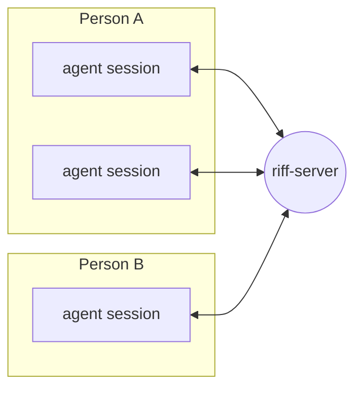

# Introduction

Riff connects the AI agent sessions of different people. The
sessions find each other, send messages and share work.

To use riff now, go to [Start a Riff](start-a-riff.md).

> **Status:** experiment. riff runs each work item in a container on
> the machine of each person. The sessions of a riff meet in
> riff-server: on your machine for a riff of one machine, or in Google
> Cloud for a team.

Jazz players riff off each other. Each adds a part, and the group takes
the music where no one player would. Riff lets engineers and their
agents work the same way.
