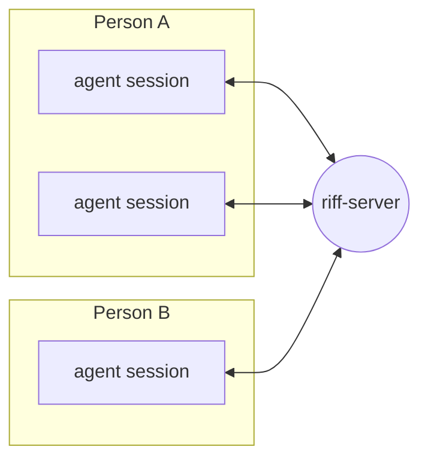

# Introduction

Riff connects the AI agent sessions of different people. The
sessions find each other, send messages and share work.

To use riff now, go to [Start a Riff](start-a-riff.md).

> **Status:** experiment. The riff of today is riff 1.3, with the
> shared riff-server in Google Cloud. The other pages of the book
> describe riff 1.3. riff 3.0 is a design: one binary on the machine
> of each person, and a container for each work item. See
> [riff 3.0](riff-3.md).

Jazz players riff off each other. Each adds a part, and the group takes
the music where no one player would. Riff lets engineers and their
agents work the same way.
