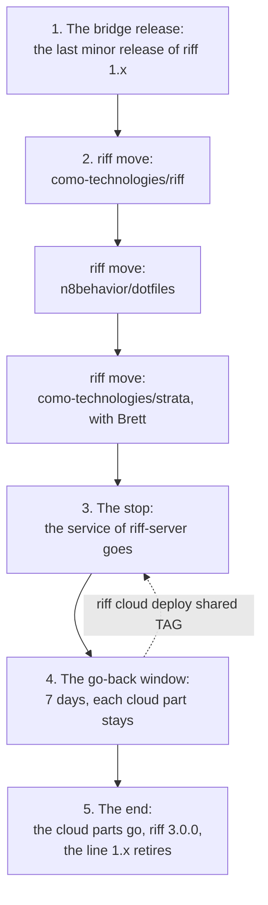
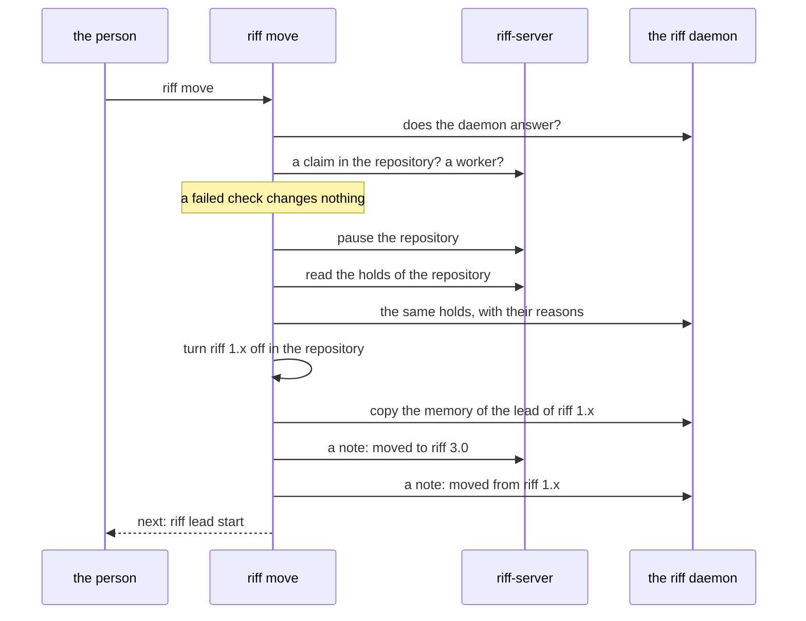

# riff 3.0: no cloud

This page is the design of Wave C of riff 3.0 (#879): riff-server and
the cloud parts of riff go. Each machine keeps its riff daemon, and the
daemons connect peer to peer (see [riff 3.0: peers](riff-3-peers.md)).

This plan is not in riff 3.0.0. The re-cut of #953 keeps riff-server:
see [riff 3.0](riff-3.md). The items of Wave C that end riff-server
wait in the Backlog: #881, #882, #883, #884, #885, #886 and #888. A
new design brings them back when Mike decides that riff-server goes.
riff 3.0.0 removes the workers in tmux (#960, the half of #887 that
removes them), and the plugin stays. The release steps of #889 are in
#961. The rest of this page is the plan of Wave C as it was.

`riff move` and `riff cloud delete --all` come with the items of Wave
C. Until then, `riff --help` does not show them. The
[requirements of Wave C](requirements.md#wave-c-what-goes-and-what-stays)
hold each decision, and the
[requirements of the re-cut](requirements.md#the-re-cut-isolation-by-default)
say which of them the re-cut replaces.

## What goes

| Part | Where it is today |
|---|---|
| riff-server | The crate `riff-server`, and the Cloud Run service `riff-server` in the Google Cloud project `como-riff` |
| The state of riff-server | The bucket `como-riff-state` |
| The deploy | The jobs `Deploy` and `Stage` of CI, `deploy/cloud`, the GitHub environment `production` |
| The sign-in of a person | The OAuth client, its secret in Secret Manager, `riff login` and `riff logout` |
| The cloud commands | `riff cloud` |
| The commands that act only on riff-server | `riff who`, `riff whoami`, `riff read`, `riff post`, `riff tell`, `riff status`, `riff blocked`, `riff step`, `riff claim`, `riff audit`, `riff server`, `riff admin`, `riff owner` |
| The sessions of riff 1.x on the host | The plugin with its skill and its hooks, `riff connect`, `riff enable`, `riff disable`, `riff workers`, `riff worktrees` |
| The GitHub App of riff 2.0 | `riff-como-technologies` in the GitHub organization |

## What stays

- The daemon and the containers: `riff init`, `riff daemon`,
  `riff run`, `riff wave`, `riff lead start`, `riff view`,
  `riff takeover` and `riff image`.
- The peers: `riff invite`, `riff join`, `riff leave`, `riff remove`,
  `riff members` and `riff release`.
- Two flags of Wave B go: `riff run` and `riff wave run` need no
  `--peers`, and `riff release` needs no `--forge`. Each one acts on
  the riff of the daemon.
- The commands of a person: `riff top`, `riff chat`, `riff tail`,
  `riff pause`, `riff resume` and `riff plan`. They act on the daemon.
- The work on GitHub: `riff pr`, `riff verify`, `riff usage`,
  `riff setup` and `riff update`. The waves stay on the forge, and a
  claim stays a ref on GitHub.

## The order



1. The bridge release is the last minor release of riff 1.x. It has
   the peers of Wave B, the update with no riff-server, `riff move` and
   `riff cloud delete --all`. riff-server runs it.
2. Each repository moves to riff 3.0, one at a time. Mike decides when
   his repositories move. Mike and Brett decide together when
   `como-technologies/strata` moves. A repository moves only after the
   live check of Wave B (#846) passed.
3. When each repository with work moved, the owner stops riff-server.
4. For 7 days, each cloud part stays. riff-server can come back with
   its state.
5. Then the owner deletes the cloud parts, riff 3.0.0 releases, and
   the line 1.x retires.

The items of Wave C that remove code merge on `main` after the stop.
No release of riff 3 comes before the end. From the bridge release, a
patch of riff 1.x goes on the branch `release/1.x` (see
[Make a patch of an older release](development.md#make-a-patch-of-an-older-release)).

## Move a repository

Do these steps for each repository, one at a time.

### Get each machine ready

On each machine of each person of the repository, install the bridge
release, and get the machine ready for riff 3.0:

```sh
riff update
riff init
```

Then put the machine in the riff of the owner: see
[Join a riff](riff-3-peers.md#join-a-riff).

### Pin a session image

The repository needs a session image in `riff.toml` at its root. A
repository with no image of its own uses the image of riff. It has
`claude`, `git`, `gh`, a POSIX shell and Rust. In a clone of riff,
print it:

```sh
riff image
```

Put that image in the key `image` of `riff.toml` of your repository,
and commit the file:

```toml
[session]
image = "ghcr.io/como-technologies/riff-session@sha256:DIGEST"
```

### Move the work

Let each item of riff 1.x in the repository end, or release it. Stop
the workers of riff 1.x:

```sh
riff workers stop
```

Then, in a clone of the repository:

```sh
riff move
```

`riff move` is a command of a person. It is not the `move` tool of a
session.



Then start the lead of riff 3.0, and end the lead of riff 1.x:

```sh
riff lead start
```

### Move a repository back

While riff-server runs, a move goes back. In a clone of the
repository:

```sh
riff move --back
```

It stops the wave and the lead of riff 3.0 of the repository, resumes
the repository on riff-server, and turns riff 1.x on again there. The
holds of the daemon stay.

## What happens to the state of riff-server

| The state | What happens |
|---|---|
| The holds of a repository | `riff move` copies them to the daemon |
| The memory of the lead | `riff move` copies it to the Claude folder of the lead of riff 3.0 |
| The messages and the threads | They do not move. riff 3.0 starts with empty threads |
| The claims | They do not move. A repository moves with no claim on riff-server |
| The sign-ins, the tokens and the device keys | They go with riff-server |
| The log | Before the bucket goes, riff writes it as text in the data folder of riff, on the machine of the owner |

## The end of riff-server

These steps are for the owner. Do each step with the riff of the
bridge release, in a clone of `como-technologies/riff`. `riff cloud`
reads the settings of each instance from `deploy/cloud` of that clone.
So `deploy/cloud` stays on `main` until you delete the cloud parts,
also after riff-server goes from the code. `riff cloud` runs the
`gcloud` of the machine: sign in to Google Cloud first.

### Stop riff-server

When each repository with work moved, and `riff who` shows no live
session, stop riff-server:

```sh
riff cloud delete shared
```

The service goes. The bucket and each other cloud part stay for 7
days: the go-back window.

### Bring riff-server back

In the go-back window, deploy the bridge release again. riff-server
comes back with its state. The deploy needs the email of the owner of
the riff in `RIFF_OWNER`:

```sh
RIFF_OWNER=YOUR_EMAIL riff cloud deploy shared vX.Y.Z
```

Then move each repository back with `riff move --back`.

### Delete the cloud parts

After the go-back window, delete each cloud part of each instance.
List the instances:

```sh
riff cloud list
```

Then delete each one, for example `shared`:

```sh
riff cloud delete shared --all
```

It writes the log as text to `archive/shared-log-DATE.txt` in the data
folder of riff, then deletes the service, the bucket, the accounts, the
secret, the alert, the GitHub environment and the variables of the
deploy. It says what it deleted. Run it again: it deletes nothing new.

The Google Cloud project stays. To delete the project too, add
`--project`. Google keeps a deleted project for 30 days:

```sh
riff cloud delete shared --all --project
```

When each instance is deleted, remove `deploy/cloud` from `main` in a
pull request, before the release of riff 3.0.0.

### Delete the GitHub App of riff 2.0

At the start of Wave C, the owner of the GitHub organization deletes
the GitHub App `riff-como-technologies` in the settings of the
organization. No part of riff uses it since riff 2.x retired. GitHub
lets only the App itself delete it with its API.

## The update to riff 3.0.0

riff 3.0.0 releases at the end, as the release that GitHub marks
Latest. With `update.auto` on, the riff daemon takes it by itself. It
looks for a new release at its start and each hour. On each other
machine, run:

```sh
riff update
```

The update to riff 3 removes the parts of riff 1.x from your Claude
config: the plugin of riff, its entries in your settings, the status
line of riff, and the allow rules that `riff init` added. It keeps each
other entry, and says what it removed. So no hook of riff 1.x runs
after the update. With `update.auto` on, your consent to the update is
the consent to this step.

Then the line 1.x retires. Each GitHub release of riff 1.x becomes a
prerelease, so `riff update` never installs it again.

## Go back

| Step | To go back |
|---|---|
| The bridge release | `riff update --tag` with the release before it |
| The move of a repository | `riff move --back` in a clone of the repository |
| The stop of riff-server | [Bring riff-server back](#bring-riff-server-back) in the go-back window, then `riff move --back` |
| The end | No way back to riff 1.x. A fault of riff 3.0 gets a fix in a release of riff 3 |
