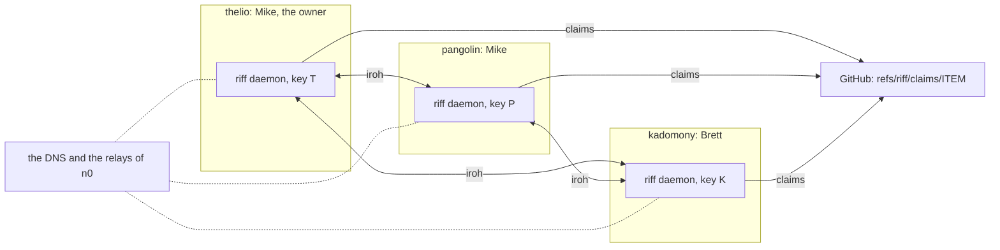
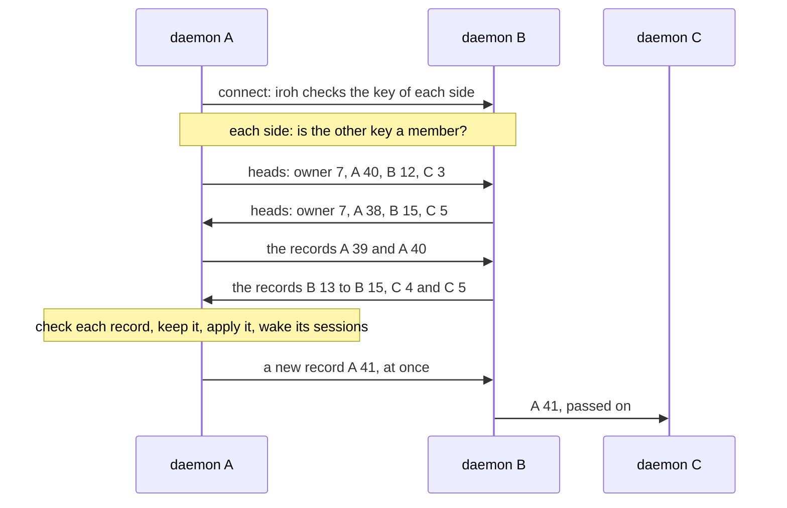
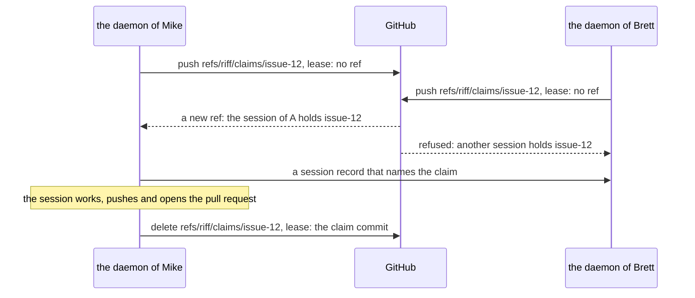
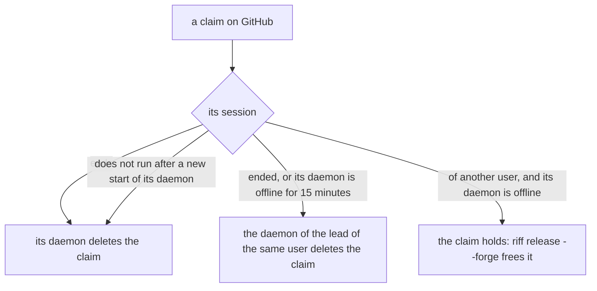

# riff 3.0: peers

This page is the design of Wave B of riff 3.0 (#803): two or more
people share one riff, and no server holds it. The daemon of each
machine keeps a copy of the riff, and the daemons connect peer to
peer.

The commands on this page come with the items of Wave B. `riff invite`,
`riff join`, `riff leave`, `riff remove` and `riff members` act on the
riff of the riff daemon of your machine. With `--email`, the member
commands act on riff-server 1.x (see
[The way over from riff 1.x](#the-way-over-from-riff-1x)). The
[requirements of Wave B](requirements.md#wave-b-the-record) hold each
decision.

The claims on the forge are here: see
[Free the claim of a machine that is gone](#free-the-claim-of-a-machine-that-is-gone)
and [How a claim works](#how-a-claim-works).

## The picture



- Each machine runs one riff daemon. Each daemon has one key. The key
  is in the OS keyring, and it never leaves the machine. While the
  keyring is locked, the daemon waits for it, and makes no new key.
- A riff belongs to its owner: the key that made it. The owner admits
  the key of each machine of each member.
- Each change of the riff is a record, signed by the daemon that wrote
  it. Each daemon keeps a copy of each record, and sends each record to
  the daemons that lack it.
- The daemons connect over iroh. iroh finds a daemon by its key, with
  the DNS and the relays of n0, and then tries a direct path. iroh
  encrypts each connection. A relay sees no record.
- A claim is a ref on GitHub. GitHub gives each item to one session.

## Share a riff

The first start of the daemon makes a riff of your own. You are its
owner. These steps add other people and other machines to it.

Run `riff invite`, `riff join`, `riff leave` and `riff remove` in a
terminal of your own. Each one refuses with no terminal, so an agent
session cannot admit a member, remove one, or move your daemon to
another riff.

### Invite a person

On the machine of the owner:

```sh
riff invite brett
```

It prints one invite string that starts with `riff1-`, and the line
that the person runs. Send the string to the person by hand, for
example in a chat. The string works one time, for 24 hours. Until
then, it is a secret: a person who has it can join as `brett`. Your
daemon keeps only a hash of it, in the file `invites.json` of its
folder.

### Join a riff

On the machine of the person, with the string of the owner:

```sh
riff join riff1-...
```

The daemon of the owner must be online. Your daemon connects to it,
and the daemon of the owner adds the key of your daemon as a member.
Then your daemon gets each record of the riff, and connects to each
other member. A failed join changes nothing, and says why: for
example, the invite ended, or a join used it already.

A daemon is in one riff at a time. `riff join` refuses while your own
riff has another member, and while your daemon is in the riff of
another person. The records of your own riff stay in the folder of
your daemon.

### Add a second machine of your own

On the machine of the owner, invite your own user. Then run
`riff join` with the new string on the second machine:

```sh
riff invite mike
```

### See the members

```sh
riff members
```

It shows the owner and each member key: the user, the host, the start
of the key, and the state: this machine, online, or the time when it
was last seen, and forked, removed or left. It needs no terminal.

```text
The riff 8a88e3dd of mike:
USER   HOST      KEY       STATE
mike   thelio    8a88e3dd  owner, this machine
brett  kadomony  1f2e3d4c  online
mike   pangolin  9c0b7a61  last seen 5m ago
```

### See the sessions of each machine

```sh
riff view
riff top
```

Both show each session of each machine of the riff: the user, the
host, the item, the state and the status. They read these sessions
from the records that your daemon keeps. A session
of a machine whose daemon is offline shows `offline`, with the time
when your daemon last saw that daemon. You can take over only a session
of your own machine. See
[See the sessions of other machines](development.md#see-the-sessions-of-other-machines)
and
[See the sessions of the riff of peers](how-it-works.md#see-the-sessions-of-the-riff-of-peers).

### Leave a riff

On the machine of a member:

```sh
riff leave
```

Your daemon sends a `left` record to each member, and waits up to 5
seconds for each one to get it. Then this machine has a riff of your
own again, with the same key. Each session of this machine leaves
with it. The owner cannot leave. A daemon that left cannot join that
riff again: the riff refuses its key.

### Remove a member

On the machine of the owner. The first command removes each machine of
the user. The second removes one machine:

```sh
riff remove brett
riff remove brett --host kadomony
```

Each daemon of the riff then refuses the key of each machine that you
removed: its connections, and each of its records after its last one.
The owner cannot remove itself.

### Free the claim of a machine that is gone

The claim of a machine of another user that is offline holds. You
free a claim of your own user. The owner frees each claim. Run the
command in the clone of the repository:

```sh
riff release issue-12 --forge
```

The riff daemon of your machine deletes the claim on GitHub. The
daemon of a member refuses a claim of another user, and says whose
claim it is. It needs no riff-server.

## The records

A record is one change of the riff by one daemon: its author. Each
author has one chain of records: the sequence numbers 1, 2, 3 and so
on, and each record holds the ID of the record before it. The ID of a
record is the BLAKE3 hash of its bytes. The author signs each record
with its key, over the tag `riff record 1` and each byte before the
signature.

| Field | Size |
|---|---|
| The format version: 1 | 1 byte |
| The type | 1 byte |
| The riff ID: the key of the owner | 32 bytes |
| The key of the author | 32 bytes |
| The sequence number | 8 bytes |
| The ID of the record before it: 32 zero bytes before the first record | 32 bytes |
| The time of the author, in milliseconds | 8 bytes |
| The length of the body | 4 bytes |
| The body: JSON | up to the size of the type |
| The ed25519 signature | 64 bytes |

Each number is big-endian. Each type has one writer. So two daemons
with the same records have the same riff.

| Type | Byte | Writer | What it holds | Largest record |
|---|---|---|---|---|
| `riff` | 1 | The owner, in its first record | The user and the host of the owner | 1 KiB |
| `member` | 2 | The owner | A member key, its user and its host | 1 KiB |
| `removed` | 3 | The owner | A member key, and its last sequence number | 1 KiB |
| `left` | 4 | A member | The leave of its own key | 1 KiB |
| `session` | 5 | The daemon of the session | The whole session: its place, its lead mark, its claims, its status and its end | 4 KiB |
| `message` | 6 | The daemon of the session that posts | A message, a note or a status request | 64 KiB |
| `plan` | 7 | A daemon of a lead, or the daemon of the owner | A hold, a free, a pause or a resume | 4 KiB |

A daemon keeps a record of another type byte, and does not apply it.
The byte 0 is no type.

## How the sync works



- Each daemon keeps one connection to each other daemon of the riff
  that is online: the owner, and each member that is not removed and
  did not leave. Of two daemons, the one with the lower key connects.
  When a connection ends, it connects again after a wait: 1 second,
  then 2, 4 and so on, up to 60 seconds.
- The heads say, for each author, the highest sequence number that a
  daemon has, and the ID of that record. Each side then sends what the
  other side lacks: the records of the owner first. After that, each
  side sends each new record at once.
- A daemon sends its heads again each minute, and at once when it gets
  a record after a gap. So a record that one side dropped comes again.
- A daemon checks each record before it keeps it, in this order: the
  size of its type, the version and the type, the riff, the author is
  the owner or a member, the next sequence number, the ID of the record
  before it, the signature, the JSON of its type, and the writer of the
  type. It refuses a bad record, and closes that connection. Its log
  names the author, the sequence number and the check, with no body.
- A daemon drops a record that it has already, with no fault, and
  sends no record back to the daemon that sent it. So a record that
  comes over two paths is kept one time.
- A fork is two records of one author with the same sequence number.
  The daemon keeps the first one, keeps no next record of that author,
  and keeps both records as the proof. It sends the proof to each
  daemon that it connects to, and posts a note to the lead of your user.
  The owner removes that key.
- When a daemon keeps a message, it wakes each of its own sessions
  that the message selects, also for a message of another machine.
- `riff daemon status` shows each connection of your daemon (see
  [See the peer links of the daemon](development.md#see-the-peer-links-of-the-daemon)).

## Holds, pauses and the lead

Two daemons can keep the same records in two orders. The state does
not change with the order:

- A free names each hold that it ends, and a resume names each pause
  that it ends. An item is held while one of its holds has no free.
- A session that takes the lead names the lead mark that it replaces.
  The lead of a user is the lead mark that no other mark names. When
  two are left, the daemon with the higher key wins.
- No daemon orders records by the time of their author.

## How a join works

```mermaid
sequenceDiagram
    participant M as Mike, the owner
    participant O as the daemon of Mike
    participant B as Brett
    participant N as the daemon of Brett
    M->>O: riff invite brett
    O-->>M: riff1-... (one time, 24 hours)
    M->>B: the string, by hand
    B->>N: riff join riff1-...
    N->>O: connect to the riff ID, ALPN riff/3/join; the secret and the host
    O->>O: check: the owner, the key, the host, the invite
    O->>O: write the member record
    O-->>N: joined
    Note over N,O: the connection goes on as the peer link
    O-->>N: the records of the riff
    N->>N: connect to each member, and sync
```

The daemon of the owner checks, in this order, that it is the owner of
its riff, that the riff does not know the key of the new daemon yet,
that the host is a name that riff takes, and that the invite is known,
not used and not ended. The first check that fails refuses the join,
and nothing changes.

A daemon keeps the riff that it joined in the file `state/joined` of
its folder, and its records in `state/riffs/RIFF`. A new start of the
daemon opens that riff. `riff daemon status` shows the riff that the
daemon is in, and the user of its owner.

## How a claim works



The daemon makes each claim in the main clone of the repository, with
your git sign-in. Each claim is a new commit: the empty tree, no
parent, no signature, and the message `riff claim ITEM` with the
trailers `Riff-Item`, `Riff-User`, `Riff-Session`, `Riff-Key` (the key
of the daemon) and `Riff-Time` (UTC). GitHub compares the lease on the
server, so only one session gets an item. A failed lease means that
another session holds the item. To see the claims of a repository, run
this in its clone:

```sh
git ls-remote origin 'refs/riff/claims/*'
```

The daemon keeps the main clone of each repository where it made a
claim. It looks at the claims there, and at the claims of each of its
waves:

- At the end of a session, its daemon deletes the claim of the
  session.
- At its start, a daemon deletes each claim of its key whose session
  does not run.
- Each minute, the daemon of the lead of a user deletes each claim of
  that user whose session ended. It also deletes each claim of that user
  whose daemon had no link to it for 15 minutes.



## The way over from riff 1.x

- riff-server 1.x runs on until Wave C. A daemon of 3.0 does not talk
  to it. A session of 1.x and a session of 3.0 do not see the messages
  or the claims of each other.
- The work of one repository runs on 1.x or on 3.0, not on both at
  one time. Mike decides when a repository moves.
- Until Wave C, each session of `riff run`, of a wave and of
  `riff lead start` has a riff-server, so its riff tools act on 1.x.
  See
  [The riff tools of a session](development.md#the-riff-tools-of-a-session).
- Until Wave C, the member commands of 1.x take `--email`:
  `riff invite --email EMAIL`, `riff remove --email EMAIL` and
  `riff members --email`.
- Until Wave C, `riff claim` and `riff release` act on riff-server
  1.x. Only `riff release ITEM --forge` acts on a claim of 3.0. The
  daemon makes each claim of 3.0.
