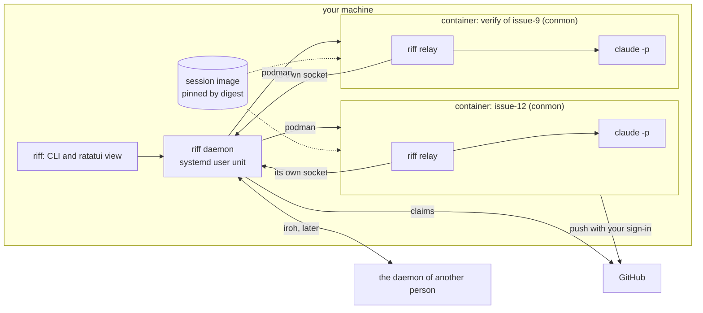

# riff 3.0

This page is the design of riff 3.0. riff 3.0 is one binary on the
machine of each person. A daemon of riff runs each work item in its
own container. Later, the daemons of different people connect peer to
peer.

## The goal of isolation

riff is not a security tool. It does not make Claude Code more secure
than a plain `claude` that you start. The permission modes and the
settings of Claude Code do that, and you choose them.

riff isolates sessions, so that they do not step on each other or on
your machine: files, git state, processes, `/tmp`, ports, CPU and
memory.

riff does not make Claude less secure. A session gets no power that a
plain `claude` lacks, other than the riff tools.

## The picture

- The daemon is a systemd user unit. It owns the state, the keys and
  the sessions.
- Each work item is one session in one rootless podman container. A
  verify is an item too. The session starts, does its item and ends.
- `riff relay` is the entrypoint of the container. It starts `claude`
  and talks to the daemon through a socket that only that session
  sees.
- Each repository names its session image, pinned by digest.
- The daemon makes the claims on GitHub. The session pushes its work
  with your sign-in.

## What sessions share

Each row is a thing that two sessions on one machine share. The last
column is honest: it says what a session can still do to another
session. An "open" row waits for a spike:
[#707](https://github.com/como-technologies/riff/issues/707) (one item
in a container) or
[#708](https://github.com/como-technologies/riff/issues/708) (the
claims on GitHub).

| What sessions share | How riff keeps them apart | What a session can still do to another |
|---|---|---|
| The files of your machine | Each session is a rootless podman container (`--userns=keep-id`). It writes only its binds: its own clone, its own Claude folder, the folder of its socket and the cache volumes. Each other write goes to the copy-on-write layer of the container, and goes when the session ends. | Nothing outside its binds. See the rows of git and of the caches. |
| git: the clone and its alternates | Each session has its own clone, made with `git clone --reference MAIN` in a folder of riff. The container sees the objects of the main clone at the same path, with no write. No session writes the git dir of the main clone or of another session. Open: #707 decides. | Nothing in the clone of another session. A `git gc` of the main clone can remove an object that a session clone reads. |
| git: the config | `~/.gitconfig` is bound with no write, or as an overlay whose changes go when the session ends. riff writes no git config. | Nothing. |
| git: the commit | A commit has your git identity and a `Riff-Session:` trailer. A session commits with no signature: it sets `commit.gpgsign=false`. The squash merge on GitHub makes the commit on `main`. No gpg agent goes into a container. Open: #707 decides. | Nothing. Only the trailer tells the commits of two sessions apart. |
| git: the repository on GitHub | Each session pushes its own branch from its own clone. A claim is a compare-and-swap push of a ref, so only one session gets an item. The daemon makes the claim, not the session. Open: #708 decides the ref of a claim. | With your sign-in, a session can push to the branch of another session, delete it, or move a claim ref. |
| The processes | Each container has its own processes. A `pkill` in one session does not hit another. `podman stop` ends a session and each of its processes. | Nothing: it does not see the processes of another container. |
| `/tmp` | Each container has its own `/tmp`. It goes when the session ends. | Nothing. |
| The ports | Each container has its own loopback. A test port of one session does not hit another. | It can reach a port that listens on the network of your machine, as each program on it can. |
| The caches: cargo registry, cargo git, sccache and rustup | The caches are named volumes, bound with write. The tools lock them themselves. Open: #707 measures a cold build. | It can write a bad file in a cache, and a later build of another session uses it. |
| Your home | The container sees only its binds, not your home. riff writes nothing in your home outside its own folders. It does not write `~/.claude`, `~/.claude.json`, a git config or a shell file. | It reads `~/.gitconfig` and `~/.config/gh`. |
| The CPU | Each container gets `--cpus`. The daemon keeps one limit for the host: the number of live sessions. Open: #707 decides. | A build of one session makes the builds of the others slower, up to its limit. |
| The memory | Each container gets `--memory`. A session past its limit loses its own processes, not those of another session. The daemon starts no new session when the free memory is below a floor. Open: #707 decides. | It takes memory, up to its limit, that a new session needs. |
| The network | Each session reaches the internet, as a plain `claude` does. No proxy and no filter. | It uses the same connection and reaches each service that your machine reaches. |
| The sign-in of `gh` | The daemon reads `gh auth token` on the host and gives the container `GH_TOKEN`. A session has your rights on GitHub, as a plain `claude` has. No GitHub App. No secret goes into a log line, a message or a file of a clone. Open: #707 decides. | It can do on GitHub each thing that you can do, also to the issues and the pull requests of another session. |
| The sign-in of `claude` | Each session has its own Claude folder in a folder of riff. `claude` signs in with the token of your plan. riff never changes your own Claude config. Open: #707 decides how the token goes into the container. | It uses the limits of your plan that another session needs. |
| The daemon and the riff tools | Each relay talks to the daemon through its own Unix socket, in a folder that only that session sees. The socket tells the daemon which session asks. The owner and admin steps need a person at the CLI. No riff tool does them. | It can send messages to other sessions through the riff tools. |
