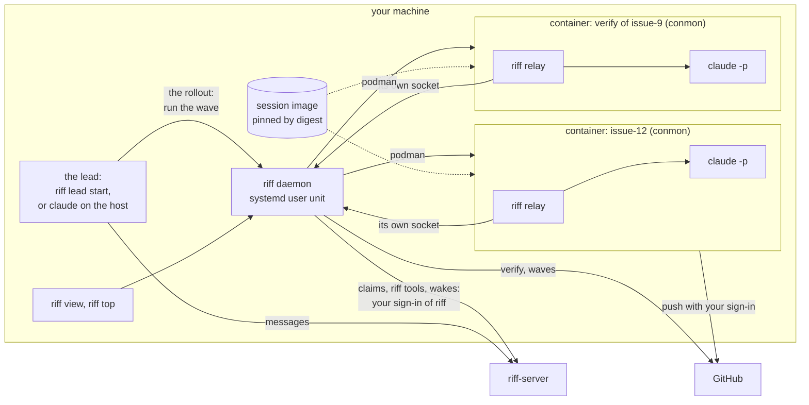
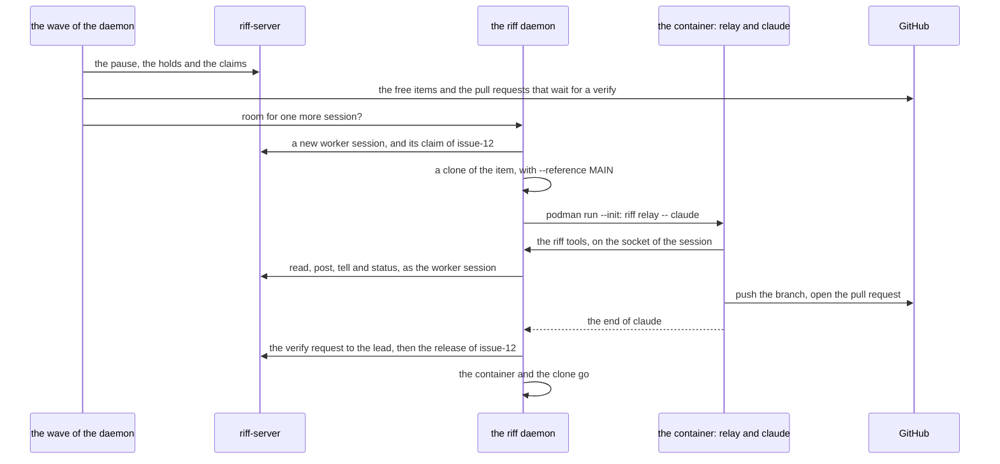
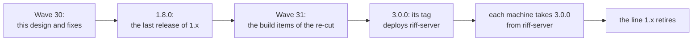

# riff 3.0

This page is the design of riff 3.0. riff 3.0 is isolation by
default: the riff daemon of each machine runs each work item in its
own container. riff-server stays the server of the riff: the claims,
the messages, the chat, the sign-in and the update of each machine.
`riff workers` and each other part of riff 1.x stay as they are. The
waves stay on GitHub. The
[requirements of the re-cut](requirements.md#the-re-cut-isolation-by-default)
hold each decision of the plan (#953).

## The goal of isolation

riff is not a security tool. It does not make Claude Code more secure
than a plain `claude` that you start. The permission modes and the
settings of Claude Code do that, and you choose them.

riff isolates sessions, so that they do not step on each other or on
your machine: files, git state, processes, `/tmp`, ports, CPU and
memory.

riff does not make Claude less secure. A session gets no power that a
plain `claude` lacks, other than the riff tools.

## The picture

- The daemon is a systemd user unit. It owns the sessions of the
  machine.
- Each work item is one session in one rootless podman container. A
  verify is an item too. The session starts, does its item and ends.
- The rollout runs the wave of the daemon. The lead asks the daemon
  to run the wave of the repository. The wave starts one session for
  each free item, in the limit of the machine. The rollout starts no
  worker in tmux. A person can still start one with
  `riff workers start`, as in riff 1.x.
- `riff relay` is the entrypoint of the container. It starts `claude`
  and talks to the daemon through a socket that only that session
  sees.
- The daemon makes the claim of each item on riff-server, as the worker
  session of the item, with your sign-in of riff. The riff tools of the
  session act on riff-server through the daemon.
- Each repository names its session image, pinned by digest, in the
  file `riff.toml` at its root. See
  [Change the session image](development.md#change-the-session-image).
- The session pushes its work with your sign-in of GitHub.

## How a session works

A second machine takes work when its daemon runs the wave of the
repository too. The claims on riff-server keep two machines from one
item.

## What changes for a person

| Step | riff 1.x | riff 3.0.0 |
|---|---|---|
| Get a machine ready | `riff connect claude` | Also `riff init` one time: podman, the daemon and the session image. See [Get ready for riff 3.0](start-a-riff.md#get-ready-for-riff-30). |
| Pin a session image | No image | `riff.toml` of each repository pins one. A repository with no image of its own pins the image of riff: `riff image` prints it. |
| Start the lead | `claude` in the clone | `riff lead start`, or `claude` in the clone as before. See [Start the lead](development.md#start-the-lead). |
| Start the work | The rollout starts workers in tmux | The rollout runs the wave of the daemon. See [Let riff run the wave](development.md#let-riff-run-the-wave). `riff workers start` still starts workers in tmux. |
| Use a second machine | `riff workers host` | `riff wave run` in a clone on that machine, or `riff workers host` as before |
| Set the limit of a machine | `riff workers limit` | `riff daemon limit` for the sessions in containers. See [Set the limit of the host](development.md#set-the-limit-of-the-host). `riff workers limit` for the workers in tmux, as before. |
| See the sessions | `riff top` | `riff view` or `riff top` |
| Work with a session | Its tmux pane | `riff takeover NAME`, or `t` in `riff view`. See [Take over a session](development.md#take-over-a-session). A worker in tmux keeps its pane. |
| Chat, pause, resume, hold | `riff chat`, `riff pause`, `riff resume`, `riff plan` | The same, on riff-server |
| Update | `riff update`, or by itself | The same. riff 3.0.0 comes from riff-server. |

## riff 3.0.0 and the line 1.x

- riff 3.0.0 is the first release where each item runs in a container
  by default. It has riff-server, `riff workers` and each other part of
  riff 1.x, except the parts in [What goes](#what-goes-in-riff-300).
- riff-server 3.0.0 serves riff 1.x too. So a machine of riff 1.x works
  until it takes 3.0.0.
- After riff 3.0.0, each GitHub release of riff 1.x becomes a
  prerelease that says that the line is retired. No patch of 1.x comes
  after 3.0.0.
- The build items: the end of the riff of peers (#959), the rollout
  that runs the wave of the daemon (#960), the command that retires a
  line (#795), and the live check of 3.0.0 (#961).

### What goes in riff 3.0.0

The riff of peers of riff 1.6 to 1.8, with its code, its tests and its
book text (#959): iroh and the use of n0, the key of the daemon, the
records and their sync, the claims on GitHub, `riff invite USER`,
`riff join`, `riff leave`, `riff remove USER`, `riff members` with no
`--email`, the flag `--peers` of `riff run` and of `riff wave run`, and
the flag `--forge` of `riff release`.

### What riff 3.0.0 leaves on a machine

riff 1.6 to 1.8 made the state of the riff of peers on each machine.
riff 3.0.0 does not read, change or delete it. DIR is the folder of
the daemon: `daemon` in the data folder of riff.

| The state | Where it is |
|---|---|
| The key of the daemon | The secret `daemon-key DIR` in the OS keyring |
| The records and the riffs of the daemon | The folder `state` in DIR, and each folder `state.lost-MS` beside it |
| The invites of the owner | `invites.json` in DIR |
| The main clones of the claims | `forges.json` in DIR |
| The claims of `--peers` | The refs `refs/riff/claims/ITEM` on GitHub |

### What stays in riff 3.0.0

- riff-server, `riff cloud`, the sign-in, the deploy and the stage.
- `riff workers` and each of its subcommands, the workers in tmux, the
  workers host, the clear of a worker, the reap, the pool of build
  jobs, the monitor and `riff worktrees`.
- The plugin of Claude Code, its skill and its hooks, `riff connect`,
  `riff enable`, `riff disable` and the status line, for a session on
  the host.
- Each command of riff-server: `riff who`, `riff chat`, `riff pause`,
  `riff resume`, `riff plan`, `riff claim`, `riff release` and the
  member commands with `--email`.

## What sessions share

Each row is a thing that two sessions on one machine share. The last
column is honest: it says what a session can still do to another
session. The rows use the result of the spike of one item in a
container,
[#707](https://github.com/como-technologies/riff/issues/699#issuecomment-6186136739),
and the result of the spike of the claims,
[#708](https://github.com/como-technologies/riff/issues/699#issuecomment-6184805987).
The [requirements of riff 3.0](requirements.md#riff-30) hold each
decision of the design.

| What sessions share | How riff keeps them apart | What a session can still do to another |
|---|---|---|
| The files of your machine | Each session is a rootless podman container (`--userns=keep-id`). It writes only its binds: its own clone, its own Claude folder, the folder of its socket and the cache volumes. Each other write goes to the copy-on-write layer of the container, and goes when the session ends. | Nothing outside its binds. See the rows of git and of the caches. |
| git: the clone and its alternates | Each session has its own clone, made with `git clone --reference MAIN` in a folder of riff. The container sees the objects of the main clone at the same path, with no write. No session writes the git dir of the main clone or of another session. The clone goes when its item ends, after its push. | Nothing in the clone of another session. A `git gc` of the main clone can remove an object that a session clone reads. |
| git: the config | `~/.gitconfig` is bound with no write, or as an overlay whose changes go when the session ends. riff writes no git config of yours. A session writes only the config of its own clone. | Nothing. |
| git: the commit | A commit has your git identity and a `Riff-Session:` trailer. A session commits with no signature: riff sets `commit.gpgsign=false` in the environment of the container, so it applies to each git call of the session. The squash merge on GitHub makes the commit on `main`. No gpg agent goes into a container. | Nothing. Only the trailer tells the commits of two sessions apart. |
| git: the repository on GitHub | Each session pushes its own branch from its own clone. The daemon makes the claims, not the session: see the next row. | With your sign-in, a session can push to the branch of another session, or delete it. |
| The claims | The daemon claims each item on riff-server, as the worker session of the item, with your sign-in of riff. riff-server gives each item to one session. The daemon releases the claim at the end of the session. riff-server ends the claim of a session that stops, as in riff 1.x. | Nothing. A session has no sign-in of riff-server, and no riff tool of a session claims or releases. |
| The processes | Each container has its own processes. Its PID 1 is the init of podman (`podman run --init`): it reaps each process that ends, so no zombie stays. A `pkill` in one session does not hit another. `podman stop` ends a session and each of its processes. | Nothing: it does not see the processes of another container. |
| `/tmp` | Each container has its own `/tmp`. It goes when the session ends. | Nothing. |
| The ports | Each container has its own loopback. A test port of one session does not hit another. | It can reach a port that listens on the network of your machine, as each program on it can. |
| The caches: `CARGO_HOME` and sccache | One named volume holds `CARGO_HOME`, and one holds the folder of sccache. Both are bound with write. The tools lock them themselves. The toolchain is in the image, with no write. A new clone has no `target/`: a warm sccache makes its build short. | It can write a bad file in a cache, and a later build of another session uses it. |
| Your home | The home of the container is an empty tmpfs at the path of your home. riff binds your `~/.gitconfig` and the Claude folder of the session on top of it. Each other write in that home goes when the session ends. riff writes nothing in your home outside its own folders. It does not write `~/.claude`, `~/.claude.json`, a git config or a shell file. | It reads `~/.gitconfig` and `~/.config/gh`. |
| The CPU | Each container gets `--cpus`, 4 by default. The daemon keeps one limit for the host: the number of live sessions, at most 3 by default. | A build of one session makes the builds of the others slower, up to its limit. |
| The memory | Each container gets `--memory`, 8 GB by default. A session past its limit loses its own processes, not those of another session. The daemon starts no new session while the free memory is below a floor, 8 GB by default. | It takes memory, up to its limit, that a new session needs. |
| The network | Each session reaches the internet, as a plain `claude` does. No proxy and no filter. | It uses the same connection and reaches each service that your machine reaches. |
| The sign-in of `gh` | The daemon reads `gh auth token` on the host and gives the container `GH_TOKEN`. podman gets only the name of the variable, so the value is in no command line. The image has `gh` at `/usr/bin/gh`. A session has your rights on GitHub, as a plain `claude` has. No GitHub App. No secret goes into a log line, a message or a file of a clone. | It can do on GitHub each thing that you can do, also to the issues and the pull requests of another session. |
| The sign-in of `claude` | Each session has its own Claude folder in a folder of riff. riff trusts the clone of the session there, as you trust the main clone. The daemon gives the session the long-lived token of `claude setup-token` in `CLAUDE_CODE_OAUTH_TOKEN`. Until that works, riff binds your `~/.claude/.credentials.json` with no write, and starts no session while its access token has less than 60 minutes left. riff never changes your own Claude config. | It uses the limits of your plan that another session needs. |
| The daemon and the riff tools | Each relay talks to the daemon through its own Unix socket, in a folder that only that session sees. The socket tells the daemon which session asks. The daemon serves the riff tools of the session on riff-server, as its worker session. A session gets only the riff tools that talk: `whoami`, `who`, `threads`, `read`, `post`, `tell`, `status` and `blocked`. No riff tool of a session acts on a folder of your machine or on a claim. The owner and admin steps need a person at the CLI. No riff tool does them. | It can send messages to other sessions through the riff tools. |
