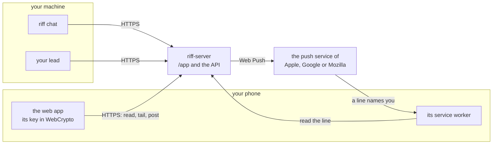
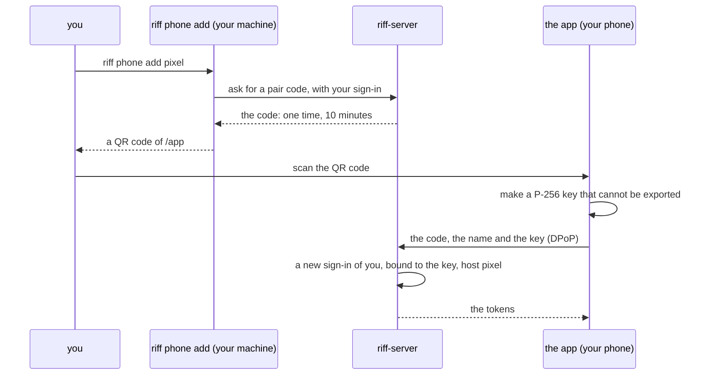
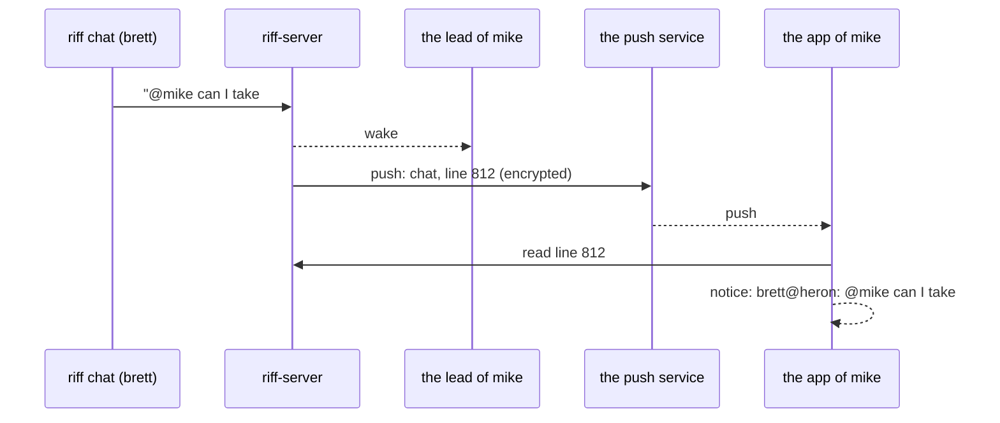

# riff on a phone

This page is the design of the phone app (#951): the riff chat on a
phone. The build items come after Mike signs off the design. Until
then, `riff --help` does not show `riff phone`, and riff-server serves
no app. The [requirements of the phone app](requirements.md#the-phone-app)
hold each decision.

## What the app does first

The first app does four things:

- It shows the thread `chat`: the history, then each new line.
- It posts a line.
- It sends `@lead`, `@USER` and `/me` as `riff chat` does. `@lead`
  wakes your lead, and `@USER` wakes the lead of USER.
- It shows a notice on the phone when a line names you.

Later items can add `riff top`, the questions of the lead, and the
steps of a lead, for example a pause. To answer the questions of your
own lead today, use Remote Control: see
[Answer your lead from the Claude app](how-it-works.md#answer-your-lead-from-the-claude-app).

## How the phone reaches the chat

riff-server stays in riff 3.0 (#953). So the phone reaches the chat
through riff-server over HTTPS, on riff 1.x and on riff 3.0.
riff-server also serves the app.



The app uses the calls of `riff chat`: it joins the thread `chat`,
reads its history, follows it with `/v1/tail`, and posts. It is a
person, as `riff chat` is. It is not a session.

## The platform

| | Native: iOS and Android | A shared Rust core with native screens | A web app from riff-server |
|---|---|---|---|
| Code | Swift and Kotlin: two apps | riff-core in Rust for both, through bindings, and two thin apps for the screens | HTML and JavaScript: one app |
| Cost | The most: each feature two times | Less: the logic one time, the screens two times | The least |
| Store and account | The App Store (the Apple Developer Program: 99 USD each year, and a review) and Google Play (25 USD one time, and a review) | The same | None |
| Notices | APNs, with a key of the Apple account on the sender, and FCM, with a Firebase project | The same | Web Push: a VAPID key on the sender, and no account. On iOS 16.4 or later, only from the Home Screen |
| The key | In the Secure Enclave or the Android Keystore | The same | In WebCrypto: not extractable, in the storage of the app |
| iroh | iroh is Rust, so it builds for iOS and Android. iOS stops an app in the background, so the app has no link while it sleeps | The same, in the core | In a browser, iroh runs as WebAssembly, only through the relays of n0 |

The first app is a web app that riff-server serves at `/app`. It works
in Safari on iOS 16.4 or later from the Home Screen, and in Chrome on
Android. It comes from the same origin as the API. So it needs no
CORS, and it sends the build of its own riff-server: riff-server
refuses a client of another release line. A native app with a shared
Rust core can come later. #958 can need it: see
[What the phone needs from #958](#what-the-phone-needs-from-958).

## Pair a phone

A phone is a device of a member, as a machine is. The owner admits the
person, not each device. You pair your phone from a machine where you
have a live sign-in. The phone needs no Google sign-in.



- `riff phone add NAME` runs in a terminal of your own. It refuses with
  no terminal, so an agent session cannot pair a phone.
- The code is in the fragment of the link, after `#`. So no request
  line and no log of riff-server holds it. riff-server keeps only its
  hash.
- The key never leaves the phone. The sign-in of the phone is bound to
  the key, as the sign-in of `riff login` is bound to the device key of
  a machine. Each call has a DPoP proof of the key.
- Your lines from the phone show as `<USER@NAME>`, for example
  `<mike@pixel>`. riff-server sets the host from the name of the pair.
- The token of a phone acts only on the thread `chat` and on the
  notices of the phone. A phone cannot claim, pause, invite or read
  another thread. So a lost phone cannot do a step of a lead or of an
  admin.
- A sign-in ends after 30 days with no refresh, as each sign-in does.
  Then pair the phone again.
- The app keeps no text of a message on the phone: only its key, its
  tokens and the number of the last line that it showed.

## A lost phone

`riff phone list` shows each of your phones. `riff phone remove NAME`
ends the sign-in of one phone at once. Run them on a machine of yours:

```sh
riff phone list
riff phone remove pixel
```

An admin ends the phone of another person with `--user`.
`riff logout --all` and `riff remove --email` also end each phone of
the person. When you clear the data of the app, its key goes. Then
pair the phone again.

## The notices

A notice on a phone needs the push service of its browser: Apple for
Safari, Google for Chrome, Mozilla for Firefox. riff-server sends each
push with Web Push (RFC 8030), signed with its VAPID key (RFC 8292).
The VAPID key is a P-256 key in Secret Manager. Web Push needs no
account at Apple or Google. A native app needs more: an account of the
Apple Developer Program and an APNs key on the sender, or a Firebase
project for FCM.

Mike keeps riff-server in riff 3.0 (#953), so riff-server sends the
notices. The "no cloud" of Wave C (#879) does not stop them.



A phone gets a notice for:

- a line of the thread `chat` that names its user with `@USER`, from
  another person or from a session of another user;
- each line of the verified lead of its user in the thread `chat`.

Your own lines give no notice. riff-server finds the lines from the
`to`, the sender and the lead mark. It does not read the body: the
client makes the selector `user=USER, lead=true` from `@USER`.

- The push holds only the thread and the number of the line, encrypted
  for the phone (RFC 8291). The app reads the line from riff-server,
  then shows the sender and the line.
- You turn the notices on and off in the app. The phone asks for your
  consent the first time.
- When the push service says that a subscription is gone (404 or 410),
  riff-server deletes it. A push never delays a post.

## What others can see

| Who | What it sees |
|---|---|
| riff-server and the Google Cloud project `como-riff` | Each line in clear text, until #958. The name of the phone, its public key, its subscription, and the time of each call |
| The push service of Apple, Google or Mozilla | The subscription of the phone, and the time and the size of each push. The push is encrypted for the phone, and holds no text of a line |
| Google sign-in | Nothing: the phone does not sign in with Google |
| n0 | Nothing: the app uses no iroh |
| The model provider of each agent session | Each chat line that a lead reads, as today |

The app calls no other service: no analytics, no crash report and no
CDN.

## What the phone needs from #958

#958 encrypts each message end to end, also at rest. The phone is one
more device that needs a key. This design leaves the key choices to
#958, and gives it these facts:

- The pair is the step where a machine of the person admits the new
  phone. #958 can admit the encryption key of the phone in the same
  step.
- The push holds no text already. The rule of the notices reads only
  the `to`, the sender and the lead mark. #958 must leave them in clear
  text, or give riff-server another way to find a line that names a
  person.
- The web app comes from riff-server. So riff-server can change the
  code of the app, and that code can use each key of the app. If #958
  does not trust riff-server, the phone needs a native app whose code
  a store signs.
- Today a new phone reads the kept history of the chat. #958 decides
  whether a new device can read the old lines.

## If a later release removes riff-server

No release removes riff-server now. If one does, the phone needs a new
path:

- The phone talks over iroh to a daemon of its user, as a client of
  that daemon. It is no peer of the riff: a phone sleeps, and holds no
  copy of the records.
- That daemon pairs the phone, and sends the notices with Web Push. Web
  Push needs no account, so a daemon can send it.
- In a browser, iroh runs only through the relays of n0. Then n0 sees
  the address of the phone and the time of each link, but no line:
  iroh encrypts each link.

## The build items

Each item is an issue in the Backlog. They start after Mike signs off
this design, in this order:

| Item | What | Needs |
|---|---|---|
| #962 | `riff phone add`, `riff phone list` and `riff phone remove`: pair a phone, and end its sign-in | None |
| #963 | riff-server serves the web app of the chat at `/app` | #962 |
| #964 | The notices, with Web Push | #963 |
| #965 | The live check: Mike pairs his phone, chats, gets a notice and removes the phone | #964 |

The items need no item of #953. So they fit on the line 1.x and on
riff 3.0. The lead puts them in the waves.
