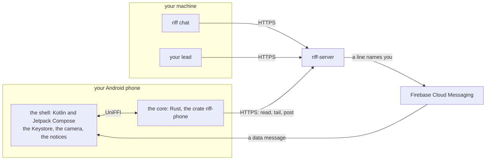
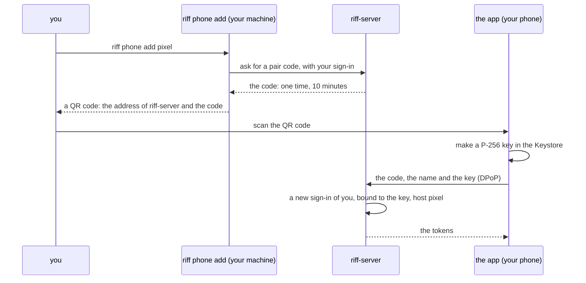
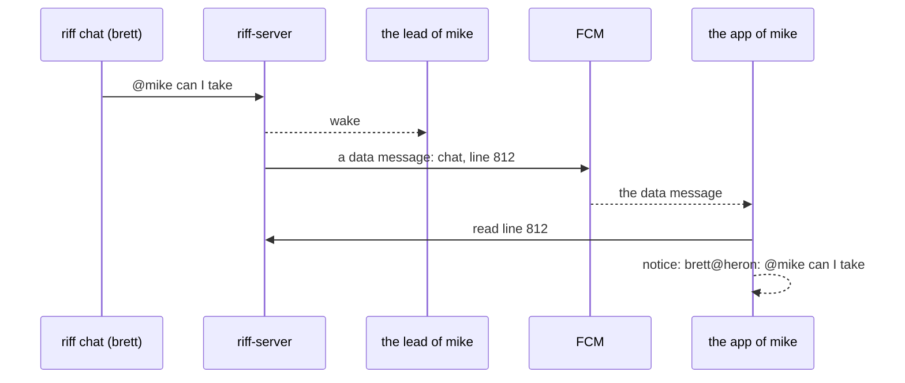

# riff on a phone

This page is the design of the phone app (#951): the riff chat on an
Android phone. The build items come after Mike signs off the design.
Until then, `riff --help` does not show `riff phone`, and no release
has the app. The
[requirements of the phone app](requirements.md#the-phone-app) hold
each decision.

## What the app does first

The first app does four things:

- It shows the thread `chat`: the history, then each new line.
- It posts a line.
- It sends `@lead`, `@USER` and `/me` as `riff chat` does. `@lead`
  wakes your lead, and `@USER` wakes the lead of USER.
- It shows a notice on the phone when a line names you.

Later items can add `riff top`, the questions of the lead, and the
steps of a lead, for example a pause. To answer the questions of your
own lead today, use Remote Control: see
[Answer your lead from the Claude app](how-it-works.md#answer-your-lead-from-the-claude-app).

## How the phone reaches the chat

riff-server stays in riff 3.0 (#953). So the phone reaches the chat
through riff-server over HTTPS, on riff 1.x and on riff 3.0.



- The core is Rust. It makes each call to riff-server, the DPoP proofs
  and the signatures, and the parse of `@lead` and `@USER`, with the
  code of riff-core. So the app and `riff chat` cannot differ.
- The shell is Kotlin and Jetpack Compose. It draws the screens, and
  it holds the parts of Android: the Keystore, the camera, Firebase
  Cloud Messaging (FCM) and the notices. No part of the app draws in a
  web view.
- The app uses the calls of `riff chat`: it joins the thread `chat`,
  reads its history, follows it with `/v1/tail`, and posts. It is a
  person, as `riff chat` is. It is not a session.

## The platform

Mike asked for an app in Rust, with no web app, and for Android only.
The options, with the facts and their links, are in
[the comparison on #951](https://github.com/como-technologies/riff/issues/951#issuecomment-6227996939):

| | A Rust core with a native shell (UniFFI) | An app all in Rust (Slint, Makepad, egui) | A Rust UI in a web view (Dioxus, Tauri 2) |
|---|---|---|---|
| Draws in a web view | No | No | Yes |
| Android today | Yes: Firefox for Android uses UniFFI | Slint and Makepad: yes. egui: the soft keyboard does not open | Yes |
| Push, camera, Keystore | Plain Android code in the shell | No API: the team writes JNI code | Tauri: plugins, but no remote push |
| iroh | iroh-ffi uses UniFFI | Rust: yes | Rust: yes |

The app is a Rust core with a thin native shell. UniFFI makes the
Kotlin bindings of the core. It runs on Android 10 or later.

## Pair a phone

A phone is a device of a member, as a machine is. The owner admits the
person, not each device. You pair your phone from a machine where you
have a live sign-in. The phone needs no Google sign-in.



- `riff phone add NAME` runs in a terminal of your own. It refuses with
  no terminal, so an agent session cannot pair a phone.
- The command prints the code as text too. The code is in no URL, so
  no request line and no log of riff-server holds it. riff-server
  keeps only its hash.
- The key is ECDSA P-256 in the Android Keystore, in StrongBox when the
  phone has it. It cannot leave the Keystore. The core asks the shell
  to sign. The sign-in of the phone is bound to the key, as the sign-in
  of `riff login` is bound to the device key of a machine. Each call
  has a DPoP proof of the key.
- Your lines from the phone show as `<USER@NAME>`, for example
  `<mike@pixel>`. riff-server sets the host from the name of the pair.
  It refuses a name that is the host of a machine or of another phone
  of yours, so a line of the phone cannot look like a line of a
  machine.
- The token of a phone acts only on the thread `chat` and on the
  notices of the phone. A phone cannot claim, pause, invite or read
  another thread. So a lost phone cannot do a step of a lead or of an
  admin.
- A sign-in ends after 30 days with no refresh, as each sign-in does.
  Then pair the phone again.
- The app keeps no text of a message in its storage: only the alias of
  its key, its tokens and the number of the last line that it showed.
  A key of the Keystore encrypts the tokens.

## A lost phone

`riff phone list` shows each of your phones. `riff phone remove NAME`
ends the sign-in of one phone at once. Run them on a machine of yours:

```sh
riff phone list
riff phone remove pixel
```

An admin ends the phone of another person with `--user`.
`riff logout --all` and `riff remove --email` also end each phone of
the person. When you clear the data of the app, its key goes. Then
pair the phone again.

## Install the app

Each release of riff attaches `riff-phone.apk`, of the same build as
riff and riff-server. The release key of the riff project signs it.
You install it by hand: Android asks you to allow the install.

- The app sends its build, as each client of riff does. When
  riff-server refuses its release line, the app says to install the
  APK of the release of riff-server.
- From 2027, Android installs an app from outside Google Play only
  from a verified developer: see
  [developer verification](https://developer.android.com/developer-verification).
  Then the riff project uses a free account of "limited distribution",
  for up to 20 devices: see
  [the FAQ](https://developer.android.com/developer-verification/guides/faq).
- Google Play can come later. It costs 25 USD one time.

## The notices

riff-server sends each notice through Firebase Cloud Messaging (FCM).
FCM is free. Firebase is on in the Google Cloud project of riff-server
(`como-riff`). riff-server sends with the FCM HTTP v1 API and its Cloud
Run service identity, so it needs no key file. Mike keeps riff-server
in riff 3.0 (#953), so riff-server sends the notices. The "no cloud"
of Wave C (#879) does not stop them.



A phone gets a notice for:

- a line of the thread `chat` that names its user with `@USER`, from
  another person or from a session of another user;
- each line of the verified lead of its user in the thread `chat`.

Your own lines give no notice. riff-server finds the lines from the
`to`, the sender and the lead mark. It does not read the body: the
client makes the selector `user=USER, lead=true` from `@USER`.

- The push is a data message with high priority. It holds only the
  thread and the number of the line. The app reads the line from
  riff-server, then shows the sender and the line.
- You turn the notices on and off in the app. Android asks for your
  consent the first time.
- When FCM says that the token of a phone is not registered,
  riff-server deletes it. A push never delays a post.
- The APK holds the Firebase config of `como-riff`. A riff-server in
  another Google Cloud project sends notices only to an APK that is
  built with its own Firebase config.
- A phone with no Google Play services gets no notice. The chat works.
  UnifiedPush can come later.

## What others can see

| Who | What it sees |
|---|---|
| riff-server and the Google Cloud project `como-riff` | Each line in clear text, until #958. The name of the phone, its public key, its FCM token, and the time of each call |
| Google, through FCM and Google Play services | The FCM token of the phone, and the time and the size of each push. A push holds the thread and the number of a line, and no text |
| Google sign-in | Nothing: the phone does not sign in with Google |
| n0 | Nothing: the app uses no iroh |
| The model provider of each agent session | Each chat line that a lead reads, as today |

The app calls only riff-server, and FCM through the Firebase Messaging
library. It has no analytics and no crash report.

## What the phone needs from #958

#958 encrypts each message end to end, also at rest. The phone is one
more device that needs a key. This design leaves the key choices to
#958, and gives it these facts:

- The pair is the step where a machine of the person admits the new
  phone. #958 can admit the encryption key of the phone in the same
  step.
- The Rust core can hold the encryption of #958, with the same crates
  as the CLI.
- The push holds no text already. The rule of the notices reads only
  the `to`, the sender and the lead mark. #958 must leave them in clear
  text, or give riff-server another way to find a line that names a
  person.
- The release key of the riff project signs the app, so riff-server
  cannot change its code.
- Today a new phone reads the kept history of the chat. #958 decides
  whether a new device can read the old lines.

## An iPhone app

The riff project makes no iPhone app. riff is open source, so another
person can make one. It needs:

- the Apple Developer Program, 99 USD each year: a free account cannot
  use push;
- a shell in Swift and SwiftUI over the same Rust core: UniFFI makes
  Swift bindings too;
- the key in the Secure Enclave, which keeps P-256 keys;
- a Notification Service Extension in Swift, to show a push with no
  text;
- an APNs key on riff-server, or in Firebase;
- a Mac to build the app.

## If a later release removes riff-server

No release removes riff-server now. If one does, the phone needs a new
path:

- The phone talks over iroh to a daemon of its user, as a client of
  that daemon. It is no peer of the riff: a phone sleeps, and holds no
  copy of the records.
- n0 supports iroh on Android, and iroh-ffi uses UniFFI. So the core
  can hold iroh.
- That daemon pairs the phone. That release chooses how a notice
  reaches the phone, for example FCM or UnifiedPush.

## The build items

Each item is an issue in the Backlog. They start after Mike signs off
this design, in this order:

| Item | What | Needs |
|---|---|---|
| #962 | `riff phone add`, `riff phone list` and `riff phone remove`: pair a phone, and end its sign-in | None |
| #963 | The Rust core: the crate `riff-phone`, with UniFFI bindings for Kotlin | #962 |
| #977 | The Android app: the Jetpack Compose shell, the key in the Keystore, the APK in each release | #963 |
| #964 | The notices, with FCM | #977 |
| #965 | The live check: Mike installs the APK, pairs, chats, gets a notice and removes the phone | #964 |

The items need no item of #953. So they fit on the line 1.x and on
riff 3.0. The lead puts them in the waves.
