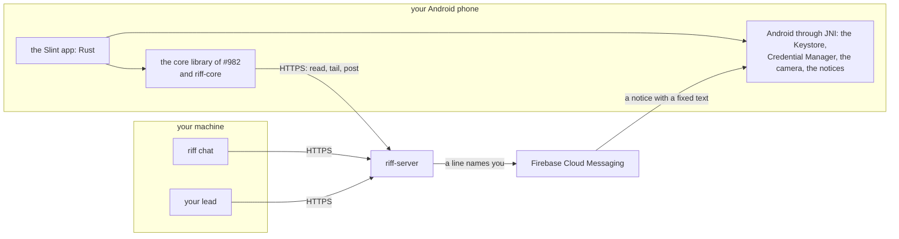
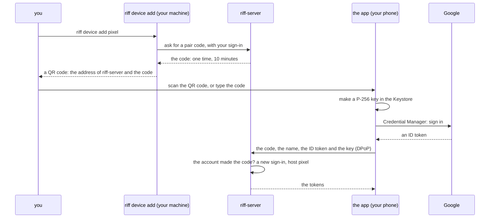
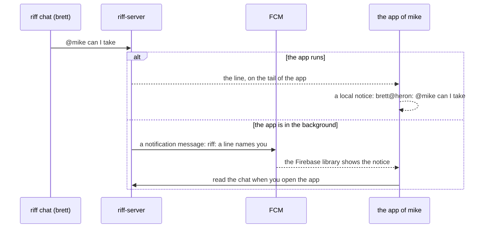

# riff on a phone

This page is the design of the phone app (#951): the riff chat on an
Android phone. It is one child design of
[the UIs of riff](riff-uis.md) (#982). The build items come after
Mike signs off the design. Until then, `riff --help` does not show
`riff device`, and no release has the app. The
[requirements of the phone app](requirements.md#the-phone-app) hold
each decision.

## What the app does first

The first app does four things:

- It shows the thread `chat`: the history, then each new line.
- It posts a line.
- It sends `@lead`, `@USER` and `/me` as `riff chat` does. `@lead`
  wakes your lead, and `@USER` wakes the lead of USER.
- It shows a notice on the phone when a line names you.

Later items can add `riff top`, the questions of the lead, and the
steps of a lead, for example a pause. The app itself is #963. Until
then, answer your lead in `riff chat`: see
[Ask a lead in the chat](how-it-works.md#ask-a-lead-in-the-chat).

## How the phone reaches the chat

riff-server stays in riff 3.0 (#953). So the phone reaches the chat
through riff-server over HTTPS, on riff 1.x and on riff 3.0.



- The app is a [Slint](https://slint.dev) app, all in Rust. Slint is
  the toolkit of each graphical UI of riff (#982).
- The app builds on the core library of #982, which comes in riff 3.1:
  the client of riff-server and the models of the views. The parse of
  `@lead` and `@USER`, the signed payload and the sign-in proof come
  from riff-core. So the app and `riff chat` cannot differ.
- The app uses the calls of `riff chat`: it joins the thread `chat`,
  reads its history, follows it with `/v1/tail`, and posts. It is a
  person, as `riff chat` is. It is not a session.

## The platform

The app runs on Android 10 or later. No part of it draws in a web view.
It has no Kotlin or Java source of the riff project.

- Slint has had official Android support since
  [1.5](https://slint.dev/blog/slint-1.5-released). It has its own
  Android input code, so the soft keyboard, the IME and copy and paste
  work.
- The app calls the parts of Android through JNI: the Keystore,
  Credential Manager, the camera and the notices.
- The Java that the app needs comes from crates and libraries: the
  helper of Slint, the callback class of
  [jni-min-helper](https://docs.rs/jni-min-helper/latest/jni_min_helper/),
  Credential Manager and Firebase Messaging. Gradle builds the APK with
  these libraries, so the build needs a JDK.
- The app uses the royalty-free license of Slint. It shows the
  AboutSlint widget in its About screen.
- The app has no TalkBack: Slint has no screen reader support on
  Android.

## Pair a phone

A phone is a device of a member, as a machine is. One command adds each
kind of device: `riff device add`. You add your phone from a machine
where you ran `riff login`. Then the phone signs in with Google, as
`riff login` does.

```sh
riff device add pixel
```

- NAME is the name of the device, for example `pixel`, as the host name
  of a machine. It is not a Google ID. Your chat lines from the phone
  show as `USER@NAME`, and `riff device remove NAME` uses it.
- `--kind` names the kind of device. The kind sets the scope of the
  device when you add it. The first kind is `phone`, the default: a
  phone acts only on the chat. Each child design of #982 adds its kind
  and its scope, for example a browser or a desktop app.
- NAME is optional. With no NAME, the name is the kind, for example
  `phone`.



- `riff device add [NAME]` runs in a terminal of your own. It refuses
  with no terminal, so an agent session cannot add a device. It draws
  the QR
  code with [tui-qrcode](https://crates.io/crates/tui-qrcode), a
  Ratatui widget, and prints the code as text too. The code is in no
  URL, so no request line and no log of riff-server holds it.
  riff-server keeps only its hash.
- The app reads the QR code with the camera, through the NDK camera API
  and the decoder [rqrr](https://crates.io/crates/rqrr). A typed code
  is the fallback.
- The Google sign-in uses
  [Credential Manager](https://developer.android.com/identity/sign-in/credential-manager-siwg-implementation):
  one tap on the account sheet. It needs an Android OAuth client and a
  Web OAuth client of the riff. riff-server takes an ID token whose
  audience is that Web client.
- The person comes from the `riff login` of the terminal: riff-server
  ties the code to that Google account. It takes the phone only when
  the phone signs in with the same Google account. Then it binds the
  tokens of the phone to the key.
- The key is ECDSA P-256 in the Android Keystore, in StrongBox when the
  phone has it. It cannot leave the Keystore. The device key of a
  machine is P-256 too, so the sign-in proof (DPoP) stays the same.
- Your lines from the phone show as `<USER@NAME>`, for example
  `<mike@pixel>`. riff-server sets the host from the name of the pair.
  It refuses a name that is the host of a machine or of another phone
  of yours, so a line of the phone cannot look like a line of a
  machine.
- The token of a phone acts only on the thread `chat` and on the
  notices of the phone. A phone cannot claim, pause, invite or read
  another thread. So a lost phone cannot do a step of a lead or of an
  admin.
- A sign-in ends after 30 days with no refresh, as each sign-in does.
  Then pair the phone again.
- The app keeps no text of a message in its storage: only the alias of
  its key, its tokens and the number of the last line that it showed.
  A key of the Keystore encrypts the tokens.

## A lost phone

`riff device list` shows each of your devices: its kind, its name, the
time of its sign-in and the time of its last call. A machine where you
ran `riff login` is a device of the kind `machine`, with its host as
its name. `riff device remove NAME` ends the sign-in of one device at
once, also of a machine. Run them on a machine of yours:

```sh
riff device list
riff device remove pixel
```

An admin ends the device of another person with `--user`.
`riff logout --all` and `riff remove` also end each device of
the person. When you clear the data of the app, its key goes. Then add
the phone again.

## Install the app

Each release of riff attaches `riff-phone.apk`, of the same build as
riff and riff-server. The release key of the riff project signs it.
You install it by hand: Android asks you to allow the install.

- The app sends its build, as each client of riff does. When
  riff-server refuses its release line, the app says to install the
  APK of the release of riff-server.
- From 2027, Android installs an app from outside Google Play only
  from a verified developer: see
  [developer verification](https://developer.android.com/developer-verification).
  Then the riff project uses a free account of "limited distribution",
  for up to 20 devices: see
  [the FAQ](https://developer.android.com/developer-verification/guides/faq).
- Google Play can come later. It costs 25 USD one time.

## The notices

A phone gets a notice for:

- a line of the thread `chat` that names its user with `@USER`, from
  another person or from a session of another user;
- each line of the verified lead of its user in the thread `chat`.

Your own lines give no notice. riff-server finds the lines from the
`to`, the sender and the lead mark. It does not read the body: the
client makes the selector `user=USER, lead=true` from `@USER`.



- While the app runs, it follows the chat. It shows a local notice
  through JNI, with the sender and the line.
- In the background, riff-server sends an FCM notification message with
  a fixed text, for example "riff: a line names you". The Firebase
  library of the APK shows it by itself, with no service of ours. No
  push holds the text of a line: the app shows the line when you open
  it.
- riff-server sends with the FCM HTTP v1 API and its Cloud Run service
  identity, so it needs no key file. Firebase is on in the Google Cloud
  project of riff-server (`como-riff`). FCM is free.
- You turn the notices on and off in the app. Android asks for your
  consent the first time.
- When FCM says that the token of a phone is not registered,
  riff-server deletes it. A push never delays a post.
- A phone with no Google Play services gets no background notice. The
  chat and the local notice work.

## What others can see

| Who | What it sees |
|---|---|
| riff-server and the Google Cloud project `como-riff` | Each line in clear text, until #958. The name of the phone, its public key, its FCM token, and the time of each call |
| Google, through the sign-in | That the person signs in to the OAuth client of the riff, from the phone |
| Google, through FCM and Google Play services | The FCM token of the phone, and the time of each push. A push holds a fixed text, and no text of a line |
| n0 | Nothing: the app uses no iroh |
| The model provider of each agent session | Each chat line that a lead reads, as today |

The app calls only riff-server, Google for the sign-in, and FCM through
the Firebase Messaging library. It has no analytics and no crash
report.

## What the phone needs from #958

#958 encrypts each message end to end, also at rest. The phone is one
more device that needs a key. This design leaves the key choices to
#958, and gives it these facts:

- The pair is the step where a machine of the person admits the new
  phone. #958 can admit the encryption key of the phone in the same
  step.
- The app is Rust, so it can hold the encryption of #958 with the same
  crates as the CLI.
- No push holds the text of a line. The rule of the notices reads only
  the `to`, the sender and the lead mark. #958 must leave them in clear
  text, or give riff-server another way to find a line that names a
  person.
- The release key of the riff project signs the app, so riff-server
  cannot change its code.
- Today a new phone reads the kept history of the chat. #958 decides
  whether a new device can read the old lines.

## An iPhone app

The riff project makes the app for Android. riff is open source, so
another person can make an iPhone app. It needs:

- the iOS support of Slint, a tech preview since
  [1.12](https://slint.dev/blog/slint-1.12-released);
- the Apple Developer Program, 99 USD each year: a free account cannot
  use push;
- the key in the Secure Enclave, which keeps P-256 keys;
- a push through APNs, with an APNs key on riff-server or in Firebase;
- a Mac to build the app.

The core library, the screens of Slint and the rules of this page stay
the same.

## If a later release removes riff-server

No release removes riff-server now. If one does, the phone needs a new
path:

- The phone talks over iroh to a daemon of its user, as a client of
  that daemon. It is no peer of the riff: a phone sleeps, and holds no
  copy of the records.
- n0 supports iroh on Android, so the app can hold iroh.
- That daemon pairs the phone. That release chooses how a notice
  reaches the phone.

## The build items

Each item is an issue in the Backlog. They start after Mike signs off
this design, in this order:

| Item | What | Needs |
|---|---|---|
| #962 | `riff device add`, `riff device list` and `riff device remove`: the pair code, the QR code, the Google sign-in of the phone on riff-server, the scope of each kind, and the end of one device | None |
| #963 | The Slint app: the chat, the key in the Keystore, the typed code, the Google sign-in, and the APK in each release | #962, and the core library of #982 (riff 3.1) |
| #977 | The QR scan with the NDK camera | #963 |
| #964 | The notices: a local notice while the app runs, and an FCM notification message with a fixed text in the background | #963 |
| #965 | The live check: Mike installs the APK, scans, signs in, chats, gets a notice and removes the phone | #964, #977 |

The lead puts them in the waves.
