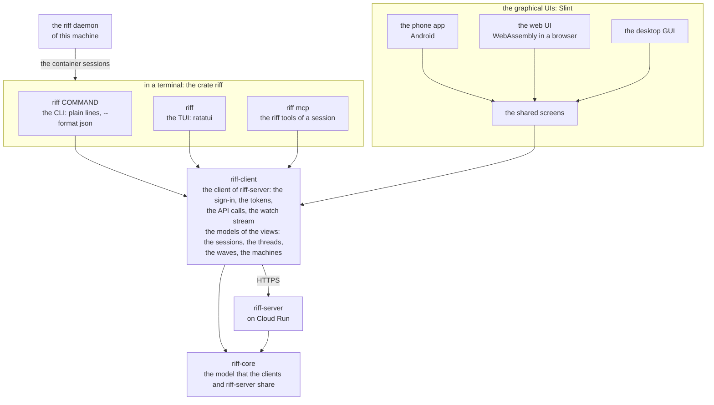
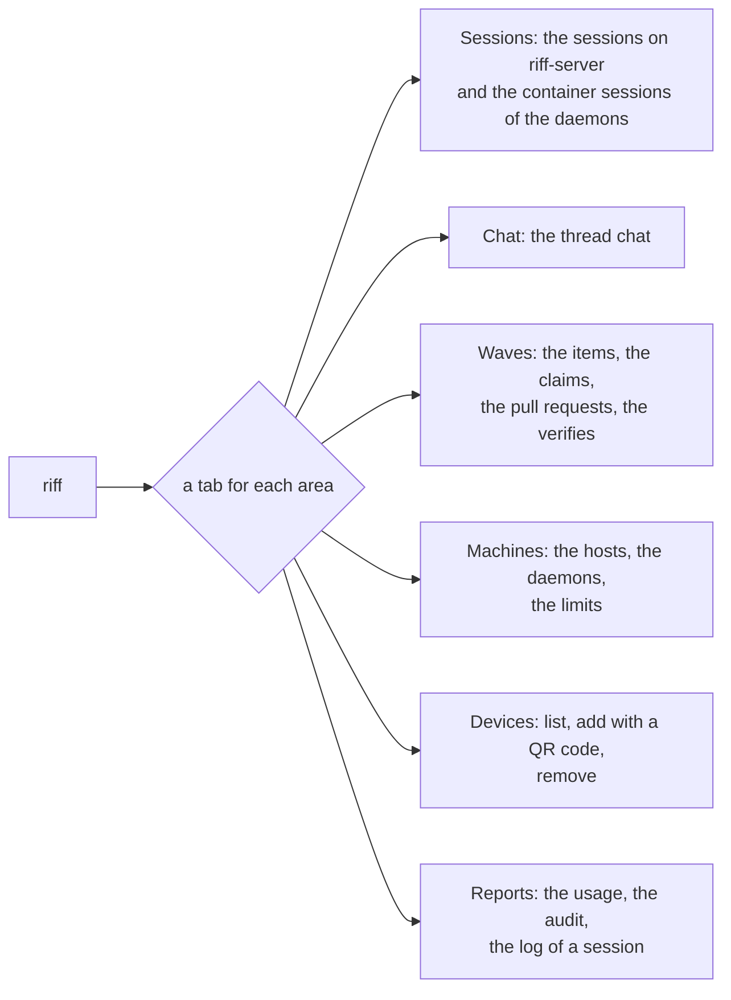
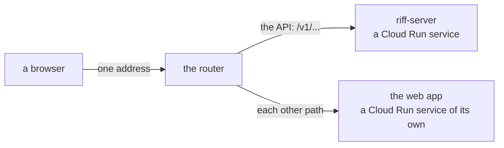
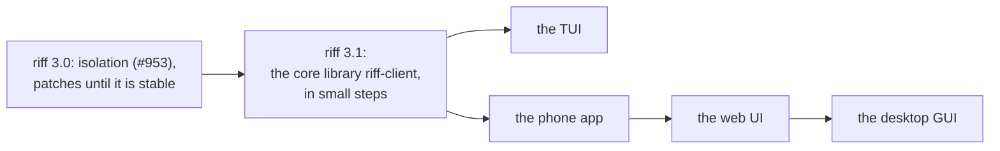

# Design: the UIs of riff

This page is the design of the UI architecture of riff (#982). It
decides the core library, the list of UIs and their order. Each UI has
a child design of its own. Only the CLI is built: the work on the rest
starts in riff 3.1 (see [The order](#the-order)). Until then,
`riff --help` does not show `riff device`, and `riff` with no command
prints the help. The [requirements of the UIs](requirements.md#the-uis)
hold each decision.

| UI | How a person starts it | Toolkit | Child design |
|---|---|---|---|
| The CLI | `riff COMMAND` | clap | This page |
| The TUI | `riff` with no command, in a terminal | ratatui | #994 |
| The phone app | The app on an Android phone | Slint | #951 |
| The web UI | A browser | Slint, built to WebAssembly | #995 |
| The desktop GUI | An app on the desktop | Slint | #996 |

## The rules for each UI

- All UI code is Rust.
- No JavaScript, no JavaScript framework (React, Vue and the like), no
  UI written in HTML and styled with CSS, and no npm tooling.
- A Rust app that builds to WebAssembly can run in a browser, when its
  Rust toolkit makes the small HTML, JavaScript or CSS that starts it.
- The phone app is for Android.
- riff-server stays on Google Cloud Run for now (#953).

## The crates and the UIs

Each UI is a thin layer over one core library: the new crate
`riff-client`.

- `riff-core` stays the model that the clients and riff-server share:
  the session URIs, the selectors, the wire types of the HTTP API, the
  device keys and the DPoP proofs, the signed messages, the records of
  the log and the build check.
- `riff-client` comes in riff 3.1. The client of riff-server and the
  models of the views move into it, out of the crate `riff`. It holds
  no terminal code. It builds for Linux, for Android and for
  WebAssembly.
- A part that is not the same on each platform is a trait that each UI
  gives. An example is the store of the tokens and of the device key:
  the OS keyring on a machine, and the Keystore on Android.
- The socket of the riff daemon stays in the crate `riff`. A terminal
  UI gives the container sessions of the daemon of its machine to the
  sessions model of `riff-client`.

## One sessions view

Each UI shows the sessions in one view: the sessions on riff-server and
the container sessions of the daemons, in one list. Today two commands
show them: `riff top` (see
[See what each session does](how-it-works.md#see-what-each-session-does))
and `riff view` (see [Watch the riff](development.md#watch-the-riff)).
They merge. The sessions tab of the TUI does what each of them does:
the live table, the board of each repository, and the attach to a
session.

## The CLI

The CLI stays simple and complete. It serves scripts, agents (through
the MCP server) and hooks.

- Each command prints plain lines that are easy to `grep`.
- Each command that prints data takes `--format text` (the default) or
  `--format json`. serde makes the JSON from the types of the data.
- `riff top` prints one look of the sessions and ends, as
  `riff top --once` does today. The live view moves to the TUI. The TUI
  design can give `riff top` a plain alias, for example `riff stats`.

## The TUI

`riff` with no command starts the TUI in a terminal. With no terminal,
it prints the help of the CLI. `riff --help` stays the help of the
CLI, and says that `riff` with no command starts the TUI.
`riff COMMAND` stays the CLI. If a bare `riff` makes the CLI
awkward, the TUI is `riff ui`. The TUI design (#994) decides.

The TUI is a ratatui app with a tab for each area. Each action of the
TUI calls the same code as its CLI command.

## The graphical UIs

The phone app, the web UI and the desktop GUI use one Rust toolkit:
[Slint](https://slint.dev). They share their screens. Each child design
checks that Slint does its platform today.

## The web UI

The web UI runs on Google Cloud Run. This is the start, for the web
design (#995) to check:

- A Cloud Run service of its own serves the web app. So a deploy of the
  UI does not restart riff-server.
- A router gives one address to the web app and to the API, for example
  the rewrites of Firebase Hosting, or a load balancer with a URL map.
  So the browser needs no CORS.

The web design compares this with a riff-server that serves the web app
itself, and picks one.

## The devices

Each UI that signs in is a device of the person: a machine, a phone, a
browser or a desktop app with a sign-in of its own. The phone design
(#951) has the commands of the devices, and builds them first:

| Command | Does |
|---|---|
| `riff device list` | Lists each signed-in device: the machines, the phones, the browsers and the desktop apps. |
| `riff device add [NAME]` | Pairs a new device with a QR code. Then the device signs in with Google, with the same account. |
| `riff device remove NAME` | Ends the sign-in of that one device. |

- The kind of a device sets its scope when you add it: the chat only,
  or each tool. Each child design names its kind and the default scope
  of that kind.
- The TUI has a devices tab. It shows each device with its kind, its
  name, its scope and its last use. It adds a device, and draws the QR
  code with [tui-qrcode](https://crates.io/crates/tui-qrcode). It
  removes a device.
- Each graphical UI has a devices view that lists and removes devices.
  It adds a device where it can show a QR code.

## The order

1. riff 3.0 (isolation, #953) ships first, with the patch releases
   that make it stable.
2. riff 3.1 moves the core library out of the CLI, in small steps. Each
   step keeps each test and changes no command. Then riff 3.1 gets
   stable.
3. After riff 3.1, the UIs come in this order: the TUI, the phone app,
   the web UI, the desktop GUI. The TUI does not block the phone app:
   the two can be built at the same time. The build items of a UI come
   from its child design, after Mike signs it off.

## The build items of riff 3.1

Each item is an issue in the Backlog. The lead puts them in the waves
after riff 3.0 is stable.

| Item | What | Needs |
|---|---|---|
| #997 | The crate `riff-client` and its platform traits. The client of riff-server moves into it: the sign-in, the tokens, the API calls and the watch stream. | None |
| #998 | The models of the views move to `riff-client`: the sessions, the threads, the waves, the machines. | #997 |
| #999 | `riff-client` builds for Android and for WebAssembly, and the Gate checks both. | #997, #998 |
| #1000 | `--format json` for each command that prints data. | #998 |
