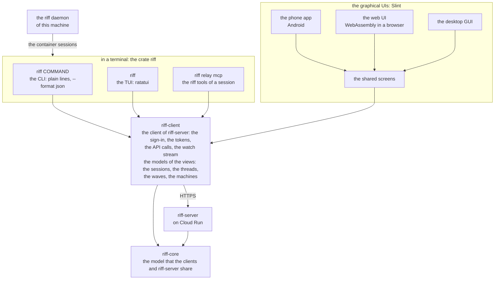
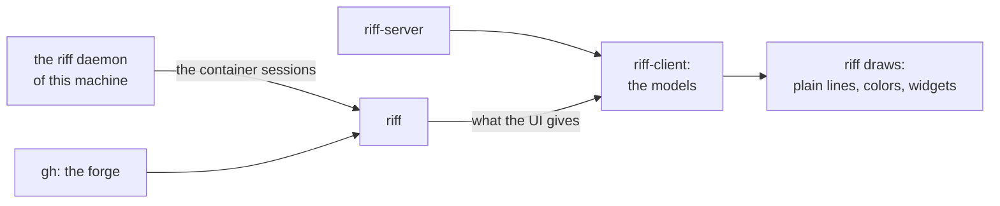
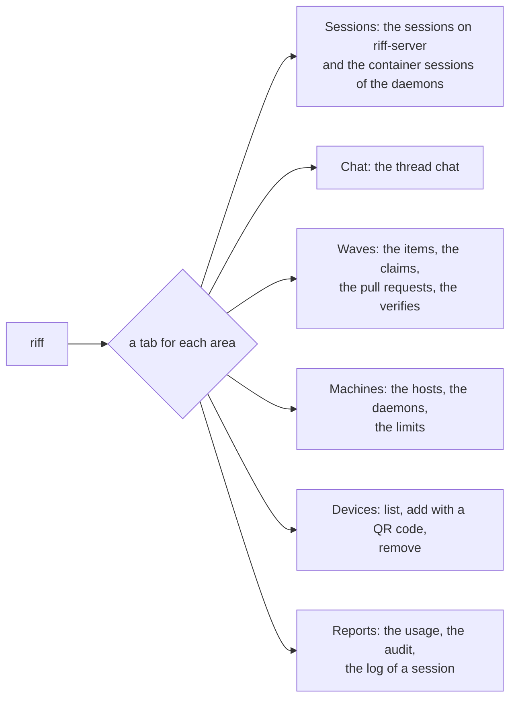
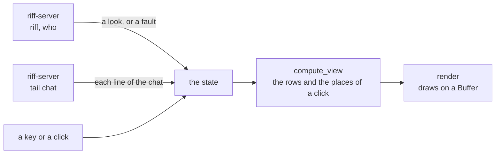
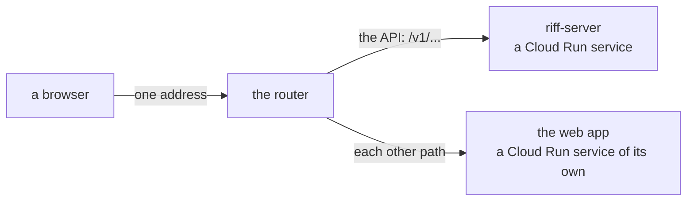
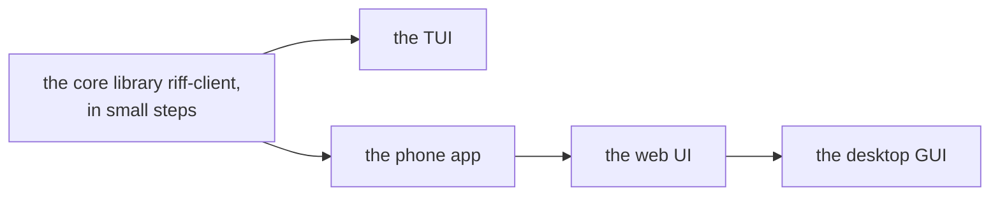

# Design: the UIs of riff

This page is the design of the UI architecture of riff (#982). It
decides the core library, the list of UIs and their order. Each UI has
a child design of its own. The CLI is built, and the frame, the
Sessions tab, the Chat tab, the Waves tab and the Machines tab of the
TUI: see [The TUI](#the-tui). The other tabs of the TUI and the other
UIs come with their build items (see [The order](#the-order)). Until
then, `riff --help` does not show `riff device`. The
[requirements of the UIs](requirements.md#the-uis) hold each decision.

| UI | How a person starts it | Toolkit | Child design |
|---|---|---|---|
| The CLI | `riff COMMAND` | clap | This page |
| The TUI | `riff` with no command, in a terminal | ratatui | #994 |
| The phone app | The app on an Android phone | Slint | #951: [riff on a phone](riff-mobile.md) |
| The web UI | A browser | Slint, built to WebAssembly | #995 |
| The desktop GUI | An app on the desktop | Slint | #996 |

## The rules for each UI

- All UI code is Rust.
- No JavaScript, no JavaScript framework (React, Vue and the like), no
  UI written in HTML and styled with CSS, and no npm tooling.
- A Rust app that builds to WebAssembly can run in a browser, when its
  Rust toolkit makes the small HTML, JavaScript or CSS that starts it.
- The phone app is for Android.
- riff-server stays on Google Cloud Run for now (#953).

## The crates and the UIs

Each UI is a thin layer over one core library: the new crate
`riff-client`.



- `riff-core` stays the model that the clients and riff-server share:
  the session URIs, the selectors, the wire types of the HTTP API, the
  device keys and the DPoP proofs, the signed messages, the records of
  the log and the build check.
- `riff-client` holds the client of riff-server (#997): the sign-in,
  the tokens, the API calls and the watch stream. Its modules are
  `api`, `link`, `login`, `device`, `secrets` and `marks`. The browser
  step of `riff login` stays in the crate `riff`. `riff-client` holds
  no terminal code. It builds for Linux, for Android and for
  WebAssembly (#999).
- `riff-client` holds the models of the views (#998), as plain data
  with serde. See [The models of the views](#the-models-of-the-views).
- A part that is not the same on each platform is a trait that each UI
  gives: `riff_client::platform::Platform`. An example is the store of
  the tokens and of the device key: the OS keyring on a machine, and
  the Keystore on Android. `riff` gives its parts at its start: the OS
  keyring, its local folders, and its lines on the terminal.
- The socket of the riff daemon stays in the crate `riff`. A terminal
  UI gives the container sessions of the daemon of its machine to the
  sessions model of `riff-client`.

## The models of the views

`riff-client` makes each model from the replies of riff-server, and
from what the UI gives. A UI only draws a model: the plain lines, the
colors and the ratatui widgets stay in the crate `riff`.

| Model | Module | Holds | Drawn by |
|---|---|---|---|
| The sessions | `sessions` | The sessions of riff-server and the container sessions of the riff daemon, one entry for each session ID | `riff top`, the Sessions tab |
| The threads | `threads` | One line for each message: the sender, the receivers, the mark `verified`, the kind and the body | `riff read`, `riff tail`, `riff chat` |
| The waves | `waves` | The open issues, the board of the current wave, the open waves | `riff top`, `riff wave list` |
| The machines | `machines` | The numbers of each host: the limit, the workers, the machine, the disk and the monitor | `riff top` |



A container session that is also a session of riff-server is one entry
of the sessions model, with the state of its container. `riff top`
gives the model no container session, so it prints what it printed
before. The Sessions tab of the TUI gives it both.

## One sessions view

Each UI shows the sessions in one view: the sessions on riff-server and
the container sessions of the daemons, in one list. In the TUI, it is
the Sessions tab (see
[See what each session does](how-it-works.md#see-what-each-session-does)
and [Watch the riff](development.md#watch-the-riff)). It does what the
live table of `riff top` and the old view of the riff daemon did: the
tree, the detail of a session, the attach to the lead, the takeover,
the end of a session and the pause. `riff top` stays (see
[The CLI](#the-cli)). The command `riff view` is gone: `riff daemon
status` prints its facts in plain lines.

## The CLI

The CLI stays simple and complete. It serves scripts and agents (through
the MCP server).

- Each command prints plain lines that are easy to `grep`.
- Each command that prints data takes `--format text` (the default) or
  `--format json`. serde makes the JSON from the types of the data.
- `riff top` stays the live table with the TUI. It draws the table
  again in place until Ctrl-C, and `riff top --once` prints one table
  and exits. `riff top` gets no alias.
- Each command keeps its work when the TUI ships, where it makes sense.
  A command may change to fit the core library and the TUI.

```sh
riff top
riff top --once
```

## The TUI

`riff` with no command starts the TUI in a terminal, also with only the
global options: `riff --server URL` starts the TUI at that riff-server.
With no terminal on stdin and stdout, for example in a script or for an
agent, `riff` prints the help of the CLI. `riff --help` stays the help
of the CLI, and says that `riff` with no command starts the TUI.
`riff COMMAND` stays the CLI. So the TUI is `riff`, not `riff ui`. To
use it, see [Open the TUI](start-a-riff.md#open-the-tui).

The TUI is a ratatui app with a tab for each area. Each action of the
TUI calls the same code as its CLI command. The design is #994. Each
tab comes with a build item:

| Build item | What |
|---|---|
| [A #1636](https://github.com/como-technologies/riff/issues/1636) | The frame: the tab strip, the header, the note line, the key line, the help, the mouse and the narrow layout. |
| [B #1637](https://github.com/como-technologies/riff/issues/1637) | 1 Sessions: each session and each worker, with its mark, its item, its state and its age, the fold, the filter, the detail, the attach, the takeover and the pause. `riff view` is gone. Built: see [See what each session does](how-it-works.md#see-what-each-session-does). |
| [E #1640](https://github.com/como-technologies/riff/issues/1640) | 2 Chat: the thread `chat`, as `riff chat` shows it. Built: see [Chat in the TUI](how-it-works.md#chat-in-the-tui). |
| [C #1638](https://github.com/como-technologies/riff/issues/1638) | 3 Waves: a board for each repository: the items, the claims, the pull requests, the next waves and the checks of `main`, with hold, free and pause. Built: see [See the open items of a wave](waves.md#see-the-open-items-of-a-wave). |
| [D #1639](https://github.com/como-technologies/riff/issues/1639) | 4 Machines: the numbers of each host, the link and riff-server, the limit of a host, and the filter of the hosts (#1702). Built: see [See the hosts in the TUI](how-it-works.md#see-the-hosts-in-the-tui) and [Filter the hosts in the TUI](how-it-works.md#filter-the-hosts-in-the-tui). |
| [G #1642](https://github.com/como-technologies/riff/issues/1642) | 5 Devices: list the devices, add one with a QR code, remove one. |
| [F #1641](https://github.com/como-technologies/riff/issues/1641) | 6 Reports: the usage, the audit and the log of a session. Built: see [See the tokens in the TUI](development.md#see-the-tokens-in-the-tui), [Audit a wave in the TUI](development.md#audit-a-wave-in-the-tui) and [See the events in the TUI](development.md#see-the-events-in-the-tui). |

Until its build item merges, the Devices tab says that it is not built
yet.



Each tab has the same five parts:

```text
[1 Sessions]  2 Chat•2  3 Waves•  4 Machines  5 Devices  6 Reports
 riff running · owner mike · build 10df8a4 · link ok 2s
 the body of the tab

 the note: the result of the last action, or the fault of the link
 1-6 tab  r read again  ? help  q quit
```

- The tab strip shows the active tab in `[ ]`. A dot after a tab says
  that it has news since you looked at it: `Chat•2` is two new lines.
- The header shows the state of the whole riff, the owner, the build
  of your riff, and the link: `link ok` with the age of the last look,
  or `link down`. When riff-server runs another build, the header
  names it.
- The TUI looks at riff-server each 3 seconds, and each 15 seconds
  after 2 minutes with no key. A look that fails keeps the last
  screen, puts `link down` in the header and the fault in the note
  line, as `riff top` does. The first look that fails ends the TUI
  with the error, before it draws a screen.
- The mouse does what the keys do. The setting `tui.mouse` turns it
  off. In a tab with rows, a click selects a row, and a second click
  opens it.
- An action that changes something, for example a hold, asks `y` or
  `n` in the note line first. The attach and the takeover leave the
  screen of the TUI, and the TUI draws again at their end.
- Under 80 columns the TUI shows the narrow layout, for a phone with
  SSH: the strip is `‹ 1/6 Sessions ›`, and the rows have fewer words.
  Under 40 columns or 10 rows, the TUI asks for a bigger terminal.

A session in a tab gets one of five marks. The worst mark comes first.

| Mark | Word | When |
|---|---|---|
| `!` | blocked | The state `blocked`. |
| `✓` | done | The phase `ends` of a container session: the turn gave its result. |
| `◐` | waiting | The state `waiting`: a verify, a merge, or an item of `Needs:`. |
| `●` | busy | The state `busy`, or the phase `works`. |
| `○` | idle | The state `idle`. |

The render is pure: a function makes the view from the state, and the
draw only reads the view. So a screen test draws a tab into a
`Buffer` of ratatui and compares the rows.



## The graphical UIs

The phone app, the web UI and the desktop GUI use one Rust toolkit:
[Slint](https://slint.dev). They share their screens. Each child design
checks that Slint does its platform today.

## The web UI

The web UI runs on Google Cloud Run. This is the start, for the web
design (#995) to check:

- A Cloud Run service of its own serves the web app. So a deploy of the
  UI does not restart riff-server.
- A router gives one address to the web app and to the API, for example
  the rewrites of Firebase Hosting, or a load balancer with a URL map.
  So the browser needs no CORS.



The web design compares this with a riff-server that serves the web app
itself, and picks one.

## The devices

Each UI that signs in is a device of the person: a machine, a phone, a
browser or a desktop app with a sign-in of its own. The phone design
(#951) has the commands of the devices, and builds them first: see
[Pair a phone](riff-mobile.md#pair-a-phone).

| Command | Does |
|---|---|
| `riff device list` | Lists each signed-in device: the machines, the phones, the browsers and the desktop apps. |
| `riff device add [NAME]` | Pairs a new device with a QR code. Then the device signs in with Google, with the same account. |
| `riff device remove NAME` | Ends the sign-in of that one device. |

- The kind of a device sets its scope when you add it: the chat only,
  or each tool. Each child design names its kind and the default scope
  of that kind.
- The TUI has a devices tab. It shows each device with its kind, its
  name, its scope and its last use. It adds a device, and draws the QR
  code with [tui-qrcode](https://crates.io/crates/tui-qrcode). It
  removes a device.
- Each graphical UI has a devices view that lists and removes devices.
  It adds a device where it can show a QR code.

## The order



1. The core library moves out of the CLI, in small steps. Each step
   keeps each test and changes no command. Then the core library gets
   stable.
2. After the core library, the UIs come in this order: the TUI, the
   phone app, the web UI, the desktop GUI. The TUI does not block the
   phone app: the two can be built at the same time. The build items of
   a UI come from its child design, after Mike signs it off.

## The build items of the core library

Each item is an issue in the Backlog. The lead puts them in the
waves.

| Item | What | Needs |
|---|---|---|
| #997 | The crate `riff-client` and its platform traits. The client of riff-server moves into it: the sign-in, the tokens, the API calls and the watch stream. | None |
| #998 | The models of the views move to `riff-client`: the sessions, the threads, the waves, the machines. | #997 |
| #999 | `riff-client` builds for Android and for WebAssembly, and the Gate checks both. | #997, #998 |
| #1000 | `--format json` for each command that prints data. | #998 |
