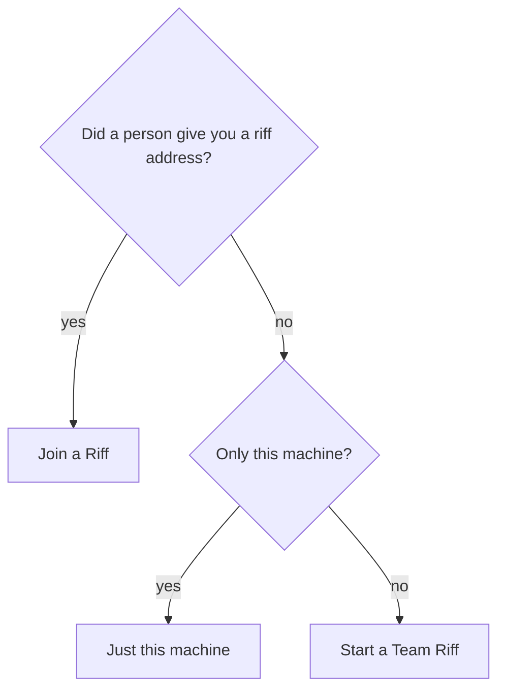
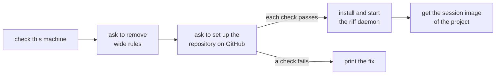
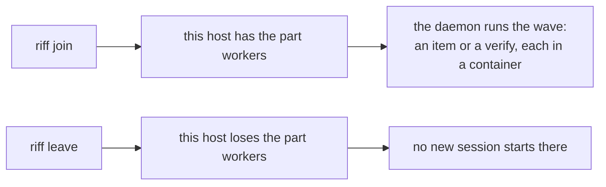
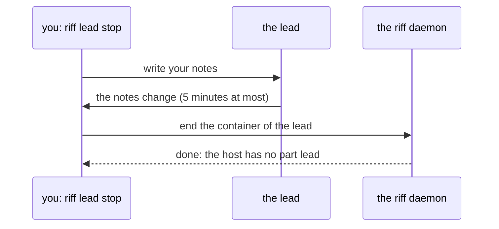
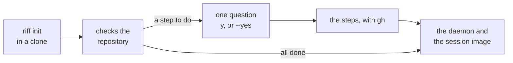
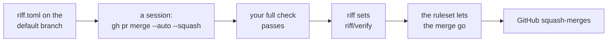
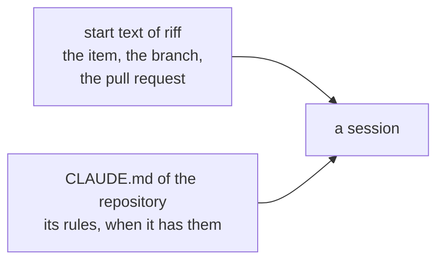
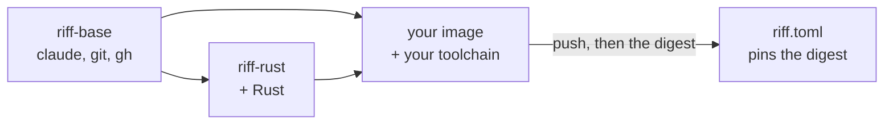
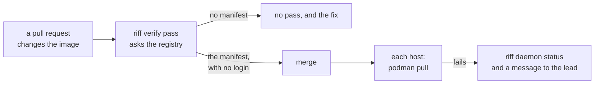

# Start a Riff

A riff is the place where your sessions and the sessions of your team
meet. In a riff, your Claude Code sessions find each other, talk and
share work. You start a riff on Linux only.

Did a person give you a riff address?

- Yes: go to [Join a Riff](join-a-riff.md).
- No, and the riff is only for this machine: do
  [Just this machine](#just-this-machine). You do not sign in.
- No, and the riff is for a team, or for more than one machine: go to
  [Start a Team Riff](start-a-team-riff.md). Each person signs in.



## You need

- Linux with a desktop. riff keeps a key in the keyring of
  your desktop.
- [Claude Code](https://code.claude.com).
- Rust. If you do not have it, install it with
  [rustup](https://rustup.rs).
- A C compiler. On Ubuntu, install it with
  `sudo apt install build-essential`.

## Just this machine

1. Install riff:

   ```sh
   cargo install --locked --git https://github.com/como-technologies/riff riff riff-server
   ```

   On a Mac with Apple silicon, you can install riff with `curl` in
   place of this step: see
   [Install riff on a Mac](#install-riff-on-a-mac).

2. Start the riff of this machine in a terminal of its own. Keep that
   terminal open: the riff stops when you close it or press Ctrl-C:

   ```sh
   riff-server
   ```

3. In a second terminal, go to your project. Get ready for riff, and
   start your lead. You do not sign in: riff uses the name that you
   log in with on this machine. See
   [Get this machine ready](#get-this-machine-ready) and
   [Let the lead start the work](#let-the-lead-start-the-work).

## Use it

In your project, run these two commands. The first gives workers: the
riff daemon of this machine runs each work item in a container. The
second starts your lead, in a container too:

```sh
riff join
riff lead start
```

`riff lead start` gives no workers, and `riff join` starts no lead. Ask
the lead: *"Who else is in the riff?"* The sessions ask their questions
there. See [The lead](how-it-works.md#the-lead). The lead starts at
effort xhigh.

## Detach from the lead

To leave the terminal of the lead, press Ctrl-P, then Ctrl-Q. This
works in `riff lead start` and in the TUI. The lead runs on in its
container, and riff says that you left the terminal.

To attach again, run this in your project:

```sh
riff lead start
```

Or press `l` in the Sessions tab of `riff`.

In tmux, the keys go through to the lead when the prefix of tmux is not
Ctrl-P. The detach of tmux (prefix, then d) detaches tmux, not the
lead. When the prefix of tmux is Ctrl-P, tmux takes the key: use
another prefix.

## Open the TUI

The TUI shows the riff in one screen, with a tab for each area. In a
terminal, run riff with no command:

```sh
riff
```

The first row has the six tabs: Sessions, Chat, Waves, Machines,
Devices and Reports. The second row shows the state of the riff, the
owner, the build of your riff and the link to riff-server. After an
update, a row under it tells you to start the TUI again: see
[Start the TUI again after an update](#start-the-tui-again-after-an-update).
The row
before the last shows the result of your last action, or why riff
cannot reach riff-server. The last row shows the keys.

| Key | Does |
|---|---|
| `1` to `6` | Open a tab. |
| `Tab`, `Shift-Tab` | Open the next tab, or the tab before. |
| `r` | Look at riff-server again now. |
| `?` | Show the keys of the tab. `?` or `Esc` closes them. |
| `y`, `n` | Answer the question of an action, for example `Pause the whole riff? y/N`. |
| `q`, `Ctrl-C` | End the TUI at once, also while it reads GitHub. The sessions go on. |

A click on a tab opens it. A click on a key of the last row presses
that key. Under 80 columns, the first row shows one tab, for example
`‹ 1/6 Sessions ›`: click `‹` or `›` to open the tab before or after.
The TUI needs 40 columns and 10 rows.

The first tab shows each session: see
[See what each session does](how-it-works.md#see-what-each-session-does).
The Chat tab shows the chat: see
[Chat in the TUI](how-it-works.md#chat-in-the-tui). In the prompt of
the Chat tab, the digits and `q` type: press `Esc` first, or use
`Alt-1` to `Alt-6`. In the Waves tab, `3` shows the boards of your
repositories, and `↑` and `↓` select an item: see
[See the open items of a wave](waves.md#see-the-open-items-of-a-wave).
The Machines tab shows each host: see
[See the hosts in the TUI](how-it-works.md#see-the-hosts-in-the-tui).
The Reports tab shows the tokens of a wave, its audit and the events
of a session: see
[See the tokens in the TUI](development.md#see-the-tokens-in-the-tui).
The Devices tab is not built yet. See [The TUI](riff-uis.md#the-tui).

With no terminal, for example in a script, `riff` prints the help.

### Turn off the mouse in the TUI

The TUI takes the mouse. In most terminals, you can still select text:
hold Shift when you use the mouse. To turn the mouse off, run:

```sh
mkdir -p ~/.config/riff
cat >> ~/.config/riff/config.toml <<'EOF'
[tui]
mouse = false
EOF
```

The setting is the key `tui.mouse` in `~/.config/riff/config.toml`
(`$XDG_CONFIG_HOME/riff/config.toml`). It is on by default.

## Resume the new riff

A new riff is paused. The sessions talk, but they take no work. When
you want them to work, run this in a terminal:

```sh
riff resume --riff
```

See [Pause the riff](how-it-works.md#pause-the-riff).

## Let riff work in auto mode

In auto mode, Claude Code can block riff work: a riff tool,
`riff join`, or a step of a pull request. A session cannot allow
this itself. Run this once in each project, then commit the file that
it names:

```sh
riff setup
```

It adds the missing permission rules of riff to
`.claude/settings.json` at the top of the repository. It keeps each
rule that is there. It also denies a push to the default branch and
`gh pr merge --admin`. Start your sessions again to use the rules.

### Check the rules

This command changes nothing. It names each missing rule, and exits
with status 1 when a rule is missing:

```sh
riff setup --check
```

When rules are missing, `riff setup` adds them. Run it again.

For the rules of your sessions, see
[The permission rules of Claude Code](#the-permission-rules-of-claude-code).

## Update riff

Update riff on your machine. It installs `riff` and `riff-server` of
a release. On Linux x86-64, it
downloads the static binaries of the release from GitHub. On a Mac
with Apple silicon, it downloads the files of a Mac (see
[Update riff on a Mac](development.md#update-riff-on-a-mac)). On
another machine, or for a release with no files for your machine,
`cargo` builds them (see
[How riff is built and installed](development.md#how-riff-is-built-and-installed)):

```sh
riff update
```

It installs the release that your riff runs. That is not always the
newest release (see [Releases](how-it-works.md#releases)):

- The riff of this machine: it installs the release that GitHub marks
  Latest.
- A shared riff: it installs the release of the shared server. After
  a new release, update when the shared riff runs it. Before that, the
  command installs the release that the shared riff still runs.

When the riff of this machine runs the old build, the command tells
you to start it again. Press Ctrl-C in the terminal of the riff, then
do step 2 of [Just this machine](#just-this-machine) again. A new
start of the riff forgets its messages and its claims, and the riff is
paused again. Run `riff resume --riff` when you want the sessions to
work.

A riff of another version can refuse `riff` (see
[Builds](how-it-works.md#builds)). When you joined a riff, see
[Update riff](join-a-riff.md#update-riff) of Join a Riff.

With the update by itself on, riff installs each release with no
command. The riff daemon of the release then does each step of
`riff init` that needs no person: its unit and the session
images. It tells you each step that needs you. See
[Each step of an update](how-it-works.md#each-step-of-an-update), and
[See each step of an update](how-it-works.md#see-each-step-of-an-update)
for `riff update --check`.

### Start the TUI again after an update

A TUI that runs keeps its build until it starts again. An update
changes only the file of riff on disk. At each look, the TUI reads the
build of that file. When it is another build, the row under the
header says `riff VERSION ID is installed: press q, then start riff
again`, with the version and the build ID of the new riff. Press `q` in
the TUI, then start it again:

```sh
riff
```

The sessions go on while the TUI is not open. When the new TUI runs,
the row does not show.

## Install riff on a Mac

On a Mac with Apple silicon, riff runs the commands that talk to a
riff, for example `riff chat`, `riff who` and `riff top`. The sessions
do not run on a Mac yet. riff has no files for a Mac with Intel.

Download the files of a Mac of the Latest release with `curl`, check
them, and put them in `~/.cargo/bin`. riff has no Developer ID of
Apple, so do not download them with a browser: macOS refuses a file of
a browser (see [The files of a Mac](development.md#the-files-of-a-mac)):

```sh
cd "$(mktemp -d)"
base=https://github.com/como-technologies/riff/releases/latest/download
for file in riff-aarch64-apple-darwin riff-server-aarch64-apple-darwin riff-aarch64-unknown-linux-musl SHA256SUMS-aarch64-apple-darwin; do curl -fsSLO "$base/$file"; done
shasum -a 256 -c SHA256SUMS-aarch64-apple-darwin
mkdir -p ~/.cargo/bin
install -m 755 riff-aarch64-apple-darwin ~/.cargo/bin/riff
install -m 755 riff-server-aarch64-apple-darwin ~/.cargo/bin/riff-server
install -m 755 riff-aarch64-unknown-linux-musl ~/.cargo/bin/
```

When `curl` fails, the Latest release has no files of a Mac. Then
install riff with `cargo`, as in step 1 of
[Just this machine](#just-this-machine).

When your shell finds no `riff`, add `~/.cargo/bin` to the `PATH` of
zsh, then open a new terminal:

```sh
echo 'export PATH="$HOME/.cargo/bin:$PATH"' >> ~/.zprofile
```

## Approve a release

The lead publishes each release: in its container, it pushes the tag
`vX.Y.Z` with the token of the lead App. Only a person approves the
deploy: the owner or an admin of a riff that deploys its own server.
No session approves, also not the lead when you say approve in riff
chat. The riff daemon tells you in `riff chat` when a deploy waits.
Approve it in a plain terminal, outside Claude Code:

```sh
riff release approve v3.3.0
```

You also give the other human gates: a rollback and a skip. See
[Who tags and who approves a release](how-it-works.md#who-tags-and-who-approves-a-release)
and [The release cycle](development.md#the-release-cycle).

## Get this machine ready

riff runs each work item in a container of its own on your machine:
the riff daemon runs it. To get ready, install podman and catatonit,
the init of podman. riff starts each container with it. On Ubuntu:

```sh
sudo apt install podman catatonit
```

Then run this in your clone of the project:

```sh
riff init
```



`riff init` prints one line for each check, with `pass`, `step` or
`fail`:

| Check | It must be true |
|---|---|
| podman | `podman --version` runs. |
| The init of podman | `catatonit` is in a folder of podman, for example `/usr/libexec/podman`. Each session runs it as its first process. |
| `/etc/subuid`, `/etc/subgid` | Each gives you 65536 IDs or more. The fix adds a free range: it starts after the end of each range in the file, and at 100000 or more. |
| cgroup v2 | Your user gets `cpu` and `memory`. |
| The session image | `riff.toml` of the project pins it. |
| The riff binary | It is static, so `riff relay` starts in each session image. |
| The repository on GitHub | In a clone of a repository on GitHub: `riff.toml` is on the default branch, auto-merge and squash merge are on, a ruleset of the default branch requires `riff/verify`, the Backlog and a wave are there, a pull request runs a CI check, and the default branch has the guard of the bot of the session App. With `[release]` in `riff.toml`, the ruleset `releases` lets the lead App push a release tag. `riff init` checks no `CLAUDE.md` or `AGENTS.md`: such a file is the choice of the repository. `riff init` does the first five, the guard and the ruleset `releases` itself, after one question. See [Add another repository to the riff](#add-another-repository-to-the-riff). |

A line with `fail` also gives the fix. A line with `step` is a check of
your repository on GitHub that `riff init` fixes itself, after one
question. Do each fix, then run `riff init` again. When each check
passes, `riff init` installs and starts the riff daemon, and the daemon
gets the session image. A riff daemon that runs already stays. Then do
one item: see
[Run one item in a container](development.md#run-one-item-in-a-container).

### Let the lead start the work

You start no worker by hand. A host gives workers to a repository after
`riff join` (see [Give workers from a host](#give-workers-from-a-host)).
Then, when the current wave has free work, the riff daemon of the host
runs each free item and each verify in a container, in the limit of the
machine. The lead gets a note.

To run your lead in a container too, run this in your clone of the
project. The lead needs the claude token of this machine: see
[Start the lead](development.md#start-the-lead).

```sh
riff lead start
```

`riff lead start` gives no workers, and it does not join the host. It
says so when the host gave no workers. A host gives workers after
`riff join`: see [Give workers from a host](#give-workers-from-a-host).

`riff lead start` attaches your terminal to the lead. Select text with
the mouse, then copy and paste, as in a plain terminal: the `claude` of
the lead takes no mouse. When a program in the container takes the
mouse, hold Shift when you use the mouse. When the attach ends, after a
detach or the end of the lead, riff turns off each mode that a program
in the container can leave on in your terminal, for example the mouse
reports. So your terminal is whole again.

When another session of you is the lead, `riff lead start` makes the
new session the lead. It prints which session was the lead before. In
the lead container, `whoami` says in its first line when the session is
not the lead. To see which session is the lead:

```sh
riff who
```

To see the containers:

```sh
riff daemon status
```

A second machine takes work when it joined too: see
[Use a second machine](development.md#use-a-second-machine).

### Give workers from a host

A host has two parts in a repository. It gives workers: its riff daemon
runs the wave, which is the work items and the verifies. It runs the
lead of a person. `riff join` gives this host the part workers. Run it
in your clone of the project:

```sh
riff join
```

The daemon serves the repository, gets the session image that
`riff.toml` pins, and runs the wave. It needs the sign-in of riff, of
`gh` and of `claude` on this machine. The host keeps the part until
`riff leave`, also over a restart of the daemon and over an update.

To give workers from another host of yours, with no login there:

```sh
riff join --host thelio
```



See [Add a host to the wave](development.md#add-a-host-to-the-wave).

### Take the workers from a host

A host that joined gives workers until you take them. Run this in your
clone of the project:

```sh
riff leave
```

The daemon starts no new session for the repository on this host. The
sessions that run go on to their end. The lead on this host goes on,
and the rollout of the lead asks for no wave there. To end the
sessions that run, and free their items:

```sh
riff leave --now
```

When the host has no other part in the repository, for example a lead,
its daemon stops serving the repository. Add `--host thelio` to do it
for another host of yours. See
[Stop the wave](development.md#stop-the-wave).

### Stop the lead

To end the lead on this host, run this in your clone of the project:

```sh
riff lead stop
```

riff asks the lead to write its notes, and waits up to 5 minutes for
them. Then the riff daemon ends the container of the lead, and the host
loses the part lead. An update starts the lead no more. The workers of
the host go on: `riff lead stop` does not take the part workers. To
start the lead again:

```sh
riff lead start
```



To stop the lead on another host of yours, with no login there:

```sh
riff lead stop --host thelio
```

Only you in a terminal and your lead in this repository can use
`--host`. The daemon of HOST refuses each other session, for example a
worker. In the container of the lead, name the host with `--host`, and
write your notes first.

When the host has no other part in the repository, its daemon stops
serving it. To take the part workers too, see
[Take the workers from a host](#take-the-workers-from-a-host).

### Get the static riff

A riff of `cargo install` or `just install` links the libc of your
machine. A session image can have an older libc, so that riff may not
start there. Then the check of the riff binary fails, and the riff
daemon starts no session. Get the static riff of the release:

```sh
riff update
```

Then run `riff init` again. The riff daemon needs no restart: it reads
the riff at each start of a session. With `update.auto` on, riff gets
the static riff by itself: see
[Update riff by itself](how-it-works.md#update-riff-by-itself).

### The permission rules of Claude Code

In auto mode, Claude Code can refuse a step of riff. So riff writes the
permission rules of its steps in two places. `riff init` writes no rule
into your own Claude Code settings.

| Place | Written by | Into |
|---|---|---|
| The project | `riff setup`: see [Let riff work in auto mode](#let-riff-work-in-auto-mode) | `.claude/settings.json` at the top of the repository |
| The session | the riff daemon, for each session | the `settings.json` of the own Claude folder of the session |

The project place has these rules:

| Rules | Allow |
|---|---|
| `mcp__riff` | the riff tools |
| `Bash(riff)`, `Bash(riff *)` | each `riff` command |
| `Bash(gh pr create *)`, `Bash(gh pr merge --auto --squash *)`, `Bash(gh pr comment *)`, `Bash(gh pr view *)` | the steps of a pull request |

Each rule names its program and its words. Its only `*` is at its
end, after a space. So a rule allows only the steps that it names.

The project place also denies a push to the default branch and
`gh pr merge --admin`. The deny rules never leave the project.

The riff daemon gives each session the rules of its steps. The lead in
a container calls its riff by the path `/opt/riff/riff`, so it gets
these rules of its own:

| Rules | Allow |
|---|---|
| `Bash(/opt/riff/riff relay watch)`, `Bash(/opt/riff/riff relay watch --follow)` | the wakes of the lead |
| `Bash(/opt/riff/riff wave *)` | the steps of the waves of the lead: see [Waves](waves.md) |
| `Bash(/opt/riff/riff wave move *)`, `Bash(/opt/riff/riff wave end *)` | move items to another wave, end a wave |
| `Bash(/opt/riff/riff release status)`, `Bash(/opt/riff/riff release cut *)`, `Bash(/opt/riff/riff release hold *)` | the steps of the release cycle of the lead: see [The release cycle](development.md#the-release-cycle). No rule names `riff release approve`: only you approve |

When the auto mode check still refuses a step of riff, the session
writes the step on its issue and tells your lead. The fix is a new
rule in the code of riff, not a step that you type.

#### The rules of gh on GitHub

The session place has these rules of `gh`, by role:

| Rules | Allow |
|---|---|
| `Bash(gh pr create *)`, `Bash(gh pr merge --auto --squash *)`, `Bash(gh pr view *)`, `Bash(gh pr checks *)` | the steps of a pull request |
| `Bash(gh run view *)`, `Bash(gh run rerun *)` | a worker reads the log of a failed check, and runs a flaky job again |
| `Bash(gh issue view *)`, `Bash(gh issue list *)` | read an issue |
| `Bash(gh issue comment *)` | a worker adds to an issue. A verifier puts each finding in its result: see [Add to an issue](how-it-works.md#add-to-an-issue) |
| `Bash(gh issue edit *)` | the lead edits the body of an issue. A worker and a verifier have deny rules for the body and the title |

#### One step in each call

Claude Code matches a rule to each part of a Bash call. So a session
of riff runs each `riff` and `gh` step alone, in its own call, and
gives each file by its absolute path:

```sh
gh issue comment 12 --body-file /home/you/tmp/comment-12.md
```

A rule allows no call that also has a `cd` out of the working folders
of the session, for example `cd ~/tmp && gh issue comment 12 --body-file
comment-12.md`. Then the auto mode check judges the whole call, and it
can refuse it. A `-R` before the words of a step also matches no rule:
put `--repo OWNER/REPO` after them.

#### Remove a wide rule

riff adds rules, and removes none with no yes. A rule that you added
by hand can be much wider than its step. `riff init` reads the allow
rules of your user settings, and of the project settings and the local
settings of the repository of the current folder. It names each rule
that is wider than the steps of riff, with its file, and asks one
question. Answer `y` to remove them:

```sh
riff init
```

riff removes only the wide rules. It keeps each other rule and each
other key. A wide rule fails no check. `riff init --yes` and
`riff init --check` remove no rule. A rule of the Bash tool is wide
when:

- it has no pattern: `Bash` allows each command;
- or it has a `*` that is not at its end after a space, for example
  `Bash(gh pr merge * --auto --squash)`;
- or it allows a command that no step of riff needs, for example
  `Bash(git push *)` allows a push to the default branch.

The old form `Bash(cargo test:*)` is the same as `Bash(cargo test *)`.
A rule of another tool, for example `Read`, is never wide.

### Run riff init with no question

This command asks no question. It sets up the repository on GitHub: see
[Add another repository to the
riff](#add-another-repository-to-the-riff). It removes no wide rule:

```sh
riff init --yes
```

### Check this machine only

This command changes nothing and asks nothing. It prints the fix of
each check that fails and each wide rule. It exits with
status 1 when a check fails:

```sh
riff init --check
```

## Add another repository to the riff

riff works on other projects too. In a clone of the repository, run
`riff init`. On a repository that is not set up for riff, it shows
each step and asks one question. Answer `y`. You must be an admin of
the repository:

```sh
riff init
```

`riff init` sets up the repository with `gh`, in this order. It skips
each step that is done already:

| Step | What `riff init` does |
|---|---|
| Merge settings | It allows auto-merge and squash merge. |
| `riff.toml` and the guard | When the default branch has no `riff.toml`, or no guard of the bot of the session App, it makes the branch `riff-setup` with each file that is missing, opens the pull request "Set up riff", and squash-merges it. `riff.toml` pins `riff-base`, the image of riff with `claude`, `git` and `gh` and no language. The guard is `.github/workflows/riff-guard.yml`: see [Add the guard](#add-the-guard). |
| The Backlog | It makes the `Backlog`. |
| The first wave | When the repository has no open wave, it makes `Wave 1`, and the label `question` when the repository has none. |
| The ruleset | It makes the ruleset `riff` of the default branch: a pull request, squash merges only, and the checks that your CI runs on a pull request, and `riff/verify`. A repository with no CI gets `riff/verify` alone. |
| The ruleset `releases` | In a repository with `[release]` in `riff.toml`, it makes the ruleset `releases` on the tags `v*`: only the admin role of the repository and the lead App of the riff push a release tag. See [Let the lead push the release tag](#let-the-lead-push-the-release-tag). |



`riff init` makes `riff.toml` on the default branch of `origin`. When
your clone is on the default branch, has no change, and lacks only
commits of `origin`, it runs `git pull --ff-only` there. Else it says
why it did not, and you run `git pull` in your clone. A second run of
`riff init` changes nothing on GitHub and asks nothing. See
[Read the output for a repository on GitHub](#read-the-output-for-a-repository-on-github).

One part is your own work: the CI. The full check of a pull request, its
CI, is the gate of a change: riff waits for it before it starts a
verify, and the ruleset lets no change merge without it. riff needs no
CI, though. A repository with no CI has no check but `riff/verify`, and
`riff init` says so in a note. See
[Use the checks that you have](#use-the-checks-that-you-have) and
[A repository with no CI](#a-repository-with-no-ci).

A `CLAUDE.md` or an `AGENTS.md` is the choice of the repository. riff
needs neither, and `riff init` checks neither: it prints no line for
them, and a repository with none passes. A session reads the rules of
the repository for agents when it has them. See
[Write a CLAUDE.md, when you want one](#write-a-claudemd-when-you-want-one).

The wave starts a session only for an issue with a `Done when:` line
or a `## Done when` heading. `riff init` names the open issues that lack
both, in a note that fails no check. See
[Find the issues with no Done when line](development.md#find-the-issues-with-no-done-when-line).
The names that riff uses on the forge are in
[The names riff uses on the forge](waves.md#the-names-riff-uses-on-the-forge).

To do the steps with no question, run `riff init --yes`. To see the
steps and change nothing, run `riff init --check`. A person who is not
an admin of the repository gets the fix of each check, and riff changes
nothing: ask an admin to run `riff init`.

### Install the GitHub Apps of riff on the account

Each session acts on GitHub as a bot of the two GitHub Apps of the
riff. See
[Make the GitHub Apps of riff](start-a-team-riff.md#make-the-github-apps-of-riff).
A repository of another account, for example `n8behavior`, needs both
Apps on that account. Without them, no worker starts there: no session
gets your token. The owner or an admin of the riff runs this in a
plain terminal, in a clone of the repository. Put the account in place
of `OWNER`:

```sh
riff github install OWNER
```

Your browser opens the install page of each App that is not on the
account. The owner of the account clicks **Install** for each App, on
the repositories of the riff. riff waits at most 10 minutes for the two
installs. Then it checks the token of each role for the repository of
the folder, as `riff github check` does. The same command gives each
App and each install the rights of riff: see
[Accept the new rights of the lead App](start-a-team-riff.md#accept-the-new-rights-of-the-lead-app).

### Add the repository to the installs of the Apps

The owner of an account can install the Apps with **Only select
repositories**. Then each new repository of the riff on that account
must be in both installs. `riff github check` in a clone of a
repository that an install does not have fails, and names the fix. The
owner or an admin of the riff runs the fix in a plain terminal, in a
clone of the repository. Put the account in place of `OWNER`:

```sh
riff github install OWNER
```

For each App whose install does not have the repository, your browser
opens the page **Configure** of the install. Under **Repository
access**, add the repository, and click **Save**. riff waits at most 10
minutes until both installs have it. Then it checks the token of each
role for the repository, as `riff github check` does. Outside a clone,
name the repository:

```sh
riff github install OWNER --repo OWNER/NAME
```

### Run the checks in the container of the lead

A lead can run `riff init --check` in its container. A container runs
no podman, and the host runs the checks of the machine. So in a
container `riff init` skips them, says so in one line, and runs the
checks of the repository:

```sh
riff init --check
```

```text
riff checks this machine:
  skip  the checks of the machine: the host runs them
  skip  the steps of the repository: a person runs riff init in a terminal for them
  ...
```

In a container, `riff init` only checks, also with `--yes`. It does no
step of the repository: the lead has no right to change the settings or
the rulesets of the repository. It installs no daemon and pulls no
image: the host has them. To do the steps, you run `riff init` in a
plain terminal, in your clone of the repository.

### Read the output for a repository on GitHub

This is the output of `riff init` in a clone of `acme/app` that is not
set up for riff. The answer to the question is `y`. A line with `...`
stands for lines that this page leaves out:

```text
riff checks this machine:
  ...
  step  the session image: cannot read the riff config /home/mike/app/riff.toml: No such file or directory (os error 2). Step: make riff.toml on main with a pull request
  ...
  step  riff.toml on main: main of acme/app has no riff.toml, so riff lead start stops. Step: make riff.toml on main with a pull request
  step  auto-merge and squash merge: acme/app allows no auto-merge. Step: allow auto-merge and squash merge
  step  the ruleset of main: no ruleset of main requires the check riff/verify, so a merge does not wait for the verify. Step: make the ruleset riff on main
  step  the milestone Backlog: acme/app has no open milestone Backlog. Step: make the milestone Backlog
  step  the first wave: acme/app has no open wave. Step: make the milestone Wave 1
  pass  the checks of a pull request: pull requests ran checks / lint and checks / test, and the ruleset that riff makes requires them
  ...
riff can set up acme/app for riff. These steps change GitHub:
  allow auto-merge and squash merge
  make riff.toml on main with a pull request
  make the milestone Backlog
  make the milestone Wave 1
  make the ruleset riff on main
Do them? [y/N] y
  done  allow auto-merge and squash merge: allowed both
  done  make riff.toml on main with a pull request: opened https://github.com/acme/app/pull/7 and merged it
  done  make the milestone Backlog: made Backlog
  done  make the milestone Wave 1: made Wave 1
  done  make the ruleset riff on main: requires checks / lint and checks / test and riff/verify
riff.toml is on main now. riff ran git pull --ff-only in this clone, so the clone has it.
riff checks this machine again:
  ...
  pass  riff.toml on main: main of acme/app has it
  pass  auto-merge and squash merge: acme/app allows both
  pass  the ruleset of main: it requires the check riff/verify
  pass  the milestone Backlog: acme/app has it open
  pass  the first wave: acme/app has the open wave Wave 1
  pass  the checks of a pull request: the full check is checks / lint and checks / test
  ...
This machine is ready. Run one item in a container: riff run ITEM
```

- A line with `step` is a check that fails, and that `riff init` fixes
  with a step. No fact that a step fixes shows as `fail`. A line with
  `fail` is your work: it gives the fix.
- After the steps, riff checks again. A check passes when its step
  worked.
- `riff init` makes `riff.toml` on `origin`. Then it runs
  `git pull --ff-only` in your clone when your clone is on the default
  branch, has no change, and lacks only commits of `origin`. Else it
  says why it did not, and you run `git pull` yourself.

When a check still fails, the end of the output names each one with its
fix. riff installs nothing then, and exits with 1. For example, when the
pull requests ran a check of your CI and no rule requires it, the check
of a pull request fails until you add that check to the ruleset:

```text
riff checks this machine:
  ...
  fail  the checks of a pull request: pull requests of acme/app ran checks / lint, and no rule requires them, so a merge does not wait for them. Fix: add them to the ruleset of main. See "Use the checks that you have" in the book. Then run riff init again
  ...
1 check failed. riff installed no daemon and pulled no image. Do each fix, then run riff init again:
  the checks of a pull request: add them to the ruleset of main. See "Use the checks that you have" in the book. Then run riff init again
```

### A repository with no CI

riff needs no CI. A repository with no CI has no check but
`riff/verify`. `riff init` makes the ruleset with that check alone, and
it says so in a note:

```text
riff checks this machine again:
  ...
  pass  the checks of a pull request: acme/app has no CI: no pull request ran a check, so riff/verify is the only check
  ...
This machine is ready. Run one item in a container: riff run ITEM
```

The wave starts the verify of a pull request at once, as no check must
end first. The verifier runs the tests that the criteria name, as no
check ran them. GitHub merges the pull request when `riff/verify`
passes. riff never invents a check for you. When you add a CI later, run
`riff init` again: it names the checks to add to the ruleset, and
[Use the checks that you have](#use-the-checks-that-you-have) shows how.

### Do the steps by hand

You can do each step yourself. `riff init --check` names the step of
each check that fails:

```sh
riff init --check
```



| Check of `riff init` | Step |
|---|---|
| `riff.toml` on the default branch | [Add riff.toml](#add-rifftoml) |
| auto-merge and squash merge | [Allow auto-merge and squash merge](#allow-auto-merge-and-squash-merge) |
| the ruleset of the default branch | [Make the ruleset of the default branch](#make-the-ruleset-of-the-default-branch) |
| the Backlog, the first wave | [Make the Backlog and the first wave](#make-the-backlog-and-the-first-wave) |
| the checks of a pull request | [Use the checks that you have](#use-the-checks-that-you-have) |
| the guard | [Add the guard](#add-the-guard) |
| the ruleset `releases` | [Let the lead push the release tag](#let-the-lead-push-the-release-tag) |

The checks of a pull request are your own work. Your repository may
have a CI already: see
[Use the checks that you have](#use-the-checks-that-you-have). With no
CI, see [A repository with no CI](#a-repository-with-no-ci).

### Add riff.toml

Each repository of the riff has the file `riff.toml` at its root, on
its default branch. Its key `image` pins the session image. Without
the file on the default branch of `origin`, `riff lead start` stops
with the error `riff.toml is not on origin/main`. It starts no lead and
no wave. The base image of riff, `riff-base`, has `claude`, `git` and
`gh`, and no language. A project adds its toolchain in an image of its
own: see [Build the image of a project](#build-the-image-of-a-project).

riff sets no cache and no variable of a tool in a session. A project
that wants a build cache adds the tables `[session.env]` and
`[session.volumes]` to `riff.toml`: see
[Set the env and the volumes of a session](development.md#set-the-env-and-the-volumes-of-a-session).

This command writes `riff.toml` with `riff-base`:

```sh
IMAGE=$(gh api repos/como-technologies/riff/contents/deploy/rust/Dockerfile --jq .content | base64 -d | sed -n 's/^FROM //p' | head -n 1)
printf '[session]\nimage = "%s"\n' "$IMAGE" > riff.toml
```

Commit it on the default branch, and push it. Do this before you make
the ruleset: after the ruleset, each change needs a pull request.

```sh
git add riff.toml
git commit -m "Pin the session image"
git push
```

### Add the guard

The guard is the workflow `.github/workflows/riff-guard.yml`. It puts
back a change of the bot of the session App to the body, the title or
a comment of an issue: see
[Add to an issue](how-it-works.md#add-to-an-issue). `riff init` asks
riff-server for the bot, and checks the guard of that bot on the
default branch. A riff with no session App needs no guard, and the
check passes. When riff cannot ask riff-server, the check fails with no
step: start riff-server, or sign in with `riff login`, and run
`riff init` again.

To write the guard yourself, take the guard of the repository of riff,
and put the bot of your session App in it. `riff github check` names
the bot: see
[Check the tokens of each role](start-a-team-riff.md#check-the-tokens-of-each-role).
Put it in place of `riff-acme[bot]`:

```sh
BOT='riff-acme[bot]'
mkdir -p .github/workflows
gh api repos/como-technologies/riff/contents/.github/workflows/riff-guard.yml --jq .content | base64 -d | sed "s/riff-como-technologies\[bot\]/$BOT/" > .github/workflows/riff-guard.yml
```

Then merge it with a pull request, as each change. When GitHub refuses
the push of a workflow, give `gh` the scope `workflow`:

```sh
gh auth refresh -s workflow
```

### Set up the repository on GitHub

Run each step once, in a clone of the repository, as an admin of the
repository. `gh` fills `{owner}` and `{repo}` from the remote of the
clone.

#### Use the checks that you have

A repository whose ruleset of the default branch requires checks has a
full check. riff reads the required checks of that ruleset. The full
check is each of them but `riff/verify`. riff starts the verify of a
pull request when each of them passed or ended on its head. A pass of
`riff verify pass` needs a success of each of them. A check that GitHub
skipped, or that ended `neutral`, counts as a success. The daemon
watches `main` with the same checks: see
[When main breaks](how-it-works.md#when-main-breaks). riff reads the
rulesets of GitHub, and not the branch protection of the old kind.

To see the checks that riff waits for:

```sh
BRANCH=$(gh api repos/{owner}/{repo} --jq .default_branch)
gh api "repos/{owner}/{repo}/rules/branches/$BRANCH" --jq '[.[] | select(.type == "required_status_checks") | .parameters.required_status_checks[].context] - ["riff/verify"]'
```

The answer is a list, for example `["checks / docs"]`. An empty list
means that the repository has no CI: `riff/verify` is the only check,
and riff waits for nothing else. When your CI has checks that the list
does not name, put them in the ruleset before `riff/verify`: see
[Make the ruleset of the default branch](#make-the-ruleset-of-the-default-branch).

#### Allow auto-merge and squash merge

Each work session runs `gh pr merge --auto --squash`. GitHub refuses
it until the repository allows both:

```sh
gh api -X PATCH repos/{owner}/{repo} -F allow_auto_merge=true -F allow_squash_merge=true
```

#### Make the ruleset of the default branch

Without a rule, nothing on GitHub makes a merge wait for the verify.
This ruleset needs a pull request, and the check `riff/verify`. It
allows squash merges only, and it lets nobody bypass it. When your CI
has checks, put each of them before `riff/verify`, in the same list:

```sh
gh api -X POST repos/{owner}/{repo}/rulesets --input - <<'JSON'
{
  "name": "riff",
  "target": "branch",
  "enforcement": "active",
  "conditions": { "ref_name": { "include": ["~DEFAULT_BRANCH"], "exclude": [] } },
  "bypass_actors": [],
  "rules": [
    { "type": "deletion" },
    { "type": "non_fast_forward" },
    {
      "type": "pull_request",
      "parameters": {
        "required_approving_review_count": 0,
        "dismiss_stale_reviews_on_push": false,
        "require_code_owner_review": false,
        "require_last_push_approval": false,
        "required_review_thread_resolution": false,
        "allowed_merge_methods": ["squash"]
      }
    },
    {
      "type": "required_status_checks",
      "parameters": {
        "strict_required_status_checks_policy": false,
        "required_status_checks": [
          { "context": "riff/verify" }
        ]
      }
    }
  ]
}
JSON
```

#### Let the lead push the release tag

A repository with `[release]` in `riff.toml` has the release cycle of
riff: the lead pushes the tag `vX.Y.Z` of each release with the token
of the lead App. This ruleset lets only the admin role of the
repository and the lead App create, move or delete a tag `v*`. A
worker cannot push one. `riff github check` names the bot of the lead
App, `SLUG[bot]`: see
[Check the tokens of each role](start-a-team-riff.md#check-the-tokens-of-each-role).
Put its slug in place of `riff-acme-lead`:

```sh
LEAD_ID=$(gh api apps/riff-acme-lead --jq .id)
gh api -X POST repos/{owner}/{repo}/rulesets --input - <<JSON
{
  "name": "releases",
  "target": "tag",
  "enforcement": "active",
  "conditions": { "ref_name": { "include": ["refs/tags/v*"], "exclude": [] } },
  "bypass_actors": [
    { "actor_id": 5, "actor_type": "RepositoryRole", "bypass_mode": "always" },
    { "actor_id": $LEAD_ID, "actor_type": "Integration", "bypass_mode": "always" }
  ],
  "rules": [
    { "type": "creation" },
    { "type": "update" },
    { "type": "deletion" }
  ]
}
JSON
```

The repository of riff gets the same ruleset from `just github`: see
[Set up the repository](development.md#set-up-the-repository).

#### Make the Backlog and the first wave

A wave is a milestone named `Wave N`. The Backlog is the milestone
`Backlog`: `riff wave move --to Backlog` and
`riff wave end --move-open-to-backlog` need it. This command makes the
first wave. It makes the Backlog too, when the repository has none:

```sh
riff wave make "Wave 1"
```

A repository that has waves and no Backlog gets the Backlog alone:

```sh
gh api -X POST repos/{owner}/{repo}/milestones -f title=Backlog
```

### Write a CLAUDE.md, when you want one

A `CLAUDE.md` or an `AGENTS.md` is the choice of the repository. riff
needs neither. The start text of riff says only what riff needs: the
item, the branch, the frame of the pull request and, for a verify, the
report. A session reads the rules of the repository for agents when it
has them. Write one when you want to give each session rules.



| Part | What it says |
|---|---|
| Work | The commands to run before a push, and how to read the result. |
| Issues | What a `Done when:` line names. |
| Verify | What a verifier reads and runs, and what it does not run, for example the command that runs a test from the test build of CI. |

Write the file with your own commands in place of `make check`, and push
it with a pull request:

```sh
cat > CLAUDE.md <<'EOF'
# Notes for agents

## Work

- Run `make check` before each push. It passes with no warning.
- Each change has a test.

## Issues

- Each "Done when:" line of an issue names a test that you can run.

## Verify

- A verifier reads the diff and runs the test of each criterion.
- A verifier does not run `make check` again: the CI did it.
EOF
```

The `CLAUDE.md` of riff is an example of a longer file.

### Use any default branch

The default branch can have any name: `main`, `master` or `trunk`.
The wave reads it from GitHub, and keeps it in no file. A
verify reads its diff against that branch, a rebase starts from it, and
the look watches its full check. This command shows the branch that riff
reads:

```sh
gh api repos/{owner}/{repo} --jq .default_branch
```

After you rename the default branch, do nothing: the wave reads the new
name within 10 minutes. When GitHub does not answer, the wave starts no
work at that look, and `riff daemon status` says why. The wave looks
again each minute.

### Build the image of a project

riff publishes two images that a project builds its session image
`FROM`:

| Image | What it has | Use it |
|---|---|---|
| `riff-base` | Debian, `bash`, CA certificates, `git`, `curl`, `ps`, `gh` and `claude`. No language, no build tool. | For any project. Install your toolchain on it. |
| `riff-rust` | `riff-base`, the C linker, and one stable Rust with `rustfmt` and `clippy`. | For a Rust project that can use that Rust. |



Your image adds the toolchain of your project to one of them. Do not add
riff to the image: riff binds its own binary into each session. A
session cannot write the toolchain folder of the image, so the toolchain
must be in the image.

These two commands read the digest of each image from `main` of riff.
You pin a digest, so a tag cannot move under you:

```sh
BASE=$(gh api repos/como-technologies/riff/contents/deploy/rust/Dockerfile --jq .content | base64 -d | sed -n 's/^FROM //p' | head -n 1)
RUST=$(gh api repos/como-technologies/riff/contents/deploy/session/Dockerfile --jq .content | base64 -d | sed -n 's/^FROM //p' | head -n 1)
```

The notes of each release of riff name the same two digests. Then write
the Dockerfile. This one is for a project that needs Node:

```sh
mkdir -p deploy/session
cat > deploy/session/Dockerfile <<EOF
FROM $BASE
RUN apt-get update && apt-get install -y --no-install-recommends nodejs npm && rm -rf /var/lib/apt/lists/*
EOF
```

A Rust project has two ways. When its CI uses the Rust of `riff-rust`,
build `FROM riff-rust` and add what the project needs:

```sh
mkdir -p deploy/session
cat > deploy/session/Dockerfile <<EOF
FROM $RUST
RUN apt-get update && apt-get install -y --no-install-recommends libssl-dev && rm -rf /var/lib/apt/lists/*
EOF
```

When its CI pins another Rust, build `FROM riff-base` and install that
version. Put the version of `rust-toolchain.toml` in place of `1.88`:

```sh
mkdir -p deploy/session
cat > deploy/session/Dockerfile <<EOF
FROM $BASE
RUN apt-get update && apt-get install -y --no-install-recommends gcc libc6-dev make pkg-config && rm -rf /var/lib/apt/lists/*
ENV RUSTUP_HOME=/usr/local/rustup CARGO_HOME=/usr/local/cargo PATH=/usr/local/cargo/bin:\$PATH
RUN curl -fsSL https://sh.rustup.rs | sh -s -- -y --no-modify-path --profile minimal --default-toolchain 1.88 --component rustfmt --component clippy && chmod -R a+rX /usr/local/rustup /usr/local/cargo
EOF
```

Try the image on your machine before you push it:

```sh
podman build -t localhost/session:test deploy/session
podman run --rm localhost/session:test claude --version
```

### Build the image with a workflow

A workflow builds the image on each change of its folder, and pushes it
to the registry of GitHub. The package name is the repository name
with `-session`:

```sh
mkdir -p .github/workflows
cat > .github/workflows/session-image.yml <<'EOF'
name: Session image
on:
  push:
    branches: [main]
    paths: [deploy/session/**]
  pull_request:
    paths: [deploy/session/**]
permissions:
  contents: read
  packages: write
jobs:
  image:
    runs-on: ubuntu-latest
    steps:
      - uses: actions/checkout@v7
      - run: echo "IMAGE=ghcr.io/${GITHUB_REPOSITORY,,}-session" >> "$GITHUB_ENV"
      - uses: docker/login-action@v4
        with:
          registry: ghcr.io
          username: ${{ github.actor }}
          password: ${{ secrets.GITHUB_TOKEN }}
      - uses: docker/setup-buildx-action@v4
      - id: build
        uses: docker/build-push-action@v7
        with:
          context: deploy/session
          push: true
          tags: ${{ env.IMAGE }}:${{ github.sha }}
          provenance: false
      - run: echo "image = \"$IMAGE@${{ steps.build.outputs.digest }}\"" >> "$GITHUB_STEP_SUMMARY"
EOF
```

Merge the Dockerfile and the workflow with a pull request. A pull
request from a branch of the repository runs the workflow too, so the
summary of the run shows the line for `riff.toml`. Show it:

```sh
gh run list --workflow session-image.yml --limit 1
gh run view RUN_ID
```

### Pin the image of the project

Put the digest from the summary in `riff.toml`. Put your owner and your
repository in place of `OWNER` and `REPO`, and the digest in place of
`DIGEST`. riff refuses a tag:

```sh
IMAGE=ghcr.io/OWNER/REPO-session
DIGEST=sha256:DIGEST
printf '[session]\nimage = "%s@%s"\n' "$IMAGE" "$DIGEST" > riff.toml
```

Merge `riff.toml` into the default branch with a pull request: the
sessions use only the merged pin (see
[Only a merged pin counts](development.md#only-a-merged-pin-counts)).
Make the package public in its settings on GitHub, and check that each
host can pull it: see
[Check that each host can pull the image](#check-that-each-host-can-pull-the-image).
Then run `riff init`. When each check passes, the riff daemon pulls the
image:

```sh
riff init
```

For a repository that has no `riff.toml` yet, `riff init --image` pins
the image in the first pull request:

```sh
riff init --yes --image "$IMAGE@$DIGEST"
```

### Check that each host can pull the image

The session image must be pullable by each host of the wave. The riff
daemon runs `podman pull` as your user on the host. riff manages no
registry login, so only a `podman login` of your user on that host
counts. A host that cannot pull the image starts no session of the
repository.



To ask the registry the question of a host that has no login, run
this in a clone of the repository. It reads `riff.toml` of the working
tree, so you can try an edit before its pull request:

```sh
riff image --check
```

When the registry gives the manifest, it prints one line and exits with
status 0. When it gives none, it prints the fix and exits with
status 1. This is the line for a private package:

```text
ghcr.io gives no manifest of ghcr.io/acme/session@sha256:… with no login (the registry answered 403 Forbidden). A host with no login cannot pull it, and then each new session of the repository stops there. Fix: make the package public, or run podman login ghcr.io on each host of the wave.
```

Do the fix. Make the package public in its settings on GitHub. Or run
this as your user on each host of the wave, and give the login of the
registry:

```sh
podman login ghcr.io
```

The verify of a pull request that changes the image in `riff.toml`
asks the registry the same question. It passes no pull request while
the registry gives no manifest: see
[Report a verify](how-it-works.md#report-a-verify). When a host cannot
pull the image of a wave, the daemon starts no item there. It shows the
image and the reason in the line of the wave, and it tells the lead
once with the fix. It pulls again each minute:

```sh
riff daemon status
```

### Build the image again for a new riff-base

riff needs a version of `claude` and of `gh` at least as new as those of
its `riff-base`. A new release of riff can need newer tools. At the
first job of a wave of your repository after the update, the daemon
reads the version of both tools in your image. When one is too old, the
lead gets one message. It names the tools and the digest of the new
`riff-base`. File an item for it, and in the item change the `FROM` line
of the Dockerfile to the new digest:

```sh
BASE=$(gh api repos/como-technologies/riff/contents/deploy/rust/Dockerfile --jq .content | base64 -d | sed -n 's/^FROM //p' | head -n 1)
sed -i "s|^FROM .*|FROM $BASE|" deploy/session/Dockerfile
```

Merge it. The workflow builds the new image. Then pin its digest in
`riff.toml`, as in
[Pin the image of the project](#pin-the-image-of-the-project). A
project that builds `FROM riff-rust` takes the digest of `riff-rust`
from the notes of the release, in place of `$BASE`.

To learn more, read [How It Works](how-it-works.md).
