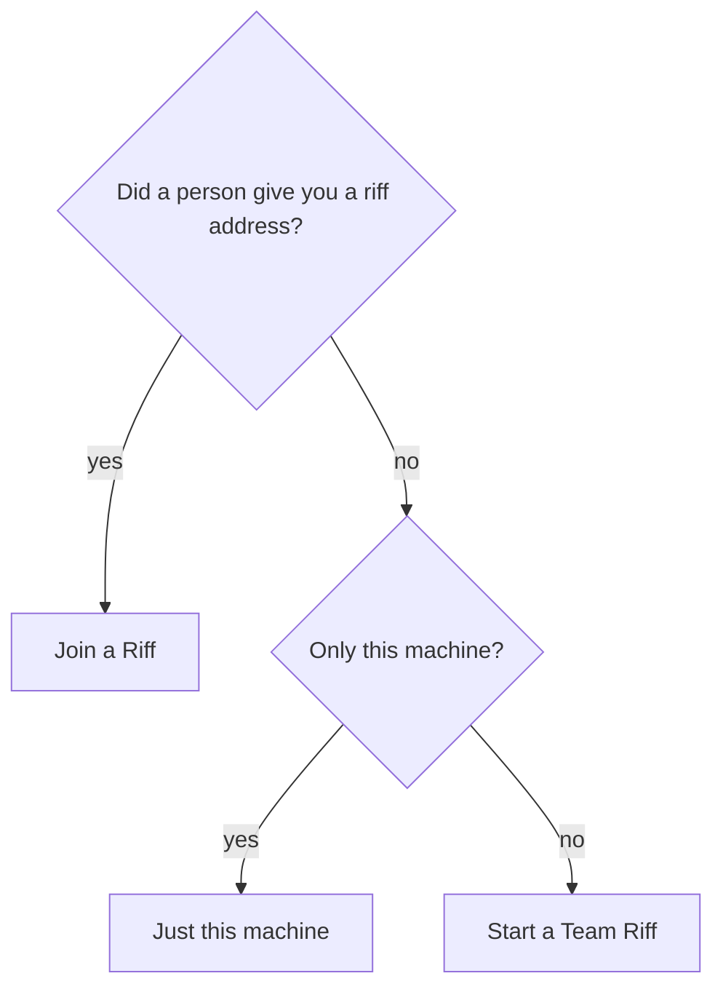
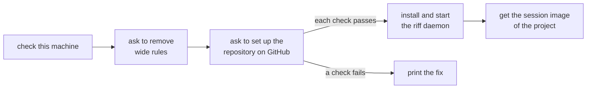
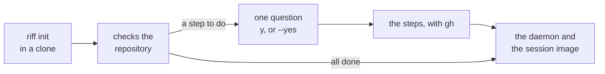
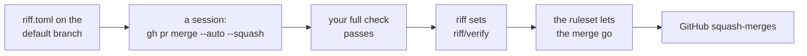
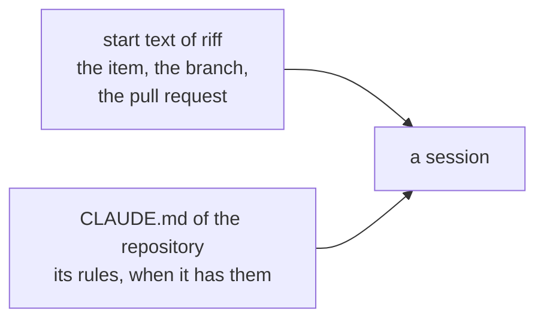

# Start a Riff

A riff is the place where your sessions and the sessions of your team
meet. In a riff, your Claude Code sessions find each other, talk and
share work. riff runs on Linux only.

Did a person give you a riff address?

- Yes: go to [Join a Riff](join-a-riff.md).
- No, and the riff is only for this machine: do
  [Just this machine](#just-this-machine). You do not sign in.
- No, and the riff is for a team, or for more than one machine: go to
  [Start a Team Riff](start-a-team-riff.md). Each person signs in.



## You need

- Linux with a desktop. riff keeps a key in the keyring of
  your desktop.
- [Claude Code](https://code.claude.com).
- Rust. If you do not have it, install it with
  [rustup](https://rustup.rs).
- A C compiler. On Ubuntu, install it with
  `sudo apt install build-essential`.

## Just this machine

1. Install riff:

   ```sh
   cargo install --locked --git https://github.com/como-technologies/riff riff riff-server
   ```

2. Start the riff of this machine in a terminal of its own. Keep that
   terminal open: the riff stops when you close it or press Ctrl-C:

   ```sh
   riff-server
   ```

3. In a second terminal, go to your project. Get ready for riff, and
   start your lead. You do not sign in: riff uses the name that you
   log in with on this machine. See
   [Get this machine ready](#get-this-machine-ready) and
   [Let the lead start the work](#let-the-lead-start-the-work).

## Use it

In your project, run `riff lead start`. Your lead runs in a container.
The riff daemon starts the other sessions in containers too. Ask the
lead: *"Who else is in the riff?"* The sessions ask their questions
there. See [The lead](how-it-works.md#the-lead). The lead starts at
effort xhigh.

## Resume the new riff

A new riff is paused. The sessions talk, but they take no work. When
you want them to work, run this in a terminal:

```sh
riff resume --riff
```

See [Pause the riff](how-it-works.md#pause-the-riff).

## Let riff work in auto mode

In auto mode, Claude Code can block riff work: a riff tool,
`riff wave run`, or a step of a pull request. A session cannot allow
this itself. Run this once in each project, then commit the file that
it names:

```sh
riff setup
```

It adds the missing permission rules of riff to
`.claude/settings.json` at the top of the repository. It keeps each
rule that is there. It also denies a push to the default branch and
`gh pr merge --admin`. Start your sessions again to use the rules.

### Check the rules

This command changes nothing. It names each missing rule, and exits
with status 1 when a rule is missing:

```sh
riff setup --check
```

When rules are missing, `riff setup` adds them. Run it again.

For the rules of your sessions, see
[The permission rules of Claude Code](#the-permission-rules-of-claude-code).

## Update riff

Update riff on your machine. It installs `riff` and `riff-server` of
a release. On Linux x86-64, it
downloads the static binaries of the release from GitHub. On another
machine, or for a release with no static binaries, `cargo` builds them
(see
[How riff is built and installed](development.md#how-riff-is-built-and-installed)):

```sh
riff update
```

It installs the release that your riff runs. That is not always the
newest release (see [Releases](how-it-works.md#releases)):

- The riff of this machine: it installs the release that GitHub marks
  Latest.
- A shared riff: it installs the release of the shared server. After
  a new release, update when the shared riff runs it. Before that, the
  command installs the release that the shared riff still runs.

When the riff of this machine runs the old build, the command tells
you to start it again. Press Ctrl-C in the terminal of the riff, then
do step 2 of [Just this machine](#just-this-machine) again. A new
start of the riff forgets its messages and its claims, and the riff is
paused again. Run `riff resume --riff` when you want the sessions to
work.

A riff of another version can refuse `riff` (see
[Builds](how-it-works.md#builds)). When you joined a riff, see
[Update riff](join-a-riff.md#update-riff) of Join a Riff.

With the update by itself on, riff installs each release with no
command. The riff daemon of the release then does each step of
`riff init` that needs no person: its unit and the session
images. It tells you each step that needs you. See
[Each step of an update](how-it-works.md#each-step-of-an-update), and
[See each step of an update](how-it-works.md#see-each-step-of-an-update)
for `riff update --check`.

## Approve a release

The owner or an admin of a riff that deploys its own server gives the
human gates of each release: the deploy, a rollback and a skip. The
riff daemon tells you in `riff chat` when a deploy waits. Approve it in
a plain terminal, outside Claude Code:

```sh
riff release approve v3.3.0
```

See [The release cycle](development.md#the-release-cycle) for each
gate.

## Get this machine ready

riff runs each work item in a container of its own on your machine:
the riff daemon runs it. To get ready, install podman and catatonit,
the init of podman. riff starts each container with it. On Ubuntu:

```sh
sudo apt install podman catatonit
```

Then run this in your clone of the project:

```sh
riff init
```



`riff init` prints one line for each check, with `pass`, `step` or
`fail`:

| Check | It must be true |
|---|---|
| podman | `podman --version` runs. |
| The init of podman | `catatonit` is in a folder of podman, for example `/usr/libexec/podman`. Each session runs it as its first process. |
| `/etc/subuid`, `/etc/subgid` | Each gives you 65536 IDs or more. The fix adds a free range: it starts after the end of each range in the file, and at 100000 or more. |
| cgroup v2 | Your user gets `cpu` and `memory`. |
| The session image | `riff.toml` of the project pins it. |
| The riff binary | It is static, so `riff relay` starts in each session image. |
| The repository on GitHub | In a clone of a repository on GitHub: `riff.toml` is on the default branch, auto-merge and squash merge are on, a ruleset of the default branch requires `riff/verify`, the Backlog and a wave are there, and a pull request runs a CI check. `riff init` checks no `CLAUDE.md` or `AGENTS.md`: such a file is the choice of the repository. `riff init` does the first five itself, after one question. See [Add another repository to the riff](#add-another-repository-to-the-riff). |

A line with `fail` also gives the fix. A line with `step` is a check of
your repository on GitHub that `riff init` fixes itself, after one
question. Do each fix, then run `riff init` again. When each check
passes, `riff init` installs and starts the riff daemon, and the daemon
gets the session image. A riff daemon that runs already stays. Then do
one item: see
[Run one item in a container](development.md#run-one-item-in-a-container).

### Let the lead start the work

You start no worker by hand. When the current wave has free work, the
rollout of your lead asks the riff daemon of your machine to run the
wave of the repository. The daemon runs each free item and each verify
in a container, in the limit of the machine. The lead gets a note.

To run your lead in a container too, run this in your clone of the
project. It also starts the wave of the repository, when none runs.
The lead needs the claude token of this machine: see
[Start the lead](development.md#start-the-lead).

```sh
riff lead start
```

When another session of you is the lead, `riff lead start` makes the
new session the lead. It prints which session was the lead before. In
the lead container, `whoami` says in its first line when the session is
not the lead. To see which session is the lead:

```sh
riff who
```

To see the containers:

```sh
riff daemon status
```

A second machine takes work when its daemon runs the wave too: see
[Use a second machine](development.md#use-a-second-machine).

### Get the static riff

A riff of `cargo install` or `just install` links the libc of your
machine. A session image can have an older libc, so that riff may not
start there. Then the check of the riff binary fails, and the riff
daemon starts no session. Get the static riff of the release:

```sh
riff update
```

Then run `riff init` again. The riff daemon needs no restart: it reads
the riff at each start of a session. With `update.auto` on, riff gets
the static riff by itself: see
[Update riff by itself](how-it-works.md#update-riff-by-itself).

### The permission rules of Claude Code

In auto mode, Claude Code can refuse a step of riff. So riff writes the
permission rules of its steps in two places. `riff init` writes no rule
into your own Claude Code settings.

| Place | Written by | Into |
|---|---|---|
| The project | `riff setup`: see [Let riff work in auto mode](#let-riff-work-in-auto-mode) | `.claude/settings.json` at the top of the repository |
| The session | the riff daemon, for each session | the `settings.json` of the own Claude folder of the session |

The project place has these rules:

| Rules | Allow |
|---|---|
| `mcp__riff` | the riff tools |
| `Bash(riff)`, `Bash(riff *)` | each `riff` command |
| `Bash(gh pr create *)`, `Bash(gh pr merge --auto --squash *)`, `Bash(gh pr comment *)`, `Bash(gh pr view *)` | the steps of a pull request |

Each rule names its program and its words. Its only `*` is at its
end, after a space. So a rule allows only the steps that it names.

The project place also denies a push to the default branch and
`gh pr merge --admin`. The deny rules never leave the project.

The riff daemon gives each session the rules of its steps. The lead in
a container calls its riff by the path `/opt/riff/riff`, so it gets
these rules of its own:

| Rules | Allow |
|---|---|
| `Bash(/opt/riff/riff relay watch)`, `Bash(/opt/riff/riff relay watch --follow)` | the wakes of the lead |
| `Bash(/opt/riff/riff wave *)` | the steps of the waves of the lead: see [Waves](waves.md) |
| `Bash(/opt/riff/riff wave move *)`, `Bash(/opt/riff/riff wave end *)` | move items to another wave, end a wave |
| `Bash(/opt/riff/riff release status)`, `Bash(/opt/riff/riff release cut *)` | the steps of the release cycle of the lead: see [The release cycle](development.md#the-release-cycle). No rule names `riff release approve`: only you approve |

When the auto mode check still refuses a step of riff, the session
writes the step on its issue and tells your lead. The fix is a new
rule in the code of riff, not a step that you type.

#### The rules of gh on GitHub

The session place has these rules of `gh`, by role:

| Rules | Allow |
|---|---|
| `Bash(gh pr create *)`, `Bash(gh pr merge --auto --squash *)`, `Bash(gh pr view *)`, `Bash(gh pr checks *)` | the steps of a pull request |
| `Bash(gh run view *)`, `Bash(gh run rerun *)` | a worker reads the log of a failed check, and runs a flaky job again |
| `Bash(gh issue view *)`, `Bash(gh issue list *)`, `Bash(gh issue edit *)` | the steps of an issue |

#### One step in each call

Claude Code matches a rule to each part of a Bash call. So a session
of riff runs each `riff` and `gh` step alone, in its own call, and
gives each file by its absolute path:

```sh
gh issue edit 12 --body-file /home/you/tmp/body-12.md
```

A rule allows no call that also has a `cd` out of the working folders
of the session, for example `cd ~/tmp && gh issue edit 12 --body-file
body-12.md`. Then the auto mode check judges the whole call, and it
can refuse it. A `-R` before the words of a step also matches no rule:
put `--repo OWNER/REPO` after them.

#### Remove a wide rule

riff adds rules, and removes none with no yes. A rule that you added
by hand can be much wider than its step. `riff init` reads the allow
rules of your user settings, and of the project settings and the local
settings of the repository of the current folder. It names each rule
that is wider than the steps of riff, with its file, and asks one
question. Answer `y` to remove them:

```sh
riff init
```

riff removes only the wide rules. It keeps each other rule and each
other key. A wide rule fails no check. `riff init --yes` and
`riff init --check` remove no rule. A rule of the Bash tool is wide
when:

- it has no pattern: `Bash` allows each command;
- or it has a `*` that is not at its end after a space, for example
  `Bash(gh pr merge * --auto --squash)`;
- or it allows a command that no step of riff needs, for example
  `Bash(git push *)` allows a push to the default branch.

The old form `Bash(cargo test:*)` is the same as `Bash(cargo test *)`.
A rule of another tool, for example `Read`, is never wide.

### Run riff init with no question

This command asks no question. It sets up the repository on GitHub: see
[Add another repository to the
riff](#add-another-repository-to-the-riff). It removes no wide rule:

```sh
riff init --yes
```

### Check this machine only

This command changes nothing and asks nothing. It prints the fix of
each check that fails and each wide rule. It exits with
status 1 when a check fails:

```sh
riff init --check
```

## Add another repository to the riff

riff works on other projects too. In a clone of the repository, run
`riff init`. On a repository that is not set up for riff, it shows
each step and asks one question. Answer `y`. You must be an admin of
the repository:

```sh
riff init
```

`riff init` sets up the repository with `gh`, in this order. It skips
each step that is done already:

| Step | What `riff init` does |
|---|---|
| Merge settings | It allows auto-merge and squash merge. |
| `riff.toml` | When the default branch has none, it makes the branch `riff-setup` with `riff.toml`, opens the pull request "Set up riff", and squash-merges it. `riff.toml` pins the session image of the riff that you run. |
| The Backlog | It makes the `Backlog`. |
| The first wave | When the repository has no open wave, it makes `Wave 1`. |
| The ruleset | It makes the ruleset `riff` of the default branch: a pull request, squash merges only, and the checks `riff/verify` and the checks that your CI runs on a pull request. A repository whose CI has no check yet gets the check `Gate`. |



`riff init` makes `riff.toml` on the default branch of `origin`. When
your clone is on the default branch, has no change, and lacks only
commits of `origin`, it runs `git pull --ff-only` there. Else it says
why it did not, and you run `git pull` in your clone. A second run of
`riff init` changes nothing on GitHub and asks nothing. See
[Read the output for a repository on GitHub](#read-the-output-for-a-repository-on-github).

One part is your own work. `riff init` has no step for it, and it
names the fix: a CI check that a pull request runs. The full check of a
pull request, its CI, is the gate of a change: riff waits for it before
it starts a verify, and the ruleset lets no change merge without it. See
[Add the job Gate](#add-the-job-gate) and
[Use the checks that you have](#use-the-checks-that-you-have).

A `CLAUDE.md` or an `AGENTS.md` is the choice of the repository. riff
needs neither, and `riff init` checks neither: it prints no line for
them, and a repository with none passes. A session reads the rules of
the repository for agents when it has them. See
[Write a CLAUDE.md, when you want one](#write-a-claudemd-when-you-want-one).

To do the steps with no question, run `riff init --yes`. To see the
steps and change nothing, run `riff init --check`. A person who is not
an admin of the repository gets the fix of each check, and riff changes
nothing: ask an admin to run `riff init`.

### Run the checks in the container of the lead

A lead can run `riff init --check` in its container. A container runs
no podman, and the host runs the checks of the machine. So in a
container `riff init` skips them, says so in one line, and runs the
checks of the repository:

```sh
riff init --check
```

```text
riff checks this machine:
  skip  the checks of the machine: the host runs them
  ...
```

`riff init` with no `--check` does the steps of the repository in the
container, as on the host. It installs no daemon and pulls no image: the
host has them.

### Read the output for a repository on GitHub

This is the output of `riff init` in a clone of `acme/app` that is not
set up for riff. The answer to the question is `y`. A line with `...`
stands for lines that this page leaves out:

```text
riff checks this machine:
  ...
  step  the session image: cannot read the riff config /home/mike/app/riff.toml: No such file or directory (os error 2). Step: make riff.toml on main with a pull request
  ...
  step  riff.toml on main: main of acme/app has no riff.toml, so riff lead start stops. Step: make riff.toml on main with a pull request
  step  auto-merge and squash merge: acme/app allows no auto-merge. Step: allow auto-merge and squash merge
  step  the ruleset of main: no ruleset of main requires the check riff/verify, so a merge does not wait for the verify. Step: make the ruleset riff on main
  step  the milestone Backlog: acme/app has no open milestone Backlog. Step: make the milestone Backlog
  step  the first wave: acme/app has no open wave. Step: make the milestone Wave 1
  pass  the checks of a pull request: pull requests ran checks / lint and checks / test, and the ruleset that riff makes requires them
  ...
riff can set up acme/app for riff. These steps change GitHub:
  allow auto-merge and squash merge
  make riff.toml on main with a pull request
  make the milestone Backlog
  make the milestone Wave 1
  make the ruleset riff on main
Do them? [y/N] y
  done  allow auto-merge and squash merge: allowed both
  done  make riff.toml on main with a pull request: opened https://github.com/acme/app/pull/7 and merged it
  done  make the milestone Backlog: made Backlog
  done  make the milestone Wave 1: made Wave 1
  done  make the ruleset riff on main: requires checks / lint and checks / test and riff/verify
riff.toml is on main now. riff ran git pull --ff-only in this clone, so the clone has it.
riff checks this machine again:
  ...
  pass  riff.toml on main: main of acme/app has it
  pass  auto-merge and squash merge: acme/app allows both
  pass  the ruleset of main: it requires the check riff/verify
  pass  the milestone Backlog: acme/app has it open
  pass  the first wave: acme/app has the open wave Wave 1
  pass  the checks of a pull request: the full check is checks / lint and checks / test
  ...
This machine is ready. Run one item in a container: riff run ITEM
```

- A line with `step` is a check that fails, and that `riff init` fixes
  with a step. No fact that a step fixes shows as `fail`. A line with
  `fail` is your work: it gives the fix.
- After the steps, riff checks again. A check passes when its step
  worked.
- `riff init` makes `riff.toml` on `origin`. Then it runs
  `git pull --ff-only` in your clone when your clone is on the default
  branch, has no change, and lacks only commits of `origin`. Else it
  says why it did not, and you run `git pull` yourself.

When a check still fails, the end of the output names each one with its
fix. riff installs nothing then, and exits with 1. For example, when no
pull request of the repository ran a check, the ruleset gets the check
`Gate`, and the check of a pull request fails until you add that job:

```text
riff checks this machine again:
  ...
  fail  the checks of a pull request: no pull request of acme/app ran a check named Gate, and no rule requires another check, so the full check never ends. Fix: add a workflow that runs on pull_request, with a job named Gate. See "Add the job Gate" in the book. Then run riff init again
  ...
1 check failed. riff installed no daemon and pulled no image. Do each fix, then run riff init again:
  the checks of a pull request: add a workflow that runs on pull_request, with a job named Gate. See "Add the job Gate" in the book. Then run riff init again
```

### Do the steps by hand

You can do each step yourself. `riff init --check` names the step of
each check that fails:

```sh
riff init --check
```



| Check of `riff init` | Step |
|---|---|
| `riff.toml` on the default branch | [Add riff.toml](#add-rifftoml) |
| auto-merge and squash merge | [Allow auto-merge and squash merge](#allow-auto-merge-and-squash-merge) |
| the ruleset of the default branch | [Make the ruleset of the default branch](#make-the-ruleset-of-the-default-branch) |
| the Backlog, the first wave | [Make the Backlog and the first wave](#make-the-backlog-and-the-first-wave) |
| the checks of a pull request | [Add the job Gate](#add-the-job-gate) |

The full check is a step of your own. Your repository may have one
already: see
[Use the checks that you have](#use-the-checks-that-you-have).

### Add riff.toml

Each repository of the riff has the file `riff.toml` at its root, on
its default branch. Its key `image` pins the session image. Without
the file on the default branch of `origin`, `riff lead start` stops
with the error `riff.toml is not on origin/main`. It starts no lead and
no wave. The image of riff has `claude`, `git`, `gh` and Rust, so it is
good for a Rust project. For another toolchain, see
[Pin an image with another toolchain](#pin-an-image-with-another-toolchain).

This command writes `riff.toml` with the image of riff:

```sh
IMAGE=$(gh api repos/como-technologies/riff/contents/riff.toml --jq .content | base64 -d | sed -n 's/^image = "\(.*\)"$/\1/p')
printf '[session]\nimage = "%s"\n' "$IMAGE" > riff.toml
```

Commit it on the default branch, and push it. Do this before you make
the ruleset: after the ruleset, each change needs a pull request.

```sh
git add riff.toml
git commit -m "Pin the session image of riff"
git push
```

### Set up the repository on GitHub

Run each step once, in a clone of the repository, as an admin of the
repository. `gh` fills `{owner}` and `{repo}` from the remote of the
clone.

#### Add the job Gate

riff starts the verify of a pull request only when the full check of
its head is done. A repository whose ruleset requires no check but
`riff/verify` has a full check named `Gate`. Add a workflow with a job
of that name. Put the command of your tests in place of `make test`.
Push the workflow to the default branch before you make the ruleset.
A repository with checks already needs no job `Gate`: skip this step,
and see [Use the checks that you have](#use-the-checks-that-you-have).

```sh
mkdir -p .github/workflows
cat > .github/workflows/gate.yml <<'YAML'
name: Gate
on:
  pull_request:
  push:
    branches: [main]
jobs:
  Gate:
    runs-on: ubuntu-latest
    steps:
      - uses: actions/checkout@v4
      - run: make test
YAML
git add .github/workflows/gate.yml
git commit -m "Add the job Gate"
git push
```

#### Use the checks that you have

A repository whose ruleset of the default branch requires checks
already needs no job `Gate`. riff reads the required checks of that
ruleset. The full check is each of them but `riff/verify`. riff starts
the verify of a pull request when each of them passed or ended on its
head. A pass of `riff verify pass` needs a success of each of them. A
check that GitHub skipped, or that ended `neutral`, counts as a success.
The daemon watches `main` with the same checks: see
[When main breaks](how-it-works.md#when-main-breaks). riff reads the
rulesets of GitHub, and not the branch protection of the old kind.

To see the checks that riff waits for:

```sh
BRANCH=$(gh api repos/{owner}/{repo} --jq .default_branch)
gh api "repos/{owner}/{repo}/rules/branches/$BRANCH" --jq '[.[] | select(.type == "required_status_checks") | .parameters.required_status_checks[].context] - ["riff/verify"]'
```

The answer is a list, for example `["checks / docs"]`. An empty list
means that riff waits for a check run named `Gate`. When your full
check has other names, put them in the ruleset in place of `Gate`: see
[Make the ruleset of the default branch](#make-the-ruleset-of-the-default-branch).

#### Allow auto-merge and squash merge

Each work session runs `gh pr merge --auto --squash`. GitHub refuses
it until the repository allows both:

```sh
gh api -X PATCH repos/{owner}/{repo} -F allow_auto_merge=true -F allow_squash_merge=true
```

#### Make the ruleset of the default branch

Without a rule, nothing on GitHub makes a merge wait for the verify.
This ruleset needs a pull request, and the checks `Gate` and
`riff/verify`. It allows squash merges only, and it lets nobody bypass
it. When your full check has other names, put them in place of `Gate`:

```sh
gh api -X POST repos/{owner}/{repo}/rulesets --input - <<'JSON'
{
  "name": "riff",
  "target": "branch",
  "enforcement": "active",
  "conditions": { "ref_name": { "include": ["~DEFAULT_BRANCH"], "exclude": [] } },
  "bypass_actors": [],
  "rules": [
    { "type": "deletion" },
    { "type": "non_fast_forward" },
    {
      "type": "pull_request",
      "parameters": {
        "required_approving_review_count": 0,
        "dismiss_stale_reviews_on_push": false,
        "require_code_owner_review": false,
        "require_last_push_approval": false,
        "required_review_thread_resolution": false,
        "allowed_merge_methods": ["squash"]
      }
    },
    {
      "type": "required_status_checks",
      "parameters": {
        "strict_required_status_checks_policy": false,
        "required_status_checks": [
          { "context": "Gate" },
          { "context": "riff/verify" }
        ]
      }
    }
  ]
}
JSON
```

#### Make the Backlog and the first wave

A wave is a milestone named `Wave N`. The Backlog is the milestone
`Backlog`: `riff wave move --to Backlog` and
`riff wave end --move-open-to-backlog` need it. This command makes the
first wave. It makes the Backlog too, when the repository has none:

```sh
riff wave make "Wave 1"
```

A repository that has waves and no Backlog gets the Backlog alone:

```sh
gh api -X POST repos/{owner}/{repo}/milestones -f title=Backlog
```

### Write a CLAUDE.md, when you want one

A `CLAUDE.md` or an `AGENTS.md` is the choice of the repository. riff
needs neither. The start text of riff says only what riff needs: the
item, the branch, the frame of the pull request and, for a verify, the
report. A session reads the rules of the repository for agents when it
has them. Write one when you want to give each session rules.



| Part | What it says |
|---|---|
| Work | The commands to run before a push, and how to read the result. |
| Issues | What a `Done when:` line names. |
| Verify | What a verifier reads and runs, and what it does not run. |

Write the file with your own commands in place of `make check`, and push
it with a pull request:

```sh
cat > CLAUDE.md <<'EOF'
# Notes for agents

## Work

- Run `make check` before each push. It passes with no warning.
- Each change has a test.

## Issues

- Each "Done when:" line of an issue names a test that you can run.

## Verify

- A verifier reads the diff and runs the test of each criterion.
- A verifier does not run `make check` again: the CI did it.
EOF
```

The `CLAUDE.md` of riff is an example of a longer file.

### Use any default branch

The default branch can have any name: `main`, `master` or `trunk`.
The wave reads it from GitHub at each look, and keeps it in no file. A
verify reads its diff against that branch, a rebase starts from it, and
the look watches its full check. This command shows the branch that riff
reads:

```sh
gh api repos/{owner}/{repo} --jq .default_branch
```

After you rename the default branch, do nothing: the next look reads the
new name. When GitHub does not answer, the wave starts no work at that
look, and `riff daemon status` says why. The wave looks again each
minute.

### Pin an image with another toolchain

The session image of riff has `claude`, `git`, `gh` and Rust. A project
with another toolchain needs an image of its own. Start from the image
that `riff.toml` pins now, and add the toolchain. The base is Debian,
and a package that you install is there in each session. Do not add
riff to the image: riff binds its own binary into each session.

```sh
BASE=$(sed -n 's/^image = "\(.*\)"$/\1/p' riff.toml)
mkdir -p deploy/session
cat > deploy/session/Dockerfile <<EOF
FROM $BASE
RUN apt-get update && apt-get install -y --no-install-recommends nodejs npm && rm -rf /var/lib/apt/lists/*
EOF
```

Build the image, try it, and push it to a registry. Put your owner in
place of `OWNER`:

```sh
IMAGE=ghcr.io/OWNER/session
podman build -t "$IMAGE:node" deploy/session
podman run --rm "$IMAGE:node" node --version
podman login ghcr.io
podman push --digestfile /tmp/digest "$IMAGE:node"
```

`podman push` writes the digest of the image to `/tmp/digest`. Pin
that digest in `riff.toml`. riff refuses a tag:

```sh
printf '[session]\nimage = "%s@%s"\n' "$IMAGE" "$(cat /tmp/digest)" > riff.toml
```

Merge `riff.toml` into the default branch with a pull request: the
sessions use only the merged pin (see
[Only a merged pin counts](development.md#only-a-merged-pin-counts)).
Make the package public in its settings on GitHub. A private package
needs `podman login ghcr.io` on each machine of the riff. Then run
`riff init`. When each check passes, the riff daemon pulls the image:

```sh
riff init
```

To learn more, read [How It Works](how-it-works.md).
