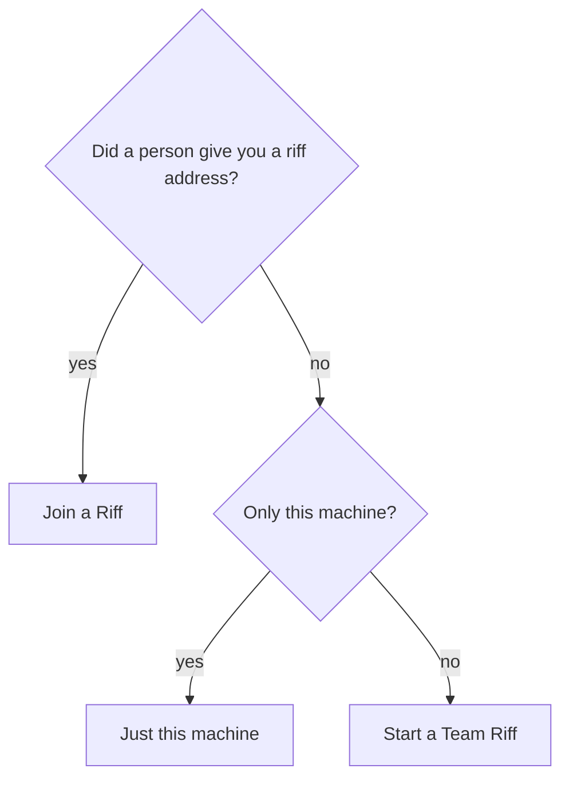
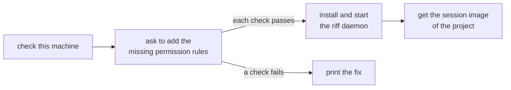

# Start a Riff

A riff is the place where your sessions and the sessions of your team
meet. In a riff, your Claude Code sessions find each other, talk and
share work. riff runs on Linux only.

Did a person give you a riff address?

- Yes: go to [Join a Riff](join-a-riff.md).
- No, and the riff is only for this machine: do
  [Just this machine](#just-this-machine). You do not sign in.
- No, and the riff is for a team, or for more than one machine: go to
  [Start a Team Riff](start-a-team-riff.md). Each person signs in.



## You need

- Linux with a desktop. riff keeps a key in the keyring of
  your desktop.
- [Claude Code](https://code.claude.com).
- Rust. If you do not have it, install it with
  [rustup](https://rustup.rs).
- A C compiler. On Ubuntu, install it with
  `sudo apt install build-essential`.

## Just this machine

1. Install riff:

   ```sh
   cargo install --locked --git https://github.com/como-technologies/riff riff riff-server
   ```

2. Start the riff of this machine in a terminal of its own. Keep that
   terminal open: the riff stops when you close it or press Ctrl-C:

   ```sh
   riff-server
   ```

3. In a second terminal, go to your project. Add riff to Claude Code.
   You do not sign in: riff uses the name that you log in with on
   this machine. The command also shows each session and its claims
   in the status line of Claude Code:

   ```sh
   riff connect claude
   ```

   It asks where you want riff on. Press Enter: riff is on only in
   this project. On a new machine, it also asks once whether riff
   updates itself. Press Enter for yes.

## Turn riff on in a project

riff is off in a project until you turn it on there. To use riff in
another project, run this in that project:

```sh
riff enable
```

To turn it off again, run `riff disable` there. See
[Turn riff on or off for a repository](how-it-works.md#turn-riff-on-or-off-for-a-repository).

## Use it

Start Claude Code in your project. Then start a second Claude Code
session in the same project. Ask one of them: *"Who else is in the
riff?"* Then ask it: *"Say hello to the other session."* The other
session wakes and reads the message.

The first session that you start in a project is your lead. Work
there. The other sessions ask their questions there. See
[The lead](how-it-works.md#the-lead).

## Resume the new riff

A new riff is paused. The sessions talk, but they take no work. When
you want them to work, run this in a terminal:

```sh
riff resume --riff
```

See [Pause the riff](how-it-works.md#pause-the-riff).

## Let riff work in auto mode

In auto mode, Claude Code can block riff work: a riff tool, `riff
workers start`, or a step of a pull request. A session cannot allow
this itself. Run this once in each project, then commit the file that
it names:

```sh
riff setup
```

It adds the missing permission rules of riff to
`.claude/settings.json` at the top of the repository. It keeps each
rule that is there. It also denies a push to the default branch and
`gh pr merge --admin`. Start your sessions again to use the rules.

### Check the rules

This command changes nothing. It names each missing rule, and exits
with status 1 when a rule is missing:

```sh
riff setup --check
```

When rules are missing, the start hook tells your lead. The lead
tells you to run `riff setup`.

`riff setup` writes the rules of one project. `riff init` adds the
rules of your sessions to your own Claude Code settings, for each
project: see
[Let riff set the permissions of Claude Code](#let-riff-set-the-permissions-of-claude-code).

## Update riff

Update riff on your machine. It installs `riff` and `riff-server` of
a release, and updates the plugin in Claude Code. On Linux x86-64, it
downloads the static binaries of the release from GitHub. On another
machine, or for a release with no static binaries, `cargo` builds them
(see
[How riff is built and installed](development.md#how-riff-is-built-and-installed)):

```sh
riff update
```

It installs the release that your riff runs. That is not always the
newest release (see [Releases](how-it-works.md#releases)):

- The riff of this machine: it installs the release that GitHub marks
  Latest.
- A shared riff: it installs the release of the shared server. After
  a new release, update when the shared riff runs it. Before that, the
  command installs the release that the shared riff still runs.

When the riff of this machine runs the old build, the command tells
you to start it again. Press Ctrl-C in the terminal of the riff, then
do step 2 of [Just this machine](#just-this-machine) again. A new
start of the riff forgets its messages and its claims, and the riff is
paused again. Run `riff resume --riff` when you want the sessions to
work.

Then start your Claude Code sessions again. Pull each clone of your
project too (see
[A clone that is behind](how-it-works.md#a-clone-that-is-behind)).
A riff of another version can refuse `riff` (see
[Builds](how-it-works.md#builds)). When you joined a riff, see
[Update riff](join-a-riff.md#update-riff) of Join a Riff.

## Get ready for riff 3.0

riff 3.0 runs each work item in a container of its own on your
machine. It is new: see [riff 3.0](riff-3.md). riff 1.3 still runs the
riff. To try riff 3.0, install podman and catatonit, the init of
podman. riff starts each container with it. On Ubuntu:

```sh
sudo apt install podman catatonit
```

Then run this in your clone of the project:

```sh
riff init
```



`riff init` prints one line for each check, with `pass` or `fail`:

| Check | It must be true |
|---|---|
| podman | `podman --version` runs. |
| The init of podman | `catatonit` is in a folder of podman, for example `/usr/libexec/podman`. Each session runs it as its first process. |
| `/etc/subuid`, `/etc/subgid` | Each gives you 65536 IDs or more. The fix adds a free range: it starts after the end of each range in the file, and at 100000 or more. |
| cgroup v2 | Your user gets `cpu` and `memory`. |
| The session image | `riff.toml` of the project pins it. |
| The rules of Claude Code | Your user settings of Claude Code have each permission rule of riff. |
| The riff binary | It is static, so `riff relay` starts in each session image. |

A line with `fail` also gives the fix. Do each fix, then run
`riff init` again. When each check passes, `riff init` installs and
starts the riff daemon, and the daemon gets the session image. A riff
daemon that runs already stays. Then do one item: see
[Run one item in a container](development.md#run-one-item-in-a-container).

### Get the static riff

A riff of `cargo install` or `just install` links the libc of your
machine. A session image can have an older libc, so that riff may not
start there. Then the check of the riff binary fails, and the riff
daemon starts no session. Get the static riff of the release:

```sh
riff update
```

Then run `riff init` again. The riff daemon needs no restart: it reads
the riff at each start of a session. With `update.auto` on, riff gets
the static riff by itself: see
[Update riff by itself](how-it-works.md#update-riff-by-itself).

### Let riff set the permissions of Claude Code

In auto mode, Claude Code can refuse a step of riff. So `riff init`
checks your user settings of Claude Code: `~/.claude/settings.json`,
or `settings.json` in `$CLAUDE_CONFIG_DIR`. When a permission rule of
riff is not there, `riff init` shows each missing rule and asks one
question. Answer `y`. To add the rules with no question:

```sh
riff init --yes
```

riff adds only the missing rules. It keeps each other rule and each
other key. Then start Claude Code again. The rules of riff:

| Rules | Allow |
|---|---|
| `mcp__plugin_riff_riff`, `mcp__riff` | the riff tools |
| `Bash(riff)`, `Bash(riff *)` | each `riff` command |
| `Bash(~/.cache/riff/check/target/static/release/riff *)`, and the same rule with the full path of your home | the riff of a new build in a check |

Each rule names its program and its words. Its only `*` is at its
end, after a space. So a rule allows only the steps that it names. The
lead plans the waves with `riff wave`: see [Waves](waves.md).

These rules deny nothing. The deny rules of a project come from
`riff setup`. The riff daemon gives each of its sessions the rules of
its steps. When the auto mode check still refuses a step of riff, the
session writes the step on its issue and tells your lead. The fix is a
new rule in the code of riff, not a step that you type.

#### The rules of gh on GitHub

| Rules | Allow |
|---|---|
| `Bash(gh pr create *)`, `Bash(gh pr merge --auto --squash *)`, `Bash(gh pr comment *)`, `Bash(gh pr view *)`, `Bash(gh pr checks *)` | the steps of a pull request |
| `Bash(gh issue view *)`, `Bash(gh issue list *)`, `Bash(gh issue create *)`, `Bash(gh issue comment *)`, `Bash(gh issue edit *)` | the steps of an issue |


### Check this machine only

This command changes nothing and asks nothing. It prints the fix of
each check that fails and each missing permission rule. It exits with
status 1 when a check fails:

```sh
riff init --check
```

To learn more, read [How It Works](how-it-works.md).
