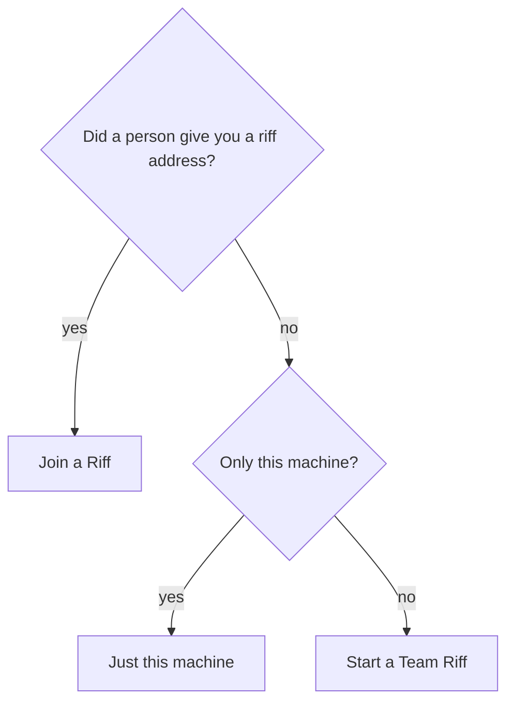
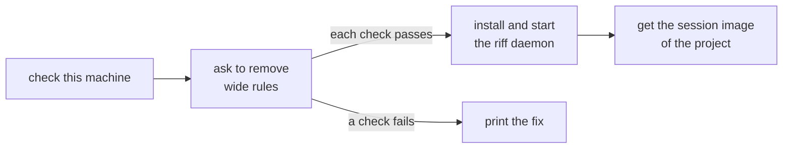
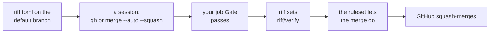

# Start a Riff

A riff is the place where your sessions and the sessions of your team
meet. In a riff, your Claude Code sessions find each other, talk and
share work. riff runs on Linux only.

Did a person give you a riff address?

- Yes: go to [Join a Riff](join-a-riff.md).
- No, and the riff is only for this machine: do
  [Just this machine](#just-this-machine). You do not sign in.
- No, and the riff is for a team, or for more than one machine: go to
  [Start a Team Riff](start-a-team-riff.md). Each person signs in.



## You need

- Linux with a desktop. riff keeps a key in the keyring of
  your desktop.
- [Claude Code](https://code.claude.com).
- Rust. If you do not have it, install it with
  [rustup](https://rustup.rs).
- A C compiler. On Ubuntu, install it with
  `sudo apt install build-essential`.

## Just this machine

1. Install riff:

   ```sh
   cargo install --locked --git https://github.com/como-technologies/riff riff riff-server
   ```

2. Start the riff of this machine in a terminal of its own. Keep that
   terminal open: the riff stops when you close it or press Ctrl-C:

   ```sh
   riff-server
   ```

3. In a second terminal, go to your project. Get ready for riff, and
   start your lead. You do not sign in: riff uses the name that you
   log in with on this machine. See
   [Get ready for riff 3.0](#get-ready-for-riff-30) and
   [Let the lead start the work](#let-the-lead-start-the-work).

## Use it

In your project, run `riff lead start`. Your lead runs in a container.
The riff daemon starts the other sessions in containers too. Ask the
lead: *"Who else is in the riff?"* The sessions ask their questions
there. See [The lead](how-it-works.md#the-lead). The lead starts at
effort xhigh.

## Resume the new riff

A new riff is paused. The sessions talk, but they take no work. When
you want them to work, run this in a terminal:

```sh
riff resume --riff
```

See [Pause the riff](how-it-works.md#pause-the-riff).

## Let riff work in auto mode

In auto mode, Claude Code can block riff work: a riff tool,
`riff wave run`, or a step of a pull request. A session cannot allow
this itself. Run this once in each project, then commit the file that
it names:

```sh
riff setup
```

It adds the missing permission rules of riff to
`.claude/settings.json` at the top of the repository. It keeps each
rule that is there. It also denies a push to the default branch and
`gh pr merge --admin`. Start your sessions again to use the rules.

### Check the rules

This command changes nothing. It names each missing rule, and exits
with status 1 when a rule is missing:

```sh
riff setup --check
```

When rules are missing, `riff setup` adds them. Run it again.

For the rules of your sessions, see
[The permission rules of Claude Code](#the-permission-rules-of-claude-code).

## Update riff

Update riff on your machine. It installs `riff` and `riff-server` of
a release. On Linux x86-64, it
downloads the static binaries of the release from GitHub. On another
machine, or for a release with no static binaries, `cargo` builds them
(see
[How riff is built and installed](development.md#how-riff-is-built-and-installed)):

```sh
riff update
```

It installs the release that your riff runs. That is not always the
newest release (see [Releases](how-it-works.md#releases)):

- The riff of this machine: it installs the release that GitHub marks
  Latest.
- A shared riff: it installs the release of the shared server. After
  a new release, update when the shared riff runs it. Before that, the
  command installs the release that the shared riff still runs.

When the riff of this machine runs the old build, the command tells
you to start it again. Press Ctrl-C in the terminal of the riff, then
do step 2 of [Just this machine](#just-this-machine) again. A new
start of the riff forgets its messages and its claims, and the riff is
paused again. Run `riff resume --riff` when you want the sessions to
work.

A riff of another version can refuse `riff` (see
[Builds](how-it-works.md#builds)). When you joined a riff, see
[Update riff](join-a-riff.md#update-riff) of Join a Riff.

With the update by itself on, riff installs each release with no
command. The riff daemon of the release then does each step of
`riff init` that needs no person: its unit and the session
images. It tells you each step that needs you. See
[Each step of an update](how-it-works.md#each-step-of-an-update), and
[See each step of an update](how-it-works.md#see-each-step-of-an-update)
for `riff update --check`.

### Remove the plugin of riff 3

riff 3 put a plugin in Claude Code. riff 4 has no plugin, so each of
its hooks fails in each session of Claude Code on your machine. Run
this to remove the plugin:

```sh
riff init
```

It removes the folder `~/.local/share/riff/claude-plugin`. In your
user settings of Claude Code, and in the settings of the project of
the current folder, it removes `riff@riff` from `enabledPlugins`,
`riff` from `extraKnownMarketplaces`, and a `statusLine` that runs
`riff statusline`. Each other setting stays. `riff init --check` only
names them. With the update by itself on, the riff daemon of the
release removes them too.

## Approve a release

The owner or an admin of a riff that deploys its own server gives the
human gates of each release: the deploy, a rollback and a skip. The
lead tells you in `riff chat` when a deploy waits. Approve it in a
plain terminal, outside Claude Code:

```sh
riff release approve v3.3.0
```

See [The release cycle](development.md#the-release-cycle) for each
gate.

## Get ready for riff 3.0

riff 3 runs each work item in a container of its own on your
machine: the riff daemon runs it. It is new: see [riff 3.0](riff-3.md).
To get ready, install podman and catatonit, the init of podman. riff
starts each container with it. On Ubuntu:

```sh
sudo apt install podman catatonit
```

Then run this in your clone of the project:

```sh
riff init
```



`riff init` prints one line for each check, with `pass` or `fail`:

| Check | It must be true |
|---|---|
| podman | `podman --version` runs. |
| The init of podman | `catatonit` is in a folder of podman, for example `/usr/libexec/podman`. Each session runs it as its first process. |
| `/etc/subuid`, `/etc/subgid` | Each gives you 65536 IDs or more. The fix adds a free range: it starts after the end of each range in the file, and at 100000 or more. |
| cgroup v2 | Your user gets `cpu` and `memory`. |
| The session image | `riff.toml` of the project pins it. |
| The riff binary | It is static, so `riff relay` starts in each session image. |
| The repository on GitHub | In a clone of a repository on GitHub: auto-merge and squash merge are on, a ruleset of the default branch requires `riff/verify`, and the Backlog is there. See [Add another repository to the riff](#add-another-repository-to-the-riff). |

A line with `fail` also gives the fix. Do each fix, then run
`riff init` again. When each check passes, `riff init` installs and
starts the riff daemon, and the daemon gets the session image. A riff
daemon that runs already stays. Then do one item: see
[Run one item in a container](development.md#run-one-item-in-a-container).

### Let the lead start the work

You start no worker by hand. When the current wave has free work, the
rollout of your lead asks the riff daemon of your machine to run the
wave of the repository. The daemon runs each free item and each verify
in a container, in the limit of the machine. The lead gets a note.

To run your lead in a container too, run this in your clone of the
project. It also starts the wave of the repository, when none runs.
The lead needs the claude token of this machine: see
[Start the lead](development.md#start-the-lead).

```sh
riff lead start
```

When another session of you is the lead, `riff lead start` makes the
new session the lead. It prints which session was the lead before. In
the lead container, `whoami` says in its first line when the session is
not the lead. To see which session is the lead:

```sh
riff who
```

To see the containers:

```sh
riff daemon status
```

A second machine takes work when its daemon runs the wave too: see
[Use a second machine](development.md#use-a-second-machine).

### Get the static riff

A riff of `cargo install` or `just install` links the libc of your
machine. A session image can have an older libc, so that riff may not
start there. Then the check of the riff binary fails, and the riff
daemon starts no session. Get the static riff of the release:

```sh
riff update
```

Then run `riff init` again. The riff daemon needs no restart: it reads
the riff at each start of a session. With `update.auto` on, riff gets
the static riff by itself: see
[Update riff by itself](how-it-works.md#update-riff-by-itself).

### The permission rules of Claude Code

In auto mode, Claude Code can refuse a step of riff. So riff writes the
permission rules of its steps in two places. `riff init` writes no rule
into your own Claude Code settings.

| Place | Written by | Into |
|---|---|---|
| The project | `riff setup`: see [Let riff work in auto mode](#let-riff-work-in-auto-mode) | `.claude/settings.json` at the top of the repository |
| The session | the riff daemon, for each session | the `settings.json` of the own Claude folder of the session |

The project place has these rules:

| Rules | Allow |
|---|---|
| `mcp__riff` | the riff tools |
| `Bash(riff)`, `Bash(riff *)` | each `riff` command |
| `Bash(gh pr create *)`, `Bash(gh pr merge --auto --squash *)`, `Bash(gh pr comment *)`, `Bash(gh pr view *)` | the steps of a pull request |

Each rule names its program and its words. Its only `*` is at its
end, after a space. So a rule allows only the steps that it names.

The project place also denies a push to the default branch and
`gh pr merge --admin`. The deny rules never leave the project.

The riff daemon gives each session the rules of its steps. The lead in
a container calls its riff by the path `/opt/riff/riff`, so it gets
these rules of its own:

| Rules | Allow |
|---|---|
| `Bash(/opt/riff/riff relay watch)`, `Bash(/opt/riff/riff relay watch --follow)` | the wakes of the lead |
| `Bash(/opt/riff/riff wave *)` | the steps of the waves of the lead: see [Waves](waves.md) |
| `Bash(/opt/riff/riff wave move *)`, `Bash(/opt/riff/riff wave end *)` | move items to another wave, end a wave |
| `Bash(/opt/riff/riff release status)`, `Bash(/opt/riff/riff release cut *)` | the steps of the release cycle of the lead: see [The release cycle](development.md#the-release-cycle). No rule names `riff release approve`: only you approve |

When the auto mode check still refuses a step of riff, the session
writes the step on its issue and tells your lead. The fix is a new
rule in the code of riff, not a step that you type.

#### The rules of gh on GitHub

The session place has these rules of `gh`, by role:

| Rules | Allow |
|---|---|
| `Bash(gh pr create *)`, `Bash(gh pr merge --auto --squash *)`, `Bash(gh pr view *)`, `Bash(gh pr checks *)` | the steps of a pull request |
| `Bash(gh issue view *)`, `Bash(gh issue list *)`, `Bash(gh issue edit *)` | the steps of an issue |

#### One step in each call

Claude Code matches a rule to each part of a Bash call. So a session
of riff runs each `riff` and `gh` step alone, in its own call, and
gives each file by its absolute path:

```sh
gh issue edit 12 --body-file /home/you/tmp/body-12.md
```

A rule allows no call that also has a `cd` out of the working folders
of the session, for example `cd ~/tmp && gh issue edit 12 --body-file
body-12.md`. Then the auto mode check judges the whole call, and it
can refuse it. A `-R` before the words of a step also matches no rule:
put `--repo OWNER/REPO` after them.

#### Remove a wide rule

riff adds rules, and removes none with no yes. A rule that you added
by hand can be much wider than its step. `riff init` reads the allow
rules of your user settings, and of the project settings and the local
settings of the repository of the current folder. It names each rule
that is wider than the steps of riff, with its file, and asks one
question. Answer `y` to remove them:

```sh
riff init
```

riff removes only the wide rules. It keeps each other rule and each
other key. A wide rule fails no check. `riff init --yes` and
`riff init --check` remove no rule. A rule of the Bash tool is wide
when:

- it has no pattern: `Bash` allows each command;
- or it has a `*` that is not at its end after a space, for example
  `Bash(gh pr merge * --auto --squash)`;
- or it allows a command that no step of riff needs, for example
  `Bash(git push *)` allows a push to the default branch.

The old form `Bash(cargo test:*)` is the same as `Bash(cargo test *)`.
A rule of another tool, for example `Read`, is never wide.

### Run riff init with no question

This command asks no question. It removes no wide rule:

```sh
riff init --yes
```

### Check this machine only

This command changes nothing and asks nothing. It prints the fix of
each check that fails and each wide rule. It exits with
status 1 when a check fails:

```sh
riff init --check
```

## Add another repository to the riff

riff works on other projects too. A new repository needs five parts
that riff does not make: `riff.toml` with the session image, a job
`Gate`, the settings of the repository, a ruleset of the default
branch, and the Backlog. In a clone of the repository, `riff init`
checks them, and names the step of each check that fails:

```sh
riff init --check
```



| Check of `riff init` | Step |
|---|---|
| the session image | [Add riff.toml](#add-rifftoml) |
| auto-merge and squash merge | [Allow auto-merge and squash merge](#allow-auto-merge-and-squash-merge) |
| the ruleset of the default branch | [Make the ruleset of the default branch](#make-the-ruleset-of-the-default-branch) |
| the Backlog | [Make the Backlog and the first wave](#make-the-backlog-and-the-first-wave) |

The job `Gate` is a step of your own: `riff init` cannot check it.

### Add riff.toml

Each repository of the riff has the file `riff.toml` at its root, on
its default branch. Its key `image` pins the session image. Without
the file on the default branch of `origin`, `riff lead start` stops
with the error `riff.toml is not on origin/main`. It starts no lead and
no wave. The image of riff has `claude`, `git`, `gh` and Rust, so it is
good for a Rust project. For another toolchain, see
[Pin an image with another toolchain](#pin-an-image-with-another-toolchain).

This command writes `riff.toml` with the image of riff:

```sh
IMAGE=$(gh api repos/como-technologies/riff/contents/riff.toml --jq .content | base64 -d | sed -n 's/^image = "\(.*\)"$/\1/p')
printf '[session]\nimage = "%s"\n' "$IMAGE" > riff.toml
```

Commit it on the default branch, and push it. Do this before you make
the ruleset: after the ruleset, each change needs a pull request.

```sh
git add riff.toml
git commit -m "Pin the session image of riff"
git push
```

### Set up the repository on GitHub

Run each step once, in a clone of the repository, as an admin of the
repository. `gh` fills `{owner}` and `{repo}` from the remote of the
clone.

#### Add the job Gate

riff starts the verify of a pull request only when a check run named
`Gate` passed on its head. Add a workflow with a job of that name.
Put the command of your tests in place of `make test`. Push the
workflow to the default branch before you make the ruleset:

```sh
mkdir -p .github/workflows
cat > .github/workflows/gate.yml <<'YAML'
name: Gate
on:
  pull_request:
  push:
    branches: [main]
jobs:
  Gate:
    runs-on: ubuntu-latest
    steps:
      - uses: actions/checkout@v4
      - run: make test
YAML
git add .github/workflows/gate.yml
git commit -m "Add the job Gate"
git push
```

#### Allow auto-merge and squash merge

Each work session runs `gh pr merge --auto --squash`. GitHub refuses
it until the repository allows both:

```sh
gh api -X PATCH repos/{owner}/{repo} -F allow_auto_merge=true -F allow_squash_merge=true
```

#### Make the ruleset of the default branch

Without a rule, nothing on GitHub makes a merge wait for the verify.
This ruleset needs a pull request, and the checks `Gate` and
`riff/verify`. It allows squash merges only, and it lets nobody bypass
it:

```sh
gh api -X POST repos/{owner}/{repo}/rulesets --input - <<'JSON'
{
  "name": "riff",
  "target": "branch",
  "enforcement": "active",
  "conditions": { "ref_name": { "include": ["~DEFAULT_BRANCH"], "exclude": [] } },
  "bypass_actors": [],
  "rules": [
    { "type": "deletion" },
    { "type": "non_fast_forward" },
    {
      "type": "pull_request",
      "parameters": {
        "required_approving_review_count": 0,
        "dismiss_stale_reviews_on_push": false,
        "require_code_owner_review": false,
        "require_last_push_approval": false,
        "required_review_thread_resolution": false,
        "allowed_merge_methods": ["squash"]
      }
    },
    {
      "type": "required_status_checks",
      "parameters": {
        "strict_required_status_checks_policy": false,
        "required_status_checks": [
          { "context": "Gate" },
          { "context": "riff/verify" }
        ]
      }
    }
  ]
}
JSON
```

#### Make the Backlog and the first wave

A wave is a milestone named `Wave N`. The Backlog is the milestone
`Backlog`: `riff wave move --to Backlog` and
`riff wave end --move-open-to-backlog` need it. This command makes the
first wave. It makes the Backlog too, when the repository has none:

```sh
riff wave make "Wave 1"
```

A repository that has waves and no Backlog gets the Backlog alone:

```sh
gh api -X POST repos/{owner}/{repo}/milestones -f title=Backlog
```

### Pin an image with another toolchain

The session image of riff has `claude`, `git`, `gh` and Rust. A project
with another toolchain needs an image of its own. Start from the image
that `riff.toml` pins now, and add the toolchain. The base is Debian,
and a package that you install is there in each session. Do not add
riff to the image: riff binds its own binary into each session.

```sh
BASE=$(sed -n 's/^image = "\(.*\)"$/\1/p' riff.toml)
mkdir -p deploy/session
cat > deploy/session/Dockerfile <<EOF
FROM $BASE
RUN apt-get update && apt-get install -y --no-install-recommends nodejs npm && rm -rf /var/lib/apt/lists/*
EOF
```

Build the image, try it, and push it to a registry. Put your owner in
place of `OWNER`:

```sh
IMAGE=ghcr.io/OWNER/session
podman build -t "$IMAGE:node" deploy/session
podman run --rm "$IMAGE:node" node --version
podman login ghcr.io
podman push --digestfile /tmp/digest "$IMAGE:node"
```

`podman push` writes the digest of the image to `/tmp/digest`. Pin
that digest in `riff.toml`. riff refuses a tag:

```sh
printf '[session]\nimage = "%s@%s"\n' "$IMAGE" "$(cat /tmp/digest)" > riff.toml
```

Merge `riff.toml` into the default branch with a pull request: the
sessions use only the merged pin (see
[Only a merged pin counts](development.md#only-a-merged-pin-counts)).
Make the package public in its settings on GitHub. A private package
needs `podman login ghcr.io` on each machine of the riff. Then run
`riff init`. When each check passes, the riff daemon pulls the image:

```sh
riff init
```

To learn more, read [How It Works](how-it-works.md).
