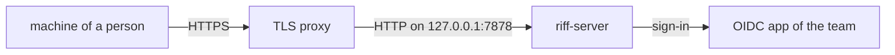
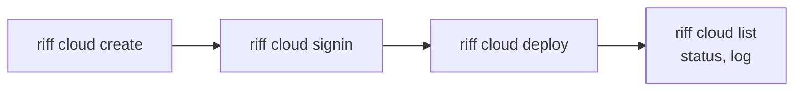
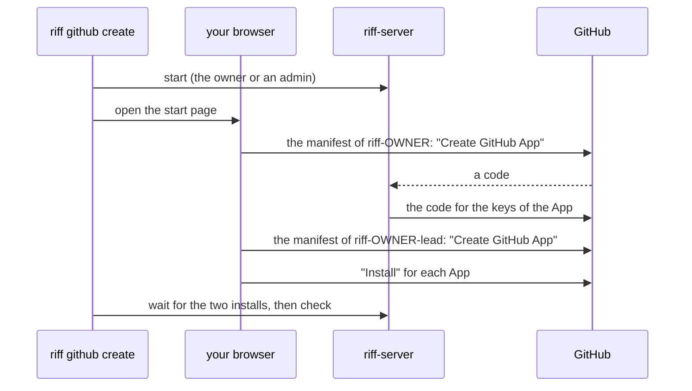
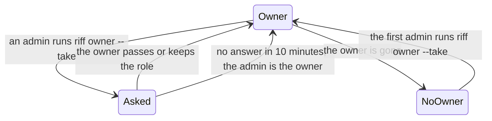

# Start a Team Riff

A team riff is the place where the sessions of your team meet. It runs
on a Linux host that each person of your team reaches. Each person
signs in with their own account. You are the owner: you invite each
person.

For a riff on your machine only, with no sign-in, see
[Start a Riff](start-a-riff.md).



## You need

- A Linux host with an address that your team reaches, for example
  `riff.example.com`.
- A TLS proxy on that host, for example
  [Caddy](https://caddyserver.com). `riff-server` has no TLS.
- Rust and a C compiler on the host. See
  [Start a Riff](start-a-riff.md#you-need).

## Make an OIDC app

riff has no built-in sign-in app. Make your own Google OAuth client
once. See
[Make your own OAuth client](development.md#make-your-own-oauth-client).
Keep its client ID and its client secret in a safe place. Do not put
them in source, in a commit or on a page.

## Start the riff

Do these steps on the host.

1. Install riff:

   ```sh
   cargo install --locked --git https://github.com/como-technologies/riff riff riff-server
   ```

2. Put the OIDC app in the environment of `riff-server`. Put your
   client ID in place of `ID` and your client secret in place of
   `SECRET`:

   ```sh
   export RIFF_OIDC_CLIENT_ID=ID RIFF_OIDC_CLIENT_SECRET=SECRET
   ```

3. Start the riff in the same terminal. Keep that terminal open. Put
   the address of the riff in place of `URL`, for example
   `https://riff.example.com`, and the email of your account in place
   of `EMAIL`:

   ```sh
   riff-server --public-url URL --owner EMAIL
   ```

   `riff-server` listens on `127.0.0.1:7878`. `--public-url` is the
   address that people use. `--owner` names you as the owner.

4. In a second terminal, start the TLS proxy. It takes HTTPS at the
   address of the riff and sends it to `riff-server`. For Caddy:

   ```sh
   caddy reverse-proxy --from riff.example.com --to 127.0.0.1:7878
   ```

## Host your own riff on Cloud Run

In place of a Linux host, `riff cloud` can run the riff on Google
Cloud Run. It uses the `gcloud` of your machine. Install the
[gcloud CLI](https://cloud.google.com/sdk/docs/install), and sign in:

```sh
gcloud auth login
```

Make a Google Cloud project, and link a billing account to it. See
[Set up the cloud project](development.md#set-up-the-cloud-project)
for the commands.



### Who runs riff cloud

You run the writes of `riff cloud` in a terminal: `create`, `signin`,
`deploy`, `smoke` and `delete`. `smoke` is a write too: it signs in to
the riff, and posts a message. Your lead session can run them too. A
worker, or an agent session that is not your lead, cannot run them:
riff refuses, and changes nothing. In a worker, it says:

```text
riff: a worker never changes a riff in the cloud. riff cloud changed nothing. Ask the lead: the lead or a person runs it.
```

Each session can run the reads: `list`, `status` and `log`.

### Make the riff

Do these steps in a clone of riff, so that the deploy can build the
image. Put a name for the riff in place of `NAME`, for example `team`,
your project in place of `PROJECT`, and a region in place of
`REGION`, for example `europe-west1`:

```sh
git clone https://github.com/como-technologies/riff
cd riff
riff cloud create NAME --project PROJECT --region REGION
```

It writes the settings file `deploy/cloud/NAME.env`. The service, the
bucket, the accounts and the two secrets take the name of the riff: the
secret of the sign-in client, and the secret that keeps the keys of the
GitHub Apps (see
[Make the GitHub Apps of riff](#make-the-github-apps-of-riff)). Then it
makes each of them. It checks each one first, so you can run it again.
To get an email for each error of the riff, give your email:

```sh
RIFF_OWNER=YOUR_EMAIL riff cloud create NAME
```

### Store the sign-in client

```sh
riff cloud signin NAME
```

It shows the steps to make the sign-in client in the console of
Google. Then it asks for the client ID and the client secret. The
secret goes to Secret Manager. The ID goes to the settings file.

### Deploy the riff

The riff needs an owner: your email. With no tag, Cloud Build builds
the image from your clone:

```sh
export RIFF_OWNER=YOUR_EMAIL
riff cloud deploy NAME
```

The URL of the riff is in `riff cloud list`. Tell each person to use
it (see [Join a riff](start-a-riff.md)).

### See and stop the riff

```sh
riff cloud list
riff cloud status NAME
riff cloud log NAME --errors
```

To stop the riff, delete its service. riff asks you to type the name.
The bucket with the state stays, unless you add `--with-state`:

```sh
riff cloud delete NAME
```

### Sign in to gcloud again

When the sign-in of `gcloud` ended, each `riff cloud` command stops
with this line:

```text
gcloud: the sign-in ended: run gcloud auth login
```

Sign in again, then run the command again:

```sh
gcloud auth login
riff cloud list
```

`no service` in `riff cloud list` means that `gcloud` replied that the
service does not exist. When your account has no permission on the
project, riff stops with the `PERMISSION_DENIED` line of `gcloud`. Sign
in with an account of the project, or ask the owner of the project for
the permission.

## Sign in first

Sign in before you invite a person. On your machine, use the riff. Put
the address of the riff in place of `URL`. For zsh, use `~/.zshrc`:

```sh
echo 'export RIFF_SERVER=URL' >> ~/.bashrc
```

Open a new terminal. Sign in with the account of `EMAIL`. Your browser
opens:

```sh
riff login
```

## Make the GitHub Apps of riff

A riff has two GitHub Apps, so that each session can act on GitHub as
a bot of riff, with only the rights of its role:

| App | Its bot | For |
|---|---|---|
| The session App `riff-OWNER` | `riff-OWNER[bot]` | each worker and each verifier |
| The lead App `riff-OWNER-lead` | `riff-OWNER-lead[bot]` | the lead |

Make them one time, on the account that holds the repositories of the
riff. You must be the owner or an admin of the riff, and an owner of
the account on GitHub. Run the command in a plain terminal, not in
Claude Code: it refuses in a session and in a container. Put the
account in place of `OWNER`, for example `como-technologies`:

```sh
riff github create --owner OWNER
```

Your browser opens the start page of the riff. On GitHub, click
**Create GitHub App** for each App, then **Install** for each App, on
the repositories of the riff. riff waits at most 10 minutes for the
two installs. Then, in a clone of a repository of the account, it
checks the token of each role.



GitHub gives the keys of the Apps only to riff-server. riff-server
keeps them in the secret of the riff in Secret Manager on Cloud Run:
`riff cloud create` makes it, and `riff cloud deploy` names it in
`RIFF_GITHUB_SECRET`. On a host, riff-server keeps them in the file
`github-apps.json` of `--dir`. A riff-server with no `--dir` keeps
them in memory: a restart loses them. The keys are in no reply and in
no log line.

The session App also has the webhook `URL/hooks/github` of the riff.
riff-server takes each event of GitHub there, and drops it for now.

The lead App pushes the release tag of a repository with the release
cycle. After you make the Apps, run `riff init` in that repository: it
adds the lead App to the ruleset `releases`. See
[Let the lead push the release tag](start-a-riff.md#let-the-lead-push-the-release-tag).

### Check the tokens of each role

In a clone of a repository of the riff, riff-server asks GitHub for a
token of each role. It compares the rights of each token with the
rights of the role, and revokes each token at once. riff prints the
bot and the rights of each role, and exits with status 1 when a role
fails:

```sh
riff github check
```

| Right | worker | verifier | lead |
|---|---|---|---|
| `metadata` | read | read | read |
| `contents` | write | read | write |
| `pull_requests` | write | read | write |
| `issues` | write | read | write |
| `statuses` | read | read | write |
| `checks` | read | read | read |
| `actions` | write | read | write |
| `workflows` | write | none | none |

No role gets `administration`, `deployments`, `environments`,
`secrets`, `variables` or `packages`. To add a repository of another
account, see
[Add another repository to the riff](start-a-riff.md#add-another-repository-to-the-riff).

To make the Apps again, first delete both Apps in the settings of the
account on GitHub. Then run `riff github create` again.

## Invite a person

Invite each person with the email of their account:

```sh
riff invite EMAIL
```

The command prints the address of the riff and the lines that the
person runs to join. Send the lines to the person. The lines hold no
secret. The person follows [Join a Riff](join-a-riff.md). To see the
members of the riff, see [See the members](#see-the-members).

## See the members

To see the owner, the admins, the members and the allowed domains of
the riff, run:

```sh
riff members
```

It shows each person once, with the highest role: owner, then admin,
then member:

```text
owner            mike@example.com
admins           ada@example.com
members          bob@gmail.com
allowed domains  example.com
```

A riff with no owner shows the owner `none`. Its last line, in
yellow, says how an admin takes the owner role (see
[Take the owner role](#take-the-owner-role)).

The lead runs it in its container too. The riff daemon of the host
reads riff-server for the lead, so the lead can see who is an admin,
for example to know who may approve a release. `riff invite`,
`riff remove`, `riff admin` and `riff owner` change the members. A
person runs these in a terminal on the host.

## See each change of the members

The riff posts each change of the members to the thread of each
repository of the riff, as a note: `riff invite`,
`riff remove`, `riff admin add`, `riff admin remove` and each
step of the owner role (see
[Take the owner role](#take-the-owner-role)). The note names the user
that made the change, the email and the change. It wakes no session.
The command prints the threads that got the note. A note that the riff
posts by itself comes from `riff@server`.

To see the notes as they come, run this in the directory of a
repository:

```sh
riff tail
```

A note looks like this:

```text
members: ada invited bob@gmail.com. bob@gmail.com is a member now.
```

## Take the owner role

A riff has one owner. Each admin can take the owner role. The owner
can answer, but an owner who is away does not stop the riff.



### Ask for the owner role

Only an admin can ask:

```sh
riff owner --take
```

The riff tells the owner at once: a direct message to the lead session
of the owner, and a note. The owner has 10 minutes to answer. With no
answer, you are the owner. The old owner stays an admin. One request
waits at a time. A second request is refused, and the refusal names
the admin that asked first.

When you are the owner already, the command says so and changes
nothing. It is not an error:

```text
You are the owner already. Nothing changed.
```

### Answer a request

To pass the role, the owner names the admin that asked:

```sh
riff owner EMAIL
```

To keep the role:

```sh
riff owner --deny
```

The riff tells the admin.

### See a change of the owner in the chat

A change of who the owner is also posts one line in the chat, as
`riff@server`. The line has the text of the note. These changes post a
line: a pass, a grant after the time, a gone owner, and a take on a
riff with no owner. A request and a deny post none, because the owner
stays the owner. The line wakes no session. To see it, run:

```sh
riff chat
```

A line looks like this:

```text
members: mike took the owner role. The riff had no owner. mike@example.com is the owner now.
```

### An owner who is gone

`riff-server` checks the owner each 10 minutes, while the riff has an
admin who is not the owner. A check misses when no session of the
owner is live, and the owner ran no riff command since the last check.
After 3 misses in a row, the server warns the owner: a note to the
sessions of the owner, and one line in the chat. When the next check
misses too, the owner is gone. The old owner stays an admin, and the
riff has no owner. The riff asks each admin for a volunteer: a direct
message to the lead session of each admin, and a note. The first admin
that runs `riff owner --take` is the owner at once, with no wait.

While the riff has no owner, `riff members` says so.
`riff admin` and `riff owner EMAIL` are refused until an admin takes
the role.

### Stay the owner

When the server warns you, run any riff command before the next
check, for example:

```sh
riff who
```

### Change the times

Three settings of `riff-server` set the times:

| Option | Variable | Default | What |
|---|---|---|---|
| `--owner-take-minutes` | `RIFF_OWNER_TAKE_MINUTES` | 10 | The minutes that the owner has to answer. |
| `--owner-ping-minutes` | `RIFF_OWNER_PING_MINUTES` | 10 | The minutes between two checks of the owner. |
| `--owner-pings` | `RIFF_OWNER_PINGS` | 3 | The misses in a row after which the server warns the owner. One more miss, and the owner is gone. |

For example, to give the owner 30 minutes to answer, add the option
to step 3 of [Start the riff](#start-the-riff):

```sh
riff-server --public-url URL --owner EMAIL --owner-take-minutes 30
```

## A restart

`riff-server` keeps its state in memory. When it stops, it forgets the
members, the sign-ins, the messages and the claims. Do steps 2 and 3 of
[Start the riff](#start-the-riff) again. Then sign in again with
`riff login`, and invite each person again. Each person signs in again
with `riff login`.

### Keep the state over a restart

Give `riff-server` a directory for its state. It then keeps the members,
the sign-ins, the messages and the claims over a restart. It starts 15
seconds later. Wait for the line `riff-server listens on` before you
run the first `riff` command:

```sh
riff-server --public-url URL --owner EMAIL --dir ~/.local/state/riff-server
```
