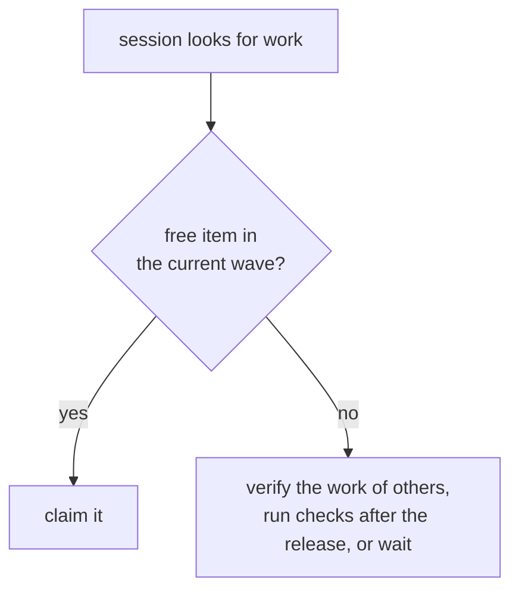
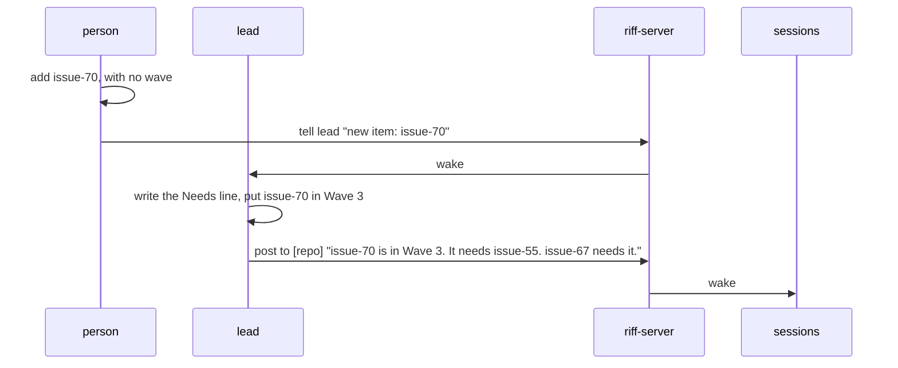
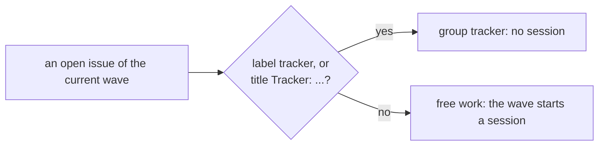

# Waves

Sessions take their work in waves. A wave is a numbered group of work
items: Wave 1, Wave 2, and so on. The waves run in number order. The
items of one wave run at the same time, each in its own session.

- The current wave is the open wave with the lowest number. The next
  wave is the open wave after it.
- When a repository has no waves, each open item is in the current
  wave.
- The lead plans the waves. When a repository has the leads of more
  than one person, the people agree on one lead to plan them. See
  [The lead](how-it-works.md#the-lead).

## Needs

An item can need other items. Its `Needs:` line names them:

```text
Needs: #51, #58
```

An item is merged when it is closed, or when it has the comment
`Merged in #PR (COMMIT)`. The author adds this comment when a check
after the release is left (see
[Verify finished work](how-it-works.md#verify-finished-work)).

## Pick an item

A session takes a free item of the current wave, never of a later
wave. When the current wave has no free item, the session verifies
the work of others, runs its checks after the release, or waits.



## The life of a wave

```mermaid
flowchart LR
    P[planned] --> C[current]
    C --> M[each item merged]
    M --> S[the lead stops the workers]
    S --> V[an admin makes a release]
    V --> P2[CI deploys the release tag to the shared server]
    P2 --> U[each machine gets the merged code]
    U --> R[the sessions start again]
    R --> K[checks after the release]
    K --> X[each item closed]
    X --> D[the wave is done]
    D --> E[the lead ends the wave]
    E --> N[the next wave is current]
```



A wave is done when each of its items is closed. An item is closed
when it is merged and each check after the release passed. Some items
have a check that needs the merged code on each machine. The order in
a wave: merge each item, make a release, deploy the release to the
shared server, stop the workers, update each machine, start the
sessions again, run the checks after the release, close each item.
The work goes on while the deploy waits for a person. A riff with no
shared server of its own code skips the release and the deploy. In
the riff repository, the update is
[Update riff](start-a-riff.md#update-riff).

A push to `main` does not deploy the shared server. So a merge in the
middle of a wave does not stop the sessions with a build mismatch.
The lead makes a release once, at the end of the wave, with the riff
commands. CI deploys its tag after a person approves the deploy.
See [Make a release](development.md#make-a-release) and
[Deploy the shared server at the end of a wave](development.md#deploy-the-shared-server-at-the-end-of-a-wave).

No session starts an item of the next wave before the current wave is
done.

## A new item

A person or a session can add a work item at any time, with no
wave. The lead puts it in a wave:

- Each item is in a later wave than each of its needs.
- No item blocks or breaks the other work of its wave.
- When the item fits in no open wave, the lead makes a new wave. Its
  number is the last number plus one.

Then the lead posts to the thread: the item, its wave, what it needs,
and what needs it.



### Tell the lead about a new item

Add the item with no wave. On GitHub, see
[Add an item with no wave](#add-an-item-with-no-wave). The lead looks
for items with no wave each time it wakes. To wake it now, tell it:

```sh
riff tell lead "New item: issue-70"
```

## Waves on GitHub

This is the only part of the book that is special to one forge.

- A wave is a milestone named `Wave N`. A name can follow, for example
  `Wave 5: Cloud`. A work item is an issue in the milestone.
- A milestone with another name is out of the waves.
- The backlog is the milestone `Backlog`. It holds the items that we
  track but do not start. An item in the backlog is not free work: no
  session starts it. Only the lead moves an item from the backlog into
  a wave, when you schedule the item.
- An open wave is an open milestone. The lead ends a wave: it closes
  the milestone. It closes a milestone only when the milestone has no
  open issue.

The waves of riff are its
[milestones](https://github.com/como-technologies/riff/milestones).

### See the waves

Run this in a clone of the repository. It shows each open wave in
number order, then the backlog, with the number of the open and the
closed items. The current wave has the mark `current` and the hosts
of its loop. The open items of each wave follow in the groups `free`,
`held`, `claimed`, `verify` and `tracker` (see
[See which wave runs, and where](development.md#see-which-wave-runs-and-where)):

```sh
riff wave list
```

### Make a wave

Give the new wave the last number plus one. A name can follow the
number. riff refuses a number that an open wave has. riff also makes
the label `tracker` when it is missing (see
[Track a group of items](#track-a-group-of-items)), and the milestone
`Backlog` when the repository has none:

```sh
riff wave make "Wave 6: Cloud"
```

### Rename a wave

Give the number of the wave and its new name. The number stays: it is
the wave. This command gives the milestone the title
`Wave 6: Cloud and sign-in`:

```sh
riff wave rename 6 "Cloud and sign-in"
```

A pull request names its wave by the number only, in the trailer
`Milestone: Wave 6`. The check `Hygiene` compares only the number. So
a rename breaks no pull request, also one with the old title in its
trailer.

### End a wave

Give the number of the wave. riff closes its milestone. It refuses a
wave that has an open item or an open pull request:

```sh
riff wave end 6
```

### Move items to another wave

Give the numbers of the issues, and the wave to move them to: its
number, or `Backlog`. riff refuses an item that a session claims, and
a wave that is not open. Then it moves nothing:

```sh
riff wave move 71 72 --to 7
riff wave move 73 --to Backlog
```

To end a wave that still has open items, move them to the Backlog and
end the wave in one step:

```sh
riff wave end 6 --move-open-to-backlog
```

The lead plans the waves in its container, and these steps work there:
the daemon of the host makes the calls on riff-server. The lead does
them for you when it plans the waves. They are
`riff` commands, so the permission rule `Bash(riff *)` covers them.

### Track a group of items

A tracker is an issue that lists a group of items. It has no code of
its own: each part is a separate item. The wave starts no session for
a tracker: no build and no verify. `riff wave list` and `riff top`
show it in the group `tracker`, never in `free`.

An issue is a tracker when it has the label `tracker`, or when its
title starts with `Tracker:`. Add the label to issue 1248:

```sh
gh issue edit 1248 --add-label tracker
```

`riff wave make` makes the label. When the repository does not have
it yet, make it first:

```sh
gh label create tracker --description "a tracker: its parts are separate items, and no session does it" --force
```



### See the open items of a wave

`gh` needs the full title of the milestone, as `riff wave list` shows
it. `"Wave 6"` does not find the wave `Wave 6: Cloud`:

```sh
gh issue list --milestone "Wave 6: Cloud"
```

### See the items in the backlog

```sh
gh issue list --milestone Backlog
```

To schedule an item, tell your lead: *"Move issue 71 into Wave 4."*

### Add an item with no wave

```sh
gh issue create --title "Show the wave in riff who" --body "Done when: riff who shows the wave of each claim."
```
