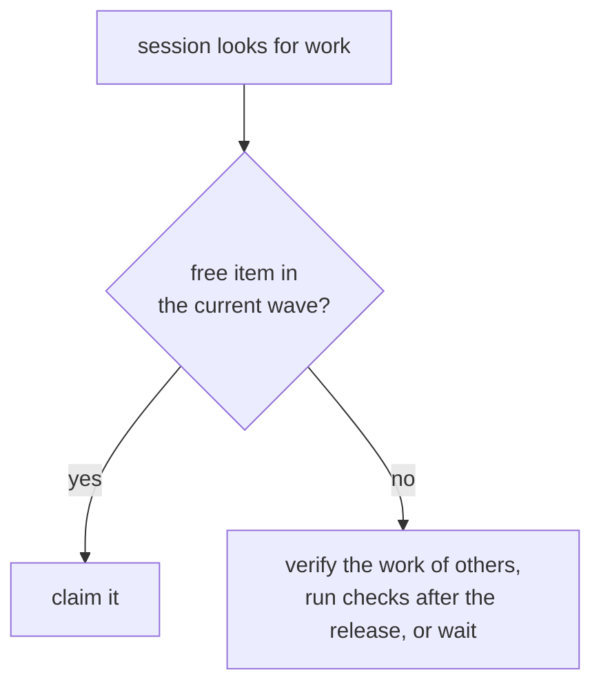
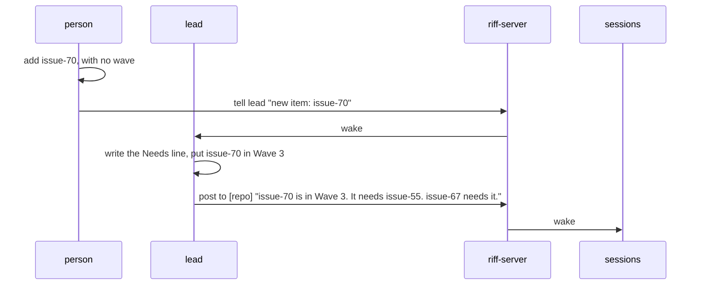
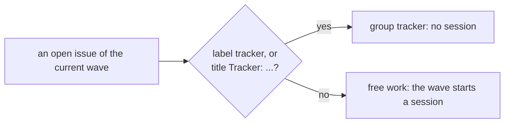
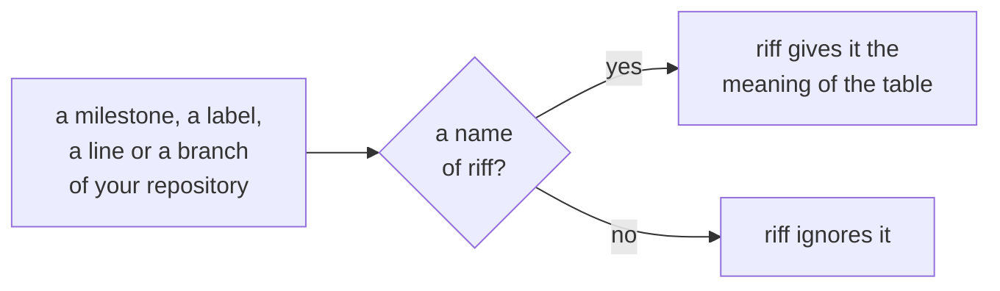

# Waves

Sessions take their work in waves. A wave is a numbered group of work
items: Wave 1, Wave 2, and so on. The waves run in number order. The
items of one wave run at the same time, each in its own session.

- The current wave is the open wave with the lowest number. The next
  wave is the open wave after it.
- When a repository has no waves, each open item is in the current
  wave.
- The lead plans the waves. A project has one lead, for each person of
  the project. See [The lead](how-it-works.md#the-lead).

## Needs

An item can need other items. Its `Needs:` line names them:

```text
Needs: #51, #58
```

An item with an open need is not free: the wave starts no build of it
until each issue of its `Needs:` line is closed. `riff wave list`,
`riff top` and the Waves tab show it in the group `needs`, with its
open needs. Here #1520 waits for #1522:

```text
needs: #1520 (#1522)
```

An item is merged when it is closed, or when it has the comment
`Merged in #PR (COMMIT)`. The author adds this comment when a check
after the release is left (see
[Verify finished work](how-it-works.md#verify-finished-work)). riff
adds it too, at the first look of the wave after the merge (see
[Leave the issue open for a check after the release](development.md#leave-the-issue-open-for-a-check-after-the-release)).

## Pick an item

A session takes a free item of the current wave, never of a later
wave. When the current wave has no free item, the session verifies
the work of others, runs its checks after the release, or waits.



The wave of the riff daemon takes only an issue with a `Done when:` line
in its body. A session stops at once without that line. For an issue
with no such line, the lead gets one message, and the wave starts no
session. When the line comes, the wave will take the issue at its next
look. See
[Add a Done when line to an issue](development.md#add-a-done-when-line-to-an-issue).

## The life of a wave

```mermaid
flowchart LR
    P[planned] --> C[current]
    C --> M[each item merged]
    M --> S[the lead stops the workers]
    S --> V[an admin makes a release]
    V --> P2[CI deploys the release tag to the shared server]
    P2 --> U[each machine gets the merged code]
    U --> R[the sessions start again]
    R --> K[checks after the release]
    K --> X[each item closed]
    X --> D[the wave is done]
    D --> E[the lead ends the wave]
    E --> N[the next wave is current]
```



A wave is done when each of its items is closed. An item is closed
when it is merged and each check after the release passed. Some items
have a check that needs the merged code on each machine. The order in
a wave: merge each item, make a release, deploy the release to the
shared server, stop the workers, update each machine, start the
sessions again, run the checks after the release, close each item.
The work goes on while the deploy waits for a person. A riff with no
shared server of its own code skips the release and the deploy. In
the riff repository, the update is
[Update riff](start-a-riff.md#update-riff).

A push to `main` does not deploy the shared server. So a merge in the
middle of a wave does not stop the sessions with a build mismatch.
The lead makes a release once, at the end of the wave, with the riff
commands. CI deploys its tag after a person approves the deploy.
See [Make a release](development.md#make-a-release) and
[Deploy the shared server at the end of a wave](development.md#deploy-the-shared-server-at-the-end-of-a-wave).

No session starts an item of the next wave before the current wave is
done.

## A new item

A person or a session can add a work item at any time, with no
wave. The lead puts it in a wave:

- Each item is in a later wave than each of its needs.
- No item blocks or breaks the other work of its wave.
- When the item fits in no open wave, the lead makes a new wave. Its
  number is the last number plus one.

Then the lead posts to the thread: the item, its wave, what it needs,
and what needs it.



### Tell the lead about a new item

Add the item with no wave. On GitHub, see
[Add an item with no wave](#add-an-item-with-no-wave). The lead looks
for items with no wave each time it wakes. To wake it now, tell it:

```sh
riff tell lead "New item: issue-70"
```

## Waves on GitHub

This is the only part of the book that is special to one forge.

- A wave is a milestone named `Wave N`. A name can follow, for example
  `Wave 5: Cloud`. A work item is an issue in the milestone.
- A milestone with another name is out of the waves.
- The backlog is the milestone `Backlog`. It holds the items that we
  track but do not start. An item in the backlog is not free work: no
  session starts it. Only the lead moves an item from the backlog into
  a wave, when you schedule the item.
- An open wave is an open milestone. The lead ends a wave: it closes
  the milestone. It closes a milestone only when the milestone has no
  open issue.

The waves of riff are its
[milestones](https://github.com/como-technologies/riff/milestones).

The names that riff uses on the forge are in
[The names riff uses on the forge](#the-names-riff-uses-on-the-forge).

### See the waves

Run this in a clone of the repository. It shows each open wave in
number order, then the backlog, with the number of the open and the
closed items. The current wave has the mark `current` and the hosts
of its loop. The open items of each wave follow in the groups `free`,
`held`, `needs` (see [Needs](#needs)), `claimed`, `verify`,
`verify waits for #N`, `rebase waits for #N`, `stuck`, `tracker` and
`question` (see
[See which wave runs, and where](development.md#see-which-wave-runs-and-where)):

```sh
riff wave list
```

A verify waits for another pull request `#N` when the heads of the two
conflict, and `#N` is before it: the verify of `#N` runs, or it passed
and `#N` waits for its merge, or the verify request of `#N` came first.
Then the verify is in the group `verify waits for #N`. It starts when
`#N` merges or its verify fails. Two pull requests that change one file
with no conflict do not wait for each other, for example two new
requirements in two sections of `requirements.md`: their verifies run
side by side. A session that holds the item of `#N`, for example to
fix its checks, does not make the verify wait (see
[The order of the verifies of a wave](how-it-works.md#the-order-of-the-verifies-of-a-wave)).

### Make a wave

Give the new wave the last number plus one. A name can follow the
number. riff refuses a number that an open wave has. riff also makes
the label `tracker` when it is missing (see
[Track a group of items](#track-a-group-of-items)), and the milestone
`Backlog` when the repository has none:

```sh
riff wave make "Wave 6: Cloud"
```

### Rename a wave

Give the number of the wave and its new name. The number stays: it is
the wave. This command gives the milestone the title
`Wave 6: Cloud and sign-in`:

```sh
riff wave rename 6 "Cloud and sign-in"
```

A pull request names its wave by the number only, in the trailer
`Milestone: Wave 6`. The check `Hygiene` compares only the number. So
a rename breaks no pull request, also one with the old title in its
trailer.

### End a wave

Give the number of the wave. riff closes its milestone. It refuses a
wave that has an open item or an open pull request:

```sh
riff wave end 6
```

### Move items to another wave

Give the numbers of the issues, and the wave to move them to: its
number, or `Backlog`. riff refuses an item that a session claims, and
a wave that is not open. Then it moves nothing:

```sh
riff wave move 71 72 --to 7
riff wave move 73 --to Backlog
```

When an item has no `Done when:` line, riff warns, and moves the item.
The wave takes only an issue with that line: see
[Add a Done when line to an issue](development.md#add-a-done-when-line-to-an-issue).
`--to Backlog` gives no warning.

To end a wave that still has open items, move them to the Backlog and
end the wave in one step:

```sh
riff wave end 6 --move-open-to-backlog
```

The lead plans the waves in its container, and these steps work there:
the daemon of the host makes the calls on riff-server. The lead does
them for you when it plans the waves. They are
`riff` commands, so the permission rule `Bash(riff *)` covers them.

### Track a group of items

A tracker is an issue that lists a group of items. It has no code of
its own: each part is a separate item. The wave starts no session for
a tracker: no build and no verify. `riff wave list` and `riff top`
show it in the group `tracker`, never in `free`.

An issue is a tracker when it has the label `tracker`, or when its
title starts with `Tracker:`. Add the label to issue 1248:

```sh
gh issue edit 1248 --add-label tracker
```

`riff wave make` makes the label. When the repository does not have
it yet, make it first:

```sh
gh label create tracker --description "a tracker: its parts are separate items, and no session does it" --force
```



### See the open items of a wave

In a terminal, run riff with no command, and press `3` for the Waves
tab of the TUI:

```sh
riff
```

The tab shows a board for each of your projects: the projects that
`riff questions` reads (see
[What reads the projects](how-it-works.md#what-reads-the-projects)). A
repository that is no project gets no board. With none of your
projects, the tab says `None of your repositories is a project of the
riff.` A board has the current wave and one row for each of its open
items:

```text
 1 Sessions  2 Chat•2  [3 Waves]  4 Machines  5 Devices  6 Reports
 riff running · build 10df8a4 · link ok 2s
 ▼ como-technologies/riff · Wave 48        1 stuck 2 free 1 held 3 work 2 verify
       STATE   ITEM   TITLE                           WHO / PULL REQUEST   AGE
   !   stuck   #1601  Fix the help                    PR #1604 conflict    2h
 > ○   free    #1620  Add the flag --format           -                    -
   ○   free    #1622  The book names the flag         -                    -
   ◌   held    #1631  Design: the web UI              waits for mike       3d
   !   work    #994   Design: the TUI of riff         3a3f8d5d blocked     32m
   ●   work    #1590  An idle look asks GitHub first  5b1e2a90 busy        40m
   ●   work    #1594  riff counts the gh calls        9c0d1e2f busy        1h
   ◐   verify  #1599  The wave takes an issue         PR #1614 verify      5m
   ◐   verify  #1600  The book tells how to detach    PR #1613 merge       9m
       done 4 · closed 1 (Enter shows them)
       main: the full check of 3f2a91c runs · 4 of 9 jobs done
 ▶ como-technologies/strata · Wave 5                               1 work 3 done
 ▶ como-technologies/kadomony · no wave

 NEXT WAVES · como-technologies/riff
   Wave 49: 8 items    Wave 50: 3 items    Backlog: 41 items


 The boards come from gh, 41s ago.
 ↑↓ select  Enter open  h hold  f free  p pause  o URL  r read again  ? help
```

- The repositories with a stuck, a held or a free item come first, with
  their boards open. Each other repository is one line with its counts.
- The rows go in the order `stuck`, `free`, `held`, `needs`, `asked`
  (the label `question`), `work`, `verify` and `tracker`. A `work` row
  shows the session of the claim and its state. A `stuck` or `verify`
  row shows the pull request and what it waits for: `verify`, `merge`,
  or why it is stuck, for example `conflict`. A `needs` row shows the
  open issues of its `Needs:` line, for example `waits for #1522` (see
  [Needs](#needs)).
- The `asked` rows have the questions of the later waves too: see
  [See the questions of each wave in the TUI](how-it-works.md#see-the-questions-of-each-wave-in-the-tui).
- The line `done 4 · closed 1` counts the items that closed in the
  wave. `Enter` on it shows them.
- The line `main` shows only when the full check of `main` runs or
  failed. A line shows each release whose checks after the deploy have
  not passed.
- `NEXT WAVES` counts the open items of the later waves and of the
  Backlog of the repository of the selected row.

A verify or a rebase that waits for its turn is a `verify` row. The row
names the pull request before it (see
[The order of the verifies of a wave](how-it-works.md#the-order-of-the-verifies-of-a-wave)).
Here the verify of #1599 and the rebase of #1601 wait for the merge of
#1613:

```text
   ◐   verify  #1599  The wave takes an issue         PR #1614 after #1613 5m
   ◐   verify  #1600  The book tells how to detach    PR #1613 merge       9m
   ◐   verify  #1601  Fix the help                    PR #1604 after #1613 2h
```

| Key | Does |
|---|---|
| `↑` `↓`, `j` `k`, the wheel | Select the row above or below. `PgUp` `PgDn` move a page, `g` `G` go to the first or the last row. A click on a row selects it, and a click on the selected row opens it. |
| `Enter` | On a repository: fold or open its board. On the closed line: show the closed items. On an item: show its whole row in the note line. |
| `←` `→`, `Space` | Fold or open the board of the repository. |
| `h`, `f` | Hold the item, or free it. See [Hold an item in the TUI](how-it-works.md#hold-an-item-in-the-tui). |
| `a` | Mark the questions of an item with the label `question` as answered, after `y`: the label goes, and your lead wakes. See [Mark the questions of an issue as answered](development.md#mark-the-questions-of-an-issue-as-answered). |
| `p`, `P` | Pause or resume the repository of the row, or the whole riff. |
| `o` | Show the URL of the pull request, the item or the repository in the note line, to copy it. |
| `r` | Read riff-server and `gh` again now. |

The tab reads `gh` each minute while it shows. It asks GitHub whether
the list of the open issues changed: the answer "no change" costs no
point. It reads the pull requests with `gh pr list` only while one is
open, and the check of `main` with a few REST calls. Its calls show as
`tui` in `riff daemon status`. Under 80 columns, a row has the mark,
the state, the item and the title.

To list the open items of a wave with `gh`, use the full title of the
milestone, as `riff wave list` shows it. `"Wave 6"` does not find the
wave `Wave 6: Cloud`:

```sh
gh issue list --milestone "Wave 6: Cloud"
```

### See the items in the backlog

```sh
gh issue list --milestone Backlog
```

To schedule an item, tell your lead: *"Move issue 71 into Wave 4."*

### Add an item with no wave

```sh
gh issue create --title "Show the wave in riff who" --body "Done when: riff who shows the wave of each claim."
```

### The names riff uses on the forge

riff uses a fixed set of names on the forge. They are rules of riff:
each repository gets the same names, and no setting changes them. When
your repository has a milestone or a label with one of these names,
riff gives it the meaning below. Other milestones and labels are out of
the waves, and riff ignores them.

| Name | What it is | What riff does with it |
|---|---|---|
| `Wave N`, or `Wave N: NAME` | a milestone | A wave. The open wave with the lowest N is the current wave. |
| `Backlog` | a milestone | The items that riff tracks and does not start. |
| `Done when:` | the start of a line in the body of an issue, or a heading `## Done when` | The wave starts a session only for an issue with this line. |
| `Needs:` | the start of a line in the body of an issue | The issues that must be merged first. |
| `tracker`, or the title start `Tracker:` | a label | A tracker has no code of its own: the wave starts no session for it. |
| `question` | a label | A lead waits for the answer of a person: the wave starts no build of the issue (see [Ask the person a question](development.md#ask-the-person-a-question)). |
| `broken-main` | a label | A fix item for a broken `main`. It is free work before each other item. |
| `no-verify` | a label | riff offers no verify for the pull request of the issue. |
| `release` | a label | A release issue or pull request: the wave starts no session for it. |
| `worktree-issue-N` | a branch | The branch of the session that works on issue N. |



#### See the names that your repository has

Run this in a clone of the repository, before the first wave. The first
command lists the milestones, and the second lists the labels. A name of
the table that your repository uses with another meaning is a clash:
rename it on the forge.

```sh
gh api 'repos/{owner}/{repo}/milestones?state=all' --jq '.[].title'
gh label list
```

`riff project init` makes the milestone `Backlog`, and `Wave 1` when
the repository has no open wave. With `Wave 1` it makes the label
`question`, when the repository has none. It also counts the open
issues with no `Done when:` line: see
[Find the issues with no Done when line](development.md#find-the-issues-with-no-done-when-line).
