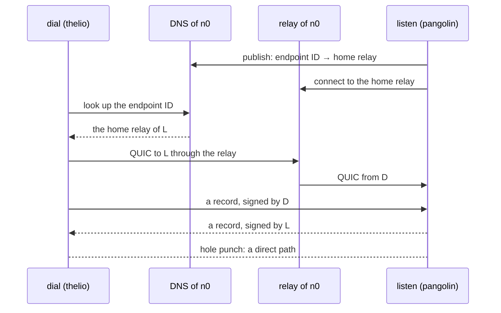

# The spike of #697: two riff daemons talk over iroh

Decision 21 of the design of riff 3.0 (#699) says: the transport of
peer to peer is iroh, and the first milestone with two peers uses the
defaults of iroh, the DNS discovery and the public relays of n0. This
spike checks that before the build items of Wave B start.

The spike is a small program, not riff code. It does not change riff.

## The result

**Recommendation: use iroh as decision 21 says.** iroh 1.3.0 with the
preset `N0` did each step of the spike between thelio and pangolin,
with no change of the defaults:

- Each side found the other by its endpoint ID only. 40 of 40 cold
  connects worked, in about 100 ms.
- Each connect started on the relay of n0 and went direct in about
  210 ms. A connect from an endpoint that knows the peer goes direct
  at once, in 3 to 7 ms.
- Each side checked the record of the other: the size, the type, the
  author and the ed25519 signature. Each bad record was refused.
- After a drop of 10 s, the connection lived on, and it worked again
  about 1.1 s after the network came back. After a drop of 60 s, the
  connection timed out, and a new connect worked
  SIXTY_UP after the network came back.
- iroh adds SIZE_ADDS to the static riff (SIZE_PLAIN to SIZE_PROBE).
- `cargo audit` finds no vulnerability. It names one crate that is
  not maintained: `paste` (see "cargo audit").

See "Notes for Wave B" for what the build items must do.

## What the program does



The program `iroh-spike` has three commands:

| Command | What it does |
|---|---|
| `listen` | Binds an endpoint with the preset `N0`, prints its endpoint ID, and answers each connection. On the first stream it reads a record, checks it, and sends a record of its own. It echoes each next stream as a ping. |
| `dial ID` | Connects to the endpoint `ID`, with only the ID. It sends a record, checks the answer, and measures each step. Each connect has a new endpoint (cold), or one endpoint for all (`--warm`). `--relay-only` uses no IP path. |
| `hold ID` | Keeps one connection and sends a ping each 250 ms. It prints each change of the path, each lost ping and each new connection. With `--drop-after` and `--drop-for`, it takes the link of its network namespace down and up again. |

### The record

`src/record.rs` holds the record and its checks (decision 23). The
type, the public key of the author, a sequence number and a UTF-8 body,
then an ed25519 signature over a domain tag and each byte before it. A
record is at most 4096 bytes. The reader checks, in this order:

1. The size: the stream gives no more than 4096 bytes.
2. The type: 1 (a message) or 2 (a status). Each other byte is
   refused.
3. The length of the body agrees with the size.
4. The author is the peer: the endpoint ID that iroh checked at the
   handshake. In the spike, the key of the endpoint is the key of the
   author.
5. The signature, with `verify_strict`.
6. The body is UTF-8.

A record that fails a check is refused, and the listener closes the
connection with the code 1.

## Before you run it

- Two Linux machines with a network to the internet. They can be on
  the same LAN.
- Rust 1.95 or later, with `cargo`.
- For the drop test: `pasta` (it comes with podman) and `ip`.
- For the static build and the size of riff: podman or docker.
- For the audit: `cargo-audit` (`just init` installs it).

## Run the spike

Build the spike on each machine:

```sh
cd spikes/iroh
nice -n 19 cargo build --release
```

Run the tests: the checks of the record, and a listener and a dialer
on this machine, with no relay:

```sh
cargo test
```

### Connect two machines

On machine A, start the listener. `--key` keeps the endpoint ID the
same at the next start:

```sh
target/release/iroh-spike listen --key /tmp/iroh-spike.key
```

It prints a line `endpoint ID`. On machine B, dial that ID 10 times,
each time with a new endpoint:

```sh
target/release/iroh-spike dial ID --count 10
```

Dial through the relay only:

```sh
target/release/iroh-spike dial ID --count 10 --relay-only
```

Dial 5 times from one endpoint:

```sh
target/release/iroh-spike dial ID --count 5 --warm
```

### Drop the network

`drop.sh` runs `hold` in a network namespace of its own, with a copy
of the network of the host. It takes the link of the namespace down
and up again. The network of the host does not change. The arguments
are the ID, the seconds before the drop, the seconds of the drop, and
the seconds of the test:

```sh
./drop.sh ID 20 10 60
./drop.sh ID 20 60 120
```

`hold` refuses `--drop-after` when `drop.sh` did not start it, so it
never takes down the link of a host.

### Measure the size

Build the spike as one static binary, as riff is built:

```sh
./static.sh
```

Measure the size that iroh adds to the static riff. The script builds
riff two times in a temporary folder: as it is, and with the spike
linked in:

```sh
./riff-size.sh
```

### Audit the crates

```sh
cargo audit
```

## The numbers

Measured on 2026-10-15 with iroh 1.3.0, from commit 9bf03d2 of the
branch `worktree-issue-697`. thelio (192.168.1.126) and pangolin
(192.168.1.144) are on the same Wi-Fi LAN, behind one NAT. Both
endpoints took the home relay `use1-1.relay.n0.iroh.link`. Each time
is from the start of the step on the side that dials.

### Connect

"connect" is the time to a QUIC connection: the DNS look-up of the ID,
and the handshake through the relay. "records" is one signed record
each way, checked on each side. "direct" is the time from the start of
the connect to the first direct path.

| From → to, kind | Connects | connect (least, median, most) | records (median) | direct (least, median, most) |
|---|---|---|---|---|
| thelio → pangolin, cold | 10 of 10 | 90.6, 99.1, 377.1 ms | 111.6 ms | 205.2, 210.4, 497.8 ms |
| pangolin → thelio, cold | 10 of 10 | 93.5, 100.0, 335.4 ms | 109.0 ms | 202.8, 209.1, 443.0 ms |
| thelio → pangolin, relay only | 10 of 10 | 93.0, 100.7, 331.7 ms | 113.4 ms | never |
| pangolin → thelio, relay only | 10 of 10 | 92.3, 96.9, 271.1 ms | 110.7 ms | never |
| thelio → pangolin, warm (2 to 5) | 4 of 4 | 3.3, 4.8, 6.7 ms | 9.1 ms | at once |
| pangolin → thelio, warm (2 to 5) | 4 of 4 | 2.5, 3.1, 4.3 ms | 6.3 ms | at once |

- The first warm connect is a cold connect: 100.3 ms and 234.1 ms.
- The round trip of the relay is about 96 ms. The round trip of the
  direct path on the LAN is 2 to 5 ms.
- The records of a cold connect go on the relay: the first direct path
  comes about 100 ms after the connect.
- A bind takes about 3.15 s to be online: to pick its home relay and
  connect to it. With no IP path it takes 1.45 s. A daemon binds
  one time, at its start.

### Reconnect after a drop

`hold` ran on thelio, and the listener ran on pangolin. The link went
down 20 s after the connect.

| Drop | Runs | The connection | Pings answered again after the link came up |
|---|---|---|---|
| 10 s | 3 | lives on: relay after 6 s, direct again after the up | 1.10, 1.11, 1.15 s |
| 60 s | 2 | SIXTY_CONN | SIXTY_TIMES |

A ping waits 1 s for its answer, so each time can be up to 1 s too
long.

### Size

| Binary | Bytes |
|---|---|
| `iroh-spike`, static, release profile of riff | 10 472 032 |
| riff, static, release | SIZE_PLAIN |
| riff with the spike linked in | SIZE_PROBE |
| iroh adds to riff | SIZE_ADDS |

iroh brings 363 crates in the lock file of the spike. The lock file of
riff has 492. Of the crates of the spike, 103 names are not in the
lock file of riff. Many of them are for Windows, macOS or the browser,
and do not build on Linux.

### cargo audit

`cargo audit` (cargo-audit 0.22.2, 1329 advisories) of
`spikes/iroh/Cargo.lock`: no vulnerability. One warning:

- RUSTSEC-2024-0436: `paste` 1.0.15 is not maintained. iroh uses it
  through `netwatch` → `netlink-packet-core` 0.8.2. It is a proc
  macro, so no code of it runs in the binary. The audit of riff
  (`.cargo/audit.toml`) ignores no advisory, but a warning does not
  fail `cargo audit`. When riff takes iroh, the job "Crate audit" of
  CI shows the warning until netwatch takes a new `netlink-packet-core`.

## Notes for Wave B

- Keep one endpoint for each daemon, and keep it bound. A cold connect
  costs a DNS look-up and the relay (about 100 ms here). A connect
  from an endpoint that knows the peer is direct at once.
- Bind at the start of the daemon. To be online takes about 3 s.
- The public relays of n0 carry the traffic when no direct path comes.
  With the relay only, each connect worked, with a round trip of about
  96 ms.
- The publisher of the preset `N0` puts only the home relay in the DNS
  of n0, not the IP addresses. So the DNS of n0 does not show where a
  person is.
- A connection with no answer ends after about 30 s (the idle time of
  iroh). A shorter drop costs no new connection. After a longer drop,
  the daemon must connect again. It needs a loop that connects again
  with a limit on each try, as `hold` does.
- The record check of the spike compares the author with the peer.
  That holds only for a record that its author sends. A record that
  one peer passes on for another needs the check of decision 20: the
  owner signs the key of each member, and the reader checks that.
- The ALPN of the spike is `riff/spike/iroh/0`. riff takes its own
  ALPN with a version in it, so that two major releases do not talk
  (#696).
